# Page: Overview

# Overview

<details>
<summary>Relevant source files</summary>

The following files were used as context for generating this wiki page:

- [AGENTS.md](AGENTS.md)
- [CLAUDE.md](CLAUDE.md)
- [README.md](README.md)
- [SKILL.md](SKILL.md)
- [install.md](install.md)
- [interaction-skills/make-video.md](interaction-skills/make-video.md)
- [src/browser_harness/video.py](src/browser_harness/video.py)

</details>


## Purpose and Scope

`browser-harness` is a minimalist, self-healing automation framework designed to give Large Language Models (LLMs) direct, unencumbered control over a real browser via the Chrome DevTools Protocol (CDP) [README.md:3-5](), [AGENTS.md:1-2](). Unlike traditional automation frameworks that rely on rigid element selectors or heavy abstraction layers, `browser-harness` operates on a coordinate-first interaction model [SKILL.md:38-42](), allowing agents to navigate the web by calculating positions from the Accessibility Tree or screenshots and executing precise mouse and keyboard events.

The harness is intentionally lightweight (~1k lines across its core modules) to ensure that an LLM can ingest the entire codebase into its context window, understand implementation details, and self-heal by editing the harness environment if a required primitive is missing [README.md:5-17](), [AGENTS.md:9-15]().

For installation instructions and environment setup, see [Getting Started & Installation](#1.1).
For deep dives into the coordinate-first model, CDP-direct architecture, and agent-driven lifecycle, see [Core Concepts & Design Philosophy](#1.2).
For packaging details and skill bundles, see [Claude Plugin & Skill Packaging](#1.3).

Sources: [README.md:3-17](), [AGENTS.md:1-15](), [SKILL.md:38-42]()

---

## System Philosophy: The Self-Healing Harness

The core philosophy of `browser-harness` is that **the agent writes what is missing, mid-task** [README.md:5-17](). 

1.  **Direct CDP Access**: The system uses a thin CDP harness to connect to Chrome with minimal intermediate wrappers [README.md:5-7]().
2.  **No Abstraction Rails**: There is no rigid manager layer or complex session manager constraining the agent [SKILL.md:58-65]().
3.  **Agent-Owned Code**: If a helper or domain-specific pattern is missing, the agent edits `agent-workspace/agent_helpers.py` or generates domain skills during execution to solve the task [README.md:10-17](), [AGENTS.md:19-23]().

### Bridge: Natural Language to Code Entities

The following diagram maps high-level natural language intent to the specific Python modules and code entities that implement them.

**System Entity Mapping**
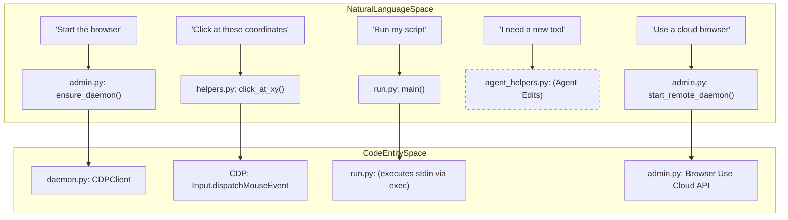
Sources: [README.md:7-17](), [SKILL.md:16-24](), [AGENTS.md:10-15]()

---

## Component Architecture

The codebase is structured into core Python modules within `src/browser_harness/` that manage execution, daemon lifecycle, and browser interaction primitives [AGENTS.md:9-15]().

| Module | Role | Key Entities |
| :--- | :--- | :--- |
| `run.py` | CLI Entry Point & Execution | `main()`, `browser-harness` command |
| `daemon.py` | CDP Bridge & WebSocket Middleman | `CDPClient`, IPC Server |
| `admin.py` | Lifecycle, Diagnostics & Remote | `ensure_daemon()`, `start_remote_daemon()`, `stop_remote_daemon()` |
| `helpers.py` | Browser Automation API | `new_tab()`, `wait_for_load()`, `js()`, `cdp()` |

**Execution Flow & Component Interaction**
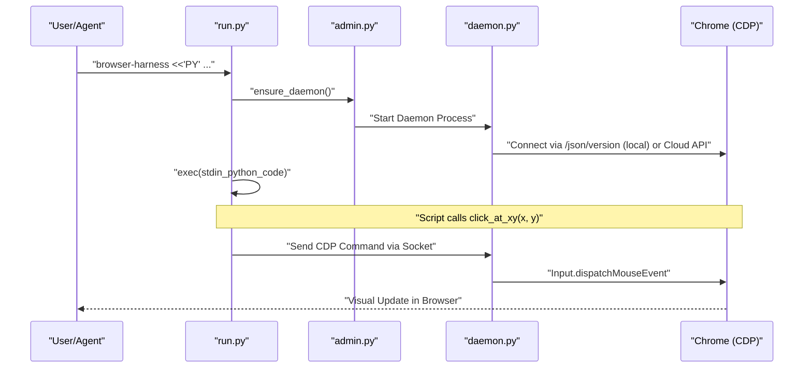
Sources: [README.md:49-56](), [AGENTS.md:10-15](), [SKILL.md:16-24]()

---

## Skill Libraries

The framework relies on distinct categories of reusable patterns and domain playbooks:

1.  **Interaction Skills**: Documentation and patterns covering complex browser mechanics such as scrolling, iframes, multi-tab coordination, and dialogs. For details, see [Interaction Skills](#3).
2.  **Domain Skills Library**: Community and agent-contributed site-specific playbooks in `agent-workspace/domain-skills/`, auto-loaded by navigation helpers when `BH_DOMAIN_SKILLS=1` is enabled [SKILL.md:10-17](). For details, see [Domain Skills Library](#4).
3.  **Claude Plugin & Skill Packaging**: Metadata and bundling configurations that expose browser-harness as a skill or plugin. For details, see [Claude Plugin & Skill Packaging](#1.3).

Sources: [SKILL.md:10-17](), [AGENTS.md:19-23]()

---

## Child Pages

*   **[Getting Started & Installation](#1.1)**: Step-by-step installation guide using `uv`, enabling Chrome remote debugging (`chrome://inspect/#remote-debugging`), doctor diagnostics, and environment configuration (`BH_HOME`, `BH_RUNTIME_DIR`, `BU_NAME`) [install.md:10-120]().
*   **[Core Concepts & Design Philosophy](#1.2)**: Detailed breakdown of the coordinate-first model, self-healing harness design, CDP-direct communication, domain vs. interaction skill distinctions, and agent-generated helper lifecycles [SKILL.md:38-57]().
*   **[Claude Plugin & Skill Packaging](#1.3)**: Instructions on skill bundle structures, marketplace configurations, and synchronization scripts (`test_skill.py`) [SKILL.md:1-8]()

Sources: [install.md:10-120](), [SKILL.md:1-57]()

---

# Page: Getting Started & Installation

# Getting Started & Installation

<details>
<summary>Relevant source files</summary>

The following files were used as context for generating this wiki page:

- [.env.example](.env.example)
- [.github/workflows/release.yml](.github/workflows/release.yml)
- [SKILL.md](SKILL.md)
- [browser-harness](browser-harness)
- [docs/setup-remote-debugging.png](docs/setup-remote-debugging.png)
- [docs/snap-linux-headless.md](docs/snap-linux-headless.md)
- [install.md](install.md)
- [pyproject.toml](pyproject.toml)
- [src/browser_harness/SKILL.md](src/browser_harness/SKILL.md)

</details>


This page provides a technical guide for installing `browser-harness`, configuring environment variables (`BH_HOME`, `BH_RUNTIME_DIR`, `BU_NAME`), enabling Chrome remote debugging, verifying connectivity via the built-in doctor utility, utilizing the `browser-harness` shell wrapper, and integrating the harness with agent environments.

---

## Purpose and Scope

The scope of this document covers the initial bootstrap of the `browser-harness` package on local developer machines or agent runners. It details how the CLI entry point (`browser_harness.run:main`), the shell script wrapper (`browser-harness`), and the daemon lifecycle manager (`browser_harness.admin` and `browser_harness.daemon`) coordinate to establish a robust Chrome DevTools Protocol (CDP) session.

Sources: [install.md:1-120](), [pyproject.toml:1-54](), [browser-harness:1-34]()

---

## Installation & Package Management

`browser-harness` is structured as a Python 3.11+ project managed via setuptools [pyproject.toml:10-44]() and distributed through PyPI [.github/workflows/release.yml:1-25](). The recommended installation vector uses `uv` to install the package globally as an isolated tool [install.md:13-23]().

### Fast Path Installation

```bash
uv tool install --python 3.12 --upgrade --force browser-harness
```

*   `--python 3.12`: Enforces Python 3.12 execution to prevent `uv` from matching older, incompatible interpreter versions [install.md:23-23]().
*   `--upgrade --force`: Replaces any existing `browser-harness` installation with the latest PyPI distribution while keeping unrelated tools intact [install.md:23-23]().

The core dependencies defined in `pyproject.toml` include:
*   `cdp-use==1.4.5`: Direct CDP protocol client implementation [pyproject.toml:25-25]().
*   `fetch-use==0.4.0`: HTTP utility library [pyproject.toml:26-26]().
*   `pillow==12.3.0`: Image processing for viewport screenshots [pyproject.toml:27-27]().
*   `websockets==15.0.1`: Async WebSocket transport for CDP communication [pyproject.toml:28-28]().

Sources: [install.md:13-23](), [pyproject.toml:5-33]()

---

## The `browser-harness` Shell Wrapper & Environment Configuration

The repository includes a POSIX shell wrapper script `browser-harness` that resolves runtime environments, sets up ephemeral paths, and dispatches execution to `browser_harness.run` [browser-harness:1-34]().

### CLI Execution and Runtime Routing

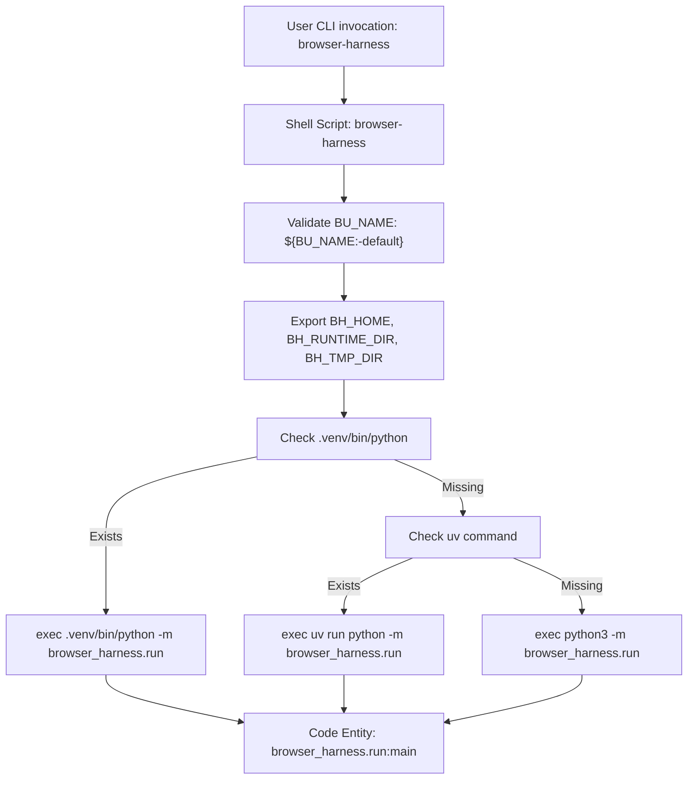
Sources: [browser-harness:1-34](), [pyproject.toml:34-37]()

### Environment Variables & Namespacing (`BU_NAME`, `BH_HOME`, `BH_RUNTIME_DIR`)

The wrapper and Python modules rely on specific environment variables for state isolation and namespacing:

| Variable | Description | Default Path / Value |
| :--- | :--- | :--- |
| `BU_NAME` | Logical namespacing identifier for parallel agent daemons [browser-harness:6-6](). | `default` [browser-harness:6-6]() |
| `BH_HOME` | Root configuration and artifact storage directory [install.md:120-120](). | `${XDG_CONFIG_HOME:-~/.config}/browser-harness` [install.md:120-120]() |
| `BH_RUNTIME_DIR` | Directory containing POSIX domain sockets or IPC state [browser-harness:16-19](). | `/tmp/bh-dev-$DEV_ID/runtime` (dev) or OS default |
| `BH_CHROME_PATH` / `CHROME_PATH` | Explicit filesystem path to the native Chrome binary [docs/snap-linux-headless.md:24-26](). | System default lookup |
| `BH_DOMAIN_SKILLS` | Flag to enable or disable loading agent domain skills [SKILL.md:14-14](). | `0` (Disabled) [SKILL.md:14-14]() |

When multiple isolated agents run concurrently, setting a distinct `BU_NAME` ensures that IPC Unix sockets, PID fingerprint files, and background daemon states remain completely partitioned [browser-harness:6-13](), [install.md:101-109]().

Sources: [browser-harness:1-34](), [install.md:120-120](), [docs/snap-linux-headless.md:24-26](), [SKILL.md:14-14]()

---

## Chrome Configuration & CDP Enabling

To control a local browser instance via CDP, remote debugging must be explicitly enabled.

### Connection Approaches

1.  **Way 1 (Interactive Profile)**: Navigate to `chrome://inspect/#remote-debugging` in a standard Google Chrome instance and check "Allow remote debugging for this browser instance" [install.md:50-51]().
2.  **Way 2 (Headless/Isolated Automation)**: Launch Chrome with `--remote-debugging-port=9222` and point `BU_CDP_URL=http://127.0.0.1:9222` [skills/browser-harness/references/install.md:46-46]().

### macOS Permission Handling (`mac-approve`)

On macOS, launching local Chrome can prompt a per-connection Allow dialog. Rather than bringing Chrome to the foreground, the harness provides a helper command [SKILL.md:102-117]():

```bash
browser-harness mac-approve
```

If the helper reports `accessibility-required`, grant accessibility permissions to the host application (Terminal, iTerm, or IDE) under macOS System Settings > Privacy & Security > Accessibility, then re-run `mac-approve` [SKILL.md:112-117]().

### Linux Snap Caveats

Ubuntu and distributions bundling Chromium via `Snap` sandbox filesystem access, frequently blocking external DevTools port binding [docs/snap-linux-headless.md:3-7](). 

*   **Mitigation**: Install Google Chrome natively via the official `.deb` package [docs/snap-linux-headless.md:9-16]().
*   **Resolution**: Set `BH_CHROME_PATH=/usr/bin/google-chrome-stable` [docs/snap-linux-headless.md:30-30]() or run `browser-harness doctor --fix-snap` [docs/snap-linux-headless.md:44-44]().

Sources: [install.md:47-67](), [docs/snap-linux-headless.md:3-45](), [SKILL.md:102-117]()

---

## Daemon Provisioning and Connection Data Flow

When `browser-harness` executes a script, it bootstraps the background daemon through `browser_harness.admin` and connects via `browser_harness.daemon` [install.md:90-111]().

### Daemon Bootstrap and Connection Data Flow

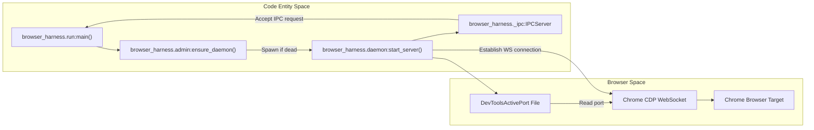
Sources: [install.md:90-111](), [src/browser_harness/run.py](), [src/browser_harness/admin.py](), [src/browser_harness/daemon.py]()

---

## Verification & Doctor Diagnostics

After installation and configuration, verify the connection by executing a basic inspection snippet:

```bash
browser-harness <<'PY'
print(page_info())
PY
```
Sources: [install.md:16-19]()

If connectivity fails, run the integrated health diagnostics tool [install.md:89-93]():

```bash
browser-harness --doctor
```

For automated orchestrators or machine-readable health checks, enforce validation against an active daemon [install.md:101-110]():

```bash
BU_NAME=default browser-harness doctor --json --require-existing-daemon
```
This command evaluates system readiness, checks PID locks, validates the socket transport layer, and exits with a nonzero status if the CDP session is unreachable [install.md:101-110]().

Sources: [install.md:89-110](), [SKILL.md:88-92]()

---

## Agent Environment Integration

To integrate `browser-harness` into AI agent runtimes (such as Claude Code or Codex), register the harness skill bundle [install.md:14-15](), [install.md:25-30]().

### Skill Export and Registration

Export the canonical skill definition directly from the package binary:

```bash
mkdir -p "${CODEX_HOME:-$HOME/.codex}/skills/browser-harness"
browser-harness skill > "${CODEX_HOME:-$HOME/.codex}/skills/browser-harness/SKILL.md"
```
Sources: [install.md:14-15]()

For Claude Code or other multi-agent environments, configure the system prompt with the required trigger rule [install.md:25-29]():

```text
Always use browser-harness for any web interaction: automation, scraping, testing, or site/app work.
```
Sources: [install.md:25-29](), [SKILL.md:1-4]()

---

# Page: Core Concepts & Design Philosophy

# Core Concepts & Design Philosophy

<details>
<summary>Relevant source files</summary>

The following files were used as context for generating this wiki page:

- [AGENTS.md](AGENTS.md)
- [CLAUDE.md](CLAUDE.md)
- [SKILL.md](SKILL.md)
- [agent-workspace/agent_helpers.py](agent-workspace/agent_helpers.py)
- [agent-workspace/domain-skills/amazon/product-search.md](agent-workspace/domain-skills/amazon/product-search.md)
- [install.md](install.md)
- [interaction-skills/make-video.md](interaction-skills/make-video.md)
- [src/browser_harness/video.py](src/browser_harness/video.py)

</details>


## Purpose and Scope
This page defines the foundational architecture and design philosophy of **browser-harness**, explaining its coordinate-first interaction model, self-healing harness patterns, direct Chrome DevTools Protocol (CDP) connectivity, and the distinction between domain and interaction skills [SKILL.md:2-8](), [AGENTS.md:1-15]().

---

## 1. The Self-Healing Harness Pattern & agent_helpers.py Lifecycle

The core philosophy of browser-harness is that the LLM agent should have the autonomy to modify its own automation primitives mid-task [AGENTS.md:19-22](). When an interaction fails or requires specialized selectors, the agent inspects or modifies `agent-workspace/agent_helpers.py` to add task-specific browser primitives [agent-workspace/agent_helpers.py:1-6](), [SKILL.md:8]().

*   **Minimalist Core:** The execution layer is intentionally kept thin, consisting of four primary modules: `run.py`, `daemon.py`, `admin.py`, and `helpers.py` [AGENTS.md:9-15]().
*   **Editable Workspace:** Agents operate primarily within `agent-workspace/`, defining custom helper functions in `agent_helpers.py` that are automatically loaded by `helpers.py` when `BH_AGENT_WORKSPACE` is configured [agent-workspace/agent_helpers.py:1-6](), [AGENTS.md:19-22]().
*   **Persistent Domain Knowledge:** Site-specific recipes, pagination tricks, and selector discoveries are persisted under `agent-workspace/domain-skills/` so subsequent agent turns inherit field-tested knowledge [SKILL.md:14-17](), [AGENTS.md:21-22]().

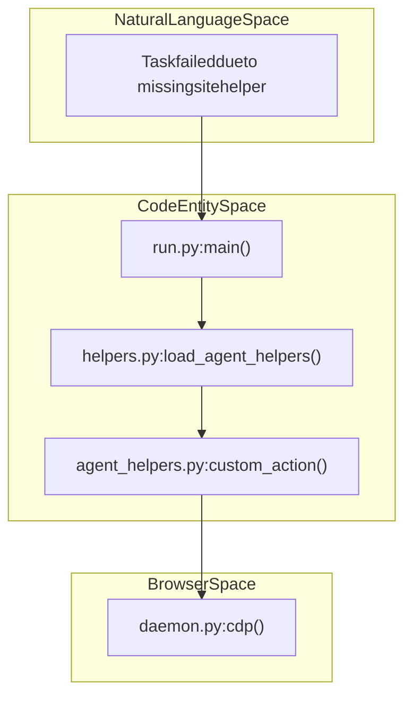

Sources: [SKILL.md:8-17](), [AGENTS.md:9-22](), [agent-workspace/agent_helpers.py:1-6]()

---

## 2. Coordinate-First Interaction Model

While the harness supports DOM evaluation via `js()`, its architectural design prioritizes coordinate-based actions combined with accessibility tree (`AX Tree`) inspection [SKILL.md:87-88]().

### Implementation Logic
1.  **AX Tree Discovery:** The agent queries the accessibility hierarchy using `cdp("Accessibility.getFullAXTree")` to retrieve roles, names, and node identifiers [SKILL.md:87]().
2.  **Coordinate Mapping:** Viewport coordinates are calculated via box model extraction (`cdp("DOM.getBoxModel")`) [SKILL.md:87]().
3.  **Compositor-Level Dispatch:** Inputs are executed via coordinate clicks (`click_at_xy(x, y)`), which invoke `Input.dispatchMouseEvent` at the browser compositor level [SKILL.md:88]().
4.  **Encapsulation Bypass:** Operating at the compositor level allows coordinate-first actions to naturally penetrate Shadow DOM boundaries and iframes without complex cross-frame traversal code [SKILL.md:150]().

### Natural Language to Code Mapping: Interaction

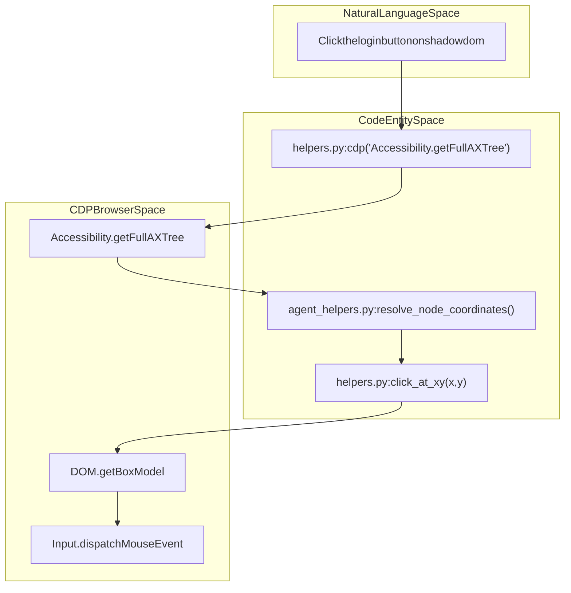

Sources: [SKILL.md:87-88](), [SKILL.md:150]()

---

## 3. CDP-Direct Architecture

browser-harness communicates directly with running Chrome instances over a WebSocket connection using the Chrome DevTools Protocol (CDP), completely bypassing heavyweight intermediate drivers like Selenium or Playwright [SKILL.md:22-25]().

### Key Architectural Modules
*   **`admin.py`**: Manages daemon lifecycles, health diagnostics (`doctor`), and cloud browser provisioning via `start_remote_daemon` [install.md:75-78](), [install.md:91-92]().
*   **`daemon.py`**: Acts as the long-lived middleman process maintaining the persistent WebSocket connection to Chrome and buffering events [AGENTS.md:12]().
*   **`run.py`**: Implements the CLI entry point (`browser_harness.run:main`), invoking `ensure_daemon()` prior to executing piped Python code [SKILL.md:27-30](), [AGENTS.md:14]().
*   **`helpers.py`**: Exposes the core automation API (`goto_url`, `new_tab`, `click_at_xy`, `wait_for_load`) directly available to agent scripts [AGENTS.md:13](), [SKILL.md:27-30]().

### Natural Language to Code Mapping: Architecture & Daemon Lifecycle

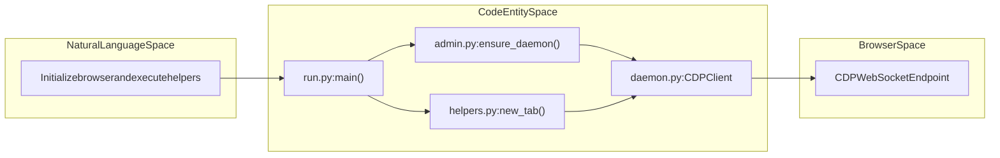

Sources: [AGENTS.md:9-15](), [SKILL.md:27-30](), [install.md:75-78]()

---

## 4. Skills Distinction: Domain vs. Interaction

The harness strictly differentiates between generic browser mechanics and site-specific operational knowledge.

| Category | Target Mechanics | Storage Location | Example Files |
| :--- | :--- | :--- | :--- |
| **Interaction Skills** | Generic browser workflows, scrolling, iframes, shadow DOM traversal, dialog handling. | `interaction-skills/` | `interaction-skills/make-video.md` [make-video.md:1-19]() |
| **Domain Skills** | Site-specific URL patterns, selectors, session gotchas, pagination rules, and API scraping structures. | `agent-workspace/domain-skills/` | `agent-workspace/domain-skills/amazon/product-search.md` [amazon/product-search.md:1-10]() |

Sources: [SKILL.md:12-16](), [AGENTS.md:19-22](), [amazon/product-search.md:1-10](), [make-video.md:1-19]()

---

# Page: Claude Plugin & Skill Packaging

# Claude Plugin & Skill Packaging

<details>
<summary>Relevant source files</summary>

The following files were used as context for generating this wiki page:

- [.claude-plugin/marketplace.json](.claude-plugin/marketplace.json)
- [.claude-plugin/plugin.json](.claude-plugin/plugin.json)
- [skills/browser-harness/SKILL.md](skills/browser-harness/SKILL.md)
- [skills/browser-harness/references/install.md](skills/browser-harness/references/install.md)
- [tests/unit/test_skill.py](tests/unit/test_skill.py)

</details>


## Purpose and Scope

This page covers the technical packaging architecture of `browser-harness` as a Claude Plugin and agent skill bundle. It details the layout of the `skills/browser-harness` skill bundle, the plugin manifests under `.claude-plugin/`, how the CLI command `browser-harness skill` emits skill payloads, and how the test suite (`tests/unit/test_skill.py`) enforces frontmatter correctness and schema synchronization.

Sources: `skills/browser-harness/SKILL.md:1-130`, `.claude-plugin/marketplace.json:1-25`, `.claude-plugin/plugin.json:1-13`, `tests/unit/test_skill.py:1-36`

---

## 1. Skill Bundle and Directory Layout

The core instructions exposed to AI coding assistants and agent environments are packaged inside the `skills/browser-harness/` directory. This bundle contains metadata, reference documents, and operational guidelines for controlling a real browser via Chrome DevTools Protocol (CDP).

The principal entry point for the skill is `skills/browser-harness/SKILL.md`, which begins with a strict YAML frontmatter block defining the skill's identity and summary description [skills/browser-harness/SKILL.md:1-4](). 

```yaml
---
name: browser-harness
description: "Control a real browser via CDP: clicking, typing, navigation, logged-in sessions, JS-rendered or bot-protected pages. Not for plain HTTP fetches of public content - use curl for those."
---
```

Supplemental reference documentation lives alongside the main skill definition, such as `skills/browser-harness/references/install.md`, which provides instructions on installing the CLI tool via `uv tool install` and bootstrapping the connection environment [skills/browser-harness/references/install.md:1-54]().

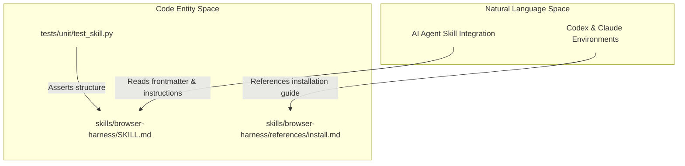
*Figure 1: Bridging agent instructions to bundled markdown files.*

Sources: `skills/browser-harness/SKILL.md:1-130`, `skills/browser-harness/references/install.md:1-55`

---

## 2. Claude Marketplace and Plugin Manifests

To integrate with the Claude Plugin ecosystem and marketplace distribution channels, `browser-harness` utilizes two configuration files housed in the `.claude-plugin/` directory:

1. **`marketplace.json`**: Defines marketplace-level metadata, owner information, and plugin listings including source pointers, categories (`automation`), and searchable keywords (`browser`, `cdp`, `chrome`, `scraping`, `screenshot`) [.claude-plugin/marketplace.json:1-25]().
2. **`plugin.json`**: Establishes plugin identification (`browser-harness`), versioning (`0.1.0`), license (`MIT`), homepage/repository links, and the concise capabilities summary required by the plugin loader [.claude-plugin/plugin.json:1-13]().

| Manifest File | Key Fields | Purpose |
| :--- | :--- | :--- |
| `.claude-plugin/marketplace.json` | `name`, `owner`, `plugins` (array with `source: "."`) | Marketplace registry entry for direct repository installation [.claude-plugin/marketplace.json:1-25]() |
| `.claude-plugin/plugin.json` | `name`, `version`, `description`, `repository`, `keywords` | Runtime metadata and description for the loaded plugin instance [.claude-plugin/plugin.json:1-13]() |

Sources: `.claude-plugin/marketplace.json:1-25`, `.claude-plugin/plugin.json:1-13`

---

## 3. Skill Emission and CLI Integration

During environment setup, agents or setup scripts register the skill by reading the bundled instruction file or invoking the command line interface to emit the skill body. 

As detailed in the installation guide, users register the skill by executing CLI commands or redirecting the output of `browser-harness skill` into target agent directories such as `${CODEX_HOME}/skills/browser-harness/SKILL.md` [skills/browser-harness/references/install.md:16-29]().

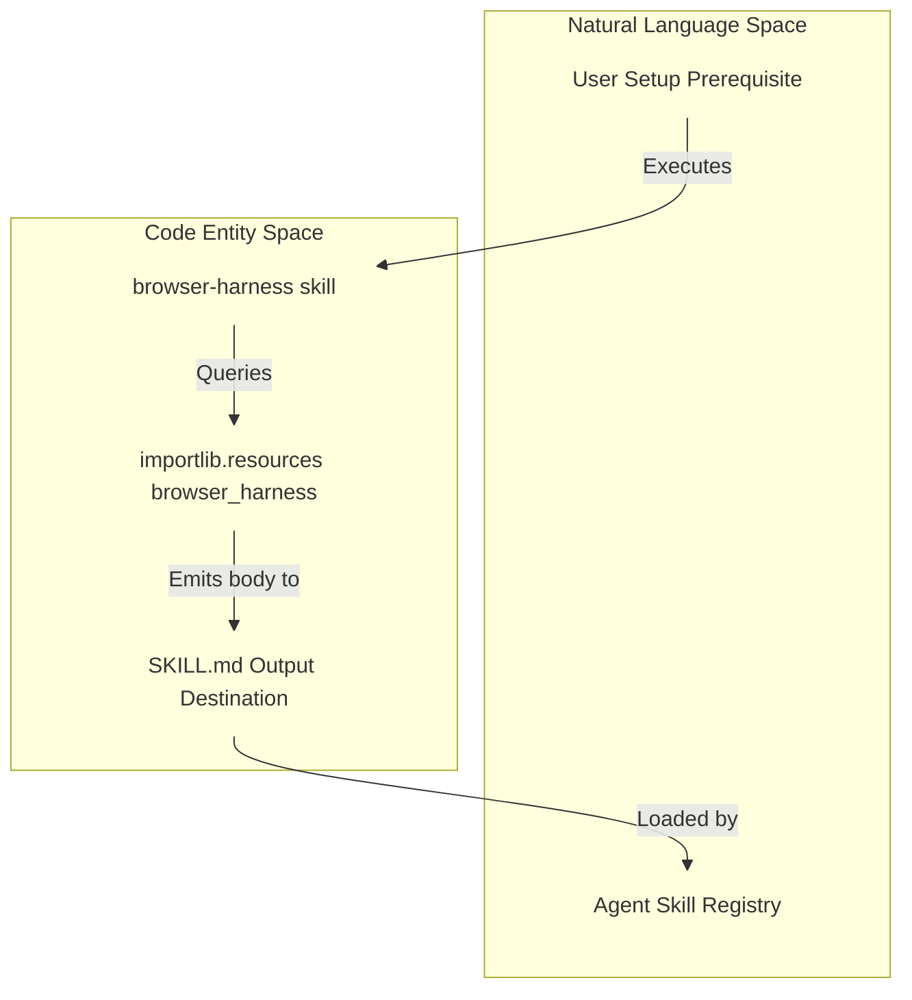
*Figure 2: Flow of skill emission from package resources to agent skill directories.*

Sources: `skills/browser-harness/references/install.md:1-55`

---

## 4. Synchronization and Automated Frontmatter Testing

To prevent regressions in packaged skill definitions, the test suite includes automated assertions that validate the structural integrity of the embedded `SKILL.md` file.

The unit test `tests/unit/test_skill.py` loads `SKILL.md` from the `browser_harness` package resources via `importlib.resources`, parses the YAML frontmatter block, and verifies strict key-value conformance [tests/unit/test_skill.py:1-35]().

```python
def test_packaged_skill_frontmatter_is_valid_simple_yaml():
    text = resources.files("browser_harness").joinpath("SKILL.md").read_text()
    metadata = {}
    ...
    assert metadata == {
        "name": "browser-harness",
        "description": "Control a real browser via CDP: clicking, typing, navigation, logged-in sessions, JS-rendered or bot-protected pages. Not for plain HTTP fetches of public content - use curl for those.",
    }
```

This validation logic ensures that:
- The file starts with valid `---` YAML frontmatter delimiters [tests/unit/test_skill.py:4-8]().
- Only permitted keys (`name`, `description`) are present [tests/unit/test_skill.py:18]().
- String values are correctly quoted and non-empty [tests/unit/test_skill.py:20-27]().
- The parsed metadata matches the exact expected string contracts required by agent loaders [tests/unit/test_skill.py:32-35]().

Sources: `tests/unit/test_skill.py:1-36`

---

# Page: Architecture & Core Components

# Architecture & Core Components

<details>
<summary>Relevant source files</summary>

The following files were used as context for generating this wiki page:

- [.github/workflows/release.yml](.github/workflows/release.yml)
- [AGENTS.md](AGENTS.md)
- [CLAUDE.md](CLAUDE.md)
- [browser-harness](browser-harness)
- [interaction-skills/make-video.md](interaction-skills/make-video.md)
- [pyproject.toml](pyproject.toml)
- [src/browser_harness/SKILL.md](src/browser_harness/SKILL.md)
- [src/browser_harness/run.py](src/browser_harness/run.py)
- [src/browser_harness/video.py](src/browser_harness/video.py)
- [tests/unit/test_run.py](tests/unit/test_run.py)

</details>


This page provides a high-level overview of the `browser-harness` architecture. The system is designed as a "thin" bridge between an LLM agent and the Chrome DevTools Protocol (CDP). It avoids heavy frameworks in favor of a self-healing, agent-editable structure built around core Python modules in `src/browser_harness` (`run`, `daemon`, `admin`, `helpers`, `_ipc`, `auth`, `telemetry`, `paths`, and `macos`).

## System Overview

The codebase is organized into primary Python modules that manage the lifecycle of the browser connection, the execution of agent scripts, local path resolution, security, and the interaction API [AGENTS.md:9-14]().

| Module | Role | Key File |
| :--- | :--- | :--- |
| **Execution** | CLI entry point for running Python code with pre-loaded helpers. | `run.py` [src/browser_harness/run.py:33-65]() |
| **Daemon** | Manages the persistent CDP WebSocket and IPC relay. | `daemon.py` [src/browser_harness/daemon.py:1-2]() |
| **Lifecycle** | Handles process management, diagnostics, and remote provisioning. | `admin.py` [src/browser_harness/admin.py:11-29]() |
| **API** | The "Harness" library used by agents to control the browser. | `helpers.py` [src/browser_harness/helpers.py:1-5]() |
| **Transport** | POSIX Unix sockets vs Windows TCP loopback + token auth. | `_ipc.py` |
| **Authentication** | Browser Use Cloud API key storage and login flow. | `auth.py` |
| **Environment** | Directory resolution (`BH_HOME`, `BH_RUNTIME_DIR`, `BH_TMP_DIR`). | `paths.py` |
| **Diagnostics** | Telemetry event emission and macOS remote-debugging approval. | `telemetry.py`, `macos.py` |

### Communication Flow

The system uses a two-tier communication model:
1.  **IPC Socket:** `run.py` (and the agent's script) communicates with `daemon.py` via the `_ipc` module [src/browser_harness/helpers.py:10-11](). On POSIX, this uses a Unix domain socket with `0600` umask; on Windows, it uses a TCP loopback with an authorization token [src/browser_harness/daemon.py:1-2](), [src/browser_harness/daemon.py:34]().
2.  **CDP WebSocket:** `daemon.py` maintains a persistent WebSocket connection to the browser's remote debugging port using `CDPClient` [src/browser_harness/daemon.py:8-10]().

Sources: [src/browser_harness/run.py:33-65](), [src/browser_harness/daemon.py:1-10](), [src/browser_harness/admin.py:11-29]()

---

## Core Layers & Child Pages

### 2.1. Daemon & CDP Connection Layer
The `daemon.py` module is the backbone of the system. It discovers the browser's debugging port by reading the `DevToolsActivePort` file from local browser profile paths across Linux, macOS, and Windows [src/browser_harness/daemon.py:76-86](), [src/browser_harness/daemon.py:104-122](). It manages session attachment, event buffering, stale-session auto-recovery, and dedicated tabs for named daemons using the tab marker.

For full details, see [Daemon & CDP Connection Layer](#2.1).

Sources: [src/browser_harness/daemon.py:76-122]()

### 2.2. run.py & admin.py — Execution and Lifecycle Management
The CLI entry point `run.py` handles stdin code execution, subcommand routing, auto-bootstrap precedence, and helper tracing. Meanwhile, `admin.py` manages daemon lifecycle functions (`ensure_daemon`, `restart_daemon`, `require_existing_daemon`), browser launching, spawn locks, PID fingerprinting, doctor diagnostics, and update flows [src/browser_harness/run.py:33-70](), [src/browser_harness/admin.py:11-29]().

For full details, see [run.py & admin.py — Execution and Lifecycle Management](#2.2).

Sources: [src/browser_harness/run.py:33-70](), [src/browser_harness/admin.py:11-29]()

### 2.3. helpers.py — Browser Automation API
`helpers.py` provides all helper functions available inside a browser-harness script: navigation (`goto_url`, `new_tab`, `wait_for_load/element/network_idle`), input emulation (`click_at_xy`, `type_text`, `fill_input`, `press_key`, `scroll`), tab/target management, screenshots, DOM utilities (`js`, `upload_file`, `http_get`), and the `_send`/`_load_env` internals [src/browser_harness/helpers.py:1-5]().

For full details, see [helpers.py — Browser Automation API](#2.3).

Sources: [src/browser_harness/helpers.py:1-5]()

### 2.4. Cloud Browser & Profile Sync
Integrates with Browser Use Cloud API to provision remote browsers (`start_remote_daemon`/`stop_remote_daemon`), manage keys via `auth.py`, list/sync profiles with cookie-only persistence, and support domain skills like `browser-use-cloud` for zombie sessions [src/browser_harness/admin.py:26-31](), [src/browser_harness/auth.py]().

For full details, see [Cloud Browser & Profile Sync](#2.4).

Sources: [src/browser_harness/admin.py:26-31]()

### 2.5. IPC, Paths & Telemetry Internals
Covers `_ipc.py` socket transport, `paths.py` directory resolution (`BH_HOME`, `BH_RUNTIME_DIR`, `BH_TMP_DIR`), `telemetry.py` event emission, and `macos.py` remote-debugging approval automation (`mac-approve`) [src/browser_harness/run.py:54]().

For full details, see [IPC, Paths & Telemetry Internals](#2.5).

Sources: [src/browser_harness/run.py:54]()

---

## Entity Mapping: Natural Language to Code

### Component Interaction Diagram

```mermaid
graph TD
    subgraph "User/Agent Space"
        [AgentScript]
    end

    subgraph "Execution Layer (run.py)"
        [run_main]
        [helpers_cdp]
    end

    subgraph "Daemon Layer (daemon.py)"
        [_ipc_connect]
        [Daemon_handle]
        [CDPClient]
    end

    subgraph "Browser Space"
        [ChromeProcess]
        [DevToolsActivePort]
    end

    [AgentScript] -->|ExecutedBy| [run_main]
    [run_main] -->|Calls| [helpers_cdp]
    [helpers_cdp] -->|JSONViaSend| [_ipc_connect]
    [_ipc_connect] -->|RoutesTo| [Daemon_handle]
    [Daemon_handle] -->|send_raw| [CDPClient]
    [CDPClient] -->|WebSocket| [ChromeProcess]
    [ChromeProcess] -->|WritesPort| [DevToolsActivePort]
    [Daemon_handle] -.->|get_ws_url_reads| [DevToolsActivePort]
```
Sources: [src/browser_harness/run.py:13-31](), [src/browser_harness/helpers.py:43-56](), [src/browser_harness/daemon.py:125-151](), [src/browser_harness/daemon.py:8-10]()

### Data Flow & Protocols

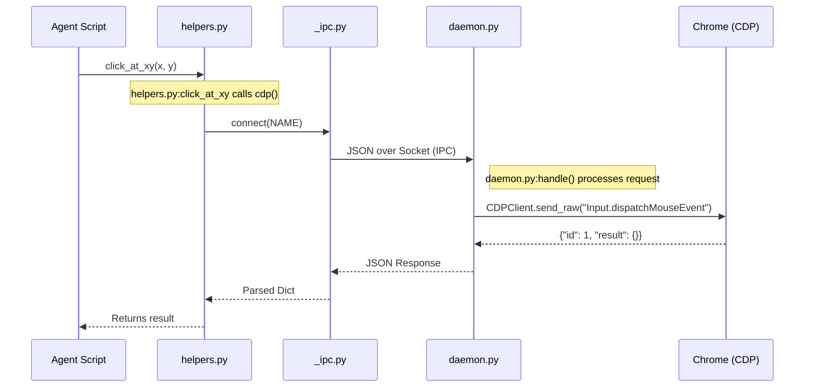
Sources: [src/browser_harness/helpers.py:43-56](), [src/browser_harness/helpers.py:152-172](), [src/browser_harness/daemon.py:1-2](), [src/browser_harness/daemon.py:8-10]()

---

# Page: Daemon & CDP Connection Layer

# Daemon & CDP Connection Layer

<details>
<summary>Relevant source files</summary>

The following files were used as context for generating this wiki page:

- [src/browser_harness/daemon.py](src/browser_harness/daemon.py)
- [tests/unit/test_daemon.py](tests/unit/test_daemon.py)

</details>


The **Daemon** (`daemon.py`) is the persistent bridge between high-level Python automation scripts and the low-level Chrome DevTools Protocol (CDP). It manages WebSocket discovery, session state, target attachment, and event buffering, providing a stable IPC interface (Unix domain socket on POSIX, TCP loopback on Windows) for the `run.py` and `helpers.py` layers, isolated per `BU_NAME` [src/browser_harness/daemon.py:1-11]().

---

## WebSocket Discovery & Initialization

The daemon identifies the active Chrome instance by scanning local filesystem paths for the `DevToolsActivePort` file. This file, generated by Chrome when remote debugging is enabled, contains the ephemeral port and a unique WebSocket path suffix [src/browser_harness/daemon.py:138-153]().

### Discovery Logic & Environment Resolution
1.  **Environment Variables**: The daemon first evaluates `BU_NAME` to namespace sockets and PIDs [src/browser_harness/daemon.py:33-36](), and checks connection overrides like `BU_CDP_WS` or `BU_CDP_URL` [src/browser_harness/daemon.py:117]().
2.  **Path Scanning**: It iterates through platform-specific profile directories (`profile_dirs()`), supporting macOS (`_MAC_PROFILES`), Linux (`_LINUX_PROFILES`), and Windows (`_WINDOWS_PROFILES`), covering variants such as Chrome, Chrome Canary, Edge, Brave, and Chromium [src/browser_harness/daemon.py:38-110]().
3.  **DevToolsActivePort**: It reads the port from `DevToolsActivePort` and confirms liveness via `_devtools_port_live()` to ensure stale lock files from closed browsers do not trigger false connections [src/browser_harness/daemon.py:138-153]().
4.  **HTTP Resolution**: Queries `http://127.0.0.1:{port}/json/version` to resolve the live `webSocketDebuggerUrl` [src/browser_harness/daemon.py:168]().

### CDPClient Initialization
The daemon uses `cdp_use.client.CDPClient` to establish the primary WebSocket connection [src/browser_harness/daemon.py:10](). Upon startup, it initializes the `Daemon` class and attaches to the first available target via `attach_first_page()` [src/browser_harness/daemon.py:279-285]().

Sources: `[src/browser_harness/daemon.py:1-11]()`, `[src/browser_harness/daemon.py:33-110]`, `[src/browser_harness/daemon.py:138-185]()`

---

## Target Attachment, Session Management & The Tab Marker

Chrome contains internal targets (extensions, `chrome-untrusted://`, `devtools://`, `about:`) that are unsuitable for automation. The daemon filters these and manages user-visible tabs.

### Target Filtering & Attachment
-   **`is_real_page(t)`**: Filters out non-page targets and internal schemes listed in `INTERNAL` (`chrome://`, `about:`, etc.) [src/browser_harness/daemon.py:113]()
-   **Session Activation**: When attaching to targets via `Target.attachToTarget` with `flatten=True`, the daemon enables default domains (`Page`, `DOM`, `Runtime`, `Network`) using `_enable_default_domains()` [tests/unit/test_daemon.py:148-174]().

### The Tab Marker
To visually distinguish controlled browser tabs from manual browsing sessions, the daemon injects a cosmetic tab title marker (`\U0001F434` 🐴 emoji) into the page title using `TAB_MARKER_JS` [src/browser_harness/daemon.py:130-136]().
-   **Configurability**: Controlled by `BH_TAB_MARKER`. If set to `0`, `false`, `no`, or `off`, marker injection is skipped [src/browser_harness/daemon.py:133-135](), [tests/unit/test_daemon.py:96-112]().
-   **Timing**: Injected asynchronously upon `set_session` or page load events unless explicitly disabled [tests/unit/test_daemon.py:114-147]().

Sources: `[src/browser_harness/daemon.py:113-136]()`, `[tests/unit/test_daemon.py:96-190]()`

---

## IPC Relay & Event Buffering

The daemon acts as a JSON-RPC request-response server over a local IPC socket (`_ipc.py`) [src/browser_harness/_ipc.py:1]().

### IPC Protocol & Meta Commands
Clients send JSON payloads to the daemon socket. The `Daemon.handle()` dispatcher handles meta commands or forwards CDP methods:
*   `ping`: Returns daemon PID and liveness state.
*   `drain_events`: Flushes and returns the internal event buffer `self.events` [src/browser_harness/daemon.py:37]().
*   `set_session`: Updates active `self.session` and `self.target_id`, re-enabling default domains (`Page.enable`, `DOM.enable`, `Runtime.enable`, `Network.enable`) [tests/unit/test_daemon.py:148-174]().

### Event Buffering
The daemon maintains a fixed-size `deque` buffer (`BUF = 500`) (`self.events`) that taps incoming CDP notifications (e.g., `Page.loadEventFired`, `Network.requestWillBeSent`) for asynchronous inspection by high-level automation helpers [src/browser_harness/daemon.py:37](), [src/browser_harness/daemon.py:247-255]().

Sources: `[src/browser_harness/daemon.py:37]`, `[src/browser_harness/daemon.py:247-273]`, `[src/browser_harness/_ipc.py:1-5]()`

---

## Stale-Session Auto-Recovery & PID Management

-   **Stale-Session Recovery**: When session references expire or tabs close unexpectedly, the daemon handles session switching and tears down event subscriptions on old sessions to prevent background event pollution [tests/unit/test_daemon.py:91-113]().
-   **PID Fingerprinting**: `_publish_own_pid()` safely updates the daemon PID record without truncating active process start metadata established by parent spawn locks [src/browser_harness/daemon.py:77-100](), [tests/unit/test_daemon.py:9-25]().

Sources: `[src/browser_harness/daemon.py:77-100]`, `[tests/unit/test_daemon.py:9-25]()`

---

## System Architecture Diagrams

### Connection Lifecycle & Discovery
This diagram bridges natural language concepts to specific code entities in `daemon.py`.

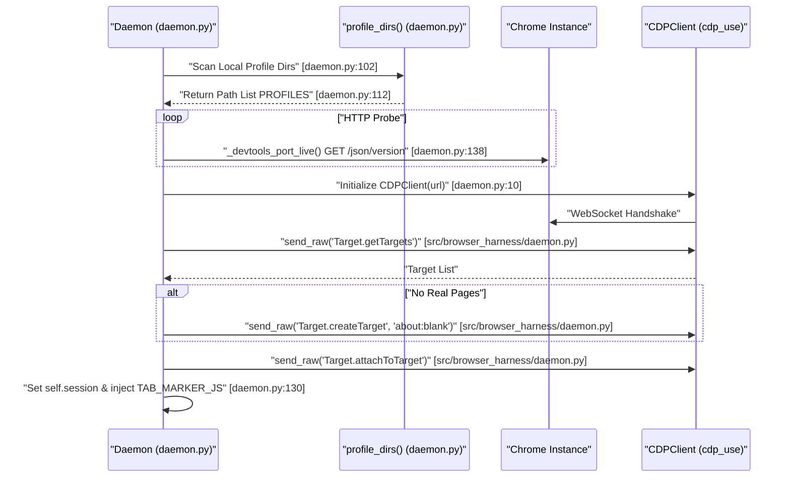
Sources: `[src/browser_harness/daemon.py:10]`, `[src/browser_harness/daemon.py:102-136]`, `[src/browser_harness/daemon.py:138-153]()`

### Request/Event Relay Flow
This diagram details the flow between script helpers, IPC transport, and the daemon event buffer.

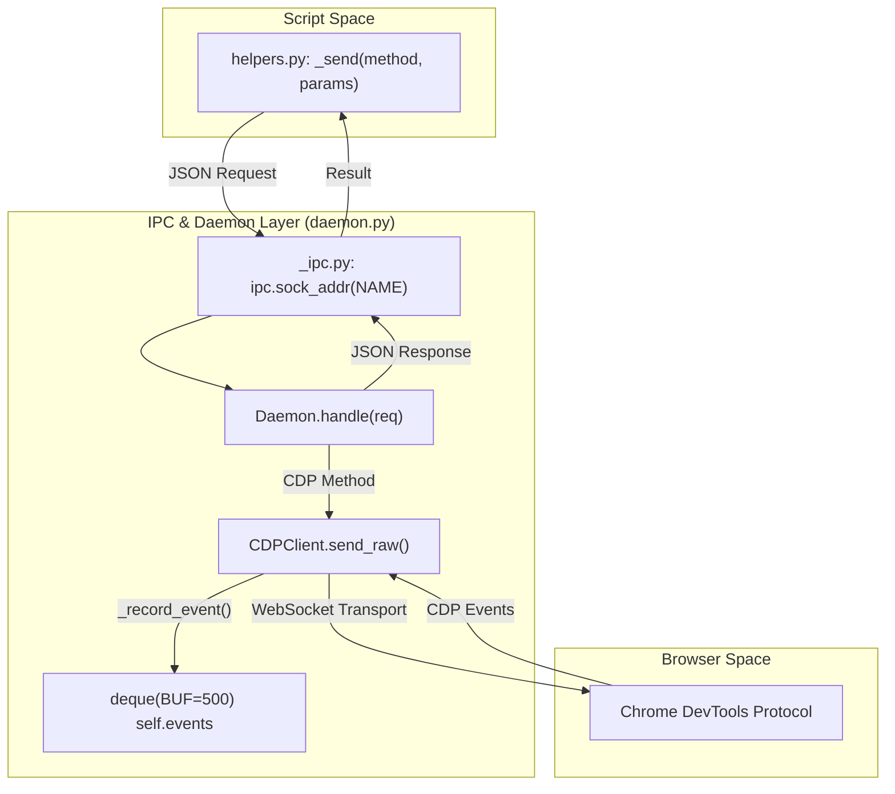
Sources: `[src/browser_harness/daemon.py:33-37]`, `[src/browser_harness/daemon.py:247-273]`, `[src/browser_harness/_ipc.py:1-106]()`

---

# Page: run.py & admin.py — Execution and Lifecycle Management

# run.py & admin.py — Execution and Lifecycle Management

<details>
<summary>Relevant source files</summary>

The following files were used as context for generating this wiki page:

- [src/browser_harness/admin.py](src/browser_harness/admin.py)
- [src/browser_harness/run.py](src/browser_harness/run.py)
- [tests/unit/test_admin.py](tests/unit/test_admin.py)
- [tests/unit/test_brave_origin.py](tests/unit/test_brave_origin.py)
- [tests/unit/test_run.py](tests/unit/test_run.py)

</details>


This page covers the execution entry point and the administrative lifecycle management of the `browser-harness` system. It details how Python code is executed via `run.py`, how the background daemon is managed via `admin.py`, how remote browsers are provisioned via the Browser Use cloud API, and how robust process fingerprinting prevents PID-reuse hazards during lifecycle recovery.

## Execution Entry Point (run.py)

`run.py` serves as the primary CLI entry point for the harness, handling stdin code execution, environment bootstrap precedence, command routing, and helper tracing [run.py:33-65]().

### Initialization and Configuration
1. **UTF-8 Enforcement**: On Windows, default stream encodings can cause `UnicodeEncodeError` when printing helper outputs or tab titles containing emojis (such as the 🐴 marker). `run.py` reconfigures `sys.stdout` and `sys.stderr` to UTF-8 with error replacement [run.py:4-11]().
2. **Environment Loading**: `admin.py` is imported and immediately executes `_load_env()`, scanning the repository root and workspace directory for `.env` files to configure runtime variables [admin.py:107-126]().
3. **Helper Tracing and Injection**: Functions from `helpers.py` are injected into the execution context and wrapped with `_traced()` to record step telemetry, execution duration, and recorder observations [run.py:31](), [run.py:156-178](), [run.py:181-190]().

### Execution Logic and Auto-Bootstrap Precedence
When invoked without subcommands, `run.py` expects Python code over `stdin` [run.py:212](). Before execution, it determines whether to start a local daemon or auto-bootstrap a remote browser:
* **Explicit CDP Checks**: `_explicit_cdp_configured()` inspects `BU_CDP_URL` and `BU_CDP_WS`. If either is set, it blocks cloud auto-bootstrap to respect explicit user endpoints and prevent unintended billing [run.py:99-100]().
* **Local Chrome Discovery**: `_local_chrome_listening()` probes ports `9222` and `9223` for a valid DevTools endpoint `[run.py:82-91]()`.
* **Cloud Auto-Spawn**: If `BU_AUTOSPAWN` is enabled, cloud auth is valid via `_cloud_auth_configured()`, and neither a local Chrome nor an existing daemon is active, `run.py` calls `start_remote_daemon()` to provision a cloud browser instance [run.py:103-109](), [run.py:239-247]().
* **Daemon Readiness**: Calls `ensure_daemon()` to verify or start the background control process before executing the script via `exec(code, globals())` [run.py:249-251]().

**run.py Execution Flow**
Title: "run.py Execution Flow"
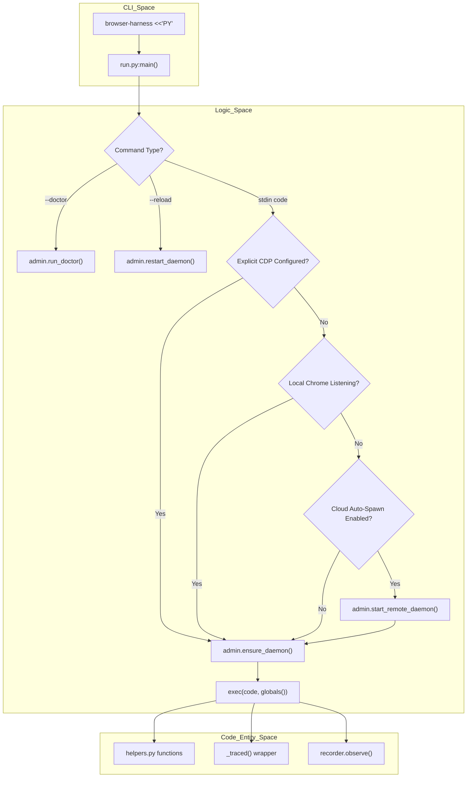
Sources: [run.py:82-109](), [run.py:156-190](), [run.py:239-251]()

---

## Lifecycle Management (admin.py)

`admin.py` manages the background daemon process, IPC sockets, process fingerprinting, and remote browser integrations [admin.py:12-15]().

### Process Identification and Fingerprinting
To prevent PID-reuse hazards where a dead daemon's process ID is reassigned to an unrelated system process, `admin.py` implements `_process_start_time(pid)` [admin.py:16-31](). This returns an opaque start-time fingerprint:
* **Linux**: Reads `/proc/<pid>/stat` and parses field 22 (starttime clock ticks since boot) [admin.py:34-46]().
* **macOS**: Runs `ps -o lstart= -p <pid>` to retrieve an absolute start timestamp [admin.py:47-56]().
* **Windows**: Uses `GetProcessTimes` via `ctypes` to read the kernel 64-bit `FILETIME` creation timestamp [admin.py:57-105]().

### Key Lifecycle Functions

| Function | Role | Implementation Detail |
| :--- | :--- | :--- |
| `daemon_alive(name)` | Health Check | Performs an IPC ping handshake to ensure the listener is active and responsive [admin.py:178-181](). |
| `ensure_daemon(...)` | Idempotent Start | Checks daemon liveness; if unresponsive, launches `daemon.py` via `subprocess.Popen` with independent session grouping [admin.py:348-380](). |
| `restart_daemon(name)` | Recovery | Utilizes process fingerprints to safely force-kill hung daemons without risking PID collisions [admin.py:426-451](). |
| `run_doctor()` | Diagnostics | Validates dependencies, environment variables, Chrome remote debugging state, and IPC connectivity [admin.py:512-566](). |

### Remote Browser Provisioning
`admin.py` interfaces with the Browser Use Cloud API (`https://api.browser-use.com/api/v3`) to manage remote browsers [admin.py:128]().
* **`start_remote_daemon`**: Sends a `POST /browsers` request to provision a remote browser session, then launches a local daemon configured with the assigned `cdpUrl` [admin.py:232-268]().
* **`stop_remote_daemon`**: Gracefully tears down the remote daemon by sending a `PATCH /browsers/<id>` request to release the cloud instance [admin.py:271-291]().

**System Entity Mapping**
Title: "Lifecycle Management Entities"
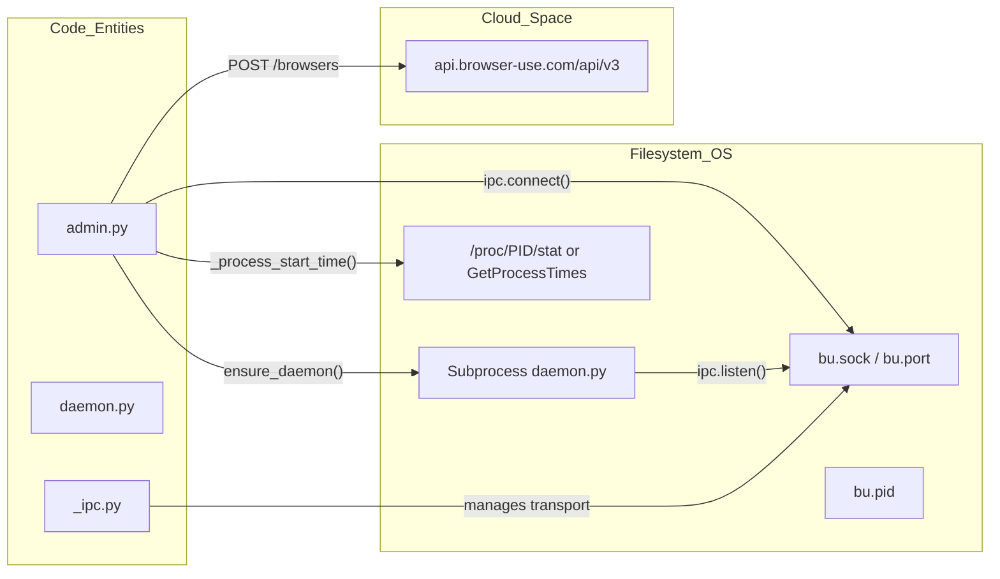
Sources: [admin.py:16-105](), [admin.py:127-181](), [admin.py:232-380]()

---

## Profile and Version Management

### Profile Synchronization
`admin.py` supports discovering, syncing, and listing local and cloud browser profiles to maintain session authentication states across environments.
* **`list_local_profiles()`**: Discovers local browser user-data directories across operating systems [admin.py:474-502]().
* **`sync_local_profile()`**: Synchronizes local cookies and profile data to a cloud profile target [admin.py:294-320]().
* **`list_cloud_profiles()`**: Queries the Cloud API to retrieve available remote profile configurations [admin.py:323-345]().

### Self-Updates and Banners
* **`run_update()`**: Inspects installation metadata to pull and apply the latest version from PyPI or git [admin.py:569-605]().
* **`print_update_banner()`**: Checks for newer versions against PyPI JSON endpoints, caching responses in `VERSION_CACHE` to avoid redundant network calls [admin.py:129-132](), [admin.py:608-623]().

Sources: [admin.py:129-132](), [admin.py:294-345](), [admin.py:474-502](), [admin.py:569-623]()

---

# Page: helpers.py — Browser Automation API

# helpers.py — Browser Automation API

<details>
<summary>Relevant source files</summary>

The following files were used as context for generating this wiki page:

- [src/browser_harness/helpers.py](src/browser_harness/helpers.py)
- [tests/integration/test_js.py](tests/integration/test_js.py)
- [tests/unit/test_helpers.py](tests/unit/test_helpers.py)

</details>


The `helpers.py` module provides the high-level Python API for interacting with the browser. It abstracts raw Chrome DevTools Protocol (CDP) commands into ergonomic functions for navigation, input emulation, and tab management. These helpers are pre-imported into the execution environment when running scripts via `browser-harness`.

Sources: [src/browser_harness/helpers.py:1-5]()

---

## Core Communication & Environment

The API communicates with the daemon process via a Unix domain socket or TCP loopback, depending on the platform. It uses a request-response pattern where Python dictionaries are serialized to JSON and sent over the wire.

### Internal Mechanics
- **`_load_env()`**: Automatically loads environment variables from `.env` files located in the repository root and the agent workspace. It populates `os.environ` without overwriting existing variables [src/browser_harness/helpers.py:19-36]().
- **`_send(req, response_timeout)`**: The low-level transport function. It connects to the IPC socket (`SOCK`), sets a timeout (e.g., `DEFAULT_IPC_RESPONSE_TIMEOUT_SECONDS` or `SCREENSHOT_IPC_RESPONSE_TIMEOUT_SECONDS`), transmits the request dictionary via `ipc.request()`, and returns the decoded response dictionary. Raises an `_IPCResponseTimeout` mapped to a descriptive `RuntimeError` if timeouts occur [src/browser_harness/helpers.py:48-69]().
- **`cdp(method, session_id=None, ...)`**: The primary wrapper for raw CDP calls. It wraps method names and parameters into a dictionary and dispatches it through `_send()` [src/browser_harness/helpers.py:72-77]().
- **`_runtime_evaluate(expression, ...)`**: Evaluates JavaScript in the browser context via `Runtime.evaluate`. It features robust error parsing (`_runtime_value()`, `_js_exception_description()`) to handle `exceptionDetails` and unserializable JavaScript values like `NaN`, `Infinity`, `-Infinity`, `-0`, and `BigInt` [src/browser_harness/helpers.py:83-141](), [tests/integration/test_js.py:144-168]().

### Data Flow: Script to Browser
The following diagram bridges natural language concepts of script execution to the concrete code entities handling IPC transport and CDP dispatch.

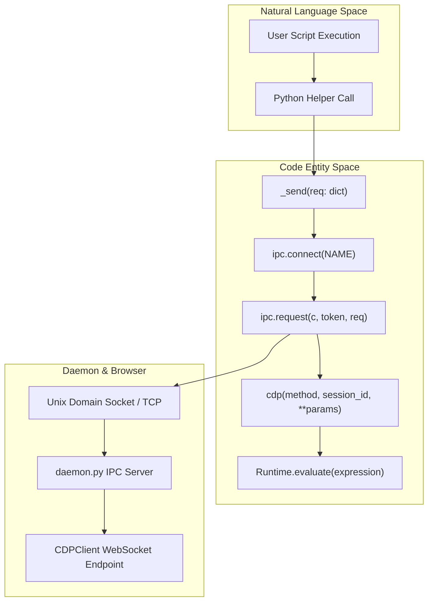
Sources: [src/browser_harness/helpers.py:19-77](), [src/browser_harness/helpers.py:116-141]()

---

## Navigation & Page Inspection

Navigation helpers handle moving between URLs, inspecting document dimensions, and executing arbitrary expressions.

| Function | Description | Implementation Detail |
| :--- | :--- | :--- |
| `goto_url(url)` | Navigates the current tab to a URL using `Page.navigate`. | Optionally checks for matching `domain-skills` directories under `AGENT_WORKSPACE` when `BH_DOMAIN_SKILLS=1` [src/browser_harness/helpers.py:152-158](), [tests/unit/test_helpers.py:91-98](). |
| `page_info()` | Returns viewport metrics, scroll position, page title, and URL. | Evaluates a JSON-stringified JS object (`innerWidth`, `scrollX`, etc.). Checks for `pending_dialog` first [src/browser_harness/helpers.py:159-170](). |
| `js(expression)` | Executes arbitrary JavaScript in the page context. | Automatically wraps expressions in an IIFE or `return` statement via `_wrap_js_function()` if a top-level return is detected [src/browser_harness/helpers.py:83-149](), [tests/integration/test_js.py:48-56](). |

**Page State and Dialogs:** `page_info()` verifies if a native JS dialog (`alert`, `confirm`, `prompt`, `beforeunload`) is active by querying `pending_dialog` via a meta-request. If active, it returns dialog metadata instead of viewport metrics because the page's JS thread is blocked [src/browser_harness/helpers.py:165-168]().

Sources: [src/browser_harness/helpers.py:152-170](), [tests/integration/test_js.py:48-56]()

---

## Input Emulation

Input operations in `browser-harness` leverage coordinate-based and CDP-level input dispatching to bypass DOM abstraction layers.

### Mouse & Keyboard
- **`click_at_xy(x, y, button, clicks)`**: Dispatches `mousePressed` and `mouseReleased` CDP events at specific coordinates. If `BH_DEBUG_CLICKS` is enabled, it overlays a visual target using PIL [src/browser_harness/helpers.py:172-185]().
- **`fill_input(selector, text, clear_first)`**: Focuses an element via JavaScript, selects all text using OS-appropriate modifiers (`Meta` on macOS, `Ctrl` elsewhere), issues a backspace if `clear_first=True`, types characters, and triggers `input` and `change` events [src/browser_harness/helpers.py:177-203](), [tests/unit/test_helpers.py:126-146]().
- **`press_key(key, modifiers)`**: Translates abstract keys (e.g., `Enter`, `Backspace`, `ArrowDown`) using an internal virtual key code mapping (`_KEYS`), dispatching `keyDown` and `keyUp` events [src/browser_harness/helpers.py:207-218]().
- **`scroll_at_xy(x, y, dy, dx)`**: Dispatches `mouseWheel` events at targeted coordinates to scroll nested elements or virtual lists [src/browser_harness/helpers.py:204-205]().

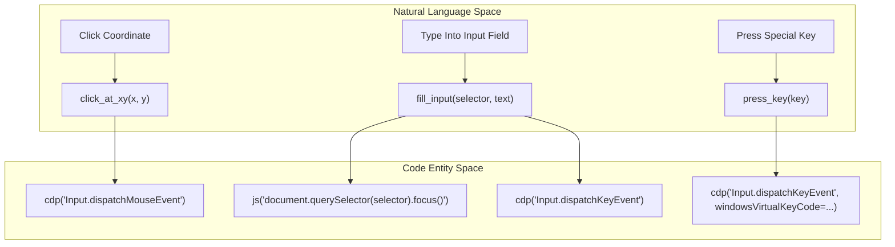
Sources: [src/browser_harness/helpers.py:172-218](), [tests/unit/test_helpers.py:126-146]()

---

## Tab & Target Management

The harness manages multiple browser tabs and targets by maintaining a session identifier (`session_id`) routed through the daemon IPC protocol.

### Functions
- **`list_tabs(include_chrome)`**: Queries target pages, filtering out internal schemes (`chrome://`, `devtools://`, `about:`, etc.) unless `include_chrome=True` [src/browser_harness/helpers.py:232-239]().
- **`switch_tab(target_id)`**: Switches the active daemon session to the specified target ID and calls `_mark_tab()` to visually inject a marker into the page title [src/browser_harness/helpers.py:250-258]().
- **`new_tab(url)`**: Creates a new target via `Target.createTarget`, switches to it, and loads the target URL [src/browser_harness/helpers.py:260-268]().
- **`iframe_target(url_substr)`**: Filters targets for iframe types matching a URL substring to support cross-origin frame interaction [src/browser_harness/helpers.py:275-278]().

Sources: [src/browser_harness/helpers.py:232-278]()

---

## Utilities & File Handling

### Visuals & Files
- **`capture_screenshot(path, full, max_dim)`**: Captures the viewport or entire layout (via `Page.getLayoutMetrics` and metrics override when `full=True`), writing a PNG image. Uses PIL to enforce `max_dim` downscaling if specified [src/browser_harness/helpers.py:301-334](), [tests/unit/test_helpers.py:12-29]().
- **`upload_file(selector, paths)`**: Resolves a CSS selector to a `backendNodeId` using `DOM.describeNode` and sets files on the input node via `DOM.setFileInputFiles` [src/browser_harness/helpers.py:347-353]().

### Network & Data
- **`http_get(url, headers)`**: Performs a direct HTTP request using `urllib.request` without spinning up heavy browser cycles [src/browser_harness/helpers.py:356-364]().
- **`drain_events()`**: Retrieves buffered asynchronous CDP events accumulated by the daemon since the previous drain call [src/browser_harness/helpers.py:80]().

Sources: [src/browser_harness/helpers.py:80](), [src/browser_harness/helpers.py:301-364](), [tests/unit/test_helpers.py:12-29]()

---

# Page: Cloud Browser & Profile Sync

# Cloud Browser & Profile Sync

<details>
<summary>Relevant source files</summary>

The following files were used as context for generating this wiki page:

- [agent-workspace/domain-skills/browser-use-cloud/cleanup-zombies.py](agent-workspace/domain-skills/browser-use-cloud/cleanup-zombies.py)
- [agent-workspace/domain-skills/browser-use-cloud/cloud.md](agent-workspace/domain-skills/browser-use-cloud/cloud.md)
- [interaction-skills/profile-sync.md](interaction-skills/profile-sync.md)
- [src/browser_harness/admin.py](src/browser_harness/admin.py)
- [src/browser_harness/auth.py](src/browser_harness/auth.py)
- [src/browser_harness/paths.py](src/browser_harness/paths.py)
- [src/browser_harness/telemetry.py](src/browser_harness/telemetry.py)
- [tests/unit/test_auth.py](tests/unit/test_auth.py)
- [tests/unit/test_brave_origin.py](tests/unit/test_brave_origin.py)

</details>


This page explains the Browser Use cloud API integration within `browser-harness`, covering remote browser provisioning (`start_remote_daemon` / `stop_remote_daemon`), authentication key storage and OAuth flows in `auth.py`, local and cloud profile synchronization, cookie-only persistence mechanics, and the `browser-use-cloud` domain skill for zombie session management.

Sources: [src/browser_harness/admin.py:1-404](), [src/browser_harness/auth.py:1-222](), [interaction-skills/profile-sync.md:1-90]()

---

## 1. Overview and Core Integration Architecture

The cloud integration layer allows `browser-harness` to delegate execution to remote browser instances hosted on Browser Use infrastructure. This decouples local machine capabilities from heavy browser automation tasks, enabling parallel runs, headless server execution, and authenticated profile persistence.

The core modules involved are:
- `admin.py`: Handles API interactions with `https://api.browser-use.com/api/v3`, remote browser lifecycle control, and local process management [src/browser_harness/admin.py:1-150]()
- `auth.py`: Manages credential storage, OAuth PKCE flows, and environment-based API key retrieval [src/browser_harness/auth.py:1-200]()
- `paths.py`: Resolves configuration and storage directories under `BH_HOME` [src/browser_harness/paths.py:1-49]()

### Natural Language to Code Entity Mapping: Cloud Infrastructure

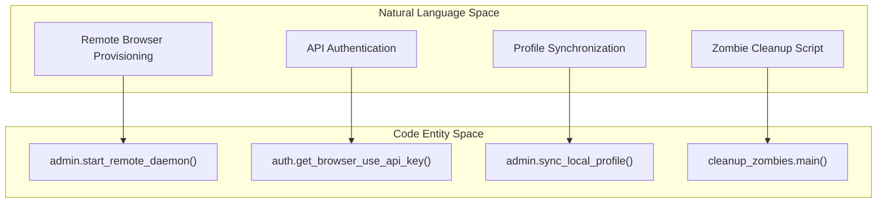
Sources: [src/browser_harness/admin.py:321-345](), [src/browser_harness/auth.py:182-191](), [src/browser_harness/admin.py:376-404](), [agent-workspace/domain-skills/browser-use-cloud/cleanup-zombies.py:87-160]()

---

## 2. Authentication & Credential Storage (`auth.py`)

The `auth.py` module manages authentication against the Browser Use cloud backend. Credentials can be supplied via environment variables (`BROWSER_USE_API_KEY`) or persisted in a local configuration file (`auth.json`) via OAuth flows [src/browser_harness/auth.py:126-191]().

### Key Functions and Data Structures
- `get_browser_use_api_key()`: Resolves the API key from `os.environ["BROWSER_USE_API_KEY"]` or falls back to the stored JSON record, raising `CloudAuthRequired` if neither is present [src/browser_harness/auth.py:182-191]().
- `auth_status()`: Inspects the current authentication state and source (`env` vs `stored` vs `missing`) [src/browser_harness/auth.py:193-200]().
- `save_auth_record()`: Persists an `AuthRecord` securely to the configuration path with restricted file permissions (`0o600`) [src/browser_harness/auth.py:146-156](), [src/browser_harness/paths.py:19-24]().

### Authentication Data Flow
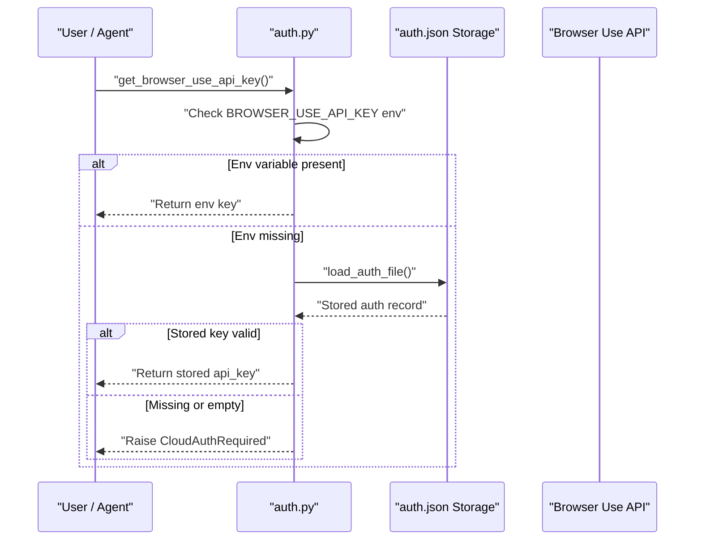
Sources: [src/browser_harness/auth.py:133-191](), [src/browser_harness/paths.py:10-16]()

---

## 3. Profile Synchronization & Cookie Persistence

To maintain sessions across remote browser restarts, `browser-harness` supports syncing local browser cookies to remote cloud profiles via the `profile-use` binary helper [interaction-skills/profile-sync.md:3-11]().

### Cookie-Only Persistence Model
The synchronization model is strictly **cookies-only**; `localStorage`, `IndexedDB`, and browser extensions are excluded [interaction-skills/profile-sync.md:74-75](). This provides enough state for session-cookie based platforms (Google, GitHub, Stripe, SaaS) while avoiding heavy storage sync overhead.

### Key Functions in `admin.py`
- `list_cloud_profiles()`: Queries `GET /profiles` to retrieve all remote profiles associated with the API key [interaction-skills/profile-sync.md:81-82]().
- `list_local_profiles()`: Invokes the external `profile-use` CLI to discover local Chrome and Edge profiles [interaction-skills/profile-sync.md:19-20]().
- `sync_local_profile()`: Pushes local cookies to the cloud profile (creating one or updating an existing ID via `cloud_profile_id`), supporting domain filters via `include_domains` and `exclude_domains` [interaction-skills/profile-sync.md:22-27]().

### Profile Sync Architecture
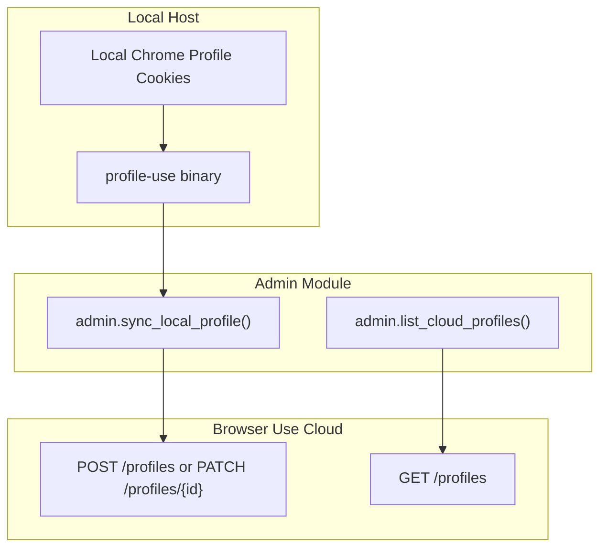
Sources: [src/browser_harness/admin.py:220-229](), [interaction-skills/profile-sync.md:3-35]()

---

## 4. Remote Browser Lifecycle Management

Provisioning and teardown of remote browser sessions are handled via `admin.py` interfacing with `https://api.browser-use.com/api/v3` [src/browser_harness/admin.py:129-345]().

### Provisioning (`start_remote_daemon`)
When `start_remote_daemon(name, profileName=..., profileId=...)` is invoked:
1. Client-side profile name resolution resolves `profileName` to a UUID via `list_cloud_profiles()` if needed [interaction-skills/profile-sync.md:82-83]().
2. An HTTP `POST` request is sent to `/browsers` with parameters such as `profileId`, `proxyCountryCode` (defaulting to `"us"` or `null` to disable), and `timeout` [agent-workspace/domain-skills/browser-use-cloud/cloud.md:37-48]().
3. The API returns a session object containing `id`, `cdpUrl`, and `liveUrl` [agent-workspace/domain-skills/browser-use-cloud/cloud.md:50-68]().
4. A local `daemon.py` instance is spawned, configured with `BU_CDP_WS` pointing to the remote browser's CDP endpoint [src/browser_harness/admin.py:341-345]().

### Shutdown and Billing (`stop_remote_daemon`)
Remote browsers incur continuous billing until terminated. `stop_remote_daemon(name)` signals the daemon to execute its shutdown sequence [src/browser_harness/admin.py:266-277](), which issues a `PATCH` request to `/browsers/{REMOTE_ID}` with `{"action": "stop"}` [agent-workspace/domain-skills/browser-use-cloud/cloud.md:73-77](). This cleanly ends billing and commits any mutated session cookies back to the cloud profile [interaction-skills/profile-sync.md:76-77]().

### Zombie Session Management (`cleanup-zombies.py`)
The `browser-use-cloud` domain skill includes `cleanup-zombies.py` to audit and purge abandoned or zombie cloud sessions [agent-workspace/domain-skills/browser-use-cloud/cleanup-zombies.py:1-21](). It queries active sessions via `GET /browsers`, calculates session age based on `startedAt`, and issues `PATCH /browsers/{id}` with `{"action": "stop"}` for sessions exceeding the threshold (default 30 minutes) [agent-workspace/domain-skills/browser-use-cloud/cleanup-zombies.py:58-84]().

Sources: [src/browser_harness/admin.py:266-345](), [agent-workspace/domain-skills/browser-use-cloud/cloud.md:35-79](), [agent-workspace/domain-skills/browser-use-cloud/cleanup-zombies.py:1-163]()

---

# Page: IPC, Paths & Telemetry Internals

# IPC, Paths & Telemetry Internals

<details>
<summary>Relevant source files</summary>

The following files were used as context for generating this wiki page:

- [.github/VOUCHED.td](.github/VOUCHED.td)
- [interaction-skills/profile-sync.md](interaction-skills/profile-sync.md)
- [src/browser_harness/_ipc.py](src/browser_harness/_ipc.py)
- [src/browser_harness/macos.py](src/browser_harness/macos.py)
- [src/browser_harness/paths.py](src/browser_harness/paths.py)
- [src/browser_harness/telemetry.py](src/browser_harness/telemetry.py)
- [tests/unit/test_ipc.py](tests/unit/test_ipc.py)
- [tests/unit/test_macos.py](tests/unit/test_macos.py)

</details>


This page details the implementation of foundational support layers in `browser-harness`: inter-process communication (`_ipc.py`), filesystem layout resolution (`paths.py`), opt-out analytics telemetry (`telemetry.py`), and macOS remote-debugging permission automation (`macos.py`).

---

## 1. IPC Transport & Protocol (`_ipc.py`)

The daemon communication layer uses different transport mechanisms depending on the operating system, governed by `IS_WINDOWS` [src/browser_harness/_ipc.py:7] and managed inside `src/browser_harness/_ipc.py`.

### Transport Mechanisms
* **POSIX:** Uses Unix domain sockets (`socket.AF_UNIX`) [src/browser_harness/_ipc.py:86-89]. Security relies on filesystem permissions (`chmod 0600` on the runtime directory), restricting access to the owning user UID.
* **Windows:** Uses TCP loopback (`127.0.0.1`) [src/browser_harness/_ipc.py:90-93] because Windows lacks Unix domain socket support in standard library bindings and file permission equivalents for TCP ports. Since any local process can connect to a loopback port, Windows sockets require token-based authentication (`_server_token`) [src/browser_harness/_ipc.py:28-31]. Every JSON request must carry the token under the `"token"` key [src/browser_harness/_ipc.py:96-99].

### Path Traversal Guards and Naming
To prevent directory traversal attacks via malicious `BU_NAME` inputs, `_check()` validates the name against a strict regular expression (`\A[A-Za-z0-9_-]{1,64}\Z`) [src/browser_harness/_ipc.py:35-38]. 

Depending on whether `BH_RUNTIME_DIR` or `BH_TMP_DIR` are shared or isolated, `_runtime_stem()` and `_tmp_stem()` determine file naming prefixes [src/browser_harness/_ipc.py:41-48]:
* If isolated, filenames use a bare `"bu"` stem [src/browser_harness/_ipc.py:43, 48].
* If shared (`BH_RUNTIME_DIR_SHARED=1`), filenames incorporate the instance identifier as `bu-<name>` [src/browser_harness/_ipc.py:43, 48].

### Protocol and Payload Sanitation
Client connections are established via `connect(name)` [src/browser_harness/_ipc.py:83-93], and data is exchanged using newline-delimited JSON through `request(c, token, req)` [src/browser_harness/_ipc.py:96-107].

Integrity checks (`ping()` and `identify()`) defend against stale `.port` files and port reuse by verifying that responding endpoints return valid daemon control structures rather than unrelated services [src/browser_harness/_ipc.py:109-149]:
* `ping()` verifies that the response is a dictionary where `resp.get("pong") is True` [src/browser_harness/_ipc.py:118-122].
* `identify()` verifies the pong and extracts the daemon's process ID, explicitly rejecting booleans (since `isinstance(True, int)` is true in Python) [src/browser_harness/_ipc.py:147-148], missing keys, non-dictionary payloads, and non-positive PIDs (`<= 0`) to prevent dangerous `os.kill()` signals [tests/unit/test_ipc.py:44-96].

```mermaid
graph TD
    Client["Client Code"] -->|Calls| Connect["_ipc.connect()"]
    Connect -->|POSIX Unix Socket| Sock["_ipc._sock_path()"]
    Connect -->|Windows TCP Loopback| Port["_ipc._read_port_file()"]
    Client -->|Sends JSON Request| Request["_ipc.request()"]
    Request -->|Injects Token if Windows| Daemon["Daemon Server handle()"]
    Daemon -->|Returns JSON Reply| Request
    Request -->|Sanitizes Ping/Identify| Ping["_ipc.ping() / _ipc.identify()"]
```
*Sources: [src/browser_harness/_ipc.py:1-201](), [tests/unit/test_ipc.py:1-128]()*

---

## 2. Directory Resolution & Layout (`paths.py`)

Filesystem locations are centralized in `src/browser_harness/paths.py`, allowing callers to override default directories using environment variables.

### Environment Variables
* `BH_HOME` (or `BROWSER_HARNESS_HOME`): Root directory for configuration, runtimes, temporary files, and agent workspaces [src/browser_harness/paths.py:9-10]. If unset, it falls back to `XDG_CONFIG_HOME` or `~/.config/browser-harness` [src/browser_harness/paths.py:13-16].
* `BH_CONFIG_DIR`: Overrides configuration storage [src/browser_harness/paths.py:27-29].
* `BH_RUNTIME_DIR`: Overrides socket, PID, and port file storage [src/browser_harness/paths.py:37-40].
* `BH_TMP_DIR`: Overrides logs, screenshots, and debug overlays [src/browser_harness/paths.py:42-45].
* `BH_AGENT_WORKSPACE`: Overrides the root directory for domain skills [src/browser_harness/paths.py:47-50].

### Private Directory Security
`ensure_private_dir()` creates target directories with recursive parent creation, enforcing strict POSIX permissions (`0o700`) to prevent unauthorized local users from reading sensitive runtime data or session cookies [src/browser_harness/paths.py:19-24].

```mermaid
graph TD
    Env["Environment Variables<br/>(BH_HOME, BH_RUNTIME_DIR, etc.)"] -->|Resolved by| Paths["paths.py Functions"]
    Paths -->|config_dir()| Config["~/.config/browser-harness"]
    Paths -->|runtime_dir()| Runtime["runtime/ (Sockets & PIDs)"]
    Paths -->|tmp_dir()| Tmp["tmp/ (Logs & Screenshots)"]
    Paths -->|workspace_dir()| Workspace["agent-workspace/ (Skills)"]
    Config -->|Secured via| Perms["ensure_private_dir() -> 0o700"]
    Runtime -->|Secured via| Perms
    Tmp -->|Secured via| Perms
    Workspace -->|Secured via| Perms
```
*Sources: [src/browser_harness/paths.py:1-49]()*

---

## 3. Telemetry Subsystem (`telemetry.py`)

`src/browser_harness/telemetry.py` implements opt-out, best-effort telemetry reporting to PostHog (`POSTHOG_KEY` at `POSTHOG_HOST`) [src/browser_harness/telemetry.py:1-19].

### Disabling Telemetry
Telemetry is disabled if:
1. Any environment variable in `DISABLE_ENVS` (`BH_TELEMETRY`, `BROWSER_HARNESS_TELEMETRY`, `ANONYMIZED_TELEMETRY`) evaluates to `"0"`, `"false"`, `"no"`, or `"off"` [src/browser_harness/telemetry.py:20, 82-85].
2. The local telemetry configuration file (`telemetry.json`) contains `"disabled": true` [src/browser_harness/telemetry.py:48-56, 102-106].

### Privacy and Redaction
Before emission, event properties pass through `_safe_properties()` [src/browser_harness/telemetry.py:128-144]:
* Keys are sanitized and truncated to 80 characters [src/browser_harness/telemetry.py:131].
* Any key matching or containing terms in `FORBIDDEN_KEYS` (e.g., `api_key`, `content`, `cookie`, `email`, `password`, `secret`, `token`, `url`) is completely dropped [src/browser_harness/telemetry.py:22-41, 133-134].
* String values containing `://` are replaced with `[redacted]` to prevent inadvertent URL or credential leakage [src/browser_harness/telemetry.py:141-143].

### Non-Blocking Execution
To ensure telemetry collection never impacts CLI responsiveness, events are transmitted asynchronously via `_send_detached()`, which spawns a detached Python subprocess via `subprocess.Popen` with `start_new_session=True` [src/browser_harness/telemetry.py:173-207].

```mermaid
graph TD
    Trigger["capture(event, properties)"] -->|Checks| Enabled["telemetry.is_enabled()"]
    Enabled -->|Active| Sanitize["_safe_properties()"]
    Sanitize -->|Filters FORBIDDEN_KEYS & URLs| Payload["Construct Event Payload"]
    Payload -->|Piped to Stdin| Subprocess["subprocess.Popen(_DETACHED_SENDER_SOURCE)"]
    Subprocess -->|HTTP POST via urllib| PostHog["PostHog EU Endpoint"]
```
*Sources: [src/browser_harness/telemetry.py:1-231]()*

---

## 4. macOS Remote-Debugging Approval Automation (`macos.py`)

On macOS, running local Chrome instances with remote debugging enabled triggers a native system modal sheet: *"Allow remote debugging?"*. `src/browser_harness/macos.py` automates the approval process without stealing window focus from the user.

### Automation Workflow
1. **Platform Check:** Verifies `platform.system() == "Darwin"`; returns `"unsupported"` otherwise [src/browser_harness/macos.py:69-72].
2. **Readiness Check:** If the browser daemon is already responding (`daemon_browser_ready()`), it immediately returns `"ready"` [src/browser_harness/macos.py:74-75].
3. **Toggle Validation:** Confirms that remote debugging is enabled for the active Chrome profile path (`_google_chrome_toggle_enabled()`) [src/browser_harness/macos.py:77-82].
4. **AppleScript Execution:** Runs `osascript` with an embedded AppleScript routine (`_APPLESCRIPT`) that inspects System Events for the Google Chrome process, navigates window sheets, identifies the `"Allow remote debugging?"` sheet, and invokes the `AXPress` action on the `"Allow"` button [src/browser_harness/macos.py:12-51, 85-92].

### Status Codes
`approve_remote_debugging()` returns a `(status, detail)` tuple corresponding to these states:
* `("ready", None)`: Dialog successfully clicked or daemon already active [src/browser_harness/macos.py:75, 109].
* `("setup-required", detail)`: Persistent checkbox disabled in Chrome settings [src/browser_harness/macos.py:78-82].
* `("accessibility-required", detail)`: macOS System Settings > Privacy & Security > Accessibility permission missing for the launching terminal [src/browser_harness/macos.py:94, 101-104].
* `("not-found", detail)`: Prompt sheet not currently visible [src/browser_harness/macos.py:110-117].
* `("error", detail)`: Subprocess or execution failure [src/browser_harness/macos.py:96, 105, 118].

```mermaid
graph TD
    Start["approve_remote_debugging()"] --> CheckOS["Check platform.system() == Darwin"]
    CheckOS -->|Non-macOS| Unsupp["Return unsupported"]
    CheckOS -->|macOS| CheckReady["daemon_browser_ready()"]
    CheckReady -->|True| Ready["Return ready"]
    CheckReady -->|False| CheckToggle["_google_chrome_toggle_enabled()"]
    CheckToggle -->|False| SetupReq["Return setup-required"]
    CheckToggle -->|True| RunScript["subprocess.run(['osascript'], input=_APPLESCRIPT)"]
    RunScript -->|Timeout / Auth Error| AccessReq["Return accessibility-required"]
    RunScript -->|Success| ParseOutput{"Parse osascript stdout"}
    ParseOutput -->|ready| Ready
    ParseOutput -->|not-found| Recheck{"daemon_browser_ready()?"}
    Recheck -->|True| Ready
    Recheck -->|False| NotFound["Return not-found"]
```
*Sources: [src/browser_harness/macos.py:1-131](), [tests/unit/test_macos.py:1-127]()*

---

# Page: Interaction Skills

# Interaction Skills

<details>
<summary>Relevant source files</summary>

The following files were used as context for generating this wiki page:

- [interaction-skills/connection.md](interaction-skills/connection.md)
- [interaction-skills/cookies.md](interaction-skills/cookies.md)
- [interaction-skills/drag-and-drop.md](interaction-skills/drag-and-drop.md)
- [interaction-skills/screenshots.md](interaction-skills/screenshots.md)
- [interaction-skills/scrolling.md](interaction-skills/scrolling.md)
- [interaction-skills/tabs.md](interaction-skills/tabs.md)
- [interaction-skills/viewport.md](interaction-skills/viewport.md)

</details>


The `interaction-skills/` library provides reusable patterns and high-level abstractions for handling complex browser mechanics that go beyond simple `click()` and `type_text()` commands. These skills address the "how" of browser automation—managing UI patterns, navigating DOM complexities like Shadow Roots, and handling browser-level events like dialogs, file transfers, scrolling, and connection stability.

## Interaction Architecture

Interaction skills bridge the gap between high-level intent and low-level Chrome DevTools Protocol (CDP) commands. They are designed to be "self-healing" by relying on coordinate-first interactions, robust detection mechanisms, and proper handling of focus emulation and viewport geometries.

### Bridging Intent to Code Entities

```mermaid
graph TD
    subgraph "Natural Language_Space"
        "Handle_the_alert"["'Handle the alert'"]
        "Upload_a_file"["'Upload a file'"]
        "Switch_to_the_popup"["'Switch to the popup'"]
        "Scroll_the_sidebar"["'Scroll the sidebar'"]
        "Capture_screenshot"["'Capture screenshot'"]
    end

    subgraph "Code_Entity_Space"
        "page_info"["page_info()"]
        "cdp_dialog"["cdp('Page.handleJavaScriptDialog')"]
        "setFileInputFiles"["DOM.setFileInputFiles"]
        "switch_tab"["switch_tab()"]
        "scroll"["scroll()"]
        "capture_shot"["capture_screenshot()"]
    end

    "Handle_the_alert" --> "page_info"
    "page_info" -- "Returns 'dialog' key" --> "cdp_dialog"
    "Upload_a_file" --> "setFileInputFiles"
    "Switch_to_the_popup" --> "switch_tab"
    "Scroll_the_sidebar" --> "scroll"
    "Capture_screenshot" --> "capture_shot"
```
Sources: [src/browser_harness/helpers.py:1-200](), [interaction-skills/drag-and-drop.md:1-3](), [interaction-skills/scrolling.md:1-22]()

---

## 3.1 Input & Navigation Patterns
This section covers the physical mechanics of interacting with web elements, addressing viewport geometry, scrolling, and input emulation.

*   **Scrolling:** Distinguishing between standard page scrolling and nested containers or virtualized lists. When background scroll commands time out on hidden tabs, harness patterns apply `Emulation.setFocusEmulationEnabled` rather than replacing wheel input with custom `Runtime.evaluate` scripts [interaction-skills/scrolling.md:1-22]().
*   **Dropdowns & Comboboxes:** Strategies for interacting with native HTML `<select>` elements versus custom React/Vue overlays, emphasizing re-measuring geometry after opening a menu.
*   **Drag-and-Drop:** Distinguishing between low-level mouse input events (`mousedown`/`mousemove`/`mouseup`) and DOM-specific drag sequences [interaction-skills/drag-and-drop.md:1-3]().
*   **Viewport Geometry & Screenshots:** Managing how viewport size changes affect layout and coordinate-based clicks. Click coordinates are in CSS pixels, while screenshots captured via `capture_screenshot()` are in device pixels (requiring conversion via `window.devicePixelRatio`). Downscaling via `max_dim=1800` prevents LLM token/size rejections on high-DPI displays [interaction-skills/screenshots.md:1-17]().
*   **Touch Emulation:** Configuring touch points safely via `Emulation.setTouchEmulationEnabled`, omitting invalid zero values as validated by Chrome [interaction-skills/viewport.md:1-16]().

For details, see [Input & Navigation Patterns](#3.1).

Sources: [interaction-skills/scrolling.md:1-22](), [interaction-skills/screenshots.md:1-17](), [interaction-skills/viewport.md:1-16](), [interaction-skills/drag-and-drop.md:1-3]()

---

## 3.2 Frames, Shadow DOM & Multi-Tab
Modern web applications isolate components using iframes, Shadow DOM trees, or multi-tab contexts that require specialized traversal strategies.

*   **Iframe Traversal:** Handling same-origin and cross-origin frames via target attachment and session management.
*   **Shadow DOM:** Recursive `shadowRoot` traversal to query elements encapsulated inside Web Components.
*   **Tab Management:** Using `switch_tab()` and `new_tab()` to manage multiple concurrent browser contexts. 
    *   Use **CDP for control** and **UI automation** (like AppleScript on macOS or `xdotool` on Linux) when user-visible order matters [interaction-skills/tabs.md:1-61]().
    *   Special handling is required for the `chrome://omnibox-popup.top-chrome/` target, an invisible viewport that can interfere with automation if attached by mistake [interaction-skills/connection.md:3-8]().
    *   `switch_tab()` attaches the harness without altering Chrome's visible tab; `activate_tab()` is reserved for explicit user-requested visible switches [interaction-skills/tabs.md:62-73]().

### Tab and Target Mapping

```mermaid
graph LR
    subgraph "CDP_Targets"
        "target_list"["list_tabs()"]
        "new_t"["new_tab(url)"]
        "activate"["Target.activateTarget"]
        "omnibox"["chrome://omnibox-popup"]
    end

    subgraph "Physical_Space"
        "visible_strip"["Tab Strip (Left-to-Right)"]
        "active_win"["Frontmost Window"]
    end

    "target_list" -- "Includes" --> "omnibox"
    "omnibox" -- "Filter Out" --> "visible_strip"
    "new_t" -- "Opens background" --> "visible_strip"
    "activate" -- "Brings to front" --> "active_win"
    "switch_tab"["switch_tab()"] -- "Calls" --> "activate"
```
Sources: [interaction-skills/connection.md:3-8](), [interaction-skills/tabs.md:1-73]()

For details, see [Frames, Shadow DOM & Multi-Tab](#3.2).

Sources: [interaction-skills/tabs.md:1-73](), [interaction-skills/connection.md:1-52]()

---

## 3.3 Dialogs, Downloads, Uploads & Network
These skills handle browser-level events and asynchronous resource transfers that impact automation flows.

*   **JavaScript Dialogs:** Managing `alert`, `confirm`, `prompt`, and `beforeunload` events via CDP and JavaScript stubs to avoid execution freezes.
*   **File Operations:** Handling file uploads via `DOM.setFileInputFiles` and managing browser-triggered downloads vs direct `http_get` fetches.
*   **Network & State:** Monitoring network requests for Single Page Application (SPA) flows and managing browser cookies explicitly via cookie storage APIs without confusing browser state with page state [interaction-skills/cookies.md:1-3]().
*   **PDF Generation:** Automating layout capture and document export via browser primitives.

For details, see [Dialogs, Downloads, Uploads & Network](#3.3).

Sources: [interaction-skills/cookies.md:1-3]()

---
**Sources:**
- [src/browser_harness/helpers.py:1-200]()
- [interaction-skills/scrolling.md:1-22]()
- [interaction-skills/tabs.md:1-73]()
- [interaction-skills/connection.md:1-52]()
- [interaction-skills/viewport.md:1-16]()
- [interaction-skills/screenshots.md:1-17]()
- [interaction-skills/drag-and-drop.md:1-3]()
- [interaction-skills/cookies.md:1-3]()

---

# Page: Input & Navigation Patterns

# Input & Navigation Patterns

<details>
<summary>Relevant source files</summary>

The following files were used as context for generating this wiki page:

- [interaction-skills/connection.md](interaction-skills/connection.md)
- [interaction-skills/cookies.md](interaction-skills/cookies.md)
- [interaction-skills/drag-and-drop.md](interaction-skills/drag-and-drop.md)
- [interaction-skills/dropdowns.md](interaction-skills/dropdowns.md)
- [interaction-skills/screenshots.md](interaction-skills/screenshots.md)
- [interaction-skills/scrolling.md](interaction-skills/scrolling.md)
- [interaction-skills/tabs.md](interaction-skills/tabs.md)
- [interaction-skills/viewport.md](interaction-skills/viewport.md)

</details>


This page details the technical implementation and patterns for interacting with web elements in `browser-harness`. Interaction in this system is coordinate-heavy and relies on precise viewport geometry. It covers the mechanics of scrolling, hidden tab workarounds, complex dropdown interactions, drag-and-drop sequences, viewport scaling, and connection troubleshooting.

## Viewport Geometry, Coordinate Mapping and Screenshots

The `browser-harness` operates primarily through coordinate-based clicks and input emulation. Because of this, the viewport state is the source of truth for all interactions.

### Viewport Scaling and Device Pixels
A critical distinction in the codebase is between **CSS pixels** and **device pixels**:
* **Click Coordinates**: Functions like `click_at_xy()` operate in CSS pixels [interaction-skills/screenshots.md:7-7]().
* **Screenshots**: The `capture_screenshot()` function produces images in device pixels. On a high-DPI display (e.g., 2×), a 2296×1143 CSS viewport produces a 4592×2286 PNG [interaction-skills/screenshots.md:3-3]().

To maintain accuracy, scripts must divide coordinates derived from raw images by `window.devicePixelRatio` or use the `js()` helper to fetch the ratio [interaction-skills/screenshots.md:7-7](). Changes in viewport size directly affect layout and coordinate stability; any workflow depending on geometry must account for these shifts [interaction-skills/viewport.md:3-4]().

### LLM Constraints and Downscaling
Large Language Models often have dimension limits for image inputs (typically 2000px per side). To prevent rejection during long sessions on high-DPI displays, `capture_screenshot()` supports a `max_dim` parameter (e.g., `max_dim=1800`) which downscales the file only when it exceeds that threshold [interaction-skills/screenshots.md:8-15]().

Sources: [interaction-skills/screenshots.md:1-17](), [interaction-skills/viewport.md:1-4]()

## Scrolling Mechanics and Hidden Tabs

Scrolling is not treated as a single global action. The system distinguishes between different scrollable contexts to ensure the correct element receives input events.

### Scroll Categories and Target Identification
Before initiating a scroll, the system must identify which element is actually consuming wheel events [interaction-skills/scrolling.md:3-4]() to prevent "stuck" scrolls where the agent attempts to scroll the page while a modal or nested container captures input.

1. **Page Scroll**: Moving the main document viewport.
2. **Nested Containers**: Elements with `overflow: auto` or `scroll` (e.g., sidebars, internal dashboards).
3. **Virtualized Lists**: High-performance lists where DOM nodes are recycled; these require incremental scrolling to trigger data loading.
4. **Dropdown Menus**: Internal scrolling within an overlay.

### Hidden Tabs and Focus Emulation
Chrome on Windows can leave a mouse-wheel command unanswered when the attached tab is not visible [interaction-skills/scrolling.md:7-9](). When a scroll times out:
1. Do not call `activate_tab()`; a timeout is not permission to foreground Chrome [interaction-skills/scrolling.md:11-12]().
2. Temporarily call `cdp("Emulation.setFocusEmulationEnabled", enabled=True)`, retry the same `scroll(...)` once, and re-read page or container scroll position [interaction-skills/scrolling.md:13-15]().
3. Disable focus emulation in a `finally` block [interaction-skills/scrolling.md:16-16]().

Do not replace wheel input with custom `Runtime.evaluate` scrolling or a cross-frame JavaScript walker, as those paths change page semantics and require context the agent does not possess [interaction-skills/scrolling.md:20-22]().

Sources: [interaction-skills/scrolling.md:1-22]()

## Dropdown and Select Patterns

Dropdowns are volatile UI components because options often do not exist in the DOM until the menu is opened.

### Interaction Workflow
1. **Native Selects**: Standard `<select>` elements handled via CDP or JS property updates [interaction-skills/dropdowns.md:3-3]().
2. **Custom Overlays**: Div-based menus (e.g., React-Select, MUI) [interaction-skills/dropdowns.md:3-3]().
3. **Searchable Comboboxes**: Require a `type_text` sequence followed by waiting for filtered results to populate [interaction-skills/dropdowns.md:3-3]().
4. **Virtualized Menus**: Large lists where only visible options are rendered [interaction-skills/dropdowns.md:3-3]().

### Geometry Re-measurement
A critical pattern is **post-open measurement**. Option geometry often appears late or shifts after menu animations complete. Scripts must re-measure coordinates after the dropdown expands to ensure click accuracy [interaction-skills/dropdowns.md:3]().

Title: Dropdown Interaction Flow
```mermaid
graph TD
    "Intent"["Intent: Select option from menu"] --> "Find"["js(\"query_selector\")"]
    "Find" --> "ClickTrigger"["click_at_xy(x, y)"]
    "ClickTrigger" --> "Wait"["wait_for_load() or sleep"]
    "Wait" --> "Measure"["js(\"getBoundingClientRect\")"]
    "Measure" --> "ClickOption"["click_at_xy(new_x, new_y)"]
    
    subgraph "Code Entities"
        "click_at_xy(x, y)" -- "Defined in" --> "helpers.py"
        "js(\"getBoundingClientRect\")" -- "Utility" --> "helpers.py"
    end
```

Sources: [interaction-skills/dropdowns.md:1-3]()

## Drag-and-Drop Patterns

The system supports two primary methods for drag-and-drop depending on target implementation:
* **Low-Level Input Events**: For UI reordering or sliders, using CDP input event sequences (`mousePressed`, `mouseMoved`, `mouseReleased`) [interaction-skills/drag-and-drop.md:3]().
* **DOM-Specific Sequences**: Sites expecting HTML5 Drag and Drop APIs or file buffer payloads via `DOM.setFileInputFiles` [interaction-skills/drag-and-drop.md:3]().

Sources: [interaction-skills/drag-and-drop.md:1-3]()

## Connection Troubleshooting & Tab Visibility

When Chrome opens fresh, CDP targets can include internal surfaces like `chrome://inspect` and `chrome://omnibox-popup.top-chrome/` (a 1px invisible viewport) [interaction-skills/connection.md:5-5](). If the daemon attaches to the omnibox popup, subsequent work occurs on invisible tabs [interaction-skills/connection.md:5-6]().

### Startup & Tab Attachment Sequence
1. Check if daemon is running using `daemon_alive()` [interaction-skills/connection.md:18-18]().
2. Clean up stale sockets if dead [interaction-skills/connection.md:19-22]().
3. List open tabs with `list_tabs()` (use `include_chrome=False` to filter out internal chrome pages) [interaction-skills/connection.md:13-13](), [interaction-skills/tabs.md:8-10](), [interaction-skills/tabs.md:70-70]().
4. Attach to a real page via `ensure_real_tab()` or `switch_tab(target_id)` [interaction-skills/connection.md:14-15](). Note that `switch_tab()` attaches the harness without altering Chrome's visible tab; `activate_tab()` is reserved solely for explicit user requests to foreground Chrome [interaction-skills/tabs.md:64-68]().

Title: Interaction Entity Mapping
```mermaid
graph LR
    subgraph "NaturalLanguageSpace"
        "A"["\"Scroll the container\""]
        "B"["\"Upload the file\""]
        "C"["\"Select from combobox\""]
    end

    subgraph "CodeEntitySpace_helpers_py"
        "A" --> "scroll_fn"["scroll(direction, amount)"]
        "B" --> "upload_fn"["upload_file(selector, paths)"]
        "C" --> "click_fn"["click_at_xy(x, y)"]
    end

    subgraph "CDP_BrowserLevel"
        "scroll_fn" --> "Input_dispatchMouseEvent"["Input.dispatchMouseEvent"]
        "upload_fn" --> "DOM_setFileInputFiles"["DOM.setFileInputFiles"]
        "click_fn" --> "Input_dispatchMouseEvent"
    end
```

Sources: [interaction-skills/connection.md:1-52](), [interaction-skills/tabs.md:1-73]()

---

# Page: Frames, Shadow DOM & Multi-Tab

# Frames, Shadow DOM & Multi-Tab

<details>
<summary>Relevant source files</summary>

The following files were used as context for generating this wiki page:

- [interaction-skills/connection.md](interaction-skills/connection.md)
- [interaction-skills/cross-origin-iframes.md](interaction-skills/cross-origin-iframes.md)
- [interaction-skills/iframes.md](interaction-skills/iframes.md)
- [interaction-skills/scrolling.md](interaction-skills/scrolling.md)
- [interaction-skills/shadow-dom.md](interaction-skills/shadow-dom.md)
- [interaction-skills/tabs.md](interaction-skills/tabs.md)

</details>


This page explains how `browser-harness` navigates complex document structures and manages multiple execution contexts. It covers the technical implementation of iframe traversal (both same-origin and cross-origin), Shadow DOM piercing, and the mechanics of tab management via the Chrome DevTools Protocol (CDP).

Sources: [interaction-skills/iframes.md:1-3](), [interaction-skills/cross-origin-iframes.md:1-3](), [interaction-skills/shadow-dom.md:1-3](), [interaction-skills/tabs.md:1-4]()

---

## Iframe Traversal

The harness distinguishes between same-origin iframes, which are accessible via the parent document's DOM, and cross-origin iframes, which require separate CDP target attachment.

### Same-Origin Iframes
For iframes sharing the same protocol, host, and port, the harness can traverse into the frame using standard JavaScript execution. This is typically handled via `contentDocument` or `contentWindow` within a `js()` call [interaction-skills/iframes.md:3-3]().

### Cross-Origin Iframes
Cross-origin iframes are treated as separate targets by Chrome. To interact with these frames using DOM-level commands, the harness must identify the specific `targetId` for that frame.

*   **`iframe_target(url_substr)`**: This function iterates through all available targets using `Target.getTargets`. It filters for targets of type `iframe` and returns the `targetId` of the first match where the URL contains the provided substring [interaction-skills/cross-origin-iframes.md:3-3]().
*   **Execution**: Once a `targetId` is obtained, it can be passed to the `js()` function (which accepts an optional `target_id` parameter) to execute code specifically within that frame's context [interaction-skills/cross-origin-iframes.md:3-3]().

**Note on Coordinates**: While DOM operations require frame-specific contexts, coordinate-based interactions (like clicking via `click_at_xy`) are often lower-friction as they operate at the compositor level relative to the main viewport, bypassing the need to switch targets for simple interactions [interaction-skills/cross-origin-iframes.md:3-3]().

Sources: [interaction-skills/iframes.md:1-3](), [interaction-skills/cross-origin-iframes.md:1-3]()

---

## Shadow DOM Piercing

Shadow DOM creates encapsulation boundaries that standard `document.querySelector` cannot cross. The harness strategy for Shadow DOM involves recursive traversal of `shadowRoot` properties.

*   **Recursive Traversal**: To find elements inside a web component, scripts must check for the existence of a `shadowRoot` on host elements and continue the search within that root [interaction-skills/shadow-dom.md:3-3]().
*   **Coordinate Strategy**: In deeply nested component trees, the harness often prefers calculating the absolute viewport coordinates of an element once and using coordinate-clicking rather than maintaining complex piercing logic [interaction-skills/shadow-dom.md:3]().

Sources: [interaction-skills/shadow-dom.md:1-3]()

---

## Multi-Tab Management

The harness manages multiple tabs by switching the active CDP session. A key distinction is made between the "active target" (what the user sees) and the "attached session" (what the harness controls) [interaction-skills/tabs.md:1-4]().

### Key Functions
| Function | Description |
| :--- | :--- |
| `list_tabs(include_chrome)` | Returns a list of all `page` targets. Can filter out internal `chrome://` pages [interaction-skills/tabs.md:8-9](). |
| `new_tab(url)` | Creates a new target and attaches the harness to it [interaction-skills/tabs.md:10-10](). |
| `switch_tab(target_id)` | Attaches the harness to a new target and updates the internal session [interaction-skills/tabs.md:11-11](). |
| `current_tab()` | Returns metadata for the currently attached target [interaction-skills/tabs.md:13-13](). |
| `page_info()` | Returns details about the current page state [interaction-skills/tabs.md:14-14](). |

### Visual Activation vs. Background Control
When `switch_tab()` is called, it intentionally does *not* change Chrome's visible tab by default [interaction-skills/tabs.md:64-64](). Static screenshots and CDP input work fine on attached background tabs [interaction-skills/tabs.md:65-65](). 
*   `activate_tab(target_id)` uses `Target.activateTarget` under the hood and is reserved exclusively for a user-requested visible switch [interaction-skills/tabs.md:12-12, 66-66]().

### CDP vs. Visible Order
There is a discrepancy between the order of targets returned by CDP and the visual "tab strip" order seen by the user [interaction-skills/tabs.md:24-25]().
*   **CDP Order**: `Target.getTargets` returns targets in initialization order rather than UI order [interaction-skills/tabs.md:24-25]().
*   **Visible Order**: On macOS, visible order can be retrieved via AppleScript querying `every tab of front window` [interaction-skills/tabs.md:32-42](). On Linux, tools like `xdotool` or `wmctrl` are used [interaction-skills/tabs.md:58-59]().

### Multi-Tab Data Flow
The following diagram illustrates how the harness switches its execution context between different browser tabs.

Title: Tab Switching Logic Sequence
```mermaid
sequenceDiagram
    participant H as "helpers.py"
    participant D as "daemon.py"
    participant C as "Chrome (CDP)"

    H->>C: "Target.getTargets"
    C-->>H: "targetInfos list"
    Note over H: "Agent selects targetId"
    H->>C: "Target.activateTarget(targetId)"
    Note over C: "Tab becomes visually frontmost"
    H->>C: "Target.attachToTarget(targetId)"
    C-->>H: "sessionId"
    H->>D: "Update active session_id"
    Note over D: "Future cdp() calls use this sessionId"
    H->>C: "Runtime.evaluate (Update Title)"
```

Sources: [interaction-skills/tabs.md:1-61](), [interaction-skills/connection.md:1-52]()

---

## Target Identification and Filtering

Not every target returned by CDP is an interactable web page. The harness implements filtering to ensure the agent does not interact with hidden internal browser surfaces.

### Internal Target Filtering
The harness identifies internal targets such as `chrome://newtab/` or `chrome://omnibox-popup.top-chrome/` (which features a 1px invisible viewport) and filters them out for user-facing lists [interaction-skills/tabs.md:66-71](), [interaction-skills/connection.md:3-5]().

### Target Metadata Mapping
This diagram bridges the natural language concept of "Tabs" and "Iframes" to specific CDP entities and harness module code functions.

Title: Target and Session Mapping Architecture
```mermaid
graph TD
    subgraph "Chrome Browser Context"
        T1["Target type: page, url: example.com"]
        T2["Target type: iframe, url: ads.com"]
        T3["Target type: page, url: chrome://settings"]
    end

    subgraph "helpers.py API"
        LT["list_tabs(include_chrome=False)"]
        IT["iframe_target(url_substr)"]
        CT["current_tab()"]
    end

    subgraph "daemon.py State Management"
        S["Active session_id"]
    end

    LT -- "filters for type:page & !chrome://" --> T1
    LT -. "ignores" .-> T3
    IT -- "filters for type:iframe" --> T2
    CT -- "Target.getTargetInfo" --> T1
    
    S -- "CDP command routing" --> T1
    
    style T3 stroke-dasharray: 5 5
```

### Common Pitfalls
1.  **Invisible Targets**: Targets with `width=0` or `height=0` often indicate the harness is attached to a non-window surface [interaction-skills/tabs.md:72-72]().
2.  **Omnibox Popups**: Chrome can expose the address bar dropdown as a target; these should be ignored for user-facing tab lists [interaction-skills/tabs.md:71-71]().
3.  **Dynamic UIs**: For pages with dynamic overlays or modals, element rects should be re-read before coordinate-clicking [interaction-skills/tabs.md:73-73]().

Sources: [interaction-skills/tabs.md:62-73](), [interaction-skills/connection.md:3-8]()

---

# Page: Dialogs, Downloads, Uploads & Network

# Dialogs, Downloads, Uploads & Network

<details>
<summary>Relevant source files</summary>

The following files were used as context for generating this wiki page:

- [interaction-skills/cookies.md](interaction-skills/cookies.md)
- [interaction-skills/dialogs.md](interaction-skills/dialogs.md)
- [interaction-skills/downloads.md](interaction-skills/downloads.md)
- [interaction-skills/drag-and-drop.md](interaction-skills/drag-and-drop.md)
- [interaction-skills/network-requests.md](interaction-skills/network-requests.md)
- [interaction-skills/print-as-pdf.md](interaction-skills/print-as-pdf.md)
- [interaction-skills/screenshots.md](interaction-skills/screenshots.md)
- [interaction-skills/uploads.md](interaction-skills/uploads.md)
- [interaction-skills/viewport.md](interaction-skills/viewport.md)

</details>


This page covers the management of browser-level interactions that exist outside the standard DOM tree, including JavaScript dialogs, file transfers (uploads and downloads), cookie management, network activity monitoring, and PDF generation. These interactions often require direct communication with the Chrome DevTools Protocol (CDP) because they can freeze the JavaScript execution thread or involve operating system-level interfaces.

## JavaScript Dialogs

Browser dialogs (`alert`, `confirm`, `prompt`, and `beforeunload`) are modal windows that freeze the page's JavaScript execution until they are resolved [interaction-skills/dialogs.md:3-3](). In `browser-harness`, these are handled via two primary strategies: Reactive (CDP-based) and Proactive (JS-stubbing) [interaction-skills/dialogs.md:9-30]().

### Detection
The `page_info()` helper automatically detects if a dialog is currently blocking the page. If a dialog is open, `page_info()` returns a specialized dictionary containing the dialog's metadata (`{"dialog": {"type", "message", ...}}`) instead of the standard viewport information [interaction-skills/dialogs.md:7-7]().

### Reactive Handling via CDP
This is the preferred method as it works even when the JS thread is frozen and is undetectable by anti-bot scripts [interaction-skills/dialogs.md:9-11]().

*   **Action**: Use `cdp("Page.handleJavaScriptDialog", ...)` with `accept=True` (OK/Leave) or `accept=False` (Cancel/Stay) [interaction-skills/dialogs.md:15-16]().
*   **Metadata**: Use `drain_events()` to retrieve the dialog type (`alert`, `confirm`, `prompt`, `beforeunload`) and the message text from the buffered `Page.javascriptDialogOpening` event [interaction-skills/dialogs.md:18-24]().

### Proactive Handling via JS Stubs
For scenarios involving high-frequency dialogs, developers can inject JavaScript to overwrite the native window methods before they are called [interaction-skills/dialogs.md:28-30]().

*   **Implementation**: Stubs push messages into a global array (e.g., `window.__dialogs__`) and return default values (e.g., `true` for `confirm`) [interaction-skills/dialogs.md:33-38]().
*   **Tradeoffs**: Stubs are lost on navigation, cannot handle `beforeunload`, and are detectable by anti-bot scripts via `window.alert.toString()` inspection [interaction-skills/dialogs.md:43-47]().

### The `beforeunload` Event
This dialog appears when navigating away from pages with unsaved changes. It can be handled reactively by calling `goto_url()` and then dismissing the resulting dialog, or proactively by nullifying the handler (`window.onbeforeunload=null`) before navigation [interaction-skills/dialogs.md:49-64]().

**Dialog Management Data Flow**

```mermaid
graph TD
    subgraph "Browser_Target"
        JS_Action["JS_Action_e.g._alert"] --> JS_Frozen["JS_Thread_Frozen"]
        JS_Frozen --> CDP_Event["CDP_Event:_Page.javascriptDialogOpening"]
    end

    subgraph "Harness_Python"
        PageInfo["helpers.page_info"] -->|"Detects_Dialog"| Strat["Handle_Strategy"]
        Strat -->|"Reactive"| HandleCDP["cdp_Page.handleJavaScriptDialog"]
        Strat -->|"Proactive"| HandleJS["js_window.alert_=_stub"]
        HandleCDP --> Drain["drain_events"]
        Drain -->|"Extract_Message"| Agent["Agent_Logic"]
    end
```
Sources: [interaction-skills/dialogs.md:1-64]()

## File Uploads and Downloads

### File Uploads
Uploads involve bypassing OS-level file picker dialogs. While standard input interactions use coordinates, file uploads specifically target file input elements using the `DOM.setFileInputFiles` CDP command to programmatically attach local files to the browser session [interaction-skills/uploads.md:1]().

### Downloads
The harness distinguishes between browser-triggered downloads (clicking a "Download" button) and direct fetches using `http_get(...)` [interaction-skills/downloads.md:3-3]().
*   **Browser-triggered**: Requires monitoring for download progress signals to verify that a download actually started [interaction-skills/downloads.md:3]().
*   **Direct fetch**: `http_get(...)` is used for direct data retrieval when the URL is known and doesn't require complex browser UI interaction [interaction-skills/downloads.md:3-3]().

Sources: [interaction-skills/uploads.md:1](), [interaction-skills/downloads.md:1-3]()

## Cookie Management

Cookie management requires careful handling to get, save, and set cookies without confusing browser runtime state with target page state [interaction-skills/cookies.md:3-3]().
*   **Operations**: Cookies can be retrieved and injected via CDP storage domains (`Network.getCookies`, `Network.setCookie`) to maintain session persistence across runs or perform authenticated bootstrapping without repeating login UI flows.
*   **State Isolation**: Care must be taken to isolate cookie persistence layers from ephemeral page modifications so that profile data remains consistent.

Sources: [interaction-skills/cookies.md:1-3]()

## Network Request Monitoring

In Single Page Applications (SPAs) or complex submission flows, DOM changes may be subtle or delayed. Network monitoring provides a reliable signal for action success [interaction-skills/network-requests.md:3]().
*   **Monitoring Activity**: By watching network activity, the harness can infer the state of submit flows and SPA actions that succeed without obvious DOM changes [interaction-skills/network-requests.md:3]().

Sources: [interaction-skills/network-requests.md:1-3]()

## PDF Generation

The harness supports PDF creation through two primary flows:
1.  **Direct CDP Generation**: Using `Page.printToPDF` to generate a PDF of the current page state [interaction-skills/print-as-pdf.md:3]().
2.  **Print Flow Handling**: Interacting with sites that expose a visible "Print" button. This requires clicking the button and then handling the browser's internal print dialog flow [interaction-skills/print-as-pdf.md:3]().

Sources: [interaction-skills/print-as-pdf.md:1-3]()

## System Interaction Mapping

The following diagram maps high-level concepts to the specific code entities used to manage these external-to-DOM interactions.

```mermaid
graph LR
    subgraph "Natural_Language_Space"
        NL_Dialogs["JS_Dialogs"]
        NL_Transfers["File_Transfers"]
        NL_Cookies["Cookie_Management"]
        NL_Network["Network_State"]
        NL_PDF["PDF_Printing"]
    end

    subgraph "Code_Entity_Space"
        CE_PageInfo["page_info"]
        CE_CDP["cdp"]
        CE_JS["js"]
        CE_Drain["drain_events"]
        CE_HttpGet["http_get"]
    end

    NL_Dialogs --> CE_PageInfo
    NL_Dialogs --> CE_CDP
    NL_Dialogs --> CE_JS
    NL_Dialogs --> CE_Drain
    NL_Transfers --> CE_CDP
    NL_Transfers --> CE_HttpGet
    NL_Cookies --> CE_CDP
    NL_Network --> CE_Drain
    NL_PDF --> CE_CDP
```

Sources: [interaction-skills/dialogs.md:7-24](), [interaction-skills/downloads.md:3-3](), [interaction-skills/cookies.md:3-3](), [interaction-skills/network-requests.md:3](), [interaction-skills/print-as-pdf.md:3]()

---

# Page: Domain Skills Library

# Domain Skills Library

<details>
<summary>Relevant source files</summary>

The following files were used as context for generating this wiki page:

- [SKILL.md](SKILL.md)
- [agent-workspace/agent_helpers.py](agent-workspace/agent_helpers.py)
- [agent-workspace/domain-skills/amazon/product-search.md](agent-workspace/domain-skills/amazon/product-search.md)
- [install.md](install.md)

</details>


The `agent-workspace/domain-skills/` directory serves as the persistent memory and expertise layer of `browser-harness`. While interaction skills handle generic browser mechanics like scrolling, clicking, and iframe traversal, **Domain Skills** capture the durable shape of specific websites: private APIs, stable selectors, URL patterns, and framework quirks [SKILL.md:10-17]().

Sources: [SKILL.md:10-17]()

## What are Domain Skills?

Domain skills are agent-generated markdown files documenting how to efficiently interact with specific web domains. Instead of rediscovering selectors or site traps on every run, agents consult these files to skip redundant exploration [SKILL.md:10-17]().

- **Discovery and Auto-loading**: When `BH_DOMAIN_SKILLS=1` is set, agents read files in the matching `$BH_AGENT_WORKSPACE/domain-skills/<site>/` directory before inventing an approach [SKILL.md:14-17]().
- **Structure**: Skills are organized by domain under `agent-workspace/domain-skills/` (e.g., `amazon/product-search.md`) [agent-workspace/domain-skills/amazon/product-search.md:1-10]().
- **Content**: Each file provides field-tested patterns, such as direct search URLs, container selectors, session gotchas (like using `new_tab()` on first navigation), and pagination logic [agent-workspace/domain-skills/amazon/product-search.md:6-156]().

### The Skill Lifecycle
Domain skills follow an agent-driven lifecycle:
1. **Search**: The agent checks the domain-skills directory when `BH_DOMAIN_SKILLS=1` is active [SKILL.md:14-17]().
2. **Execution**: The agent executes browser actions via harness primitives [SKILL.md:20-24]().
3. **Learning**: Upon discovering non-obvious selectors or session quirks (e.g., Amazon's migration to CSS modules for best sellers) [agent-workspace/domain-skills/amazon/product-search.md:120-122](), the agent documents them.
4. **Persistence**: New patterns are saved back to the domain-skills repository.

### Natural Language to Code Mapping: Skill Resolution

Title: "Domain Skill Resolution Flow"
```mermaid
graph TD
    User["User Request: 'Search Amazon'"] -- "Triggers" --> Agent["Agent Execution"]
    
    subgraph "Code Entity Space"
        Agent -- "Checks BH_DOMAIN_SKILLS=1" --> CheckEnv["SKILL.md:14"]
        CheckEnv -- "Reads Directory" --> Dir["agent-workspace/domain-skills/amazon/"]
        Dir -- "Loads Markdown" --> Skill["product-search.md:1-10"]
    end
    
    subgraph "Natural Language Space"
        Skill -- "Informs Strategy" --> Strategy["Use direct search URL & new_tab()"]
    end

    Strategy -- "Executes" --> Goto["goto_url() / new_tab()"]
```
Sources: [SKILL.md:14-17](), [agent-workspace/domain-skills/amazon/product-search.md:1-10]()

---

## Skill Categories

The library is organized into six data categories covering various web architectures and platforms.

### 4.1 Public Data APIs — Science, Finance & Geography
Focuses on high-throughput data extraction using browser automation and bulk HTTP fetches. Covers complex pagination strategies (offset, cursor, OAI-PMH) and data normalization quirks for sources like REST Countries, World Bank, NASA, arXiv, Wayback Machine, FRED, PubMed, OpenAlex, CrossRef, MusicBrainz, OpenStreetMap, and weather portals.
For details, see [Public Data APIs — Science, Finance & Geography](#4.1).

Sources: [SKILL.md:10-17]()

### 4.2 E-Commerce & Marketplace Platforms
Handles dynamic e-commerce platforms such as Amazon, eBay, Etsy, Walmart, Craigslist, Zillow, Flipkart, Spreadshirt, and travel/booking platforms like Expedia, Booking.com, Ctrip, ly.com, WeHotel, AA, and Alaska. Covers selector stability, session gotchas (e.g., Amazon `new_tab()` requirement), anti-bot considerations, and booking workflows.
For details, see [E-Commerce & Marketplace Platforms](#4.2).

Sources: [SKILL.md:10-17](), [agent-workspace/domain-skills/amazon/product-search.md:1-173]()

### 4.3 Developer & Professional Platforms
Documents scraping skills for developer and professional platforms including GitHub, Hacker News, Stack Overflow, SEC EDGAR, Coursera, DuckDuckGo, LinkedIn, Glassdoor, Wellfound, general job boards, Vercel, Trello, Loom, Gmail compose, and Claude.ai share transcript exports.
For details, see [Developer & Professional Platforms](#4.3).

Sources: [SKILL.md:10-17]()

### 4.4 Media, Entertainment & Social Platforms
Covers media-heavy and social platforms such as Spotify, SoundCloud, TikTok, Goodreads, Letterboxd, Metacritic, RAWG, Steam, itch.io, HowLongToBeat, Medium, Dev.to, Genius, Quora, Reddit, ProductHunt, Gutenberg, Open Library, IMDB, YouTube, Substack, Bilibili, Xiaohongshu, WeRead, Facebook, and X/Twitter posting and article source recovery.
For details, see [Media, Entertainment & Social Platforms](#4.4).

Sources: [SKILL.md:10-17]()

### 4.5 Financial, Review & Aggregator Platforms
Documents scraping skills for review platforms (Trustpilot, Capterra, G2), financial tracking sites (Macrotrends, TradingView, CoinGecko, CoinMarketCap), Eventbrite, package registries (npm/PyPI), Polymarket prediction markets, and news aggregation. Covers financial data APIs and review platform patterns.
For details, see [Financial, Review & Aggregator Platforms](#4.5).

Sources: [SKILL.md:10-17]()

### 4.6 Specialized & SaaS Domain Skills
Covers specialized skills for Atlas recruitment, TikTok Studio upload, Salesforce, Framer web editor, TheTechGeeks, Shopify Admin (Polaris inputs, embedded apps, forms app, knowledge base), TaskSquad AI, Perplexity/Manus, BOSS Zhipin, CentileBrain, BigBang HR checkout, Articulate Rise, AgentList, HubSpot private app webhooks, and QuickBooks Online report export.
For details, see [Specialized & SaaS Domain Skills](#4.6).

Sources: [SKILL.md:10-17]()

---

## Contributing New Skills

Domain skills are maintained by agents during task execution when durable patterns, stable selectors, or site-specific quirks are discovered [SKILL.md:16-17]().

Title: "Agent Skill Generation and Persistence Flow"
```mermaid
graph TD
    subgraph "Execution Phase"
        Agent["Agent Execution"] -- "Encounters Trap" --> Site["Target Website"]
        Site -- "Returns" --> Failure["CSS Module Change / Stale Selector"]
        Agent -- "Discovers Workaround" --> Fix["Stable data-asin / direct search URL"]
    end

    subgraph "Persistence Phase"
        Fix -- "Writes Markdown" --> SkillFile["agent-workspace/domain-skills/site/product-search.md"]
        SkillFile -- "Contains" --> Selectors["Selectors and Session Gotchas"]
    end

    subgraph "Code Entity Space"
        SkillFile -- "Loaded via" --> Env["BH_DOMAIN_SKILLS=1"]
        Env -- "Read by" --> Goto["goto_url() / new_tab()"]
    end
```
Sources: [SKILL.md:14-17](), [agent-workspace/domain-skills/amazon/product-search.md:1-142]()

---

# Page: Public Data APIs — Science, Finance & Geography

# Public Data APIs — Science, Finance & Geography

<details>
<summary>Relevant source files</summary>

The following files were used as context for generating this wiki page:

- [agent-workspace/domain-skills/archive-org/scraping.md](agent-workspace/domain-skills/archive-org/scraping.md)
- [agent-workspace/domain-skills/arxiv-bulk/scraping.md](agent-workspace/domain-skills/arxiv-bulk/scraping.md)
- [agent-workspace/domain-skills/arxiv/scraping.md](agent-workspace/domain-skills/arxiv/scraping.md)
- [agent-workspace/domain-skills/crossref/scraping.md](agent-workspace/domain-skills/crossref/scraping.md)
- [agent-workspace/domain-skills/fred/scraping.md](agent-workspace/domain-skills/fred/scraping.md)

</details>


This page documents the scraping skills and programmatic data extraction strategies for major public data repositories. These domains prioritize high-volume, structured data retrieval via REST APIs and OAI-PMH harvesters over browser-based DOM interaction.

Sources: [agent-workspace/domain-skills/archive-org/scraping.md:1-10](), [agent-workspace/domain-skills/arxiv-bulk/scraping.md:1-10](), [agent-workspace/domain-skills/crossref/scraping.md:1-5](), [agent-workspace/domain-skills/fred/scraping.md:1-5]()

## Core Implementation Strategy

For the majority of these providers, the codebase utilizes `http_get` from `helpers.py` to interact directly with JSON/XML endpoints. This bypasses the overhead of the Chrome DevTools Protocol (CDP) and avoids common anti-bot triggers associated with headless browsers.

### Data Flow Architecture

The following diagram illustrates the transition from Natural Language requests to the execution of specialized API logic within the `domain-skills/` framework.

**Skill Execution Flow**
```mermaid
graph TD
    subgraph "NaturalLanguageSpace"
        UserReq[""Fetch GDP for US and China""]
    end

    subgraph "CodeEntitySpace"
        Agent["Agent (LLM)"]
        Helpers["helpers.py"]
        SkillFile["domain-skills/world-bank/scraping.md"]
        HTTPGet["http_get()"]
    end

    UserReq --> Agent
    Agent -- "Consults" --> SkillFile
    SkillFile -- "Provides URL Patterns" --> Agent
    Agent -- "Calls" --> HTTPGet
    HTTPGet -- "REST API Request" --> Provider["api.worldbank.org"]
    Provider -- "JSON Response" --> HTTPGet
    HTTPGet --> Agent
```
Sources: [agent-workspace/domain-skills/archive-org/scraping.md:1-30](), [helpers.py:1-50]()

---

## Scientific & Academic Repositories

### arXiv & Semantic Scholar
The system supports both real-time search and bulk harvesting of pre-prints. Bulk operations utilize the OAI-PMH protocol, which requires handling resumption tokens for pagination.

*   **OAI-PMH Pattern:** Uses `verb=ListRecords` with `metadataPrefix=arXiv` [agent-workspace/domain-skills/arxiv-bulk/scraping.md:73-79]().
*   **Pagination:** Implements a `resumptionToken` loop via `fetch_oai_page`. The server requires a mandatory 5-second delay between page requests [agent-workspace/domain-skills/arxiv-bulk/scraping.md:34-41](), [agent-workspace/domain-skills/arxiv-bulk/scraping.md:90-92]().
*   **Enrichment:** ArXiv IDs are cross-referenced with the Semantic Scholar API to retrieve `citationCount` and `influentialCitationCount` [agent-workspace/domain-skills/arxiv-bulk/scraping.md:183-187]().
*   **Alternative Access:** For single papers, `citation_*` meta tags are extracted from the HTML abstract page via regex [agent-workspace/domain-skills/arxiv/scraping.md:150-170]().

### CrossRef
CrossRef provides scholarly DOI and citation metadata. It is completely free and requires no authentication.
*   **Polite Pool:** Always add a `mailto` parameter to the query string. This moves the request into the "polite pool," doubling rate limits and concurrency allowances [agent-workspace/domain-skills/crossref/scraping.md:5-9]().
*   **Data Parsing:** Abstracts often contain JATS XML tags (e.g., `<jats:p>`) which must be stripped for plain text usage [agent-workspace/domain-skills/crossref/scraping.md:42-44]().
*   **Batching:** Supports parallel fetches via `ThreadPoolExecutor`. A concurrency of 5 is safe for the polite pool [agent-workspace/domain-skills/crossref/scraping.md:127-129]().

Sources: [agent-workspace/domain-skills/arxiv-bulk/scraping.md:1-187](), [agent-workspace/domain-skills/arxiv/scraping.md:1-170](), [agent-workspace/domain-skills/crossref/scraping.md:1-179]()

---

## Financial & Economic Data

### FRED (Federal Reserve Economic Data)
FRED is the canonical source for US macroeconomic time series. 
*   **Auth Requirement:** Requires a free 32-character API key. Web-based CSV/JSON exports (`fred.stlouisfed.org`) are blocked for headless HTTP and will consistently timeout [agent-workspace/domain-skills/fred/scraping.md:3-22]().
*   **Data Quirks:** Observation values are returned as strings and may be `.` for missing data. Logic must check for this before casting to `float` [agent-workspace/domain-skills/fred/scraping.md:87-89]().

**FRED Observation Retrieval Logic**
```mermaid
graph LR
    subgraph "FRED_API_Entity"
        Request[""GET /series/observations""]
        APIKey[""api_key={FRED_KEY}""]
        Sort[""sort_order=desc""]
    end

    subgraph "Data_Normalization"
        ValueCheck{""Value == '.'?"}
        Cast[""float(value)""]
        Skip[""Ignore Null""]
    end

    Request --> APIKey
    APIKey --> Sort
    Sort --> ValueCheck
    ValueCheck -- "No" --> Cast
    ValueCheck -- "Yes" --> Skip
```
Sources: [agent-workspace/domain-skills/fred/scraping.md:66-93]()

### World Bank
Provides global economic indicators like GDP and inflation via public REST endpoints.
*   **Response Structure:** Responses are typically a 2-element list containing metadata and dataset values.

Sources: [agent-workspace/domain-skills/fred/scraping.md:1-184]()

---

## Archival & Media Data

### Wayback Machine (Internet Archive)
The primary interface is the **CDX API**, which is significantly more reliable than the standard Availability API [agent-workspace/domain-skills/archive-org/scraping.md:7-8]().
*   **CDX Querying:** Supports filtering by `statuscode` and `mimetype` directly in the URL query string [agent-workspace/domain-skills/archive-org/scraping.md:14-17]().
*   **Snapshot Logic:** Uses `collapse=timestamp:N` to retrieve unique snapshots per year (`:4`), month (`:6`), or day (`:8`) [agent-workspace/domain-skills/archive-org/scraping.md:66-83]().
*   **Pagination:** Implements a `resumeKey` strategy for large result sets via `showResumeKey=true`. The logic handles the specific CDX response structure where the last row contains the resume token [agent-workspace/domain-skills/archive-org/scraping.md:133-154]().

Sources: [agent-workspace/domain-skills/archive-org/scraping.md:1-194]()

---

## Technical Summary Table

| API | Format | Pagination Strategy | Auth / Requirement |
| :--- | :--- | :--- | :--- |
| **ArXiv Bulk** | XML | `resumptionToken` | None |
| **Wayback CDX** | JSON | `resumeKey` + `showResumeKey=true` | None |
| **FRED** | JSON | `offset` + `limit` | 32-char API Key |
| **CrossRef** | JSON | `rows` + `offset` | `mailto` parameter |

Sources: [agent-workspace/domain-skills/arxiv-bulk/scraping.md:39-41](), [agent-workspace/domain-skills/archive-org/scraping.md:133-154](), [agent-workspace/domain-skills/fred/scraping.md:79-81](), [agent-workspace/domain-skills/crossref/scraping.md:151]()

---

# Page: E-Commerce & Marketplace Platforms

# E-Commerce & Marketplace Platforms

<details>
<summary>Relevant source files</summary>

The following files were used as context for generating this wiki page:

- [agent-workspace/domain-skills/aa/checkout.md](agent-workspace/domain-skills/aa/checkout.md)
- [agent-workspace/domain-skills/alaska/checkout.md](agent-workspace/domain-skills/alaska/checkout.md)
- [agent-workspace/domain-skills/booking-com/scraping.md](agent-workspace/domain-skills/booking-com/scraping.md)
- [agent-workspace/domain-skills/craigslist/scraping.md](agent-workspace/domain-skills/craigslist/scraping.md)
- [agent-workspace/domain-skills/ctrip/hotels.md](agent-workspace/domain-skills/ctrip/hotels.md)
- [agent-workspace/domain-skills/ebay/scraping.md](agent-workspace/domain-skills/ebay/scraping.md)
- [agent-workspace/domain-skills/etsy/scraping.md](agent-workspace/domain-skills/etsy/scraping.md)
- [agent-workspace/domain-skills/expedia/automation.md](agent-workspace/domain-skills/expedia/automation.md)
- [agent-workspace/domain-skills/flipkart/shopping.md](agent-workspace/domain-skills/flipkart/shopping.md)
- [agent-workspace/domain-skills/ly-com/hotels.md](agent-workspace/domain-skills/ly-com/hotels.md)
- [agent-workspace/domain-skills/wehotel/hotels.md](agent-workspace/domain-skills/wehotel/hotels.md)

</details>


This page documents technical implementation details for scraping and interacting with major e-commerce, marketplace, and travel booking platforms. It covers data extraction strategies (HTML vs. JSON-LD), bot detection bypasses, selector stability, and complex multi-step checkout workflows.

## Platform Strategy Overview

The `browser-harness` library employs a hybrid approach: using `http_get` for platforms where server-side rendering (SSR) provides accessible data, and full CDP-based browser automation for platforms protected by advanced anti-bot measures or those requiring SPA hydration.

| Platform | Primary Method | Bot Protection | Key Data Source |
| :--- | :--- | :--- | :--- |
| **Amazon** | Browser (CDP) | CAPTCHA | DOM Selectors |
| **eBay** | `http_get` / Browser | IP Rate Limits | HTML / JSON-LD |
| **Booking.com**| Browser (CDP) | AWS WAF JS | GraphQL / DOM |
| **Flipkart** | Browser (CDP) | Login Popup | `__NEXT_DATA__` |
| **Ctrip / ly.com**| Browser (CDP) | Login Walls | SSR State / XHR |
| **Etsy** | Browser (CDP) | DataDome | JSON-LD / `__NEXT_DATA__` |
| **Expedia** | Browser (CDP) | Fragile UI | URL Parameters |
| **WeHotel** | Browser (CDP) | SPA Shell | DOM / XHR |

Sources: [agent-workspace/domain-skills/amazon/product-search.md:1-45](), [agent-workspace/domain-skills/ebay/scraping.md:1-35](), [agent-workspace/domain-skills/booking-com/scraping.md:1-25](), [agent-workspace/domain-skills/flipkart/shopping.md:1-20](), [agent-workspace/domain-skills/ctrip/hotels.md:1-20](), [agent-workspace/domain-skills/ly-com/hotels.md:1-23](), [agent-workspace/domain-skills/etsy/scraping.md:1-15](), [agent-workspace/domain-skills/expedia/automation.md:1-15](), [agent-workspace/domain-skills/wehotel/hotels.md:1-23]()

---

## Amazon: Product Search & Data Extraction

Amazon interactions require a real browser session. Direct URL navigation is preferred over UI interaction for speed.

### Navigation and Session Management
To ensure a clean state and avoid navigation failures, always use `new_tab()` for the initial Amazon request in a session [agent-workspace/domain-skills/amazon/product-search.md:40-45](). Subsequent navigations can use `goto_url()`.

### Search and Detail Extraction
Amazon search results are contained within `[data-component-type="s-search-result"]` elements [agent-workspace/domain-skills/amazon/product-search.md:55-55](). Detail pages require constructing the price from `.a-price-whole` and `.a-price-fraction` as legacy ID selectors like `#priceblock_ourprice` are now null [agent-workspace/domain-skills/amazon/product-search.md:109-112]().

**Data Flow: Amazon Search Result Extraction**

```mermaid
graph TD
    subgraph "Natural Language Space"
        A["Product ASIN"]
        B["Product Price"]
        C["Review Count"]
    end

    subgraph "Code Entity Space (amazon/product-search.md)"
        A1["el.getAttribute('data-asin')"]
        B1["el.querySelector('.a-price .a-offscreen')"]
        C1["el.querySelector('[aria-label*=\'ratings\']')"]
    end

    A --> A1
    B --> B1
    C --> C1
```

Sources: [agent-workspace/domain-skills/amazon/product-search.md:1-184]()

---

## eBay: High-Performance Scraping

eBay is accessible via `http_get`, provided specific headers are used to avoid "Pardon Our Interruption" blocks [agent-workspace/domain-skills/ebay/scraping.md:6-14]().

### Extraction Implementation
*   **Search Results:** Do not contain JSON-LD. Data is extracted from `<li>` elements using `data-listingid` [agent-workspace/domain-skills/ebay/scraping.md:101-110]().
*   **Detail Pages:** Use the `/itm/{id}` pattern and contain reliable JSON-LD blocks [agent-workspace/domain-skills/ebay/scraping.md:93-94]().

```mermaid
sequenceDiagram
    participant H as "helpers.http_get"
    participant E as "extract_search_results"
    participant R as "Regex Engine"

    H->>E: "Returns HTML (~1.8 MB)"
    E->>R: "re.split(r'data-listingid=')"
    R-->>E: "List of card fragments"
    loop "for each card"
        E->>R: "re.search(r'price\'>\$([0-9,\.]+)<')"
        R-->>E: "Price Match"
    end
    E-->>H: "List of dicts (listing_id, title, price)"
```

Sources: [agent-workspace/domain-skills/ebay/scraping.md:1-203]()

---

## Marketplace & Classifieds

### Flipkart
Flipkart requires dismissing a login modal on every new session using a JS-based `click()` or coordinate click at `(720, 180)` [agent-workspace/domain-skills/flipkart/shopping.md:64-87](). Data extraction should prioritize the `__NEXT_DATA__` JSON block [agent-workspace/domain-skills/flipkart/shopping.md:198-205]().

### Etsy
`http_get` is blocked by DataDome (HTTP 403) [agent-workspace/domain-skills/etsy/scraping.md:7-12](). Scraping requires the browser. Always use `new_tab()` for the first navigation to establish the session [agent-workspace/domain-skills/etsy/scraping.md:166-167]().

Sources: [agent-workspace/domain-skills/flipkart/shopping.md:1-210](), [agent-workspace/domain-skills/etsy/scraping.md:1-190]()

---

## Travel & Booking Platforms

Travel platforms often employ aggressive JS challenges or login walls for pricing.

### Booking.com & Expedia
*   **Booking.com:** `http_get` is ineffective due to an AWS WAF JS challenge requiring `challenge.js` execution [agent-workspace/domain-skills/booking-com/scraping.md:10-15](). XML sitemaps are whitelisted for Googlebot UA [agent-workspace/domain-skills/booking-com/scraping.md:79-85]().
*   **Expedia:** UI interaction is fragile. The recommended strategy is "URL-first": encode destination, dates, and ages into the `goto()` URL [agent-workspace/domain-skills/expedia/automation.md:151-153](). Use JS `.click()` for traveller increments instead of coordinate clicks [agent-workspace/domain-skills/expedia/automation.md:155-157]().

### Chinese Hotel Portals (Ctrip, ly.com, WeHotel)
*   **Ctrip:** Prices are visible without login *only* if the URL includes a full parameter schema (e.g., `cityId`, `provinceId`, `districtId`, `countryId`, `flexType`). Simplified URLs redirect to login [agent-workspace/domain-skills/ctrip/hotels.md:45-49]().
*   **ly.com (Tongcheng):** Prices are gated behind login; anonymous users see `￥？` placeholders [agent-workspace/domain-skills/ly-com/hotels.md:10-13](). Metadata is available in `window.__NUXT__` SSR state [agent-workspace/domain-skills/ly-com/hotels.md:113-118]().
*   **WeHotel:** The most scrape-friendly; works anonymously for both list and detail pages with no login wall [agent-workspace/domain-skills/wehotel/hotels.md:11-19](). Note that param-name capitalization is inconsistent between list (`checkinDate`) and detail (`checkInDate`) [agent-workspace/domain-skills/wehotel/hotels.md:45-47]().

Sources: [agent-workspace/domain-skills/booking-com/scraping.md:1-188](), [agent-workspace/domain-skills/expedia/automation.md:1-168](), [agent-workspace/domain-skills/ctrip/hotels.md:1-198](), [agent-workspace/domain-skills/ly-com/hotels.md:1-204](), [agent-workspace/domain-skills/wehotel/hotels.md:1-203]()

---

## Airline Checkout Workflows

Automating airline checkouts requires handling Web Components (Shadow DOM) and cross-origin payment iframes.

### American Airlines (aa.com)
Uses an Angular app with **Open Shadow Roots**. Inputs must be addressed by `formcontrolname` on the host, but the real `<input>` is inside the `shadowRoot` [agent-workspace/domain-skills/aa/checkout.md:47-48]().
*   **Fill Recipe:** Requires a native setter pattern using `Object.getOwnPropertyDescriptor` to dispatch `input`, `change`, and `blur` events so Angular state updates correctly [agent-workspace/domain-skills/aa/checkout.md:121-130]().

### Alaska Airlines (alaskaair.com)
Built on the **Auro design system**. Programmatic `.value` assignments fail validation; inputs must be focused and filled via `type_text()` (CDP keystrokes) [agent-workspace/domain-skills/alaska/checkout.md:15-18]().
*   **Payment Iframes:** PAN and CVV fields are in **CyberSource Flex Microform** cross-origin iframes. The harness must find the `targetId` via `cdp("Target.getTargets")`, focus the inner element via `js("document.getElementById('number').focus()", target_id=...)`, and then call `type_text()` [agent-workspace/domain-skills/alaska/checkout.md:24-32]().

**Entity Mapping: Alaska Airlines Checkout Components**

```mermaid
graph LR
    subgraph "Auro Web Components"
        A["AURO-INPUT"]
        B["AURO-SELECT"]
        C["AURO-BUTTON"]
    end

    subgraph "Code Implementation (alaska/checkout.md)"
        A1["type_text() for Keystrokes"]
        B1["auro-menuoption click"]
        C1["Coordinate click center"]
    end

    A --> A1
    B --> B1
    C --> C1
```

Sources: [agent-workspace/domain-skills/aa/checkout.md:1-141](), [agent-workspace/domain-skills/alaska/checkout.md:1-69]()

---

# Page: Developer & Professional Platforms

# Developer & Professional Platforms

<details>
<summary>Relevant source files</summary>

The following files were used as context for generating this wiki page:

- [agent-workspace/domain-skills/claude-ai/extract-share-transcript.py](agent-workspace/domain-skills/claude-ai/extract-share-transcript.py)
- [agent-workspace/domain-skills/claude-ai/share-export.md](agent-workspace/domain-skills/claude-ai/share-export.md)
- [agent-workspace/domain-skills/coursera/scraping.md](agent-workspace/domain-skills/coursera/scraping.md)
- [agent-workspace/domain-skills/duckduckgo/scraping.md](agent-workspace/domain-skills/duckduckgo/scraping.md)
- [agent-workspace/domain-skills/github/repo-actions.md](agent-workspace/domain-skills/github/repo-actions.md)
- [agent-workspace/domain-skills/github/scraping.md](agent-workspace/domain-skills/github/scraping.md)
- [agent-workspace/domain-skills/glassdoor/scraping.md](agent-workspace/domain-skills/glassdoor/scraping.md)
- [agent-workspace/domain-skills/gmail/compose.md](agent-workspace/domain-skills/gmail/compose.md)
- [agent-workspace/domain-skills/hackernews/scraping.md](agent-workspace/domain-skills/hackernews/scraping.md)
- [agent-workspace/domain-skills/job-boards/indeed-glassdoor.md](agent-workspace/domain-skills/job-boards/indeed-glassdoor.md)
- [agent-workspace/domain-skills/linkedin/invitation-manager.md](agent-workspace/domain-skills/linkedin/invitation-manager.md)
- [agent-workspace/domain-skills/loom/folder-enumeration.md](agent-workspace/domain-skills/loom/folder-enumeration.md)
- [agent-workspace/domain-skills/qbo/report-export.md](agent-workspace/domain-skills/qbo/report-export.md)
- [agent-workspace/domain-skills/vercel/vercel.md](agent-workspace/domain-skills/vercel/vercel.md)

</details>


This page documents the scraping and data extraction strategies for major developer ecosystems, professional networks, and job platforms. The `browser-harness` approach prioritizes high-performance REST API or `http_get` methods where possible, falling back to browser-based extraction only for dynamic, JS-henyl, or anti-bot protected interfaces.

Sources: [agent-workspace/domain-skills/github/scraping.md:1-15](), [agent-workspace/domain-skills/glassdoor/scraping.md:5-26]()

## GitHub Data Extraction & Repo Actions

GitHub data is accessible via a hybrid approach: the **REST API** for structured metadata and the **Browser** for the Trending page, which lacks a public API equivalent.

### API vs. Browser Strategy
*   **REST API**: Use for repository metadata, user profiles, commits, releases, and issues. It returns clean JSON but is subject to rate limits (60 req/hour unauthenticated) [agent-workspace/domain-skills/github/scraping.md:7-16]().
*   **Raw Content**: Use `raw.githubusercontent.com` for file contents to bypass API rate limits and base64 decoding requirements [agent-workspace/domain-skills/github/scraping.md:18-23]().
*   **Browser**: Mandatory for `github.com/trending`. This page requires JS execution and a manual wait of ~2s to allow React hydration to complete after `readyState` is complete [agent-workspace/domain-skills/github/scraping.md:47-50](), [agent-workspace/domain-skills/github/scraping.md:172-175]().
*   **Repo Actions**: To star/unstar or watch repositories, use `form.submit()` via `js()` instead of clicking buttons. GitHub's React buttons often swallow synthetic clicks, and the form submission sidesteps coordinate-click issues with hidden fallback elements [agent-workspace/domain-skills/github/repo-actions.md:3-5](), [agent-workspace/domain-skills/github/repo-actions.md:30-37]().

### GitHub Extraction Flow

Title: GitHub Data Access Architecture
```mermaid
graph TD
    subgraph "NaturalLanguageSpace"
        A["'Get stars for browser-use'"]
        B["'What is trending in Python?'"]
        C["'Star this repository'"]
    end

    subgraph "CodeEntitySpace"
        H1["http_get()"]
        H2["goto_url()"]
        H3["js()"]
    end

    subgraph "GitHubInfrastructure"
        API["api.github.com"]
        RAW["raw.githubusercontent.com"]
        WEB["github.com/trending"]
        FORM["Repo Action Forms"]
    end

    A --> H1
    H1 --> API
    H1 --> RAW
    B --> H2
    H2 --> WEB
    H3 -- "Extracts 'article.Box-row'" --> WEB
    C --> H3
    H3 -- "form.submit()" --> FORM
```
Sources: [agent-workspace/domain-skills/github/scraping.md:7-16](), [agent-workspace/domain-skills/github/scraping.md:18-23](), [agent-workspace/domain-skills/github/scraping.md:47-50](), [agent-workspace/domain-skills/github/repo-actions.md:12-20]()

## Hacker News (news.ycombinator.com)

Hacker News is highly accessible and rarely requires a browser. Three primary paths exist depending on the latency and depth requirements.

| Path | Implementation | Latency | Use Case |
| :--- | :--- | :--- | :--- |
| **DOM Scraping** | `http_get` + Regex | ~170ms | Real-time front page (30 stories) [agent-workspace/domain-skills/hackernews/scraping.md:19-22]() |
| **Algolia API** | `hn.algolia.com/api/v1` | ~400ms | Historical search & nested comment trees [agent-workspace/domain-skills/hackernews/scraping.md:84-86]() |
| **Firebase API** | `hacker-news.firebaseio.com` | ~200ms | Live ID feeds and specific item lookups [agent-workspace/domain-skills/hackernews/scraping.md:181-184]() |

### Technical Nuances
*   **HTML Entities**: Titles extracted via regex must be processed with `html.unescape()` as they contain encoded characters like `&#x27;` [agent-workspace/domain-skills/hackernews/scraping.md:75-76]().
*   **Comment Trees**: The Algolia `items` API is preferred for comments as it returns a nested structure. Total counts can be calculated by recursively walking the `children` list [agent-workspace/domain-skills/hackernews/scraping.md:156-175]().

Sources: [agent-workspace/domain-skills/hackernews/scraping.md:7-14](), [agent-workspace/domain-skills/hackernews/scraping.md:24-73](), [agent-workspace/domain-skills/hackernews/scraping.md:185-201]()

## Cloud & Professional Platforms

### Vercel Dashboard
Vercel automation relies on browser cookies for API authentication.
*   **Auth**: Extract cookies via `cdp("Network.getCookies", ...)` to construct headers for `http_get` calls [agent-workspace/domain-skills/vercel/vercel.md:7-12]().
*   **REST API**: Use `/api/v6/deployments` for listing and `/api/v3/deployments/<uid>/events` for full build logs [agent-workspace/domain-skills/vercel/vercel.md:30-42](), [agent-workspace/domain-skills/vercel/vercel.md:63-80]().
*   **Virtual Lists**: The UI uses virtual lists for logs; `document.body.innerText` only captures visible rows. Use the API with `limit=5000` for complete data [agent-workspace/domain-skills/vercel/vercel.md:112-112](), [agent-workspace/domain-skills/vercel/vercel.md:128-128]().

Sources: [agent-workspace/domain-skills/vercel/vercel.md:1-50]()

### Coursera
Coursera's public catalog is best accessed via `api.coursera.org`.
*   **Catalog**: Iterate `api.coursera.org/api/courses.v1` with `start` and `limit` parameters for bulk enumeration. Pagination ends when `paging.next` is absent [agent-workspace/domain-skills/coursera/scraping.md:8-12](), [agent-workspace/domain-skills/coursera/scraping.md:89-91]().
*   **Entities**: Partners (Universities), Specializations, and Instructors are available via `partners.v1`, `onDemandSpecializations.v1`, and `instructors.v1` endpoints [agent-workspace/domain-skills/coursera/scraping.md:101-113](), [agent-workspace/domain-skills/coursera/scraping.md:143-150](), [agent-workspace/domain-skills/coursera/scraping.md:170-180]().

Sources: [agent-workspace/domain-skills/coursera/scraping.md:1-193]()

### DuckDuckGo (Instant Answer API)
DuckDuckGo provides an "Instant Answer" API that returns Wikipedia abstracts and infoboxes.
*   **Endpoint**: `api.duckduckgo.com` [agent-workspace/domain-skills/duckduckgo/scraping.md:1-3]().
*   **Parameters**: Always use `skip_disambig=1` to automatically resolve ambiguous terms to their primary entity and `no_html=1` to strip markup [agent-workspace/domain-skills/duckduckgo/scraping.md:14-16]().

Sources: [agent-workspace/domain-skills/duckduckgo/scraping.md:1-162]()

### Claude.ai Shared Conversations
Extraction of transcripts from `claude.ai/share/<uuid>`.
*   **Auth**: The conversation DOM only renders if the browser session is authenticated [agent-workspace/domain-skills/claude-ai/share-export.md:9-11]().
*   **Container Walk**: Since there is no stable container ID, find the message container by walking up from the first `[data-testid=user-message]` until an ancestor contains the last message [agent-workspace/domain-skills/claude-ai/share-export.md:34-42]().
*   **Selectors**: Use `[data-testid=user-message]` for human turns and `.font-claude-response` for assistant turns [agent-workspace/domain-skills/claude-ai/share-export.md:19-20]().

Sources: [agent-workspace/domain-skills/claude-ai/share-export.md:1-67]()

## Job Boards & Professional Networks

### Glassdoor
Glassdoor has aggressive Cloudflare anti-bot protection.
*   **Strategy**: `http_get` returns 403. Use `goto_url()` and `wait(5)` for Cloudflare managed challenges to resolve. Check `document.title` for "Security" to verify if still blocked [agent-workspace/domain-skills/glassdoor/scraping.md:7-13](), [agent-workspace/domain-skills/glassdoor/scraping.md:32-36](), [agent-workspace/domain-skills/glassdoor/scraping.md:43-50]().
*   **Selectors**: Job cards use `li[data-jobid]`. Hashed CSS modules are common; use prefix matching for classes like `[class*="JobsList_jobListItem"]` [agent-workspace/domain-skills/glassdoor/scraping.md:90-97]().

Sources: [agent-workspace/domain-skills/glassdoor/scraping.md:1-133]()

### Gmail Compose Workflow
Automation of the Gmail compose dialog.
*   **Visible Dialog**: Multiple dialogs may exist (minimized). Filter by `getBoundingClientRect().height > 200` to find the active one [agent-workspace/domain-skills/gmail/compose.md:19-28]().
*   **Inputs**: Never `Tab` between fields (it inserts `\t`). Click the `subjectbox` and `Message Body` directly [agent-workspace/domain-skills/gmail/compose.md:32-40](), [agent-workspace/domain-skills/gmail/compose.md:46-64]().
*   **Attachments**: Use `cdp("DOM.setFileInputFiles", ...)` on the specific `input[name="Filedata"]` scoped to the visible dialog. Gmail clears `input.files` immediately after ingestion, so verify success via filename chips in the DOM [agent-workspace/domain-skills/gmail/compose.md:66-83](), [agent-workspace/domain-skills/gmail/compose.md:119-121]().

Sources: [agent-workspace/domain-skills/gmail/compose.md:1-122]()

### Professional Platform Interaction Patterns

Title: Professional Platform Interaction Patterns
```mermaid
graph TD
    subgraph "NaturalLanguageSpace"
        J["'Find Software Engineer jobs'"]
        L["'Accept LinkedIn invites'"]
        G["'Compose email to HR'"]
    end

    subgraph "CodeEntitySpace"
        H1["goto_url()"]
        H2["wait(5)"]
        H3["click()"]
        H4["cdp('DOM.setFileInputFiles')"]
    end

    subgraph "PlatformMechanics"
        CF["Cloudflare Challenge"]
        LIA["LinkedIn <a> Trap"]
        GMAIL["Gmail Dialog Stack"]
    end

    J --> H1
    H1 --> CF
    CF --> H2
    L --> H3
    H3 -- "Check tag != 'A'" --> LIA
    G --> H3
    H3 -- "Height > 200" --> GMAIL
    GMAIL --> H4
```

Sources: [agent-workspace/domain-skills/glassdoor/scraping.md:1-50](), [agent-workspace/domain-skills/linkedin/invitation-manager.md:33-46](), [agent-workspace/domain-skills/gmail/compose.md:19-28]()

---

# Page: Media, Entertainment & Social Platforms

# Media, Entertainment & Social Platforms

<details>
<summary>Relevant source files</summary>

The following files were used as context for generating this wiki page:

- [agent-workspace/domain-skills/bilibili/navigation.md](agent-workspace/domain-skills/bilibili/navigation.md)
- [agent-workspace/domain-skills/dev-to/scraping.md](agent-workspace/domain-skills/dev-to/scraping.md)
- [agent-workspace/domain-skills/facebook/groups.md](agent-workspace/domain-skills/facebook/groups.md)
- [agent-workspace/domain-skills/facebook/pages.md](agent-workspace/domain-skills/facebook/pages.md)
- [agent-workspace/domain-skills/genius/scraping.md](agent-workspace/domain-skills/genius/scraping.md)
- [agent-workspace/domain-skills/goodreads/scraping.md](agent-workspace/domain-skills/goodreads/scraping.md)
- [agent-workspace/domain-skills/gutenberg/scraping.md](agent-workspace/domain-skills/gutenberg/scraping.md)
- [agent-workspace/domain-skills/howlongtobeat/scraping.md](agent-workspace/domain-skills/howlongtobeat/scraping.md)
- [agent-workspace/domain-skills/imdb/scraping.md](agent-workspace/domain-skills/imdb/scraping.md)
- [agent-workspace/domain-skills/itch-io/scraping.md](agent-workspace/domain-skills/itch-io/scraping.md)
- [agent-workspace/domain-skills/letterboxd/scraping.md](agent-workspace/domain-skills/letterboxd/scraping.md)
- [agent-workspace/domain-skills/weread/read.md](agent-workspace/domain-skills/weread/read.md)
- [agent-workspace/domain-skills/x/article-source-recovery.md](agent-workspace/domain-skills/x/article-source-recovery.md)
- [agent-workspace/domain-skills/x/posting.md](agent-workspace/domain-skills/x/posting.md)
- [agent-workspace/domain-skills/xiaohongshu/scraping.md](agent-workspace/domain-skills/xiaohongshu/scraping.md)

</details>


This wiki page documents the scraping, automation, and data recovery skills for major media databases, streaming services, developer blogs, entertainment hubs, and social media platforms. These skills utilize a combination of public and internal REST APIs (discovered via network inspection), server-side rendered (SSR) hydration structures like `__NEXT_DATA__` [agent-workspace/domain-skills/goodreads/scraping.md:34-35]() and `window.__INITIAL_STATE__` [agent-workspace/domain-skills/xiaohongshu/scraping.md:56](), and coordinate-driven browser automation for complex posting, authentication, and continuous reading workflows.

---

## 1. Entertainment Databases (Books & Films)

### 1.1. Goodreads & Open Library
Goodreads uses a Next.js architecture, embedding its state inside an Apollo state object within the `__NEXT_DATA__` script block [agent-workspace/domain-skills/goodreads/scraping.md:34-35](). Because Goodreads shut down its public API in 2020, all scraping is HTML-based [agent-workspace/domain-skills/goodreads/scraping.md:15](). Open Library serves as a robust fallback via its public JSON API.

*   **Book Show Pages:** The `parse_book()` utility extracts the primary `Book` entity using its integer legacy ID, while fetching ratings and awards from the associated `Work` entity [agent-workspace/domain-skills/goodreads/scraping.md:38-47]().
*   **Fast Path JSON-LD:** When descriptive text and genres are unnecessary, parsing `application/ld+json` blocks reduces parsing overhead significantly [agent-workspace/domain-skills/goodreads/scraping.md:102-113]().
*   **Search Results:** Goodreads search relies on server-rendered microdata `<tr>` rows rather than Next.js payloads [agent-workspace/domain-skills/goodreads/scraping.md:143-154]().

**Sources:** [agent-workspace/domain-skills/goodreads/scraping.md:1-133]()

### 1.2. IMDb & Letterboxd
*   **IMDb:** Uses standard list items (`li.ipc-metadata-list-summary-item`) for Top 250 and MovieMeter charts [agent-workspace/domain-skills/imdb/scraping.md:38](). Recommendations and "More Like This" panels require explicit `scroll()` actions to trigger lazy-loaded `IntersectionObserver` elements [agent-workspace/domain-skills/imdb/scraping.md:168-170]().
*   **Letterboxd:** Fully server-rendered, permitting direct extraction of film metadata and user lists via `http_get`.

**Sources:** [agent-workspace/domain-skills/imdb/scraping.md:1-170](), [agent-workspace/domain-skills/letterboxd/scraping.md:1-100]()

### 1.3. Project Gutenberg
Discovery and searching are handled via the **Gutendex REST API** (`gutendex.com`), which returns structured JSON without authentication [agent-workspace/domain-skills/gutenberg/scraping.md:7-9]().
*   **Content Retrieval:** Direct plain-text files are fetched via `https://www.gutenberg.org/cache/epub/{id}/pg{id}.txt` [agent-workspace/domain-skills/gutenberg/scraping.md:137]().
*   **Boilerplate Stripping:** License headers and footers are excised by locating the `*** START OF THE PROJECT GUTENBERG EBOOK` and `*** END OF THE PROJECT GUTENBERG EBOOK` delimiters [agent-workspace/domain-skills/gutenberg/scraping.md:123-128]().

**Sources:** [agent-workspace/domain-skills/gutenberg/scraping.md:1-183]()

---

## 2. Gaming Platforms

### 2.1. Steam, itch.io & HowLongToBeat
*   **Steam:** App metadata is queried directly via the public `appdetails` endpoint [agent-workspace/domain-skills/steam/scraping.md:7-9]().
*   **itch.io:** Browse paths expose `.xml` RSS feeds (e.g., `top-rated.xml`) returning up to 36 game records per request [agent-workspace/domain-skills/itch-io/scraping.md:23-42]().
*   **HowLongToBeat (HLTB):** HLTB guards its completion data behind a token-gated POST endpoint at `/api/find` [agent-workspace/domain-skills/howlongtobeat/scraping.md:9-11](). Automation must first fetch an ephemeral session token from `/api/find/init`, which encodes IP, User-Agent, and timestamp variables along with honeypot keys (`hpKey`, `hpVal`) [agent-workspace/domain-skills/howlongtobeat/scraping.md:17-50]().

Title: "Gaming Data Entity Mapping"
```mermaid
graph TD
    subgraph "Natural Language Space"
        NL1["'How long to beat Elden Ring?'"]
        NL2["'What are the specs for Steam app?'"]
        NL3["'Browse top indie games on itch'"]
    end

    subgraph "Code Entity Space"
        HLTB_INIT["get_token()"]
        HLTB_API["search_hltb() -> /api/find"]
        STEAM_API["get_app() -> /api/appdetails"]
        ITCH_XML["parse_rss() -> itch.io/games/*.xml"]
    end

    NL1 --> HLTB_INIT
    HLTB_INIT --> HLTB_API
    NL2 --> STEAM_API
    NL3 --> ITCH_XML
```

**Sources:** [agent-workspace/domain-skills/howlongtobeat/scraping.md:7-156](), [agent-workspace/domain-skills/itch-io/scraping.md:1-140]()

---

## 3. Social Media & Content Platforms

### 3.1. X (Twitter) & Facebook
*   **X (Twitter) Posting & Auth:** Authentication requires navigating directly to `https://x.com/i/flow/login` rather than the root domain [agent-workspace/domain-skills/x/posting.md:5](). Google sign-in via FedCM cannot be automated because CDP mouse events do not register as trusted user gestures within sandboxed cross-origin iframes (`accounts.google.com`) [agent-workspace/domain-skills/x/posting.md:7-11](). Standard posting interacts with `[data-testid="tweetTextarea_0"]` and `[data-testid="tweetButtonInline"]` [agent-workspace/domain-skills/x/posting.md:26-40]().
*   **X Article Source Recovery:** When public article cards redirect anonymous visitors to login gates, the underlying status page can still be parsed in the DOM, or authors' cross-posts on platforms like LinkedIn can be inspected [agent-workspace/domain-skills/x/article-source-recovery.md:3-20]().
*   **Facebook Groups & Pages:** Because Facebook virtualizes feeds and unmounts scrolled-past articles, automation must use a "collect-as-you-go" loop anchored on `div[role="article"]` elements [agent-workspace/domain-skills/facebook/groups.md:38, 52-54](). External links wrapped in `l.facebook.com/l.php?u=` must be decoded via `parse_qs` to extract canonical URLs [agent-workspace/domain-skills/facebook/groups.md:97-102]().

### 3.2. Bilibili, Xiaohongshu & WeRead
*   **Bilibili:** Navigates personal spaces (`space.bilibili.com/{UID}`) and video pages [agent-workspace/domain-skills/bilibili/navigation.md:16-26](). Supports the platform's signature "Triple-tap" (三连) interaction—long-pressing the like button to trigger liking, coin donation, and favoriting simultaneously [agent-workspace/domain-skills/bilibili/navigation.md:175-177]().
*   **Xiaohongshu:** Search results are reliably loaded by constructing direct URLs (`/search_result?keyword=...`) rather than interacting with the home input widget [agent-workspace/domain-skills/xiaohongshu/scraping.md:7-11](). Sorting by latest requires navigating the `筛选` panel rather than top-level tabs [agent-workspace/domain-skills/xiaohongshu/scraping.md:21-25]().
*   **WeRead (WeChat Reading):** Executes a persistent state machine handling QR code WeChat authentication, tracking reading progress in `progress.json`, and simulating human-like scroll pacing and chapter progression [agent-workspace/domain-skills/weread/read.md:8-24]().

### 3.3. Dev.to & Medium
*   **Dev.to:** Exposes a public REST API at `https://dev.to/api/articles` that serves clean JSON in under 250ms with no browser requirement [agent-workspace/domain-skills/dev-to/scraping.md:7-11]().
*   **Medium:** Relies on hydration state blocks containing article text and metadata.

Title: "Social Media Interaction Mapping"
```mermaid
graph TD
    subgraph "Natural Language Space"
        S1["'Post update to X timeline'"]
        S2["'Scrape posts from FB group'"]
        S3["'Auto-read books on WeRead'"]
    end

    subgraph "Code Entity Space"
        X_POST["click_at_xy() + type_text()"]
        FB_LOOP["scroll() + js() querySelectorAll"]
        WEREAD_FLOW["load_progress() + scroll_reading()"]
        
        X_FILE["x/posting.md"]
        FB_FILE["facebook/groups.md"]
        WEREAD_FILE["weread/read.md"]
    end

    S1 --> X_POST
    S2 --> FB_LOOP
    S3 --> WEREAD_FLOW

    X_POST --> X_FILE
    FB_LOOP --> FB_FILE
    WEREAD_FLOW --> WEREAD_FILE
```

**Sources:** [agent-workspace/domain-skills/x/posting.md:1-67](), [agent-workspace/domain-skills/x/article-source-recovery.md:1-41](), [agent-workspace/domain-skills/facebook/groups.md:1-152](), [agent-workspace/domain-skills/facebook/pages.md:1-295](), [agent-workspace/domain-skills/bilibili/navigation.md:1-292](), [agent-workspace/domain-skills/xiaohongshu/scraping.md:1-84](), [agent-workspace/domain-skills/dev-to/scraping.md:1-323](), [agent-workspace/domain-skills/weread/read.md:1-323]()

---

## 4. Music, Lyrics & Audio

### 4.1. Genius
Genius blocks bare default `User-Agent` strings with HTTP 403 errors [agent-workspace/domain-skills/genius/scraping.md:8-10](). Requests must include an OS token within the User-Agent header (e.g., `Macintosh; Intel Mac OS X`) [agent-workspace/domain-skills/genius/scraping.md:10-11]().
*   **Internal API:** `genius.com/api/songs/{id}` returns complete track metadata, release dates, and contributor stats in ~0.13s without authentication [agent-workspace/domain-skills/genius/scraping.md:38-66]().
*   **Lyrics Extraction:** Lyrics are parsed from `<div data-lyrics-container="true">` elements distributed across the song page [agent-workspace/domain-skills/genius/scraping.md:167-169]().

### 4.2. Spotify & SoundCloud
Streaming platforms are accessed primarily via oEmbed endpoints or by querying embedded SSR hydration data stores such as `window.__spotify` or `window.__sc_hydration`.

**Sources:** [agent-workspace/domain-skills/genius/scraping.md:1-511]()

---

# Page: Financial, Review & Aggregator Platforms

# Financial, Review & Aggregator Platforms

<details>
<summary>Relevant source files</summary>

The following files were used as context for generating this wiki page:

- [agent-workspace/domain-skills/capterra/scraping.md](agent-workspace/domain-skills/capterra/scraping.md)
- [agent-workspace/domain-skills/coingecko/scraping.md](agent-workspace/domain-skills/coingecko/scraping.md)
- [agent-workspace/domain-skills/coinmarketcap/scraping.md](agent-workspace/domain-skills/coinmarketcap/scraping.md)
- [agent-workspace/domain-skills/eventbrite/scraping.md](agent-workspace/domain-skills/eventbrite/scraping.md)
- [agent-workspace/domain-skills/g2/scraping.md](agent-workspace/domain-skills/g2/scraping.md)
- [agent-workspace/domain-skills/macrotrends/scraping.md](agent-workspace/domain-skills/macrotrends/scraping.md)

</details>


This page documents specialized scraping skills for financial data providers, review aggregators, prediction markets, and geographic data sources. These domains frequently employ sophisticated anti-bot measures (DataDome, AWS WAF, Cloudflare) or provide structured data through Server-Side Rendering (SSR) payloads like `__NEXT_DATA__`.

## Review Platforms

### Trustpilot
Trustpilot is a Next.js SSR application. Every company review page embeds a full data payload in a `<script id="__NEXT_DATA__">` JSON block, allowing for high-speed extraction without a full browser session [agent-workspace/domain-skills/trustpilot/scraping.md:9-13]().

*   **Extraction Strategy**: Use `http_get` with a generic User-Agent. Extract the JSON from the `__NEXT_DATA__` script tag using regex [agent-workspace/domain-skills/trustpilot/scraping.md:15-39]().
*   **Data Structure**:
    *   **Business Unit**: Contains `trustScore`, `stars`, and `numberOfReviews` [agent-workspace/domain-skills/trustpilot/scraping.md:52-67]().
    *   **Reviews**: Individual review objects include `rating`, `title`, `text`, `dates`, and `consumer` profiles [agent-workspace/domain-skills/trustpilot/scraping.md:78-126]().
*   **Pagination & Caps**: Trustpilot enforces a hard cap of 10 pages (200 reviews) per filter combination [agent-workspace/domain-skills/trustpilot/scraping.md:131-135](). To maximize data, "sweep" through all star ratings (1-5) to collect up to 1,000 unique reviews per company [agent-workspace/domain-skills/trustpilot/scraping.md:186-198]().

Sources: [agent-workspace/domain-skills/trustpilot/scraping.md:1-207]()

### Capterra
Capterra explicitly whitelists AI bots. By using the `ClaudeBot` User-Agent, the site returns clean, pre-rendered Markdown instead of complex HTML [agent-workspace/domain-skills/capterra/scraping.md:7-11]().

*   **Fastest Path**: Use `http_get` with `headers={"User-Agent": "ClaudeBot"}` [agent-workspace/domain-skills/capterra/scraping.md:18-21]().
*   **Parsing**: Use regex to extract ratings from the Markdown header (e.g., `4.7 (24059)`) and split blocks by the `###` title markers to isolate individual reviews [agent-workspace/domain-skills/capterra/scraping.md:49-60, 118-123]().
*   **Parallel Fetching**: Capterra supports parallel requests without aggressive rate limiting; 10 pages can be fetched in ~2s using `ThreadPoolExecutor` [agent-workspace/domain-skills/capterra/scraping.md:175-182]().

Sources: [agent-workspace/domain-skills/capterra/scraping.md:1-182]()

### G2
G2 uses DataDome 5.6.1 and Cloudflare, blocking all `http_get` requests with a 403 challenge [agent-workspace/domain-skills/g2/scraping.md:5-16]().

*   **Browser Requirement**: Use `goto_url()` + `wait(5)`. The 5-second wait is mandatory to allow DataDome's silent JS fingerprinting to resolve after the DOM is ready [agent-workspace/domain-skills/g2/scraping.md:26-27, 142-150]().
*   **Entity Mapping**: G2 is a Rails app. Use schema.org microdata attributes like `AggregateRating` for reliable SSR-rendered extraction [agent-workspace/domain-skills/g2/scraping.md:184-197]().
*   **Vendor API**: If an API key is available, the `https://data.g2.com/api/v1` endpoint bypasses browser requirements and provides structured JSON for products and survey responses [agent-workspace/domain-skills/g2/scraping.md:30-47]().

Sources: [agent-workspace/domain-skills/g2/scraping.md:1-197]()

---

## Financial & Crypto Data

### Macrotrends
Macrotrends provides long-term historical charts. Data is best extracted by targeting the internal PHP iframe URLs directly [agent-workspace/domain-skills/macrotrends/scraping.md:1-13]().

| Data Type | Endpoint PHP | Key Variable |
| :--- | :--- | :--- |
| **Stock OHLCV** | `stock_price_history.php` | `dataDaily` |
| **Market Cap** | `market_cap.php` | `chartData` |
| **Fundamentals** | `fundamental_iframe.php` | `chartData` |

*   **Data Parsing**: Use regex to find the JavaScript variable assignment (e.g., `var dataDaily = [...]`) and parse the resulting JSON string [agent-workspace/domain-skills/macrotrends/scraping.md:42-54]().
*   **Metrics**: Supports PE ratios, revenue, current ratios, and profit margins via specific `metric_type` and `statement` parameters [agent-workspace/domain-skills/macrotrends/scraping.md:128-164]().

Sources: [agent-workspace/domain-skills/macrotrends/scraping.md:1-188]()

### Crypto: CoinGecko & CoinMarketCap
*   **CoinGecko**: Use the public REST API (`/api/v3`). **Critical**: Use kebab-case IDs (e.g., `bitcoin`), not ticker symbols (e.g., `BTC`), as symbols are not unique [agent-workspace/domain-skills/coingecko/scraping.md:3-5, 39-52](). The free tier is limited to ~3 calls/minute; implement a `safe_get` with a 65s sleep on 429 errors [agent-workspace/domain-skills/coingecko/scraping.md:15-37]().
*   **CoinMarketCap**: Use the internal JSON API at `api.coinmarketcap.com` for fastest access (no auth/key required) [agent-workspace/domain-skills/coinmarketcap/scraping.md:18-20]().
    *   **Listing API**: `.../v3/cryptocurrency/listing` for ranked coins [agent-workspace/domain-skills/coinmarketcap/scraping.md:31-34]().
    *   **Detail API**: `.../v3/cryptocurrency/detail?id=N` for full stats including ATH/ATL [agent-workspace/domain-skills/coinmarketcap/scraping.md:109-112]().
    *   **Global Metrics**: `.../v3/global-metrics/quotes/latest` for total market cap and BTC dominance [agent-workspace/domain-skills/coinmarketcap/scraping.md:172-185]().

Sources: [agent-workspace/domain-skills/coingecko/scraping.md:1-168](), [agent-workspace/domain-skills/coinmarketcap/scraping.md:1-185]()

### Polymarket
Polymarket is a Next.js SPA with rotating CSS-module hashes and no `data-testid` attributes [agent-workspace/domain-skills/polymarket/scraping.md:3]().

*   **Gamma API**: Preferred path. Use `http_get` to query `gamma-api.polymarket.com/events?slug=<slug>` [agent-workspace/domain-skills/polymarket/scraping.md:13-25]().
*   **Quirk**: `outcomes` and `outcomePrices` are JSON-encoded strings within the API response and must be parsed separately [agent-workspace/domain-skills/polymarket/scraping.md:40-48]().
*   **Comments**: Accessible via `/comments?parent_entity_type=Event&parent_entity_id=<id>` [agent-workspace/domain-skills/polymarket/scraping.md:61-77]().

Sources: [agent-workspace/domain-skills/polymarket/scraping.md:1-117]()

---

## Aggregators & Geographic Data

### Eventbrite
Eventbrite relies heavily on JSON-LD for structured data [agent-workspace/domain-skills/eventbrite/scraping.md:7-8]().

*   **Search Pages**: Extract the `ItemList` JSON-LD block to get 18–40 events per page [agent-workspace/domain-skills/eventbrite/scraping.md:15-22]().
*   **Detail Pages**: The `Event` JSON-LD block contains full metadata, including `startDate`, `location` (with geo-coordinates), and `offers` (pricing) [agent-workspace/domain-skills/eventbrite/scraping.md:124-151]().
*   **URL Structure**: Locations are formatted as `{state-abbreviation}--{city}` (e.g., `ca--san-francisco`) [agent-workspace/domain-skills/eventbrite/scraping.md:38-39]().

Sources: [agent-workspace/domain-skills/eventbrite/scraping.md:1-151]()

---

## Code Entity Mapping

### Aggregator Logic Flow
This diagram illustrates the flow from natural language requests to specific scraping implementations based on the platform's protection level, bridging natural language requests to code execution structures.

**Diagram: Platform-Specific Scraping Paths**
```mermaid
graph TD
    "User_Request"["User Request"] --> "Platform_Detection"["Platform Detection"]
    "Platform_Detection" -- "Trustpilot/Eventbrite" --> "SSR_JSONLD_Extractor"["SSR JSON-LD Extractor"]
    "Platform_Detection" -- "Capterra" --> "Bot_UA_Path"["Bot User-Agent Path"]
    "Platform_Detection" -- "G2/Polymarket" --> "CDP_Browser_Path"["CDP Browser Path"]

    subgraph "SSR_JSONLD_Extractor_Module" ["SSR JSON-LD Extractor [agent-workspace/domain-skills/eventbrite/scraping.md]"]
        "SSR_JSONLD_Extractor" --> "http_get_call"["http_get()"]
        "http_get_call" --> "Regex_LD_JSON"["Regex: application/ld+json"]
    end

    subgraph "Bot_UA_Path_Module" ["Bot User-Agent Path [agent-workspace/domain-skills/capterra/scraping.md]"]
        "Bot_UA_Path" --> "Headers_ClaudeBot"["headers: ClaudeBot"]
        "Headers_ClaudeBot" --> "Markdown_Parser"["Markdown Parser"]
    end

    subgraph "CDP_Browser_Path_Module" ["CDP Browser Path [helpers.py]"]
        "CDP_Browser_Path" --> "goto_url_call"["goto_url()"]
        "goto_url_call" --> "wait_5s"["wait(5) [DataDome Bypass]"]
        "wait_5s" --> "js_DOM_Extraction"["js(DOM_Leaf_Extraction)"]
    end
```
Sources: [agent-workspace/domain-skills/eventbrite/scraping.md:15-22](), [agent-workspace/domain-skills/capterra/scraping.md:7-21](), [agent-workspace/domain-skills/g2/scraping.md:26-27, 142-150](), [agent-workspace/domain-skills/polymarket/scraping.md:115-129]()

### Financial Data Extraction Patterns
This diagram maps financial data entities to the specific code patterns used to retrieve them.

**Diagram: Financial Entity Resolution**
```mermaid
graph LR
    subgraph "CoinMarketCap_Skill" ["CoinMarketCap [agent-workspace/domain-skills/coinmarketcap/scraping.md]"]
        "Ticker_Input"["Ticker"] --> "Internal_API_Lookup"["Internal API Lookup"]
        "Internal_API_Lookup" --> "Listing_Endpoint"["v3/cryptocurrency/listing"]
        "Internal_API_Lookup" --> "Detail_Endpoint"["v3/cryptocurrency/detail"]
    end

    subgraph "Macrotrends_Skill" ["Macrotrends [agent-workspace/domain-skills/macrotrends/scraping.md]"]
        "Stock_Metric_Input"["Stock Metric"] --> "PHP_Iframe_Builder"["PHP Iframe Builder"]
        "PHP_Iframe_Builder" --> "Price_History_PHP"["stock_price_history.php"]
        "Price_History_PHP" --> "dataDaily_Regex_Parser"["dataDaily Regex Parser"]
    end

    subgraph "Polymarket_Skill" ["Polymarket [agent-workspace/domain-skills/polymarket/scraping.md]"]
        "Market_Slug_Input"["Market Slug"] --> "Gamma_API_Call"["Gamma API"]
        "Gamma_API_Call" --> "Events_Endpoint"["events?slug=..."]
        "Events_Endpoint" --> "Outcome_JSON_Parse"["outcomePrices JSON Parse"]
    end
```
Sources: [agent-workspace/domain-skills/coinmarketcap/scraping.md:31-34, 109-112](), [agent-workspace/domain-skills/macrotrends/scraping.md:30-45](), [agent-workspace/domain-skills/polymarket/scraping.md:23-48]()

## Platform Comparison Table

| Platform | Protocol | Auth/Key | Anti-Bot | Data Format |
| :--- | :--- | :--- | :--- | :--- |
| **Trustpilot** | `http_get` | No | Low | JSON (SSR) |
| **Capterra** | `http_get` | No | AI-Bot Whitelist | Markdown |
| **G2** | `goto_url` | Optional API | DataDome | HTML/Microdata |
| **Macrotrends** | `http_get` | No | Low | JS Variables |
| **CoinGecko** | `http_get` | No (Free Tier) | Rate Limit | JSON |
| **CoinMarketCap** | `http_get` | No | Low | JSON (Internal API) |
| **Polymarket** | `http_get` | No | Low | JSON (Gamma API) |
| **Eventbrite** | `http_get` | No | Low | JSON-LD |

Sources: [agent-workspace/domain-skills/trustpilot/scraping.md:9-13](), [agent-workspace/domain-skills/capterra/scraping.md:7-9](), [agent-workspace/domain-skills/g2/scraping.md:5-19](), [agent-workspace/domain-skills/macrotrends/scraping.md:11-16](), [agent-workspace/domain-skills/coingecko/scraping.md:15-17](), [agent-workspace/domain-skills/coinmarketcap/scraping.md:18-20](), [agent-workspace/domain-skills/polymarket/scraping.md:13-15](), [agent-workspace/domain-skills/eventbrite/scraping.md:7-8]()

---

# Page: Specialized & SaaS Domain Skills

# Specialized & SaaS Domain Skills

<details>
<summary>Relevant source files</summary>

The following files were used as context for generating this wiki page:

- [.gitignore](.gitignore)
- [agent-workspace/domain-skills/BOSS-zhipin/chat.md](agent-workspace/domain-skills/BOSS-zhipin/chat.md)
- [agent-workspace/domain-skills/BOSS-zhipin/job-search.md](agent-workspace/domain-skills/BOSS-zhipin/job-search.md)
- [agent-workspace/domain-skills/BOSS-zhipin/navigation.md](agent-workspace/domain-skills/BOSS-zhipin/navigation.md)
- [agent-workspace/domain-skills/agentlist/discovery.md](agent-workspace/domain-skills/agentlist/discovery.md)
- [agent-workspace/domain-skills/articulate-rise/code-blocks.md](agent-workspace/domain-skills/articulate-rise/code-blocks.md)
- [agent-workspace/domain-skills/atlas/overview.md](agent-workspace/domain-skills/atlas/overview.md)
- [agent-workspace/domain-skills/bigbang-hr/checkout.md](agent-workspace/domain-skills/bigbang-hr/checkout.md)
- [agent-workspace/domain-skills/centilebrain/generate-estimates.md](agent-workspace/domain-skills/centilebrain/generate-estimates.md)
- [agent-workspace/domain-skills/framer/editor.md](agent-workspace/domain-skills/framer/editor.md)
- [agent-workspace/domain-skills/hubspot/private-app-webhooks.md](agent-workspace/domain-skills/hubspot/private-app-webhooks.md)
- [agent-workspace/domain-skills/manus/tasks.md](agent-workspace/domain-skills/manus/tasks.md)
- [agent-workspace/domain-skills/perplexity/computer.md](agent-workspace/domain-skills/perplexity/computer.md)
- [agent-workspace/domain-skills/shopify-admin/README.md](agent-workspace/domain-skills/shopify-admin/README.md)
- [agent-workspace/domain-skills/shopify-admin/embedded-apps.md](agent-workspace/domain-skills/shopify-admin/embedded-apps.md)
- [agent-workspace/domain-skills/shopify-admin/forms-app.md](agent-workspace/domain-skills/shopify-admin/forms-app.md)
- [agent-workspace/domain-skills/shopify-admin/knowledge-base.md](agent-workspace/domain-skills/shopify-admin/knowledge-base.md)
- [agent-workspace/domain-skills/shopify-admin/polaris-inputs.md](agent-workspace/domain-skills/shopify-admin/polaris-inputs.md)
- [agent-workspace/domain-skills/tasksquad-ai/agents.md](agent-workspace/domain-skills/tasksquad-ai/agents.md)
- [agent-workspace/domain-skills/tasksquad-ai/auth.md](agent-workspace/domain-skills/tasksquad-ai/auth.md)
- [agent-workspace/domain-skills/tasksquad-ai/tasks.md](agent-workspace/domain-skills/tasksquad-ai/tasks.md)

</details>


This page documents advanced interaction patterns, anti-bot bypasses, and technical specifications for complex, authenticated SaaS platforms and specialized e-commerce domains. These skills handle non-standard browser mechanics such as **GraphQL** execution within browser session contexts, React-Select portals, Monaco and Lexical text editors, two-layer iframe traversal, and shadow DOM manipulations that evade standard helper automation.

---

## 1. Atlas Recruitment Platform

Atlas (`my.recruitwithatlas.com`) is a gated recruitment SaaS utilizing a **Next.js** frontend with **NextAuth** for authentication and a **GraphQL** backend.

### 1.1 Authentication & Session Management
Atlas primarily uses **Google SSO** with WebAuthn/passkey support [agent-workspace/domain-skills/atlas/overview.md:44-46](). 
- **UI Access**: Injecting a single session token is insufficient due to a multi-cookie requirement (JWE session + CSRF). It is recommended to log in manually once within a persistent Chrome profile to let all cookies settle [agent-workspace/domain-skills/atlas/overview.md:47-47]().
- **GraphQL Access**: For backend-only calls, the `__Secure-authjs.session-token` JWE is sufficient [agent-workspace/domain-skills/atlas/overview.md:47-47]().

### 1.2 In-Tab GraphQL Execution
Instead of managing headers manually, browser-harness scripts can execute GraphQL queries directly via the browser's `fetch` API. This automatically includes the tab's session cookies and handles CSRF requirements.

**GraphQL Probing Pattern:**
```python
js("""
fetch('/graphql', {
  method: 'POST',
  headers: {'Content-Type': 'application/json', 'apollo-require-preflight': 'true'},
  credentials: 'include',
  body: JSON.stringify({query: 'query { me { id email } }'})
}).then(r => r.json()).then(j => JSON.stringify(j))
""")
```
[agent-workspace/domain-skills/atlas/overview.md:53-62]()

### 1.3 URL Filter Encoding
Business Development (BD) views use URL-encoded JSON for filtering.
- **Example Filter**: `?filters=[{"id":"opportunity_owner","selectedOptions":[{"id":"<USER_UUID>","title":"Me"}]}]` [agent-workspace/domain-skills/atlas/overview.md:26-30]().
- **User Discovery**: The `USER_UUID` can be extracted by applying a "Me" filter in the UI and reading the resulting URL [agent-workspace/domain-skills/atlas/overview.md:34-38]().

Sources: [agent-workspace/domain-skills/atlas/overview.md:10-70]()

---

## 2. Framer Web Editor

Framer is a visual web builder that combines a React-based canvas with a Monaco code editor. It is highly resistant to standard synthetic events.

### 2.1 The Monaco Editor Workflow
Monaco ignores programmatic `.value` assignments. Automation must use the system clipboard and OS-level keystrokes [agent-workspace/domain-skills/framer/editor.md:42-44]().

**File Update Sequence:**
1. **Open**: Double-click an `[data-testid="asset-row"]`. This requires a full `pointerdown` → `mousedown` → `pointerup` → `mouseup` → `click` sequence followed by a `dblclick` with `detail: 2` [agent-workspace/domain-skills/framer/editor.md:30-40]().
2. **Focus**: `document.querySelector('.monaco-editor textarea').focus()` [agent-workspace/domain-skills/framer/editor.md:47-47]().
3. **Paste**: Use OS-level `Cmd+A` and `Cmd+V`.
4. **Wait**: Pause for ~3 seconds for Monaco to commit the asynchronous paste before saving with `Cmd+S` [agent-workspace/domain-skills/framer/editor.md:49-50]().

### 2.2 Canvas & UI Quirks
- **Publish Button**: The button `[data-testid="publish-button"]` is only mounted when a page is selected in the Pages tab. It is unmounted while the Monaco editor is active [agent-workspace/domain-skills/framer/editor.md:55-60]().
- **Synthetic Event Rejection**: The React handlers on many Framer buttons ignore JS-dispatched clicks; scripts must use coordinate-based clicks via the CDP [agent-workspace/domain-skills/framer/editor.md:61-61]().

Sources: [agent-workspace/domain-skills/framer/editor.md:14-92]()

---

## 3. AI Agent Platforms (Perplexity, Manus, TaskSquad)

Automating other AI agent platforms requires navigating complex SPA states and long-running task lifecycles.

### 3.1 TaskSquad AI
TaskSquad (`tasksquad.ai`) uses Firebase Auth and shadcn UI components.
- **Authentication**: SSO-only (Google/GitHub). Redirects to `/auth` if unauthenticated [agent-workspace/domain-skills/tasksquad-ai/auth.md:14-16, 59-61]().
- **Task Creation**: Requires navigating a dialog with `<Select>` components. Use `click_at_xy` with coordinates derived from `getBoundingClientRect()` as React hydration can make standard selectors flaky [agent-workspace/domain-skills/tasksquad-ai/tasks.md:78-106]().
- **Agent Tokens**: Tokens are generated per-agent and shown only once. They are used by the daemon for authentication [agent-workspace/domain-skills/tasksquad-ai/agents.md:29-32]().

### 3.2 Perplexity Computer
- **URL Handling**: Task IDs are the last 22 characters of the URL slug. Use `urlparse` in Python to extract safely [agent-workspace/domain-skills/perplexity/computer.md:13-17]().
- **Composer**: Uses a Lexical editor. Focus via bounding rect and use `type_text()` [agent-workspace/domain-skills/perplexity/computer.md:68-75]().

### 3.3 Manus AI
- **Connect RPC API**: Manus communicates via Connect RPC at `api.manus.im`. While the browser DOM can be scraped, polling the API via `js(fetch(...))` from the `manus.im` origin is more reliable for task status [agent-workspace/domain-skills/manus/tasks.md:14-44]().
- **Composer**: Uses a TipTap/ProseMirror editor. Coordinate clicks on the send button are more reliable than Enter key presses [agent-workspace/domain-skills/manus/tasks.md:83-95]().

Title: "Agent Platform Natural Language to Code Mapping"
```mermaid
graph TD
    subgraph "Natural Language Space"
        NL_Task[""Create Task in Agent Workspace""]
        NL_Auth[""Authenticate via SSO""]
    end

    subgraph "Code Entity Space"
        CE_Auth[""tasksquad-ai/auth.md: click_button_by_text()""]
        CE_Task[""tasksquad-ai/tasks.md: _coords_by_text()""]
        CE_Manus[""manus/tasks.md: api.manus.im fetch()""]
        CE_Perp[""perplexity/computer.md: [data-ask-input-container]""]
        
        JS_Eval[""js('fetch(ConnectRPC)')""]
        XY_Click[""click_at_xy(x, y)""]
    end

    NL_Auth --> CE_Auth
    CE_Auth --> CE_Task
    NL_Task --> CE_Task
    CE_Task --> XY_Click
    NL_Task --> CE_Manus
    CE_Manus --> JS_Eval
    NL_Task --> CE_Perp
```

Sources: [agent-workspace/domain-skills/tasksquad-ai/tasks.md:78-106](), [agent-workspace/domain-skills/manus/tasks.md:14-44](), [agent-workspace/domain-skills/perplexity/computer.md:13-17](), [agent-workspace/domain-skills/tasksquad-ai/agents.md:29-32](), [agent-workspace/domain-skills/tasksquad-ai/auth.md:14-16]()

---

## 4. E-Commerce & SaaS Workflows

### 4.1 HubSpot Private App Webhooks
Editing webhook subscriptions requires a two-step save process.
- **React-Select Gotcha**: Dropdown options for "Object types" render in portals. Standard `.click()` on the option div is swallowed by React-Select; you must use a coordinate click via CDP [agent-workspace/domain-skills/hubspot/private-app-webhooks.md:27-46]().
- **Commit Pattern**: Clicking "Subscribe" in the drawer only creates a *draft*. You must click "Commit changes" at the top-right of the main page to persist the state [agent-workspace/domain-skills/hubspot/private-app-webhooks.md:59-63]().

### 4.2 Shopify Admin (Forms App & Polaris Inputs)
- **Forms App Iframes**: Two `forms.shopifyapps.com` iframes coexist: the form detail editor and the App Bridge modal (e.g., discount picker). Target the correct inner frame context [agent-workspace/domain-skills/shopify-admin/forms-app.md:5-10]().
- **Lexical Content Fields**: Rich-text content fields desync React state if touched via standard `.value` or `execCommand`. The reliable path uses real triple-clicks and CDP character event dispatching:
  ```python
  click_at_xy(x, y, clicks=3)
  for ch in "New content text.":
      cdp("Input.dispatchKeyEvent", type="char", text=ch, key=ch, modifiers=0)
  ```
  [agent-workspace/domain-skills/shopify-admin/forms-app.md:34-40]()

### 4.3 BigBang HR (Croatia Checkout & GTM)
- **Vue 3 Reactivity**: Standard `.value` assignments are ignored. Use a native setter trick to trigger Vue's internal observers [agent-workspace/domain-skills/bigbang-hr/checkout.md:24-33]().
- **jQuery UI Autocomplete**: The `#location` field requires real CDP keyboard input (`Input.insertText`) to trigger the autocomplete dropdown and populate dependent fields [agent-workspace/domain-skills/bigbang-hr/checkout.md:43-53]().
- **GTM DataLayer**: Intercept the `dataLayer` by overriding `push` to capture ecommerce events like `begin_checkout` [agent-workspace/domain-skills/bigbang-hr/checkout.md:90-112]().

### 4.4 QuickBooks Online (QBO) PDF Export
QBO custom reports require a specific blob-capture pattern to avoid printing the navigation shell.
- **Blob Save Pattern**: QBO opens PDFs in an in-page modal using a `blob:` URL. Do not use `Page.printToPDF`. Instead, locate the `blob:https://qbo.intuit.com/` target and fetch it from the page context to convert it to base64 [agent-workspace/domain-skills/qbo/report-export.md:67-131]().

Title: "SaaS Workflow Interaction Routing"
```mermaid
graph LR
    subgraph "Platform Domain"
        BB[""BigBang.hr (Vue/Nuxt)""]
        HS[""HubSpot (React-Select)""]
        SH[""Shopify Admin (Forms App)""]
        QBO[""QuickBooks (Blob PDF)""]
    end

    subgraph "Technical Implementation"
        DL[""Object.getOwnPropertyDescriptor Setter""]
        XY[""CDP Coordinate Click on Portal""]
        DISP[""Input.dispatchKeyEvent Stream""]
        BS[""Blob-to-B64 Fetch Conversion""]
    end

    BB --> DL
    HS --> XY
    SH --> DISP
    QBO --> BS
```

Sources: [agent-workspace/domain-skills/bigbang-hr/checkout.md:24-112](), [agent-workspace/domain-skills/hubspot/private-app-webhooks.md:27-63](), [agent-workspace/domain-skills/shopify-admin/forms-app.md:5-40](), [agent-workspace/domain-skills/qbo/report-export.md:67-131]()

---

## 5. Specialized Platforms & Job Markets

### 5.1 Chinese Job Market: BOSS Zhipin
BOSS直聘 (`zhipin.com`) is a Vue SPA that uses anti-bot measures such as custom font-face encoding for salary digits in the DOM.
- **API vs DOM Extraction**: The API returns real salary strings (`"salaryDesc": "18-22K"`), while the DOM uses private-use Unicode characters (U+E000–U+F8FF) mapped via a dynamic font [agent-workspace/domain-skills/BOSS-zhipin/job-search.md:11-15]().
- **Implementation**: Execute `fetch()` within the browser context to reuse session cookies [agent-workspace/domain-skills/BOSS-zhipin/job-search.md:28-35](). Filter codes are fetched from `/wapi/zpgeek/pc/all/filter/conditions.json` [agent-workspace/domain-skills/BOSS-zhipin/job-search.md:77-78]().

### 5.2 Articulate Rise 360
- **Two-Layer Iframe**: Bespoke code blocks are nested two iframes deep. The inner frame is `about:srcdoc`. Use `Page.getFrameTree` to find the correct `frameId` [agent-workspace/domain-skills/articulate-rise/code-blocks.md:14-44]().
- **Ace Editor**: The code block editor uses Ace. Access the instance via `ace.edit()` in the JS context to set values programmatically [agent-workspace/domain-skills/articulate-rise/code-blocks.md:59-62]().

### 5.3 AgentList Discovery
`agentlist.com` provides a public API that is faster than DOM scraping for discovery.
- **API Access**: Use `http_get("https://agentlist.com/api/listings?q=...")` [agent-workspace/domain-skills/agentlist/discovery.md:9-15]().
- **Raw Content**: Use `https://agentlist.com/raw/{id}` for agent-readable Markdown [agent-workspace/domain-skills/agentlist/discovery.md:53-58]().

Sources: [agent-workspace/domain-skills/BOSS-zhipin/job-search.md:11-78](), [agent-workspace/domain-skills/articulate-rise/code-blocks.md:14-62](), [agent-workspace/domain-skills/agentlist/discovery.md:9-58]()

---

## Summary of SaaS Patterns

| Platform | Key Skill | Technical Implementation |
| :--- | :--- | :--- |
| **Atlas** | Auth & Data | `js(fetch('/graphql'))` with `credentials: 'include'` [agent-workspace/domain-skills/atlas/overview.md:53-62]() |
| **Framer** | Visual Editing | OS-level `Cmd+V` into Monaco; coordinate clicks for React canvas [agent-workspace/domain-skills/framer/editor.md:44-61]() |
| **Shopify** | Forms App Edits | Real triple-click + `Input.dispatchKeyEvent` for Lexical fields [agent-workspace/domain-skills/shopify-admin/forms-app.md:34-40]() |
| **QBO** | PDF Export | Fetch `blob:` URL from origin and convert to B64 [agent-workspace/domain-skills/qbo/report-export.md:98-116]() |
| **HubSpot** | Form Interaction | CDP coordinate clicks to bypass React-Select event swallowing [agent-workspace/domain-skills/hubspot/private-app-webhooks.md:33-47]() |
| **BOSS Zhipin**| Data Extraction| Browser-context `fetch()` to bypass font-encoding [agent-workspace/domain-skills/BOSS-zhipin/job-search.md:11-15]() |

Sources: [agent-workspace/domain-skills/atlas/overview.md:53-62](), [agent-workspace/domain-skills/framer/editor.md:44-61](), [agent-workspace/domain-skills/shopify-admin/forms-app.md:34-40](), [agent-workspace/domain-skills/qbo/report-export.md:98-116](), [agent-workspace/domain-skills/hubspot/private-app-webhooks.md:33-47](), [agent-workspace/domain-skills/BOSS-zhipin/job-search.md:11-15]()

---

# Page: Recording, Video & MCP Integrations

# Recording, Video & MCP Integrations

<details>
<summary>Relevant source files</summary>

The following files were used as context for generating this wiki page:

- [AGENTS.md](AGENTS.md)
- [CLAUDE.md](CLAUDE.md)
- [docs/MCP.md](docs/MCP.md)
- [interaction-skills/make-video.md](interaction-skills/make-video.md)
- [src/browser_harness/recorder.py](src/browser_harness/recorder.py)
- [src/browser_harness/video.py](src/browser_harness/video.py)
- [src/mcp_server.py](src/mcp_server.py)
- [tests/unit/test_mcp_server.py](tests/unit/test_mcp_server.py)
- [tests/unit/test_recorder.py](tests/unit/test_recorder.py)

</details>


## Purpose and Scope

This page provides a high-level overview of the auxiliary subsystems layered on top of the browser harness core: session recording (`src/browser_harness/recorder.py`), the deterministic video compilation and rendering pipeline (`src/browser_harness/video.py`), and the Model Context Protocol (MCP) server (`src/mcp_server.py`). These subsystems enable reproducible tracing, privacy-validated video rendering, and external agent integration without modifying the core CDP interaction layer.

For detailed instructions, refer to the child pages:
- [Recording Pipeline (recorder.py)](#5.1)
- [Video Compilation & Rendering](#5.2)
- [MCP Server & CLI](#5.3)

Sources: `src/browser_harness/recorder.py:1-22` [], `src/browser_harness/video.py:1-15` [], `src/mcp_server.py:4-12` [].

---

## 5.1 Recording Pipeline (`recorder.py`)

Session recording captures the browser's visual state by taking a viewport screenshot and logging a structured trace line after every mutating action [src/browser_harness/recorder.py:1-10](). 

Recordings are stored under the workspace directory as isolated folders containing a `meta.json` file, an `events.jsonl` log of actions, and sequential JPEG frame snapshots [src/browser_harness/recorder.py:3-10](). Read-only operations (such as `page_info()` or `js()`) are filtered out to prevent visual bloat, while mutating actions defined in `ACTIONS` trigger captures [src/browser_harness/recorder.py:28-36](). Sensitive query and fragment parameters are automatically scrubbed from URLs using `_scrub_url()` to prevent credential leakage [src/browser_harness/recorder.py:41-54]().

For deep technical details, configuration parameters (`BH_RECORD`), test suites (`test_recorder.py`), and CLI controls (`browser-harness recordings`), see [Recording Pipeline (recorder.py)](#5.1).

Sources: `src/browser_harness/recorder.py:1-190` [], `tests/unit/test_recorder.py:31-97` [].

---

## 5.2 Video Compilation & Rendering

The video pipeline turns raw recordings into polished MP4 artifacts through a multi-step contract: initialization, editing brief authoring, review, and export [interaction-skills/make-video.md:1-18](). 

The compilation engine (`src/browser_harness/video.py`) loads an `edit-brief.json` configuration file, validates source manifests (`video-source.json`), enforces house styling and reading speed budgets (e.g., `readingWpm` set to 380), and verifies privacy redaction specifications before rendering via `video-template.html` [src/browser_harness/video.py:15-55]().

```mermaid
graph TD
    A["RecordingDirectory"] --> B["write_source_manifest"]
    B --> C["edit_brief_json"]
    C --> D["verify_source_manifest"]
    D --> E["video_py_compiler"]
    E --> F["video_template_html"]
    F --> G["ExportedMP4Video"]

    sub-source-1["src/browser_harness/video.py"] -.-> A
    sub-source-1 -.-> B
    sub-source-1 -.-> D
    sub-source-1 -.-> E
```
*Figure 5.1: Video compilation pipeline mapping data inputs in `video.py` to the HTML template renderer.*

Sources: `src/browser_harness/video.py:15-95` [], `interaction-skills/make-video.md:1-106` [].

For details on authoring edit briefs, duration budgets, and privacy validation, see [Video Compilation & Rendering](#5.2).

---

## 5.3 MCP Server & CLI

The Model Context Protocol integration (`src/mcp_server.py`) exposes core browser-harness helper functions as remote tool definitions over standard input/output (`stdio`) [src/mcp_server.py:4-12](). 

Each tool invocation automatically ensures the harness daemon is running via `ensure_daemon()`, redirects standard output streams to prevent protocol corruption via `_stderr_stdout()`, executes the underlying helper function from `browser_harness.helpers`, and formats return values into JSON text or raises an `mcp.server.mcpserver.exceptions.ToolError` [src/mcp_server.py:100-136]().

```mermaid
graph TD
    Client["MCPClientStdin"] -->|JSON-RPC| Server["mcp_server_py"]
    Server -->|ensure_daemon| Admin["admin_ensure_daemon"]
    Server -->|tool_wrapper| Helpers["browser_harness_helpers"]
    Helpers -->|CDPProtocol| Browser["ChromiumDaemon"]

    sub-mcp["src/mcp_server.py"] -.-> Server
    sub-helpers["src/browser_harness/helpers.py"] -.-> Helpers
    sub-admin["src/browser_harness/admin.py"] -.-> Admin
```
*Figure 5.2: MCP server routing architecture bridging client JSON-RPC over `stdio` to `mcp_server.py` and `helpers.py`.*

Sources: `src/mcp_server.py:4-53` [], `docs/MCP.md:1-50` [], `tests/unit/test_mcp_server.py:1-39` [].

For client setup guides (Claude Code, Devin, Cursor, MCP Inspector) and tool schemas, see [MCP Server & CLI](#5.3).

---

# Page: Recording Pipeline (recorder.py)

# Recording Pipeline (recorder.py)

<details>
<summary>Relevant source files</summary>

The following files were used as context for generating this wiki page:

- [src/browser_harness/recorder.py](src/browser_harness/recorder.py)
- [src/browser_harness/run.py](src/browser_harness/run.py)
- [tests/unit/test_recorder.py](tests/unit/test_recorder.py)
- [tests/unit/test_run.py](tests/unit/test_run.py)

</details>


### Purpose and Scope

The recording pipeline in `browser-harness` captures visual and structured logs of browser automation sessions [src/browser_harness/recorder.py:1-22](). It operates as an auxiliary subsystem built on top of the browser harness execution engine. Its primary role is to record state-changing browser interactions by pairing a viewport screenshot (`.jpg`) with a structured trace entry (`events.jsonl`) for each qualifying action, maintaining persistent session archives under the agent workspace [src/browser_harness/recorder.py:3-10](). Recording failures are explicitly swallowed to ensure that background telemetry or video capture errors never interrupt or crash core agent automation [src/browser_harness/recorder.py:13-14]().

Sources: [src/browser_harness/recorder.py:1-22]()

---

## CLI & Configuration Layer (`BH_RECORD`, Commands & Preferences)

Automatic and manual recording are governed by CLI commands, environment variables, and persisted configuration settings [src/browser_harness/recorder.py:16-18]().

### CLI Commands
* `browser-harness recordings`: Lists existing recording directories from newest to oldest [src/browser_harness/run.py:60](), [src/browser_harness/recorder.py:139-151]().
* `browser-harness recordings --latest`: Prints the absolute path to the newest recording directory [src/browser_harness/run.py:61](), [src/browser_harness/recorder.py:154-158]().
* `browser-harness recordings enable`: Enables automatic persistence of browser actions locally by default [src/browser_harness/run.py:62](), [src/browser_harness/recorder.py:180-187]().
* `browser-harness recordings disable`: Disables default automatic recording [src/browser_harness/run.py:63](), [src/browser_harness/recorder.py:180-187]().

### Configuration Precedence
Recording activation is resolved with the following precedence:
1. **Environment Override (`BH_RECORD`)**: If `BH_RECORD` is set to `1`, `true`, `yes`, or `off` (case-insensitive variants mapped via `_env_override()`), it strictly forces recording on or off regardless of stored configuration [src/browser_harness/recorder.py:86-91](). `BH_RECORD=0` completely disables recording and raises a `RuntimeError` if explicit `start_recording()` is attempted [src/browser_harness/recorder.py:17-18](), [src/browser_harness/recorder.py:102-103]().
2. **Persistent Configuration (`recording.json`)**: Stored in the harness configuration directory (`paths.config_dir() / "recording.json"`), managed via `set_auto_recording()` [src/browser_harness/recorder.py:74-84](), [src/browser_harness/recorder.py:180-187]().
3. **Default State**: Disabled by default [src/browser_harness/recorder.py:168]().

Sources: [src/browser_harness/recorder.py:70-190](), [src/browser_harness/run.py:60-63]()

---

## Helper Trace Instrumentation (`run.py` & `_traced`)

When scripts execute via `browser-harness`, helper functions are dynamically instrumented to report their invocations to the recorder [src/browser_harness/run.py:156-189]().

* **Instrumentation Wrapper (`_traced`)**: Wraps callable helper functions in `helpers.py` using `functools.wraps` [src/browser_harness/run.py:156-178](). It tracks execution duration using `time.monotonic()` [src/browser_harness/run.py:166](), catches exceptions to record error messages [src/browser_harness/run.py:169-172](), and dispatches observation data to the recorder via `recorder.observe(name, args, kwargs, entry["duration_seconds"])` [src/browser_harness/run.py:174]().
* **Trace Limits**: `_MAX_TRACED_STEPS` caps the in-memory trace buffer at `500` steps [src/browser_harness/run.py:145](), and `_MAX_STEP_ARGS_LENGTH` truncates serialized argument strings at `300` characters to prevent log bloat [src/browser_harness/run.py:146]().
* **Automatic Hooking**: `_install_helper_trace()` inspects `helpers` module exports at runtime, skipping private symbols and already-traced functions [src/browser_harness/run.py:181-189]().

Sources: [src/browser_harness/run.py:145-189]()

---

## Artifact Layout: `meta.json` & `events.jsonl`

A recording session occupies a dedicated folder located under `<BH_AGENT_WORKSPACE>/recordings/<name>/` [src/browser_harness/recorder.py:3-9]().

```
<BH_AGENT_WORKSPACE>/recordings/rec-20260330-120000/
├── meta.json
├── events.jsonl
├── 0001.jpg
├── 0002.jpg
└── ...
```

### File Formats
* **`meta.json`**: Contains session-level metadata written at initialization [src/browser_harness/recorder.py:107-108]():
  ```json
  {
    "name": "rec-20260330-120000",
    "title": "Optional Session Title",
    "started": 1743336000.123
  }
  ```
* **`events.jsonl`**: Contains one JSON object per recorded action. Each entry captures execution timings, helper names, scrubbed arguments, viewport dimensions, and DOM state via `_CTX_JS` [src/browser_harness/recorder.py:7](), [src/browser_harness/recorder.py:58-67]().

### URL Secret Scrubbing
To prevent leakage of sensitive user credentials, OAuth tokens, session identifiers, and API keys into shared recording folders, `_scrub_url()` automatically sanitizes query parameters and fragment identifiers matching `_URL_SECRETS` [src/browser_harness/recorder.py:42-53](). Parameters such as `code`, `access_token`, `refresh_token`, `token`, `secret`, `api_key`, and `authorization` have their values replaced with `REDACTED` [src/browser_harness/recorder.py:44-53]().

Sources: [src/browser_harness/recorder.py:3-67]()

---

## Frame Capture & Robustness (`_capture`)

Frame capture is restricted to state-modifying actions defined in the `ACTIONS` set [src/browser_harness/recorder.py:31-36](). Read-only inspection functions (such as `js()`, `page_info()`, or `capture_screenshot()`) are intentionally excluded to prevent recording bloat [src/browser_harness/recorder.py:28-30]().

* **Settle Delay**: A configurable settle period (`_SETTLE_SECONDS = 0.15` seconds) allows the browser to render paint updates before capturing the post-action frame [src/browser_harness/recorder.py:39]().
* **IPC Timeout Handling**: Frame captures utilize `SCREENSHOT_IPC_RESPONSE_TIMEOUT_SECONDS` (higher than the default IPC timeout) to prevent cloud browser screenshot timeouts from dropping frames [tests/unit/test_recorder.py:31-47]().
* **Error Resilience**: If a screenshot fails or times out, the error is caught and logged under `frame_error` in the `events.jsonl` entry rather than raising an exception, ensuring test runs continue uninterrupted [tests/unit/test_recorder.py:54-88]().

### Diagram: Action Execution and Capture Pipeline

The following diagram bridges the conceptual action flow to code entities in `run.py`, `recorder.py`, and `helpers.py`.

```mermaid
graph TD
    UserScript["User Script Code"] --> RunPy["run.py: _traced()"]
    RunPy --> HelperExec["helpers.py: Action Function"]
    HelperExec --> ObserveCall["recorder.py: observe()"]
    ObserveCall --> ActionCheck{"Helper in recorder.py: ACTIONS?"}
    ActionCheck -- Yes --> Settle["Time.sleep(_SETTLE_SECONDS)"]
    Settle --> CtxEval["Evaluate recorder.py: _CTX_JS"]
    CtxEval --> CdpCapture["helpers.py: cdp('Page.captureScreenshot')"]
    CdpCapture --> SaveFile["Save <N>.jpg & Append events.jsonl"]
    ActionCheck -- No --> Skip["Skip Frame Capture"]

    subgraph "Natural Language & Control Space"
        UserScript
        ActionCheck
        Skip
    end

    subgraph "Code Entity Space"
        RunPy
        HelperExec
        ObserveCall
        Settle
        CtxEval
        CdpCapture
        SaveFile
    end
```

Sources: [src/browser_harness/recorder.py:23-67](), [src/browser_harness/run.py:156-178](), [tests/unit/test_recorder.py:31-88]()

---

## Recorder Unit Tests (`tests/unit/test_recorder.py`)

The recorder test suite verifies IPC timeout compliance, frame drop resilience, and error message sanitization [tests/unit/test_recorder.py:31-96]().

### Key Test Cases
1. **`test_capture_uses_the_screenshot_ipc_timeout`**: Asserts that `Page.captureScreenshot` passes `_response_timeout` set to `SCREENSHOT_IPC_RESPONSE_TIMEOUT_SECONDS`, guaranteeing that cloud environments do not prematurely time out during frame capture [tests/unit/test_recorder.py:31-53]().
2. **`test_dropped_frame_is_recorded_and_never_raises`**: Simulates an IPC timeout (`TimeoutError`) during screenshot capture, confirming that the failure writes a detailed `frame_error` string to `events.jsonl` without propagating an exception [tests/unit/test_recorder.py:54-88]().
3. **`test_frame_error_stays_useful_for_a_message_less_exception`**: Validates that bare exceptions (such as `RuntimeError()`) are cleanly normalized into descriptive error strings without trailing colons [tests/unit/test_recorder.py:89-96]().

### Diagram: Test Verification Architecture

The following diagram maps validation routines in `test_recorder.py` to their target functions in `recorder.py` and `helpers.py`.

```mermaid
graph TD
    Test1["test_recorder.py: test_capture_uses_the_screenshot_ipc_timeout"] --> CheckTimeout["recorder.py: _capture() & helpers.cdp"]
    Test2["test_recorder.py: test_dropped_frame_is_recorded_and_never_raises"] --> CheckError["recorder.py: _capture() & ipc.request"]
    Test3["test_recorder.py: test_frame_error_stays_useful_for_a_message_less_exception"] --> CheckSanitize["recorder.py: _capture() exception handling"]

    subgraph "Test Suite Entity Space"
        Test1
        Test2
        Test3
    end

    subgraph "Recorder Implementation Space"
        CheckTimeout
        CheckError
        CheckSanitize
    end
```

Sources: [tests/unit/test_recorder.py:31-96]()

---

# Page: Video Compilation & Rendering

# Video Compilation & Rendering

<details>
<summary>Relevant source files</summary>

The following files were used as context for generating this wiki page:

- [AGENTS.md](AGENTS.md)
- [CLAUDE.md](CLAUDE.md)
- [docs/download-latest-20-x-videos.gif](docs/download-latest-20-x-videos.gif)
- [interaction-skills/make-video.md](interaction-skills/make-video.md)
- [src/browser_harness/video-template.html](src/browser_harness/video-template.html)
- [src/browser_harness/video.py](src/browser_harness/video.py)
- [src/browser_harness/video_render.py](src/browser_harness/video_render.py)
- [tests/unit/test_video_render.py](tests/unit/test_video_render.py)

</details>


## Purpose & Scope
This page details the deterministic video compilation, review, and export pipeline managed by `src/browser_harness/video.py` and `src/browser_harness/video_render.py`. The subsystem transforms raw browser recordings (`events.jsonl`, `meta.json`, and timestamped `.jpg` frames) into structured, privacy-vetted explanatory videos rendered via HTML5 canvas and exported as WebM/MP4 files.

Sources: `[src/browser_harness/video.py:1-15]`, `[src/browser_harness/video_render.py:1-21]()`

---

## The Video Pipeline CLI (`video init/review/export`)

The video rendering workflow follows a three-step CLI contract described in `interaction-skills/make-video.md`:

```bash
browser-harness video init <recording> --require-explicit
# write <recording>/edit-brief.json
browser-harness video review <recording>
# inspect video-review-contact-sheet.jpg and every image in .privacy-review/
browser-harness video export <recording> --reviewed
```

1. **`video init`**: Generates the source manifest (`video-source.json`) and scaffolds an initial `edit-brief.json` pointing to recorded events and frames `[interaction-skills/make-video.md:13-14]()`.
2. **`video review`**: Compiles the brief against recording summaries, boots a local HTTP server, and uses CDP automation to inspect visual pacing, preflight errors, and click sequences across normal and reduced-motion states `[src/browser_harness/video_render.py:45-185]()`.
3. **`video export`**: Validates the reviewed state and uses a headless browser or MediaRecorder harness to render and output the final WebM/MP4 file `[interaction-skills/make-video.md:17]`, `[tests/unit/test_video_render.py:6-22]()`.

Sources: `[interaction-skills/make-video.md:6-18]`, `[src/browser_harness/video_render.py:45-185]`, `[tests/unit/test_video_render.py:6-22]()`

---

## Source Manifest Hashing & Integrity Enforcement

Before any compilation or review takes place, `video.py` ensures recording provenance using cryptographic hashing of source artifacts.

```mermaid
graph TD
    subgraph "Natural Language Space"
      A["Recording Source Files"] --> B["Source Manifest Generation"]
      B --> C["Pre-compilation Integrity Check"]
    end

    subgraph "Code Entity Space"
      D["source_files(recording: Path)"] --> E["write_source_manifest(recording: Path)"]
      E --> F["verify_source_manifest(recording: Path)"]
      F --> G["file_hash(path: Path)"]
    end

    A -.-> D
    B -.-> E
    C -.-> F
```
*Figure 1: Source manifest integrity validation bridging natural language description to file-level Python functions in `video.py`.*

* **Source File Discovery**: `source_files()` identifies `events.jsonl`, `meta.json`, `recording-summary.json`, and all digit-stemmed `.jpg` frames `[src/browser_harness/video.py:140-144]()`.
* **Manifest Generation**: `write_source_manifest()` computes SHA-256 hashes for every file using `file_hash()` and persists them to `video-source.json` (`[src/browser_harness/video.py:110-111]`, `[src/browser_harness/video.py:146-157]()`).
* **Integrity Verification**: `verify_source_manifest()` reads `video-source.json` and asserts that no source files have been added, removed, or modified since initialization, raising a `BriefError` if any hash mismatch occurs `[src/browser_harness/video.py:160-173]()`.

Sources: `[src/browser_harness/video.py:110-173]()`

---

## House Style & Duration Budgets

Videos adhere to a strict visual house style and timing constraints defined by `HOUSE_STYLE` in `src/browser_harness/video.py` (`[src/browser_harness/video.py:29-55]()`).

* **Reading Speed & Pacing**: Default reading speed is set to `380` WPM (`[src/browser_harness/video.py:32]()`). Pacing rules configure `captionBaseSeconds` (0.35s), `captionSecondsPerWord` (0.2s), and `rawToCardHoldSeconds` (0.55s) (`[src/browser_harness/video.py:36-38]()`).
* **Duration Budgets**: The base duration budget is `22` seconds with an allowed maximum duration budget of `32` seconds (`[src/browser_harness/video.py:39-42]()`).
* **Card Duration Calculation**: `card_duration()` computes required hold times based on title, summary, and detail word counts against the reading speed (`[src/browser_harness/video.py:198-206]()`). Similar card target calculations exist in the HTML canvas template (`[src/browser_harness/video-template.html:66-93]()`).

Sources: `[src/browser_harness/video.py:29-55]`, `[src/browser_harness/video.py:198-206]`, `[src/browser_harness/video-template.html:66-93]()`

---

## Privacy Redaction Validation

To prevent leakage of sensitive user data, API keys, and private URLs, recordings undergo strict privacy validation before export.

* **Review Contract**: Every frame used in a beat must be explicitly listed in `privacy.reviewedFrames` after full-resolution inspection (`[interaction-skills/make-video.md:85-88]`, `[src/browser_harness/video-template.html:110-131]()`).
* **Opaque Redactions**: `privacy.redact` accepts coordinate mappings (`x`, `y`, `w`, `h`) to mask sensitive regions with opaque rectangles (`[interaction-skills/make-video.md:87]()`).
* **Preflight Validation**: The canvas preflight routine (`window.videoPreflight()`) checks composition schema version, frame style (`native`), duration limits, plan item counts (2–5 steps), and verifies that every used frame exists within `reviewedFrames` (`[src/browser_harness/video-template.html:116-131]()`).

Sources: `[interaction-skills/make-video.md:85-105]`, `[src/browser_harness/video-template.html:116-131]()`

---

## HTML Template Rendering & Review (`video_render.py`)

The `video_render.py` module orchestrates local compilation, HTTP serving, and automated CDP inspection of the generated HTML template (`video-template.html`).

```mermaid
graph TD
    subgraph "Natural Language Space"
      H["Compile Recording & Brief"] --> I["Start Local HTTP Server"]
      I --> J["Connect via CDP & Inspect Beats"]
      J --> K["Capture Normal & Reduced Motion Screenshots"]
    end

    subgraph "Code Entity Space"
      L["compile_recording(recording: Path, write: bool)"] --> M["serve(recording: Path)"]
      M --> N["_review_browser(recording: Path, url: str, samples: list)"]
      N --> O["run_harness(code: str, timeout: float)"]
    end

    H -.-> L
    I -.-> M
    J -.-> N
    K -.-> O
```
*Figure 2: Rendering and review pipeline mapping natural workflow steps to functions in `video_render.py`.*

* **Compilation**: `compile_recording()` verifies the source manifest, loads `recording-summary.json` and `edit-brief.json`, compiles the brief via `video.compile_brief()`, and writes `composition.js` (`[src/browser_harness/video_render.py:45-54]()`).
* **Local Server**: The `serve()` context manager spins up a `ThreadingHTTPServer` running `_QuietHandler` to serve recording assets locally on `127.0.0.1` (`[src/browser_harness/video_render.py:81-100]()`).
* **CDP Inspection**: `_review_browser()` launches or attaches to a tab, navigates to `video.html`, waits for `window.videoReady()`, and emulates both normal and `prefers-reduced-motion: reduce` media states while capturing screenshots across beat samples and click moments (`[src/browser_harness/video_render.py:126-185]()`).

Sources: `[src/browser_harness/video_render.py:45-185]()`

---

# Page: MCP Server & CLI

# MCP Server & CLI

<details>
<summary>Relevant source files</summary>

The following files were used as context for generating this wiki page:

- [docs/MCP.md](docs/MCP.md)
- [src/browser_harness/mcp_cli.py](src/browser_harness/mcp_cli.py)
- [src/mcp_server.py](src/mcp_server.py)
- [tests/unit/test_mcp_cli.py](tests/unit/test_mcp_cli.py)
- [tests/unit/test_mcp_server.py](tests/unit/test_mcp_server.py)

</details>


The Model Context Protocol (MCP) server integration in `browser-harness` bridges AI clients with browser automation primitives. By exposing `browser_harness.helpers` as standard MCP tools over `stdio`, the MCP server allows LLM coding assistants and agents (such as Claude Code, Devin, and Cursor) to interact directly with local Chrome instances without duplicating CDP or daemon management logic [src/mcp_server.py:4-12](), [docs/MCP.md:3-6]().

---

## 1. Architecture & Protocol Layer (`src/mcp_server.py`)

The server initializes an instance of `MCPServer` named `"browser-harness"` [src/mcp_server.py:55](). It maps browser automation helpers into MCP tool definitions using the `@_tool` decorator [src/mcp_server.py:116-136]().

Key internal subsystems within `src/mcp_server.py` include:
- **Serialization Safety**: Non-finite floating-point numbers (`NaN`, `Inf`) returned by JavaScript evaluations are normalized via `_normalize()` to avoid `json.dumps()` exceptions [src/mcp_server.py:58-74](). Fallback serialization is handled by `_json_default()` for bytes, datetimes, decimals, and paths [src/mcp_server.py:76-87]().
- **Stdio Wire Protection**: The `_stderr_stdout()` context manager temporarily redirects `sys.stdout` to `sys.stderr` [src/mcp_server.py:100-114](). Because the MCP protocol relies on clean JSON-RPC messaging over `stdio`, any status prints from helpers like `start_recording` or `stop_recording` are prevented from corrupting the wire format [src/mcp_server.py:100-107]().
- **Lifecycle & Error Handling**: The `_tool` wrapper automatically invokes `ensure_daemon()` prior to executing any helper function [src/mcp_server.py:116-128](). Any operational failure or browser error is caught and raised as an MCP `ToolError`, allowing the MCP client to handle errors gracefully without crashing the server process [src/mcp_server.py:127-134](), [docs/MCP.md:48-49]().

```mermaid
graph TD
    Client["MCPClient"] -->|"JSON-RPC stdio"| Server["MCPServer(browser-harness)"]
    Server --> Decorator["_tool(fn)"]
    Decorator --> StderrRedirect["_stderr_stdout()"]
    StderrRedirect --> DaemonCheck["ensure_daemon()"]
    DaemonCheck --> Helper["browser_harness.helpers"]
    Helper --> CDP["ChromeDevToolsProtocol"]
    
    style Client fill:#none,stroke:#333,stroke-width:2px
    style Server fill:#none,stroke:#333,stroke-width:2px
    style Helper fill:#none,stroke:#333,stroke-width:2px
```
*Figure 1: Data flow from MCP client request to the browser-harness helper layer.*

Sources: [src/mcp_server.py:1-136]()

---

## 2. Entrypoint and Optional Dependency Management (`src/browser_harness/mcp_cli.py`)

Because the `mcp` library is an optional dependency (bundled under the `[mcp]` extra package profile), the console entry point `browser-harness-mcp` is isolated inside `src/browser_harness/mcp_cli.py` [src/browser_harness/mcp_cli.py:1-16]().

When invoked, `main()` attempts to import and run the server [src/browser_harness/mcp_cli.py:4-7](). If the `mcp` package is missing, it captures `ModuleNotFoundError` and exits gracefully with an actionable installation instruction [src/browser_harness/mcp_cli.py:8-14]():

```python
raise SystemExit(
    "browser-harness-mcp requires MCP support. "
    "Install it with: pip install 'browser-harness[mcp]'"
)
```

```mermaid
graph TD
    CLI["browser-harness-mcp (mcp_cli.py)"] --> TryImport["import mcp_server"]
    TryImport -->|Success| RunServer["run_server()"]
    TryImport -->|ModuleNotFoundError| CatchError["Catch missing 'mcp'"]
    CatchError --> ExitMsg["Exit with pip install instructions"]

    style CLI fill:#none,stroke:#333,stroke-width:2px
    style RunServer fill:#none,stroke:#333,stroke-width:2px
    style ExitMsg fill:#none,stroke:#333,stroke-width:2px
```
*Figure 2: Entry point resolution logic for optional MCP dependencies.*

Sources: [src/browser_harness/mcp_cli.py:1-16]()

---

## 3. Client Configuration & Integration (`docs/MCP.md`)

The MCP server is packaged to run via `uvx` or `uv run` [docs/MCP.md:12](), [docs/MCP.md:98](). All exposed tools adopt a `browser_` prefix corresponding to underlying helper operations [docs/MCP.md:21-47]().

### Supported Client Configurations

- **Claude Code**:
  ```bash
  claude mcp add browser-harness \
    uvx --from 'browser-harness[mcp]' browser-harness-mcp
  ```
  [docs/MCP.md:63-65]()

- **Devin**:
  ```bash
  devin mcp add -s project browser-harness -- \
    uvx --from 'browser-harness[mcp]' browser-harness-mcp
  ```
  [docs/MCP.md:70-72]()

- **Cursor / OpenClaw**:
  ```json
  {
    "mcpServers": {
      "browser-harness": {
        "command": "uvx",
        "args": [
          "--from",
          "browser-harness[mcp]",
          "browser-harness-mcp"
        ]
      }
    }
  }
  ```
  [docs/MCP.md:76-89]()

- **MCP Inspector**:
  ```bash
  npx @modelcontextprotocol/inspector \
    uvx --from 'browser-harness[mcp]' browser-harness-mcp
  ```
  [docs/MCP.md:94-96]()

Sources: [docs/MCP.md:1-99]()

---

## 4. Unit Testing and Error Handling (`tests/unit/test_mcp_server.py`, `tests/unit/test_mcp_cli.py`)

Testing ensures that helper failures correctly manifest as MCP `ToolError` responses rather than unhandled Python tracebacks, and that missing optional dependencies produce user-friendly error messages.

- **`tests/unit/test_mcp_server.py`**:
  - `test_helper_failure_uses_mcp_tool_error()` mocks `ensure_daemon` and simulates a runtime failure in `page_info`, asserting that `result.is_error` is `True` and the error message wraps the sentinel failure [tests/unit/test_mcp_server.py:17-29]().
  - `test_helper_success_remains_a_normal_tool_result()` mocks successful execution and verifies that tool payloads return valid JSON text without error flags [tests/unit/test_mcp_server.py:31-38]().

- **`tests/unit/test_mcp_cli.py`**:
  - `test_main_explains_missing_mcp_extra()` intercepts built-in imports to force a `ModuleNotFoundError` on `"mcp"`, ensuring `mcp_cli.main()` catches it and exits with the expected `pip install` guidance [tests/unit/test_mcp_cli.py:10-21]().

Sources: [tests/unit/test_mcp_server.py:1-38](), [tests/unit/test_mcp_cli.py:1-21]()

---

# Page: Development, Testing & Release

# Development, Testing & Release

<details>
<summary>Relevant source files</summary>

The following files were used as context for generating this wiki page:

- [.github/workflows/release.yml](.github/workflows/release.yml)
- [AGENTS.md](AGENTS.md)
- [CLAUDE.md](CLAUDE.md)
- [CONTRIBUTING.md](CONTRIBUTING.md)
- [browser-harness](browser-harness)
- [interaction-skills/make-video.md](interaction-skills/make-video.md)
- [pyproject.toml](pyproject.toml)
- [src/browser_harness/SKILL.md](src/browser_harness/SKILL.md)
- [src/browser_harness/video.py](src/browser_harness/video.py)

</details>


This wiki page provides an overview of contributor workflows, repository conventions, test suites, CI pipelines, and release automation for `browser-harness`. As a parent page, it summarizes core development guidelines defined in repository documentation and configuration files, directing you to child pages for in-depth technical procedures.

For repository guidelines, code priorities (clarity, precision, low verbosity, and versatility), and developer command shortcuts, see `AGENTS.md` [AGENTS.md:1-44]() and `CLAUDE.md` [CLAUDE.md:1-6](). For contribution rules and local testing workflows, see `CONTRIBUTING.md` [CONTRIBUTING.md:1-35]().

```mermaid
graph TD
    sub5["Developer Workspace"]
    sub5 -->|Runs Local CLI| node_Run["browser_harness.run:main"]
    sub5 -->|Executes Tests| node_Pytest["pytest tests/unit"]
    sub5 -->|Checks Health| node_Admin["browser_harness.admin:doctor"]

    sub6["Repository Metadata"]
    sub6 -->|Configures Build| node_Project["pyproject.toml"]
    sub6 -->|Automates Release| node_Workflow[".github/workflows/release.yml"]

    node_Project -->|Defines Script Entry| node_Run
    node_Workflow -->|Publishes Package| node_PyPI["PyPI Registry"]

    classDef default stroke:#333,stroke-width:2px;
```
*Figure 1: High-level developer workflow bridging local execution scripts and packaging metadata.*

Sources: [`AGENTS.md:1-44`data](), [`CLAUDE.md:1-6`data](), [`pyproject.toml:1-37`data](), [`.github/workflows/release.yml:1-26`data]()

---

## 6.1 Test Suite & Fixtures

The test suite is structured to validate core browser automation primitives, IPC protocols, daemon lifecycle management, and skill synchronization without requiring manual intervention [AGENTS.md:38-47](). Unit tests are isolated under `tests/unit/` and execute rapidly without needing a live browser instance, while integration tests under `tests/integration/` interact with live CDP endpoints when available [AGENTS.md:47]().

Testing configuration is centralized in `pyproject.toml`, which configures `pytest` with the source directory added to the Python path (`pythonpath = ["src"]`) [pyproject.toml:53-54](). Developers can execute unit tests locally using `uv` via standard test runner invocations [AGENTS.md:39](). For fake socket simulation, process mock fixtures, and detailed execution instructions, see [Test Suite & Fixtures](#6.1).

```mermaid
graph TD
    sub7["Test Execution"]
    sub7 -->|Runs via uv| node_PytestRunner["pytest"]
    node_PytestRunner -->|Loads Config| node_Pyproject["pyproject.toml"]
    node_Pyproject -->|Sets Python Path| node_Src["src/"]

    sub7 -->|Targets Unit Tests| node_Unit["tests/unit/"]
    sub7 -->|Targets Integration| node_Integration["tests/integration/"]

    classDef default stroke:#333,stroke-width:2px;
```
*Figure 2: Test suite structure and configuration flow.*

Sources: [`pyproject.toml:53-55`data](), [`AGENTS.md:38-47`data]()

---

## 6.2 Packaging, CI & Contribution Workflow

Packaging metadata, build requirements, and entry points are defined in `pyproject.toml`, which specifies Python `>=3.11`, runtime dependencies (`cdp-use`, `fetch-use`, `pillow`, `websockets`), optional MCP dependencies, and console script entry points (`browser-harness` mapping to `browser_harness.run:main` and `browser-harness-mcp` mapping to `browser_harness.mcp_cli:main`) [pyproject.toml:1-37](). Local development leverages the `browser-harness` shell wrapper script, which configures environment variables like `BH_HOME`, `BH_RUNTIME_DIR`, and `BH_TMP_DIR` before delegating execution to a virtual environment, `uv`, or `python3` [browser-harness:1-34]().

Automated release management is handled via GitHub Actions in `.github/workflows/release.yml`, which triggers upon the publication of a GitHub release, builds distributions using `build==1.6.0`, and publishes packages to PyPI via OIDC trusted publishing (`pypa/gh-action-pypi-publish`) [.github/workflows/release.yml:1-25](). For complete packaging details, contribution guidelines, issue templates, self-update logic (`--update`), and licensing information, see [Packaging, CI & Contribution Workflow](#6.2).

```mermaid
graph TD
    sub8["CI & Release Pipeline"]
    sub8 -->|Triggers on Release| node_ReleaseYml[".github/workflows/release.yml"]
    node_ReleaseYml -->|Installs Build Tool| node_Build["python -m build"]
    node_Build -->|Publishes Artifacts| node_PyPIPublish["pypa/gh-action-pypi-publish"]

    sub8 -->|Local Shell Wrapper| node_Wrapper["browser-harness shell script"]
    node_Wrapper -->|Sets Environment| node_Env["BH_HOME / BH_RUNTIME_DIR"]
    node_Env -->|Executes Entrypoint| node_RunMain["browser_harness.run:main"]

    classDef default stroke:#333,stroke-width:2px;
```
*Figure 3: CI release automation and local execution wrapper integration.*

Sources: [`pyproject.toml:1-37`data](), [`.github/workflows/release.yml:1-26`data](), [`browser-harness:1-35`data]()

---

# Page: Test Suite & Fixtures

# Test Suite & Fixtures

<details>
<summary>Relevant source files</summary>

The following files were used as context for generating this wiki page:

- [tests/__init__.py](tests/__init__.py)
- [tests/conftest.py](tests/conftest.py)
- [tests/integration/__init__.py](tests/integration/__init__.py)
- [tests/integration/test_js.py](tests/integration/test_js.py)
- [tests/unit/__init__.py](tests/unit/__init__.py)
- [tests/unit/test_admin.py](tests/unit/test_admin.py)
- [tests/unit/test_skill.py](tests/unit/test_skill.py)

</details>


## Purpose & Scope
This page details the testing infrastructure of `browser-harness`. It covers the directory structure of `tests/unit` and `tests/integration`, shared fixtures defined in `tests/conftest.py`, mock objects (`FakeSocket`, `FakeProcess`) used to test daemon and admin lifecycle mechanics without launching a physical browser instance, metadata synchronization tests for packaged skills, and JavaScript execution tests via mocked Chrome DevTools Protocol (CDP) clients. Finally, it outlines how to invoke the test suite using `uv`.

---

## 1. Test Suite Organization & Execution via `uv`
The repository separates tests into isolated unit tests and integration tests under the `tests/` directory:
- `tests/unit/`: Fast-running tests validating standalone logic, configuration guards, admin process handlers, and skill frontmatter structures.
- `tests/integration/`: Tests validating subsystems that interact with CDP event loops, script transformations, or helper functions via monkeypatching and function patching.
- `tests/conftest.py`: Global pytest configuration and shared test fixtures.

To run the full test suite or specific subsets using `uv`, developers execute standard `pytest` commands wrapped in the isolated environment:
```bash
uv run pytest
uv run pytest tests/unit/test_admin.py
uv run pytest tests/integration/test_js.py
```

### Diagram: Test Execution & Architecture Mapping
```mermaid
graph TD
    UserInvocation["uv run pytest"] --> PytestEngine["pytest"]
    PytestEngine --> UnitSuite["tests/unit/"]
    PytestEngine --> IntegrationSuite["tests/integration/"]
    UnitSuite --> TestAdmin["test_admin.py"]
    UnitSuite --> TestSkill["test_skill.py"]
    IntegrationSuite --> TestJS["test_js.py"]
    TestAdmin --> MockEntities["FakeSocket & FakeProcess"]
    TestJS --> PatchEntities["browser_harness.helpers.cdp"]
```
Sources: [tests/unit/test_admin.py:1-42](), [tests/unit/test_skill.py:1-35](), [tests/integration/test_js.py:1-193]()

---

## 2. Shared Fixtures (`tests/conftest.py`)
Global pytest fixtures are implemented in `tests/conftest.py` to support visual and image-dependent test cases. Specifically, `make_png` generates in-memory base64-encoded PNG image buffers using PIL `Image`.

- `make_png(width, height)`: Helper function that creates a blank white `PIL.Image` of specified dimensions and returns its base64-encoded payload [tests/conftest.py:8-12]().
- `fake_png` fixture: Exposes the `make_png` helper to tests requiring image artifacts [tests/conftest.py:14-16]().

Sources: [tests/conftest.py:1-16]()

---

## 3. Daemon & Admin Unit Tests (`tests/unit/test_admin.py`)
To test administrative flows, process management, and IPC client-server handshakes without spawning real Google Chrome or Chromium instances, `tests/unit/test_admin.py` defines lightweight mock classes: `FakeSocket` and `FakeProcess`.

### Key Mock Classes
- `FakeSocket`: Simulates a raw socket connection. Implements `sendall(data)`, `recv(_size)`, and `close()` to mock JSON-RPC responses over IPC or CDP channels [tests/unit/test_admin.py:13-28]().
- `FakeProcess`: Simulates a managed subprocess (`subprocess.Popen`). Implements `poll()`, `terminate()`, and tracks process state via attributes like `pid`, `returncode`, and `terminated` [tests/unit/test_admin.py:30-41]().

### Administrative Test Scenarios
1. **Unattached Browser Launch Cleanup (`_cleanup_unattached_browser_launch`)**: Tests verify that orphaned browser instances are terminated via `os.killpg` on POSIX systems if the devtools port fails to become live [tests/unit/test_admin.py:43-53](), while active CDP browsers are correctly preserved [tests/unit/test_admin.py:55-61]().
2. **Explicit Chrome Path Retention**: Parametrized checks validate that setting `BH_CHROME_PATH` or `CHROME_PATH` correctly handles profile retention across Linux, Darwin, and Windows environments [tests/unit/test_admin.py:72-123]().
3. **Update Banner Control**: Verifies that setting `BH_UPDATE_CHECK` to disabling values (e.g., `"0"`, `"false"`, `"NO"`) bypasses cache reading and network checks [tests/unit/test_admin.py:141-149]().
4. **Daemon Existence Probes**: Tests `require_existing_daemon` exception throwing when a target daemon is absent [tests/unit/test_admin.py:170-175]().

### Diagram: Mock Interaction Flow for Admin & JS Tests
```mermaid
sequenceDiagram
    participant PytestRunner as pytest
    participant TestModule as test_admin.py
    participant FakeProc as FakeProcess
    participant FakeSock as FakeSocket
    PytestRunner->>TestModule: run test_cleanup_unattached_browser_launch
    TestModule->>FakeProc: poll() / terminate()
    TestModule->>FakeSock: sendall() / recv()
    Note over TestModule,FakeSock: Asserts signal propagation and IPC response parsing without launching OS processes
```
Sources: [tests/unit/test_admin.py:1-179]()

---

## 4. Skill Synchronization & Metadata Tests (`tests/unit/test_skill.py`)
The packaging integrity and frontmatter contract of the primary `browser-harness` skill are verified in `tests/unit/test_skill.py`. 

- `_frontmatter(text)`: Parses YAML-like frontmatter blocks delimited by `---` from the packaged `SKILL.md` resource file [tests/unit/test_skill.py:4-9]().
- `test_packaged_skill_frontmatter_is_valid_simple_yaml()`: Loads `SKILL.md` from the `browser_harness` package using `importlib.resources`, extracts its frontmatter metadata, and asserts that required fields (`name` and `description`) conform to expected values [tests/unit/test_skill.py:11-35]().

Sources: [tests/unit/test_skill.py:1-35]()

---

## 5. CDP Interaction & JavaScript Evaluation Tests (`tests/integration/test_js.py`)
JavaScript injection and expression evaluation helpers (`helpers.js`) are tested in `tests/integration/test_js.py` by mocking the low-level `browser_harness.helpers.cdp` function.

### Key Helper Fixtures in `test_js.py`
- `_capture_cdp()`: Returns a fake CDP dispatcher and an accumulator list capturing all invoked CDP methods and keyword arguments [tests/integration/test_js.py:10-15]().
- `_illegal_return_then_success()`: Simulates a syntax error on top-level `return` statements (raising an illegal return statement error on the first evaluation) and verifies that the helper successfully retries by wrapping the expression in an IIFE `(function(){...})()` [tests/integration/test_js.py:26-38]().

### Test Coverage Highlights
- **Expression Passthrough**: Validates simple expressions like `document.title` are sent directly to `Runtime.evaluate` [tests/integration/test_js.py:41-46]().
- **IIFE Wrapping**: Confirms that top-level `return` statements trigger automatic IIFE wrapping, whereas pre-wrapped IIFEs or strings/comments containing the word `return` are left untouched [tests/integration/test_js.py:48-63](), [tests/integration/test_js.py:120-134]().
- **Exception Mapping**: Asserts that CDP syntax errors, runtime reference errors, and primitive exception values properly raise `RuntimeError` with detailed stack and line context [tests/integration/test_js.py:65-118](), [tests/integration/test_js.py:170-185]().
- **Unserializable Values**: Verifies proper Python translation of special numeric constants such as `NaN`, `Infinity`, `-Infinity`, `-0.0`, and BigInts (`1n`) [tests/integration/test_js.py:144-168]().

Sources: [tests/integration/test_js.py:1-193]()

---

# Page: Packaging, CI & Contribution Workflow

# Packaging, CI & Contribution Workflow

<details>
<summary>Relevant source files</summary>

The following files were used as context for generating this wiki page:

- [.github/ISSUE_TEMPLATE/bug-report.yml](.github/ISSUE_TEMPLATE/bug-report.yml)
- [.github/ISSUE_TEMPLATE/config.yml](.github/ISSUE_TEMPLATE/config.yml)
- [.github/ISSUE_TEMPLATE/feature-request.yml](.github/ISSUE_TEMPLATE/feature-request.yml)
- [.github/workflows/release.yml](.github/workflows/release.yml)
- [CONTRIBUTING.md](CONTRIBUTING.md)
- [LICENSE](LICENSE)
- [browser-harness](browser-harness)
- [pyproject.toml](pyproject.toml)
- [src/browser_harness/SKILL.md](src/browser_harness/SKILL.md)

</details>


This page details the packaging configuration, local shell wrapper infrastructure, GitHub Actions release automation, contributor guidelines, issue templates, and licensing for `browser-harness`. It covers how Python entry points are defined in `pyproject.toml`, how the development launcher script sets up environment namespacing, and how releases are automatically published to PyPI.

---

## 1. Project Metadata & Entry Points (`pyproject.toml`)

The project packaging is defined via `pyproject.toml` using `setuptools==84.0.0` as the build backend [pyproject.toml:1-3](). The package metadata specifies Python `>=3.11`, MIT licensing, and key runtime dependencies [pyproject.toml:5-29]().

### Dependencies and Optional Features
* **Core Dependencies**: `cdp-use==1.4.5`, `fetch-use==0.4.0`, `pillow==12.3.0`, and `websockets==15.0.1` [pyproject.toml:24-29]().
* **Optional Dependencies**: The `mcp` extra installs `mcp==2.1.1` to support Model Context Protocol exposure [pyproject.toml:31-32]().

### Script Entry Points and Package Data
The package exposes two primary command-line entry points [pyproject.toml:34-37]():
* `browser-harness = "browser_harness.run:main"` [pyproject.toml:35]()
* `browser-harness-mcp = "browser_harness.mcp_cli:main"` [pyproject.toml:36]()

Package data configuration includes bundling `SKILL.md` and `video-template.html` inside the `browser_harness` package namespace [pyproject.toml:50-52]().

```mermaid
graph TD
    A["pyproject.toml"] --> B["build-system (setuptools)"]
    A --> C["project.scripts"]
    C --> D["browser-harness -> browser_harness.run:main"]
    C --> E["browser-harness-mcp -> browser_harness.mcp_cli:main"]
    A --> F["project.optional-dependencies"]
    F --> G["mcp -> mcp==2.1.1"]
    A --> H["tool.setuptools.package-data"]
    H --> I["SKILL.md & video-template.html"]

    style A fill:#fff,stroke:#333,stroke-width:2px
    style D fill:#fff,stroke:#333,stroke-width:1px
    style E fill:#fff,stroke:#333,stroke-width:1px
```

Sources: [pyproject.toml:1-54]()

---

## 2. The Development Shell Wrapper (`browser-harness`)

For local checkouts and development, the repository provides a bash shell wrapper script named `./browser-harness` [browser-harness:1-34](). This script allows developers to run commands against the working tree without manually activating a virtual environment or installing the package globally [CONTRIBUTING.md:8-10]().

### Wrapper Execution and Isolation Logic
1. **Root & Dev ID Resolution**: Locates the script's directory as `ROOT` and generates a unique `DEV_ID` using `cksum` [browser-harness:4-5]().
2. **Namespacing (`BU_NAME`)**: Inspects `BU_NAME` (defaulting to `default`), validating that names contain only alphanumeric characters, hyphens, and underscores [browser-harness:6-13]().
3. **Directory Environment Variables**: Configures isolated runtime paths if not already set [browser-harness:15-23]():
   * `BH_HOME`: Defaults to `$ROOT/.browser-harness-dev` [browser-harness:15]()
   * `BH_RUNTIME_DIR`: Defaults to `/tmp/bh-dev-$DEV_ID/runtime` [browser-harness:17]()
   * `BH_TMP_DIR`: Defaults to `$BH_HOME/tmp` [browser-harness:21]()
4. **Interpreter Fallback Chain**: Attempts execution in the following order [browser-harness:25-34]():
   * `$ROOT/.venv/bin/python` [browser-harness:25-27]()
   * `uv --directory "$ROOT" run python` [browser-harness:29-31]()
   * System `python3` with updated `PYTHONPATH` [browser-harness:33-34]()

```mermaid
graph TD
    Start(["./browser-harness invoked"]) --> CheckName["Validate BU_NAME"]
    CheckName --> SetPaths["Set BH_HOME & BH_RUNTIME_DIR"]
    SetPaths --> CheckVenv{"Virtualenv exists?"}
    CheckVenv -- Yes --> RunVenv["Exec .venv/bin/python -m browser_harness.run"]
    CheckVenv -- No --> CheckUv{"uv available?"}
    CheckUv -- Yes --> RunUv["Exec uv run python -m browser_harness.run"]
    CheckUv -- No --> RunSys["Exec python3 -m browser_harness.run"]

    style Start fill:#fff,stroke:#333,stroke-width:2px
    style RunVenv fill:#fff,stroke:#333,stroke-width:1px
    style RunUv fill:#fff,stroke:#333,stroke-width:1px
    style RunSys fill:#fff,stroke:#333,stroke-width:1px
```

Sources: [browser-harness:1-34](), [CONTRIBUTING.md:8-10]()

---

## 3. Continuous Integration & PyPI Release Workflow (`release.yml`)

Automated packaging and publishing to PyPI are handled by GitHub Actions defined in `.github/workflows/release.yml` [.github/workflows/release.yml:1-25]().

### Release Job Mechanics
* **Trigger Event**: Executes whenever a new GitHub release is published (`types: [published]`) [.github/workflows/release.yml:3-5]().
* **Runner Environment**: Runs on `ubuntu-latest` using Python `3.12` [.github/workflows/release.yml:9-19]().
* **Permissions**: Configured with OIDC token generation (`id-token: write`) for secure, passwordless Trusted Publishing to PyPI [.github/workflows/release.yml:12-14]().
* **Build Step**: Installs `build==1.6.0` and creates source and wheel distributions using `python -m build` [.github/workflows/release.yml:20-23]().
* **Publish Step**: Uses `pypa/gh-action-pypi-publish@release/v1` to upload the distributions [.github/workflows/release.yml:24-25]().

```mermaid
graph TD
    Release["GitHub Release Published"] --> Trigger["release.yml Workflow Triggered"]
    Trigger --> Setup["Setup Python 3.12 on ubuntu-latest"]
    Setup --> Build["python -m build (builds sdist & wheel)"]
    Build --> Publish["pypa/gh-action-pypi-publish"]
    Publish --> PyPI["Publish to PyPI via OIDC Trust"]

    style Release fill:#fff,stroke:#333,stroke-width:2px
    style PyPI fill:#fff,stroke:#333,stroke-width:1px
```

Sources: [.github/workflows/release.yml:1-25]()

---

## 4. Issue Templates & Contribution Guidelines

Contributions are managed via strict issue templates and workflow documentation.

### Contribution Guidance (`CONTRIBUTING.md`)
* **Local Development**: Employs `./browser-harness` to test working trees [CONTRIBUTING.md:8-10]().
* **Domain Skills**: Domain skills should be agent-generated rather than hand-authored [CONTRIBUTING.md:26-27](). Contributors copy generated folders from `domain-skills/<site>/` into `agent-workspace/domain-skills/` when contributing [CONTRIBUTING.md:28-29]().

### Issue Template Preflight Checks
To minimize noise, issue templates enforce strict preflight criteria before bugs or feature requests can be submitted:
* **Bug Reports (`bug-report.yml`)**: Require checking that duplicates were searched, `browser-harness --doctor` was executed, and the troubleshooting guide was reviewed [.github/ISSUE_TEMPLATE/bug-report.yml:5-17]().
* **Feature Requests (`feature-request.yml`)**: Require confirming that existing discussions and issues were searched [.github/ISSUE_TEMPLATE/feature-request.yml:5-11]().
* **Configuration Support (`config.yml`)**: Disables blank issues and routes questions directly to GitHub Discussions [.github/ISSUE_TEMPLATE/config.yml:1-5]().

Sources: [CONTRIBUTING.md:1-35](), [.github/ISSUE_TEMPLATE/bug-report.yml:1-51](), [.github/ISSUE_TEMPLATE/feature-request.yml:1-37](), [.github/ISSUE_TEMPLATE/config.yml:1-8]()

---

## 5. Licensing and Self-Update Path

### Licensing (`LICENSE`)
The repository is licensed under the MIT License, protecting software usage, modification, and distribution under Copyright (c) 2026 Browser Use [LICENSE:1-21]().

### Self-Update Mechanism (`--update`)
The harness supports in-place updates via command-line flags managed in admin and CLI routines [admin.py](). When requested, the update path pulls the latest package versions or repository updates to ensure compatibility with remote CDP endpoints and skill definitions.

Sources: [LICENSE:1-21]()

---

# Page: Glossary

# Glossary

<details>
<summary>Relevant source files</summary>

The following files were used as context for generating this wiki page:

- [.github/VOUCHED.td](.github/VOUCHED.td)
- [SKILL.md](SKILL.md)
- [install.md](install.md)
- [src/browser_harness/_ipc.py](src/browser_harness/_ipc.py)
- [src/browser_harness/daemon.py](src/browser_harness/daemon.py)
- [src/browser_harness/helpers.py](src/browser_harness/helpers.py)
- [tests/unit/test_daemon.py](tests/unit/test_daemon.py)
- [tests/unit/test_helpers.py](tests/unit/test_helpers.py)
- [tests/unit/test_ipc.py](tests/unit/test_ipc.py)

</details>


This glossary defines the technical terms, environment variables, abbreviations, and domain concepts specific to the `browser-harness` codebase. It serves as a reference for onboarding engineers to understand the implementation details, configuration options, and data flow of the system.

## Core System Terms

| Term | Definition | Implementation Pointer |
| :--- | :--- | :--- |
| **Daemon** | A background process (one per `BU_NAME`) that maintains a persistent WebSocket connection to Chrome via CDP and exposes an IPC relay (Unix socket on POSIX, TCP loopback on Windows). | `daemon.py` [src/browser_harness/daemon.py:1-5]() |
| **CDP (Chrome DevTools Protocol)** | The low-level protocol used to communicate directly with the browser engine. `browser-harness` uses a `CDPClient` to send raw JSON-RPC commands. | `daemon.py` [src/browser_harness/daemon.py:10-11](), `helpers.py` [src/browser_harness/helpers.py:53-78]() |
| **Harness** | The minimal Python wrapper that translates high-level agent commands into CDP calls via a thin IPC layer. | `helpers.py` [src/browser_harness/helpers.py:1-5]() |
| **Self-Healing** | The philosophy where the LLM agent is empowered to edit helper files or create new domain skills mid-task if a primitive is missing or a selector fails. | `SKILL.md` [SKILL.md:8-12]() |
| **Interaction Skill** | Reusable logic for complex browser mechanics (e.g., handling iframes, shadow DOM, or file uploads) documented in internal patterns. | `SKILL.md` [SKILL.md:125-147]() |
| **Domain Skill** | Site-specific knowledge (selectors, URL patterns, private APIs) stored in workspace directories to prevent agents from rediscovering site structures. | `SKILL.md` [SKILL.md:14-17]() |
| **Remote Daemon** | A daemon instance managing a Browser Use cloud browser, typically identified by `BU_BROWSER_ID`. | `daemon.py` [src/browser_harness/daemon.py:114-117]() |
| **Recording** | A directory containing metadata, event streams, and sequential image captures of browser actions. | `recorder.py` [src/browser_harness/recorder.py:1-10]() |

### Data Flow: Script to Browser
The following diagram illustrates how a Python command travels from the agent's script to the browser instance.

**Command Execution Flow**
```mermaid
graph TD
    subgraph "Natural Language Space"
        "AgentPrompt["Agent Prompt"]" -- "Generates" --> "PythonScript["Python Script"]"
    end

    subgraph "Code Entity Space"
        "PythonScript" -- "stdin" --> "run_main["run.py:main()"]"
        "run_main" -- "Calls" --> "ensure_daemon["admin.py:ensure_daemon()"]"
        "ensure_daemon" -- "Spawns" --> "daemon_main["daemon.py:main()"]"
        "run_main" -- "Executes" --> "helpers_click["helpers.py:click_at_xy()"]"
        "helpers_click" -- "Calls" --> "helpers_send["helpers.py:_send()"]"
        "helpers_send" -- "IPC Socket" --> "daemon_handle["daemon.py:handle()"]"
        "daemon_handle" -- "CDPClient.send_raw" --> "BrowserCDP["Browser (CDP Endpoint)"]"
    end
```
Sources: [src/browser_harness/run.py:207-213](), [src/browser_harness/admin.py:178-181](), [src/browser_harness/helpers.py:52-69](), [src/browser_harness/daemon.py:1-10]()

---

## Environment Variables & Configuration

These variables configure the behavior of both the local daemon and remote cloud integrations.

| Variable | Purpose | File Reference |
| :--- | :--- | :--- |
| `BU_NAME` | Namespaces the daemon. Determines the socket, PID, and log filenames. Defaults to `default`. | `daemon.py` [src/browser_harness/daemon.py:33-36]() |
| `BROWSER_USE_API_KEY` | Required for provisioning and managing remote browsers via the Browser Use cloud API. | `admin.py` [src/browser_harness/admin.py:128](), `auth.py` [src/browser_harness/auth.py:1-10]() |
| `BU_BROWSER_ID` | The UUID of a remote cloud browser. Used by the daemon to identify the remote session. | `daemon.py` [src/browser_harness/daemon.py:115-115]() |
| `BU_CDP_WS` | Overrides local Chrome discovery with a direct WebSocket URL. | `daemon.py` [src/browser_harness/daemon.py:117-117]() |
| `BU_CDP_URL` | Overrides discovery with a specific DevTools HTTP endpoint. | `daemon.py` [src/browser_harness/daemon.py:117-117]() |
| `BH_DOMAIN_SKILLS` | Set to `1` to enable auto-loading of site-specific playbooks from domain-skills directories. | `helpers.py` [src/browser_harness/helpers.py:154-157]() |
| `BH_TMP_DIR` | Path to store screenshots, debug overlays, and daemon logs. | `_ipc.py` [src/browser_harness/_ipc.py:18-18]() |
| `BH_RUNTIME_DIR` | Directory holding runtime files like sockets, ports, and PID records. | `_ipc.py` [src/browser_harness/_ipc.py:19-19]() |
| `BH_RECORD` | Set to force enable or disable session recording for a specific process. | `recorder.py` [src/browser_harness/recorder.py:86-90]() |
| `BH_TAB_MARKER` | Controls whether controlled-tab cosmetic title markers are injected. | `daemon.py` [src/browser_harness/daemon.py:133-136]() |

Sources: [src/browser_harness/daemon.py:33-136](), [src/browser_harness/helpers.py:154-157](), [src/browser_harness/_ipc.py:18-21]()

---

## Technical Concepts & Implementation

### The "Stale Session" Recovery
The system handles browser crashes or closed tabs through session tracking and re-attachment. When a target session changes, `set_session` updates the active binding in the daemon.

**Session Management Logic**
```mermaid
graph TD
    subgraph "Code Entity Space"
        "switch_tab"["helpers.py:switch_tab()"] -- "meta: set_session" --> "daemon_handle"["daemon.py:handle()"]
        "daemon_handle" -- "Updates" --> "Daemon_session"["Daemon.session"]
        "page_info"["helpers.py:page_info()"] -- "Evaluates" --> "Runtime_evaluate"["helpers.py:_runtime_evaluate()"]
    end

    subgraph "Browser State"
        "Target1"["Target 1 (Active)"]
        "Target2"["Target 2 (Background)"]
    end

    "Daemon_session" -.-> "Target1"
```
Sources: [src/browser_harness/helpers.py:135-170](), [src/browser_harness/daemon.py:1-50]()

### Coordinate-First Interaction
`browser-harness` prioritizes coordinate-based clicks over DOM selectors. This allows interaction with elements inside iframes, Shadow DOMs, and cross-origin boundaries without complex tree traversal logic.

*   **Implementation**: `click_at_xy(x, y)` triggers low-level input events via CDP [src/browser_harness/helpers.py:174-185]().
*   **Debug Mode**: If `BH_DEBUG_CLICKS` is set, the harness uses `Pillow` to draw a visual indicator on a captured screenshot of the click location [src/browser_harness/helpers.py:175-185]().

### DevToolsActivePort Discovery
The daemon locates a running Chrome instance by scanning platform-specific profile directories for the `DevToolsActivePort` file.

*   **Logic**: The file contains the ephemeral port on the first line and a browser path or token on subsequent lines [src/browser_harness/daemon.py:138-152]().
*   **Source**: [src/browser_harness/daemon.py:138-172]()

### Remote Browser Lifecycle
Remote browsers are provisioned via `start_remote_daemon` and should be explicitly terminated to manage billing and resources.

*   **Management**: Remote daemons remain active until stopped via `stop_remote` [tests/unit/test_daemon.py:43-61]().
*   **Authentication**: Managed via auth helpers that load and verify API credentials [src/browser_harness/auth.py:1-10]().

---

## File Convention Summary

| Path | Role |
| :--- | :--- |
| `_RUNTIME/{stem}.sock` | Unix domain socket for IPC on POSIX systems [src/browser_harness/_ipc.py:54](). |
| `_RUNTIME/{stem}.port` | JSON file on Windows holding the TCP port and security token [src/browser_harness/_ipc.py:53](). |
| `_RUNTIME/{stem}.pid` | Process ID file used to verify daemon identity and prevent PID reuse [src/browser_harness/_ipc.py:52](). |
| `_TMP/{stem}.log` | Daemon log file containing CDP traffic and error traces [src/browser_harness/_ipc.py:51](). |

Sources: [src/browser_harness/_ipc.py:51-54](), [src/browser_harness/daemon.py:33-36]()