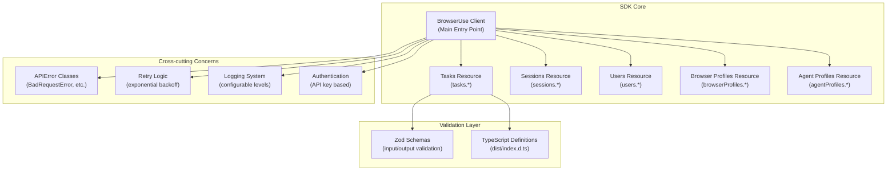
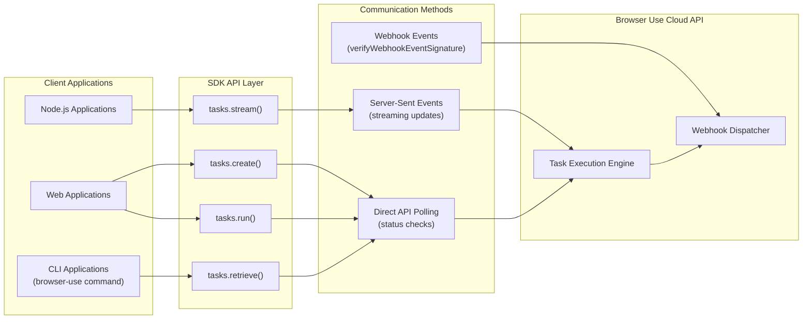

<!-- source: DeepWiki mcp.deepwiki.com · repo browser-use/browser-use-node · page 1 Overview · fetched 2026-10-30 -->

# Overview

Relevant source files

The following files were used as context for generating this wiki page:

- [CHANGELOG.md](CHANGELOG.md)
- [README.md](README.md)
- [package.json](package.json)
- [scripts/bootstrap](scripts/bootstrap)

This document provides a comprehensive overview of the browser-use-node SDK, covering its purpose, architecture, and core capabilities. The browser-use-node SDK is the official TypeScript/JavaScript library for interacting with the Browser Use Cloud API, enabling developers to automate web browsers programmatically through AI-powered agents.

For detailed implementation guides, see [Getting Started](#1.2). For specific API usage patterns, see [Tasks API](#2.2) and [Real-time Features](#3).

## Purpose and Capabilities

The browser-use-node SDK serves as a client library that abstracts the complexity of browser automation by providing a simple, type-safe interface to the Browser Use Cloud service. The SDK enables developers to:

- **Create and manage browser automation tasks** through natural language instructions
- **Stream real-time updates** from running browser automation sessions
- **Handle structured output** using Zod schema validation
- **Receive webhook notifications** for task status changes
- **Manage browser sessions and profiles** for consistent automation environments
- **Execute tasks through a CLI interface** for development and testing workflows

The SDK is designed to work across multiple JavaScript runtime environments and provides both CommonJS and ES Module exports for maximum compatibility.

## Core Architecture

The SDK follows a resource-oriented architecture centered around the `BrowserUse` client class, which provides access to specialized API resources for different aspects of browser automation.

### Client and Resource Structure

**Sources:** [package.json:1-86](), [README.md:14-25]()

### Task Management and Communication Patterns

The SDK provides multiple communication patterns for interacting with browser automation tasks, supporting both synchronous and asynchronous workflows.

**Sources:** [README.md:54-82](), [README.md:88-122](), [package.json:31-33]()

## Distribution and Runtime Support

The SDK is packaged with multiple distribution formats to support diverse JavaScript environments and build systems.

| Distribution Format | File Path | Usage |
|---------------------|-----------|-------|
| CommonJS | `dist/index.js` | Node.js, traditional bundlers |
| ES Modules | `dist/index.mjs` | Modern browsers, Deno, Bun |
| TypeScript Definitions | `dist/index.d.ts` | Type checking and IDE support |
| CLI Executable | `dist/lib/bin/cli.js` | Command-line automation |

**Runtime Environment Compatibility:**

- **Node.js** 20 LTS or later
- **Modern Browsers** (Chrome, Firefox, Safari, Edge)
- **Alternative Runtimes** (Deno v1.28.0+, Bun 1.0+)
- **Edge Computing** (Cloudflare Workers, Vercel Edge Runtime)
- **Testing Frameworks** (Jest 28+ with "node" environment)

The build system uses TypeScript compilation with dual-format output, ensuring compatibility across the JavaScript ecosystem while maintaining type safety.

**Sources:** [package.json:6-8](), [package.json:70-85](), [README.md:366-376]()

## Key Features

### Structured Output Validation

The SDK integrates with Zod schemas to provide type-safe, validated output from browser automation tasks. This ensures that the data returned from AI agents matches expected structures and types.

### Real-time Streaming

Tasks can be monitored in real-time through async generator patterns, allowing applications to respond immediately to browser automation progress and results.

### Webhook Integration

The SDK includes utilities for verifying webhook signatures and parsing webhook events, enabling secure real-time notifications for task status changes.

### CLI Tooling

A command-line interface provides development and testing capabilities, including webhook forwarding for local development environments.

### Error Handling and Resilience

Built-in retry logic with exponential backoff, comprehensive error types, and configurable timeout handling ensure robust operation in production environments.

**Sources:** [README.md:29-50](), [README.md:160-200](), [README.md:227-278]()

---

