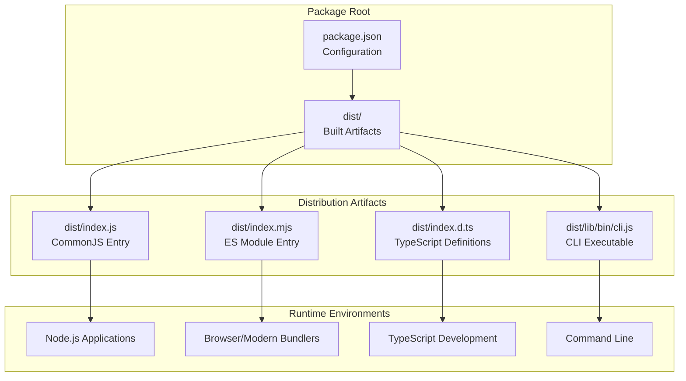
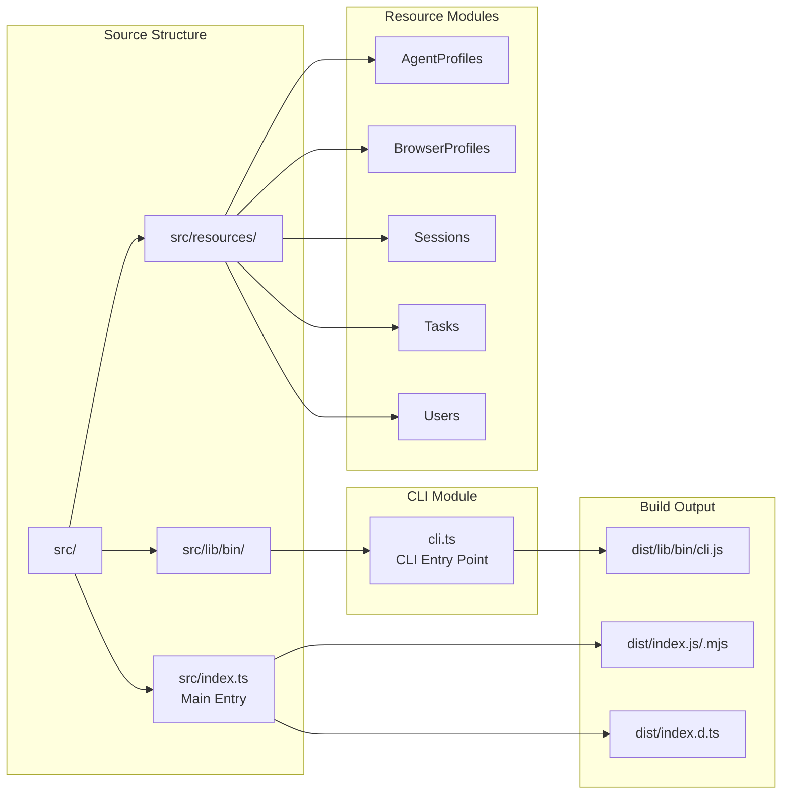
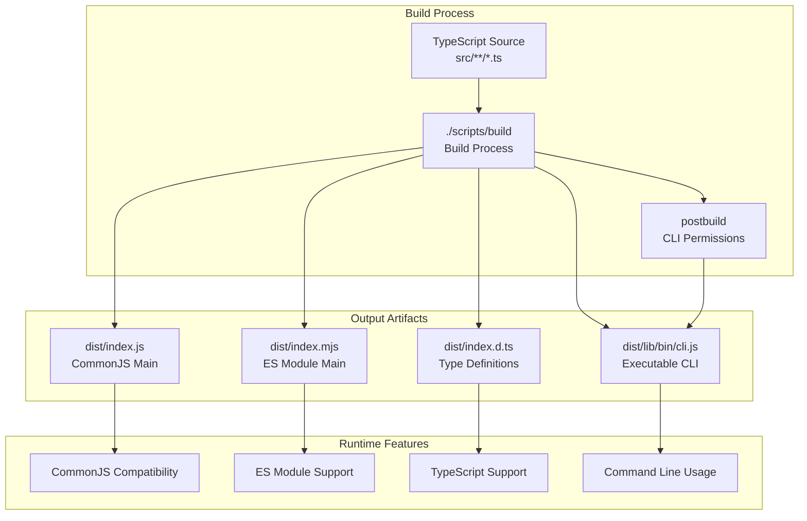

<!-- source: DeepWiki mcp.deepwiki.com · repo browser-use/browser-use-node · page 1.1 Package Structure · fetched 2026-10-30 -->

# Package Structure

Relevant source files

The following files were used as context for generating this wiki page:

- [package.json](package.json)
- [scripts/bootstrap](scripts/bootstrap)
- [src/resources/index.ts](src/resources/index.ts)

This document explains the organization and distribution structure of the browser-use-node SDK, including its multiple output formats, source code layout, and CLI tooling. This covers the physical packaging and distribution mechanisms of the SDK.

For information about the logical architecture and API resources, see [Core Concepts](#2). For details about the CLI functionality, see [CLI Tools](#4).

## Distribution Formats

The browser-use-node SDK is distributed as a multi-format package that supports both CommonJS and ES Module environments. The package provides multiple entry points to ensure compatibility across different JavaScript runtimes and bundlers.

### Entry Points

The SDK provides several entry points configured through the `exports` field:

| Format | Entry Point | Target Environment |
|--------|-------------|-------------------|
| CommonJS | `dist/index.js` | Node.js, older bundlers |
| ES Modules | `dist/index.mjs` | Modern browsers, modern bundlers |
| TypeScript Definitions | `dist/index.d.ts` | TypeScript development |
| CLI Binary | `dist/lib/bin/cli.js` | Command-line usage |

**Package Entry Point Configuration**

Sources: [package.json:6-8](), [package.json:70-85](), [package.json:31-33]()

### Package Metadata

The package is configured with the following key metadata:

- **Name**: `browser-use-sdk` - The published npm package name
- **Version**: Managed through automated release process (currently `1.2.0`)
- **Type**: `commonjs` - Default module system for Node.js compatibility
- **License**: Apache-2.0
- **Repository**: `github:browser-use/browser-use-node`

The `files` field is set to `["**/*"]`, meaning all built files in the `dist` directory are included in the published package.

Sources: [package.json:1-18]()

## Source Code Organization

The SDK source code is organized into logical modules that map directly to the built distribution artifacts.

**Source to Distribution Mapping**

### Core API Resources

The main API functionality is organized into resource modules under `src/resources/`:

| Resource | Exported Types | Purpose |
|----------|---------------|---------|
| `AgentProfiles` | `AgentProfileView`, `AgentProfileCreateParams` | AI agent configuration management |
| `BrowserProfiles` | `BrowserProfileView`, `ProxyCountryCode` | Browser session configuration |
| `Sessions` | `SessionView`, `SessionStatus` | Browser session lifecycle |
| `Tasks` | `TaskView`, `TaskStatus`, `TaskStepView` | Browser automation tasks |
| `Users` | `Users` | User account management |

These resources are re-exported through the main index file to provide a clean public API surface.

Sources: [src/resources/index.ts:1-47]()

### CLI Structure

The CLI functionality is organized separately under `src/lib/bin/` and built to `dist/lib/bin/cli.js`. The built CLI file is made executable through a post-build script and configured as a binary in the package.json.

Sources: [package.json:22](), [package.json:31-33]()

## Build System

The package uses a custom build system that produces multiple output formats from TypeScript source code.

### Build Scripts

| Script | Purpose |
|--------|---------|
| `build` | Compiles TypeScript to JavaScript for both CommonJS and ESM |
| `postbuild` | Makes CLI executable and performs post-processing |
| `prepare` | Git-aware build for development installations |

### Build Artifacts

**Build Process and Artifacts**

The build process ensures that:
- CommonJS and ES Module formats are both generated from the same source
- TypeScript definitions are preserved for development-time type checking
- CLI binary is properly marked as executable
- All artifacts maintain consistent APIs across formats

Sources: [package.json:19-29]()

## Development Environment

### Dependencies

The package maintains a clean separation between runtime and development dependencies:

- **Runtime Dependencies**: Minimal dependencies including `@dotenvx/dotenvx` and `fast-json-stable-stringify`
- **Peer Dependencies**: `react` (for React integration) and `zod` (for schema validation)
- **Development Dependencies**: Comprehensive tooling for TypeScript, testing, linting, and building

### Bootstrap Process

The development environment setup is handled by the bootstrap script, which:
1. Installs Homebrew dependencies on macOS (if `Brewfile` exists)
2. Detects and uses the appropriate package manager (`yarn` or `npm`)
3. Installs all Node.js dependencies

Sources: [scripts/bootstrap:1-19](), [package.json:34-69]()

---

