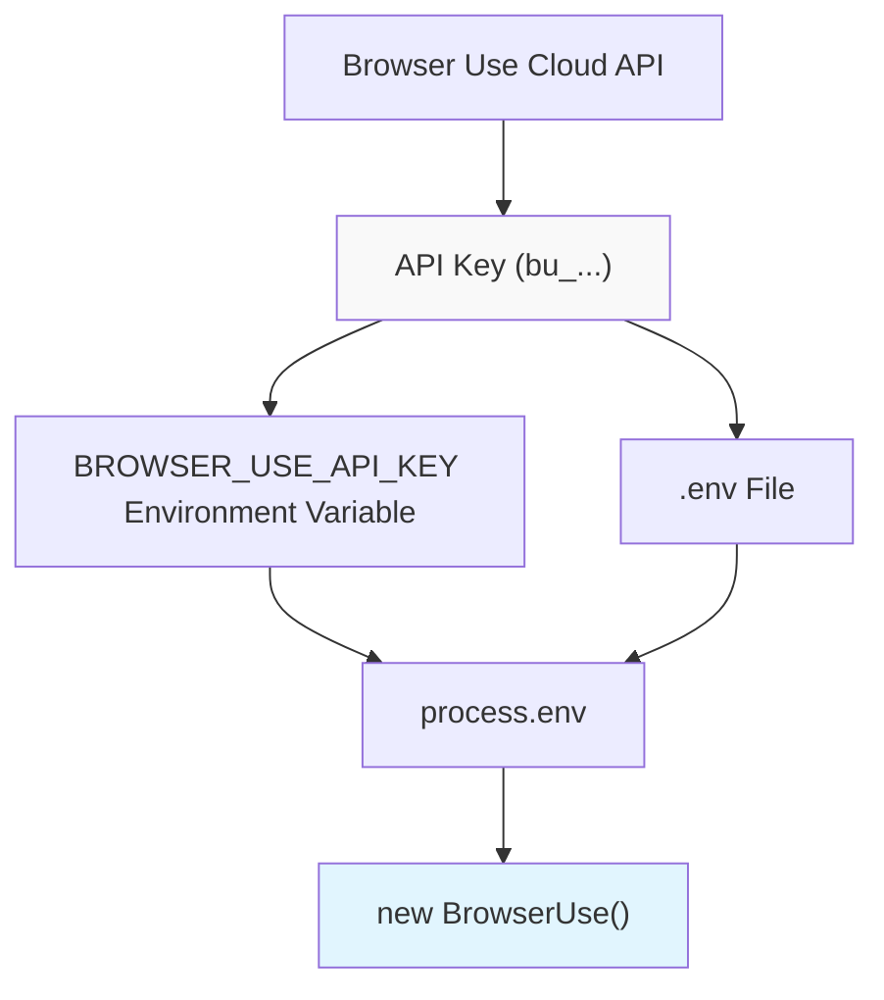
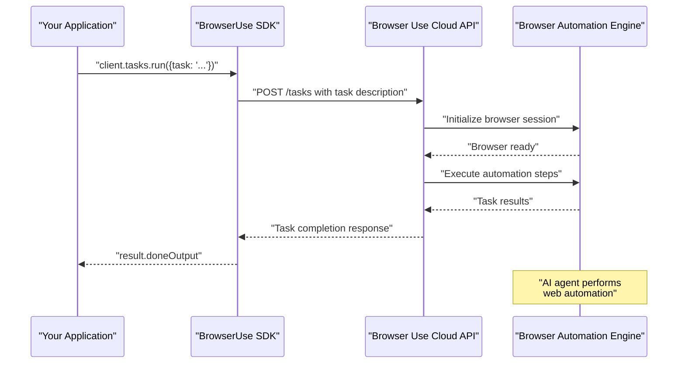

<!-- source: DeepWiki mcp.deepwiki.com · repo browser-use/browser-use-node · page 1.2 Getting Started · fetched 2026-10-30 -->

# Getting Started

<details>
<summary>Relevant source files</summary>

The following files were used as context for generating this wiki page:

- [README.md](README.md)
- [examples/.env.example](examples/.env.example)
- [examples/run.ts](examples/run.ts)
- [examples/utils.ts](examples/utils.ts)
- [src/lib/bin/auth.ts](src/lib/bin/auth.ts)

</details>


This page covers the essential steps to install the browser-use-node SDK, configure authentication, and run your first browser automation task. For detailed information about specific API resources, see [API Resources](#2.3). For advanced configuration options, see [Configuration Reference](#7.2).

## Installation

Install the SDK using your preferred package manager:

```bash
npm install browser-use-sdk
```

```bash
pnpm add browser-use-sdk
```

```bash
yarn add browser-use-sdk
```

The SDK supports multiple JavaScript runtimes and distribution formats. It provides both CommonJS and ES Module exports, ensuring compatibility across Node.js, browsers, Deno, Bun, and edge runtime environments.

**Sources:** [README.md:4](), [README.md:365-375]()

## Authentication Setup

### API Key Configuration

Before using the SDK, you need to obtain an API key from Browser Use Cloud and configure it in your environment.



**Authentication Flow Diagram**

The SDK automatically loads the API key from the `BROWSER_USE_API_KEY` environment variable. You can configure this in several ways:

### Environment Variable Method

Set the environment variable directly:

```bash
export BROWSER_USE_API_KEY="bu_your_api_key_here"
```

### .env File Method

Create a `.env` file in your project root:

```env
BROWSER_USE_API_KEY="bu_your_api_key_here"
```

The SDK's authentication module at [src/lib/bin/auth.ts:10-33]() automatically loads environment variables from `.env` files using the `@dotenvx/dotenvx` package.

### Manual Configuration

You can also pass the API key directly when creating the client:

```typescript
import BrowserUse from 'browser-use-sdk';

const client = new BrowserUse({
  apiKey: 'bu_your_api_key_here',
});
```

**Sources:** [README.md:9-18](), [examples/.env.example:14](), [src/lib/bin/auth.ts:5-33]()

## Basic Client Initialization

### Automatic Configuration

The simplest way to initialize the client is to let it automatically load the API key from environment variables:

```typescript
import BrowserUse from 'browser-use-sdk';

// Automatically loads BROWSER_USE_API_KEY from environment
const client = new BrowserUse();
```

### Manual Configuration

For more control over client configuration, you can specify options explicitly:

```typescript
import BrowserUse from 'browser-use-sdk';

const client = new BrowserUse({
  apiKey: 'bu_your_api_key_here',
  timeout: 60000, // 60 seconds
  maxRetries: 2,
  logLevel: 'info'
});
```

**Sources:** [README.md:16-18](), [examples/run.ts:11](), [README.md:171-179]()

## Running Your First Task

### Simple Task Execution

The most basic way to run a browser automation task is using the `tasks.run()` method:

```typescript
import BrowserUse from 'browser-use-sdk';

const client = new BrowserUse({
  apiKey: 'bu_your_api_key_here',
});

const result = await client.tasks.run({
  task: 'Search for the top 10 Hacker News posts and return the title and url.',
});

console.log(result.doneOutput);
```



**Task Execution Flow**

### Task Configuration Options

You can customize task execution with additional parameters:

```typescript
const result = await client.tasks.run({
  task: "What's the weather like in SF and what's the temperature?",
  agentSettings: { 
    llm: 'gemini-2.5-flash' 
  },
  // Additional configuration options available
});
```

**Sources:** [README.md:20-25](), [examples/run.ts:17-20]()

## Working with Structured Output

### Defining Output Schema

Use Zod schemas to define structured output formats for your tasks:

```typescript
import { z } from 'zod';

const TaskOutput = z.object({
  posts: z.array(
    z.object({
      title: z.string(),
      url: z.string(),
    }),
  ),
});

const result = await client.tasks.run({
  task: 'Search for the top 10 Hacker News posts and return the title and url.',
  schema: TaskOutput,
});

// Access parsed, type-safe output
for (const post of result.parsedOutput.posts) {
  console.log(`${post.title} - ${post.url}`);
}
```

The SDK automatically validates and parses the AI agent's output against your schema, providing type-safe access to structured data.

**Sources:** [README.md:32-50](), [examples/run.ts:27-56]()

## Complete Example

Here's a complete example that demonstrates the full setup process:

```typescript
#!/usr/bin/env -S npm run tsn -T

import { BrowserUse } from 'browser-use-sdk';
import { z } from 'zod';
import dotenv from '@dotenvx/dotenvx';

// Load environment variables
dotenv.config({ path: '.env' });

// Initialize client
const browseruse = new BrowserUse();

// Define output schema
const TaskOutput = z.object({
  posts: z.array(z.object({
    title: z.string(),
    url: z.string(),
  })),
});

async function runExample() {
  console.log('Running browser automation task...');

  const result = await browseruse.tasks.run({
    task: 'Search for the top 10 Hacker News posts and return the title and url!',
    schema: TaskOutput,
    agentSettings: { llm: 'gpt-4.1' },
  });

  const posts = result.parsedOutput?.posts;
  
  if (posts) {
    console.log('Top Hacker News posts:');
    for (const post of posts) {
      console.log(` - ${post.title} - ${post.url}`);
    }
  }
}

runExample().catch(console.error);
```

**Sources:** [examples/run.ts:1-63](), [examples/utils.ts:32-34]()

## Next Steps

Once you have basic task execution working, you can explore:

- **Real-time Task Monitoring**: See [Task Streaming](#3.1) for monitoring task progress in real-time
- **Webhook Integration**: See [Webhook System](#3.2) for receiving notifications about task completion
- **Advanced Task Configuration**: See [Tasks API](#2.2) for detailed task configuration options
- **Error Handling**: See [Error Handling](#2.4) for robust error management patterns

**Sources:** [README.md:52-82](), [README.md:84-122]()

---

