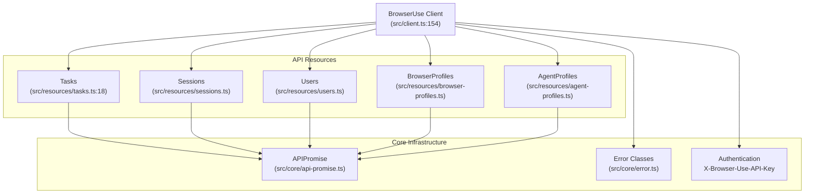
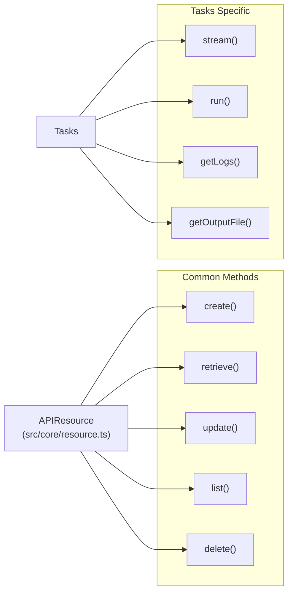
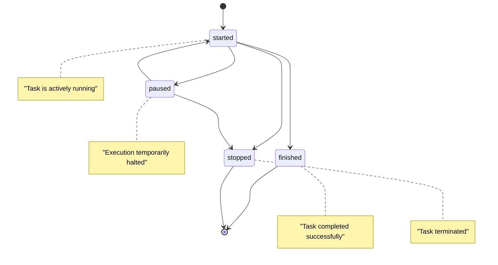
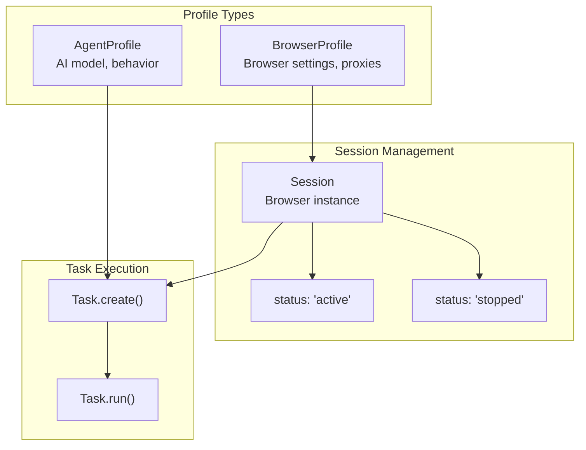
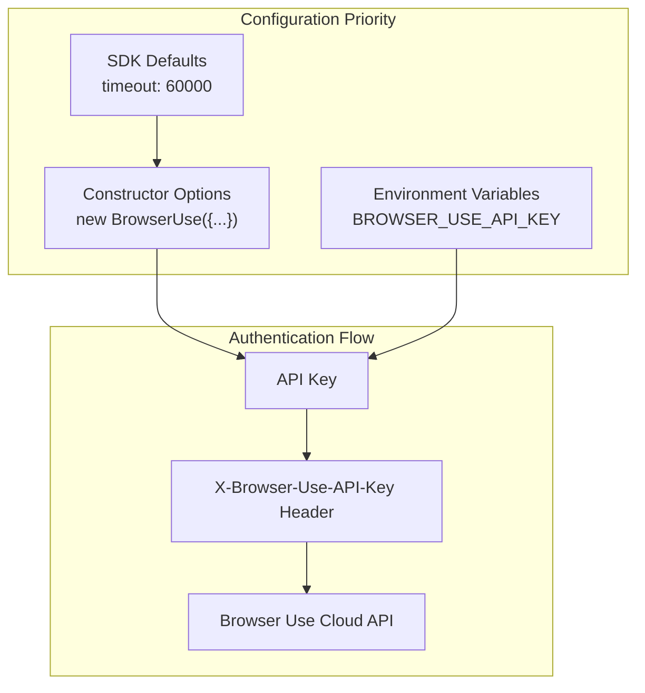
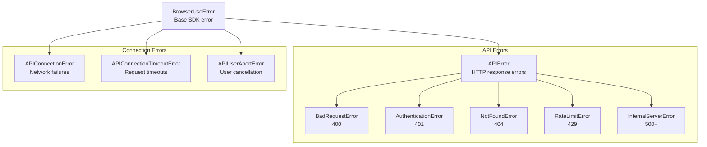

<!-- source: DeepWiki mcp.deepwiki.com · repo browser-use/browser-use-node · page 2 Core Concepts · fetched 2026-10-30 -->

# Core Concepts

Relevant source files

The following files were used as context for generating this wiki page:

- [src/client.ts](src/client.ts)
- [src/resources/tasks.ts](src/resources/tasks.ts)

This document covers the fundamental architecture and design patterns of the browser-use-node SDK. It explains how the main components work together to provide browser automation capabilities through AI agents.

For detailed usage examples, see [Basic Usage Examples](#6.1). For specific API method documentation, see [API Documentation](#7.1).

## Architecture Overview

The browser-use-node SDK follows a resource-oriented client architecture where a central `BrowserUse` client provides access to specialized API resources. Each resource handles a specific domain of functionality.

**Client-Resource Architecture**

Sources: [src/client.ts:154-765](), [src/resources/tasks.ts:18]()

## Core Components

### BrowserUse Client

The `BrowserUse` class serves as the main entry point and handles client configuration, authentication, and request infrastructure.

**Key Configuration Options**

| Option | Purpose | Default |
|--------|---------|---------|
| `apiKey` | Authentication credential | `process.env.BROWSER_USE_API_KEY` |
| `baseURL` | API endpoint | `https://api.browser-use.com/api/v2` |
| `timeout` | Request timeout (ms) | `60000` |
| `maxRetries` | Retry attempts | `2` |
| `logLevel` | Logging verbosity | `warn` |

Sources: [src/client.ts:76-149](), [src/client.ts:181-216]()

### Resource Hierarchy

Each API resource extends `APIResource` and provides domain-specific functionality through a consistent interface pattern.

**Resource Method Patterns**

Sources: [src/resources/tasks.ts:18-393]()

## Tasks: The Central Concept

Tasks represent individual browser automation jobs executed by AI agents. They are the primary unit of work in the system.

**Task Lifecycle States**

**Task Data Model**

| Field | Type | Description |
|-------|------|-------------|
| `id` | `string` | Unique task identifier |
| `sessionId` | `string` | Associated browser session |
| `status` | `TaskStatus` | Current execution state |
| `task` | `string` | Task instruction/prompt |
| `steps` | `TaskStepView[]` | Execution steps taken |
| `doneOutput` | `string` | Final task result |

Sources: [src/resources/tasks.ts:511-559](), [src/resources/tasks.ts:466]()

## Sessions and Profiles

Sessions represent browser instances, while profiles define configuration for both browsers and AI agents.

**Profile System Architecture**

Sources: [src/resources/browser-profiles.ts](), [src/resources/agent-profiles.ts](), [src/resources/sessions.ts]()

## Authentication and Configuration

The SDK uses API key authentication with configurable client options for different deployment environments.

**Configuration Sources**

Sources: [src/client.ts:182-196](), [src/client.ts:252-254]()

## Error Handling Architecture

The SDK implements a hierarchical error system with automatic retry logic for transient failures.

**Error Class Hierarchy**

**Retry Logic**

The client automatically retries requests for specific conditions:
- HTTP 408 (Request Timeout)
- HTTP 409 (Conflict/Lock Timeout) 
- HTTP 429 (Rate Limited)
- HTTP 5XX (Server Errors)
- Network connection failures

Retry behavior uses exponential backoff with jitter, respecting `Retry-After` headers when provided.

Sources: [src/client.ts:744-756](), [src/client.ts:563-638](), [src/core/error.ts]()

---

