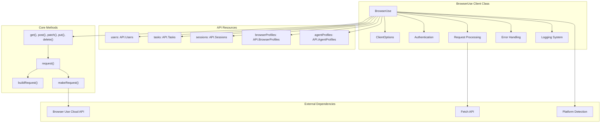
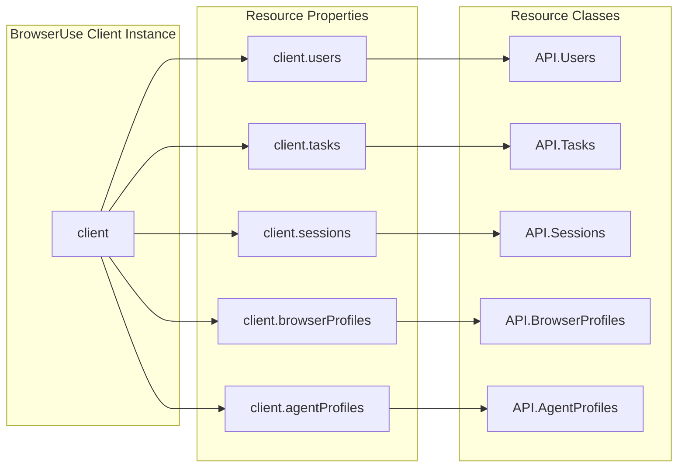
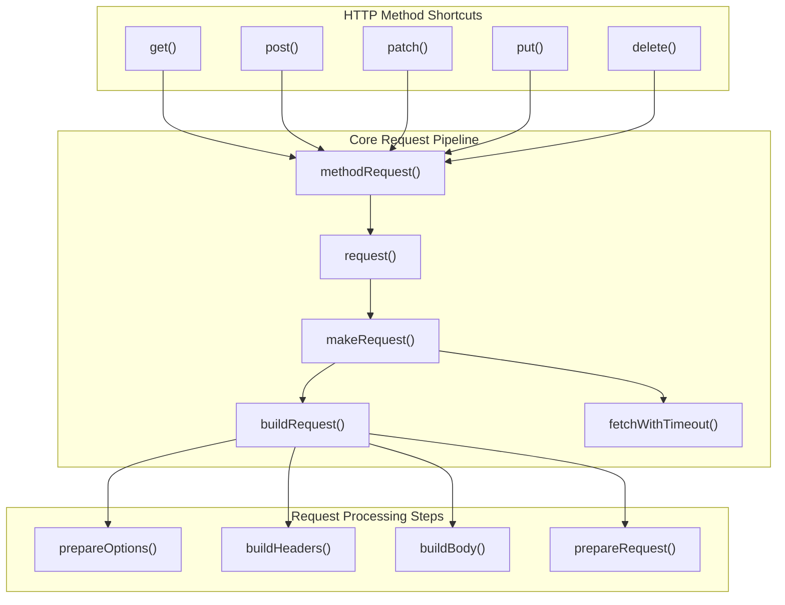
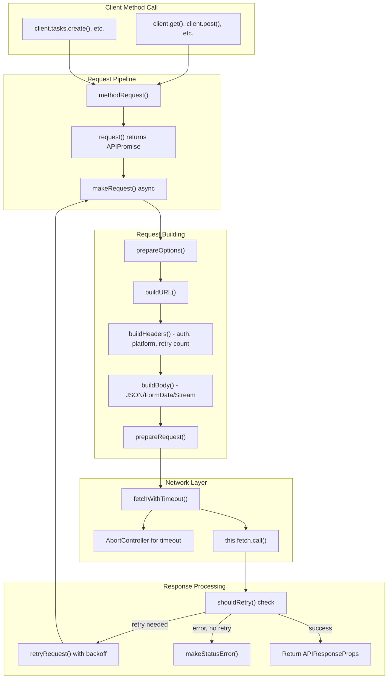

<!-- source: DeepWiki mcp.deepwiki.com · repo browser-use/browser-use-node · page 2.1 BrowserUse Client · fetched 2026-10-30 -->

# BrowserUse Client

<details>
<summary>Relevant source files</summary>

The following files were used as context for generating this wiki page:

- [src/client.ts](src/client.ts)
- [src/internal/detect-platform.ts](src/internal/detect-platform.ts)
- [tests/index.test.ts](tests/index.test.ts)
- [tests/uploads.test.ts](tests/uploads.test.ts)

</details>


The BrowserUse client is the main entry point for interacting with the Browser Use Cloud API. It provides a unified interface for browser automation tasks, session management, profile configuration, and other API resources. The client handles authentication, request/response processing, error handling, retries, and logging automatically.

For information about specific API operations like creating and managing browser automation tasks, see [Tasks API](#2.2). For details about other API resources like sessions and profiles, see [API Resources](#2.3).

## Client Architecture

The `BrowserUse` class serves as the central coordinator for all API interactions, with each resource type exposed as a dedicated property.



**Sources:** [src/client.ts:154-765]()

## Configuration and Instantiation

The client is configured through the `ClientOptions` interface, which provides comprehensive control over API behavior, networking, and logging.

### ClientOptions Interface

| Option | Type | Default | Description |
|--------|------|---------|-------------|
| `apiKey` | `string` | `process.env['BROWSER_USE_API_KEY']` | API authentication key |
| `baseURL` | `string` | `process.env['BROWSER_USE_BASE_URL']` or `https://api.browser-use.com/api/v2` | API base URL |
| `timeout` | `number` | `60000` (1 minute) | Request timeout in milliseconds |
| `maxRetries` | `number` | `2` | Maximum retry attempts for failed requests |
| `fetchOptions` | `MergedRequestInit` | `undefined` | Additional fetch configuration |
| `fetch` | `Fetch` | Global fetch | Custom fetch implementation |
| `defaultHeaders` | `HeadersLike` | `undefined` | Headers included with every request |
| `defaultQuery` | `Record<string, string>` | `undefined` | Query parameters included with every request |
| `logLevel` | `LogLevel` | `'warn'` | Logging verbosity level |
| `logger` | `Logger` | `console` | Custom logger implementation |

### Basic Instantiation

```typescript
// Using environment variables
const client = new BrowserUse();

// Explicit configuration
const client = new BrowserUse({
  apiKey: 'your-api-key',
  baseURL: 'https://api.browser-use.com/api/v2',
  timeout: 30000,
  maxRetries: 3,
  logLevel: 'info'
});
```

The constructor validates that an API key is provided either via the `apiKey` option or the `BROWSER_USE_API_KEY` environment variable, throwing a `BrowserUseError` if neither is available.

**Sources:** [src/client.ts:76-149](), [src/client.ts:181-216]()

## API Resource Properties

The client exposes five main API resource collections as properties, each providing methods for interacting with specific parts of the Browser Use API.



### Resource Overview

- **`users`**: User account management and information
- **`tasks`**: Browser automation task creation, monitoring, and control
- **`sessions`**: Browser session lifecycle management
- **`browserProfiles`**: Browser configuration and proxy settings
- **`agentProfiles`**: AI agent behavior and capability configuration

Each resource is instantiated with a reference to the parent client, allowing them to inherit authentication, retry logic, and other client-level configuration.

**Sources:** [src/client.ts:760-764](), [src/client.ts:767-771]()

## Core Functionality

### Authentication

The client uses API key authentication via the `X-Browser-Use-API-Key` header. Authentication headers are automatically added to all requests through the `authHeaders()` method.

```typescript
protected async authHeaders(opts: FinalRequestOptions): Promise<NullableHeaders | undefined> {
  return buildHeaders([{ 'X-Browser-Use-API-Key': this.apiKey }]);
}
```

**Sources:** [src/client.ts:252-254]()

### Request Processing

The client provides both high-level HTTP method shortcuts and a flexible low-level `request()` method:



**Sources:** [src/client.ts:332-362](), [src/client.ts:371-526](), [src/client.ts:640-665]()

### Retry Logic

The client implements exponential backoff retry logic with jitter for handling temporary failures:

- **Automatic Retry Conditions**: Timeouts (408), conflicts (409), rate limits (429), and 5xx server errors
- **Retry Headers**: Respects `Retry-After` and `retry-after-ms` headers from the server
- **Exponential Backoff**: Initial delay of 0.5 seconds, doubling up to 8 seconds maximum
- **Jitter**: Random variance up to 25% to prevent thundering herd

```typescript
private calculateDefaultRetryTimeoutMillis(retriesRemaining: number, maxRetries: number): number {
  const initialRetryDelay = 0.5;
  const maxRetryDelay = 8.0;
  const numRetries = maxRetries - retriesRemaining;
  const sleepSeconds = Math.min(initialRetryDelay * Math.pow(2, numRetries), maxRetryDelay);
  const jitter = 1 - Math.random() * 0.25;
  return sleepSeconds * jitter * 1000;
}
```

**Sources:** [src/client.ts:563-584](), [src/client.ts:586-623](), [src/client.ts:625-638]()

### Logging and Platform Detection

The client includes configurable logging with request correlation IDs and platform detection for proper User-Agent headers:

- **Log Levels**: `off`, `error`, `warn`, `info`, `debug`
- **Platform Detection**: Automatically detects Node.js, Deno, edge runtime, or browser environment
- **Request Correlation**: Each request gets a unique log ID for tracing

**Sources:** [src/client.ts:8](), [src/client.ts:68-73](), [src/client.ts:391-404](), [src/internal/detect-platform.ts:5-196]()

### Error Handling

The client provides a hierarchy of error classes for different failure scenarios:

- **`BrowserUseError`**: Base error class
- **`APIError`**: General API errors with status codes
- **`APIConnectionError`**: Network connectivity issues
- **`APIConnectionTimeoutError`**: Request timeouts
- **`APIUserAbortError`**: User-initiated request cancellation
- **Status-specific errors**: `NotFoundError`, `RateLimitError`, `AuthenticationError`, etc.

**Sources:** [src/client.ts:744-756](), [src/client.ts:284-291]()

## Request Lifecycle

The following diagram shows the complete flow of a request from method call to response processing:



**Sources:** [src/client.ts:352-362](), [src/client.ts:364-369](), [src/client.ts:371-526](), [src/client.ts:528-561]()

## Client Creation Patterns

### Environment-based Configuration

```typescript
// Reads from BROWSER_USE_API_KEY and BROWSER_USE_BASE_URL
const client = new BrowserUse();
```

### Explicit Configuration

```typescript
const client = new BrowserUse({
  apiKey: 'bru-key-xxx',
  baseURL: 'https://api.browser-use.com/api/v2',
  timeout: 30000,
  maxRetries: 3,
  logLevel: 'debug',
  defaultHeaders: { 'X-Custom-Header': 'value' }
});
```

### Client Inheritance with `withOptions()`

The `withOptions()` method creates a new client instance with modified configuration while preserving the original:

```typescript
const baseClient = new BrowserUse({ apiKey: 'key', timeout: 30000 });
const debugClient = baseClient.withOptions({ logLevel: 'debug' });
const fastClient = baseClient.withOptions({ timeout: 5000, maxRetries: 1 });
```

**Sources:** [src/client.ts:221-235](), [tests/index.test.ts:350-424]()

---

