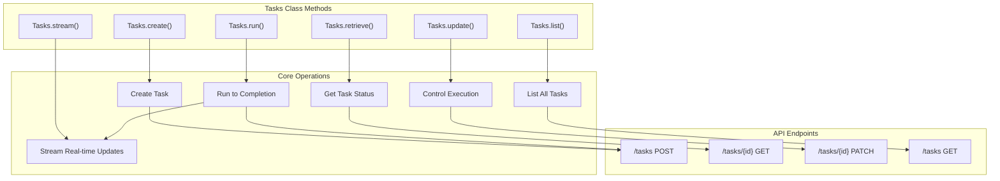
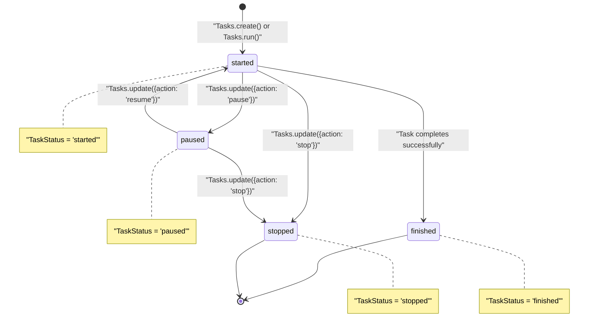
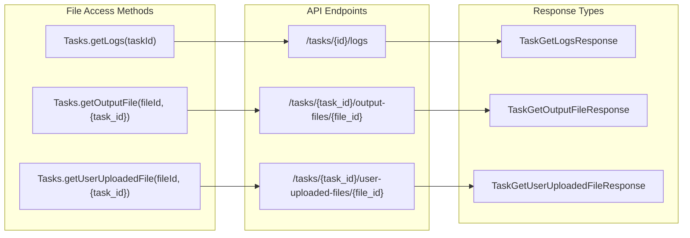

<!-- source: DeepWiki mcp.deepwiki.com · repo browser-use/browser-use-node · page 2.2 Tasks API · fetched 2026-10-30 -->

# Tasks API

<details>
<summary>Relevant source files</summary>

The following files were used as context for generating this wiki page:

- [src/resources/tasks.ts](src/resources/tasks.ts)
- [tests/api-resources/tasks.test.ts](tests/api-resources/tasks.test.ts)

</details>


The Tasks API is the core functionality of the browser-use-node SDK, providing comprehensive browser automation capabilities through AI agents. This API allows you to create, monitor, and control browser automation tasks that can navigate websites, extract data, fill forms, and perform complex web interactions.

For information about real-time task monitoring and streaming capabilities, see [Task Streaming](#3.1). For webhook-based task notifications, see [Webhook System](#3.2). For basic client setup and authentication, see [BrowserUse Client](#2.1).

## Core Task Operations

The `Tasks` class provides the primary interface for browser automation through several key methods. All task operations are accessed through the client's `tasks` resource.

### Task Creation and Execution

The fundamental operation is creating and running browser automation tasks. The API supports two primary patterns:

**Immediate Execution with `run()`**
The `run()` method creates a task and waits for completion, returning the final result. This is ideal for simple automation scripts where you want to block until the task finishes.

**Asynchronous Creation with `create()`**
The `create()` method starts a task and immediately returns a task ID, allowing you to monitor progress separately using streaming or polling. This pattern supports more complex workflows with real-time monitoring.



Sources: [src/resources/tasks.ts:64-85](), [src/resources/tasks.ts:199-233](), [src/resources/tasks.ts:113-128]()

### Session Management

Tasks operate within browser sessions, which maintain browser state across multiple tasks. You can either start a new session or continue an existing one:

- **New Session**: Specify `browserSettings.profileId` to start with a fresh browser instance
- **Existing Session**: Specify `browserSettings.sessionId` to continue in an active browser session

This session model enables complex multi-step workflows where subsequent tasks can build on previous work within the same browser context.

Sources: [src/resources/tasks.ts:24-39](), [src/resources/tasks.ts:667-722]()

## Task Lifecycle and Status Management

Tasks progress through defined states during execution. The API provides precise control over task lifecycle and real-time status monitoring.



Sources: [src/resources/tasks.ts:466](), [src/resources/tasks.ts:235-267](), [src/resources/tasks.ts:724-733]()

### Task Control Operations

The `update()` method provides granular control over task execution with these actions:

| Action | Description | Effect |
|--------|-------------|--------|
| `stop` | Halt current task | Task enters `stopped` state |
| `pause` | Temporarily suspend | Task enters `paused` state |
| `resume` | Continue paused task | Task returns to `started` state |
| `stop_task_and_session` | Halt task and end session | Both task and browser session terminate |

Sources: [src/resources/tasks.ts:724-733](), [src/resources/tasks.ts:265-267]()

## Real-time Task Monitoring

The Tasks API provides multiple approaches for monitoring task progress in real-time through streaming and polling mechanisms.

### Streaming Interface

The `stream()` method returns an async generator that yields task status updates as they occur. This provides the most responsive monitoring with minimal network overhead.

```mermaid
sequenceDiagram
    participant Client
    participant TasksStream as "Tasks.stream()"
    participant TasksWatch as "Tasks.watch()"
    participant TasksRetrieve as "Tasks.retrieve()"
    participant API as "Cloud API"
    
    Client->>TasksStream: "stream(taskId)"
    TasksStream->>TasksWatch: "watch(taskId, {interval: 500})"
    
    loop "Every 500ms"
        TasksWatch->>TasksRetrieve: "retrieve(taskId)"
        TasksRetrieve->>API: "GET /tasks/{id}"
        API-->>TasksRetrieve: "TaskView response"
        TasksRetrieve-->>TasksWatch: "TaskView"
        
        alt "Status changed"
            TasksWatch-->>TasksStream: "yield {event: 'status', data: TaskView}"
            TasksStream-->>Client: "Status update"
        else "No change"
            Note over TasksWatch: "Skip yield, continue polling"
        end
        
        alt "Task finished/stopped/paused"
            break "Exit polling loop"
        end
    end
```

Sources: [src/resources/tasks.ts:166-192](), [src/resources/tasks.ts:130-164]()

### Structured Output Support

Both `retrieve()` and `stream()` methods support structured output parsing using Zod schemas. When a schema is provided, the API automatically validates and parses the task's output according to the defined structure.

Sources: [src/resources/tasks.ts:113-128](), [src/resources/tasks.ts:166-192](), [src/lib/parse.ts:10-14]()

## File Operations

The Tasks API handles multiple types of files throughout the task lifecycle, providing secure access through presigned download URLs.

### File Types and Access Methods

| File Type | Method | Purpose |
|-----------|--------|---------|
| Task Logs | `getLogs()` | Detailed execution logs and debugging information |
| Output Files | `getOutputFile()` | Files generated by the agent during task execution |
| User Uploads | `getUserUploadedFile()` | Files uploaded by user for agent to process |



Sources: [src/resources/tasks.ts:321-323](), [src/resources/tasks.ts:352-359](), [src/resources/tasks.ts:385-392]()

### File Information in Task Views

Task data includes comprehensive file information through the `TaskView` interface:

- `outputFiles`: Array of `FileView` objects for agent-generated files
- `userUploadedFiles`: Array of `FileView` objects for user-provided files

Each `FileView` contains the file ID and name needed for downloading through the respective file access methods.

Sources: [src/resources/tasks.ts:518](), [src/resources/tasks.ts:548](), [src/resources/tasks.ts:401-405]()

## Configuration and Settings

Task creation supports extensive configuration through agent settings, browser settings, and additional parameters.

### Agent Configuration

Agent settings control the AI model and behavior:

```typescript
agentSettings: {
  llm: 'gpt-4.1' | 'gpt-4.1-mini' | 'claude-3-7-sonnet-20250219' | /* other models */,
  profileId: string,  // Reference to saved agent profile
  startUrl: string    // Initial URL for the browser session
}
```

### Browser Configuration

Browser settings determine session handling:

```typescript
browserSettings: {
  sessionId: string,  // Continue existing session
  profileId: string   // Start new session with browser profile
}
```

Note: `sessionId` and `profileId` are mutually exclusive - use `sessionId` to continue existing sessions or `profileId` to start new ones.

Sources: [src/resources/tasks.ts:684-722]()

### Additional Parameters

| Parameter | Type | Purpose |
|-----------|------|---------|
| `includedFileNames` | `string[]` | Names of uploaded files to include in task |
| `metadata` | `Record<string, string>` | Custom metadata for organization and tracking |
| `secrets` | `Record<string, string>` | Secure key-value pairs for sensitive data |
| `structuredOutputJson` | `string` | Serialized Zod schema for output validation |

Sources: [src/resources/tasks.ts:674-681]()

## Data Models

The Tasks API uses several key data structures to represent task information and execution details.

### Core Task Data

**TaskView**: Complete task information including execution details
- `id`, `sessionId`: Identifiers
- `status`: Current execution state (`TaskStatus`)
- `task`: Original task description
- `startedAt`, `finishedAt`: Timestamps
- `steps`: Array of `TaskStepView` for execution history
- `doneOutput`: Final task result
- `isSuccess`: Agent-reported success status

**TaskStepView**: Individual execution step details
- `number`: Sequential step number
- `memory`: Agent's memory state
- `nextGoal`: Current objective
- `url`: Browser URL at this step
- `actions`: Array of agent actions performed
- `screenshotUrl`: Optional screenshot of browser state

Sources: [src/resources/tasks.ts:511-559](), [src/resources/tasks.ts:478-492]()

### Pagination and Listing

**TaskListResponse**: Paginated task collection
- `items`: Array of `TaskItemView` (summary information)
- `pageNumber`, `pageSize`: Pagination controls
- `totalItems`: Total count across all pages

**TaskListParams**: Query parameters for filtering and pagination
- `filterBy`: Filter by `TaskStatus`
- `sessionId`: Filter by session
- `before`, `after`: Date range filtering
- `pageNumber`, `pageSize`: Pagination controls

Sources: [src/resources/tasks.ts:606-614](), [src/resources/tasks.ts:735-755]()

---

