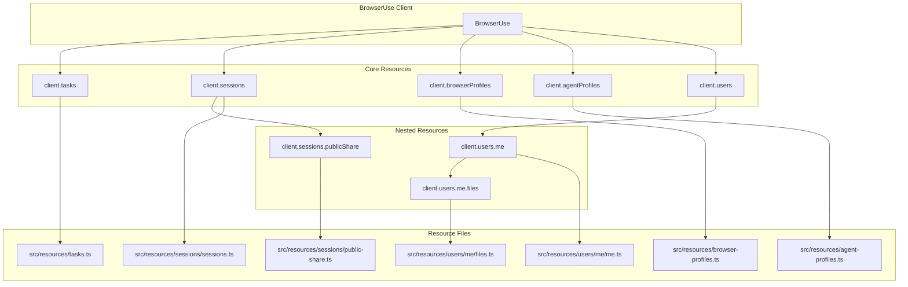
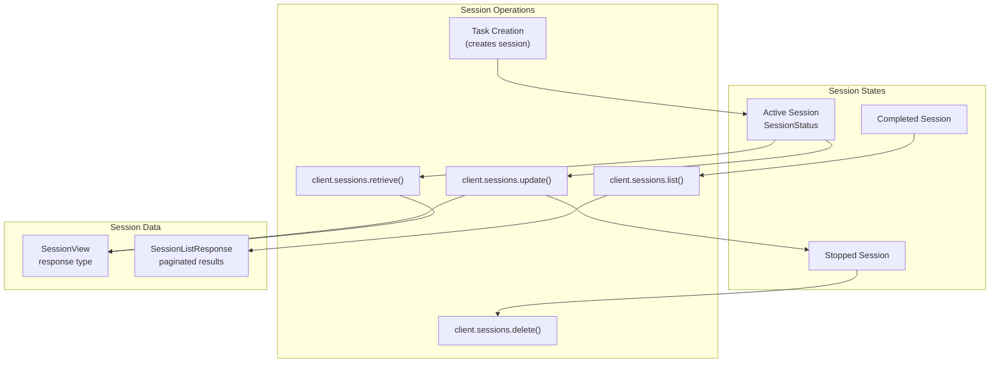
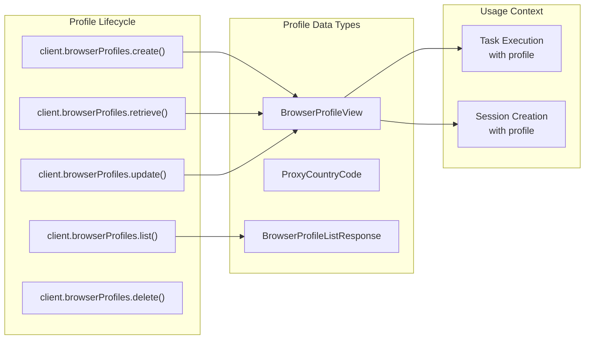
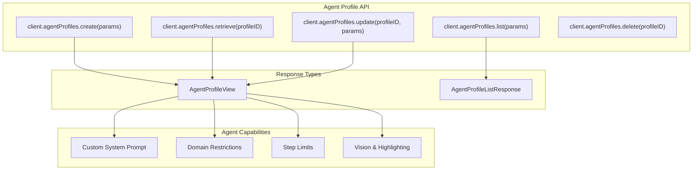
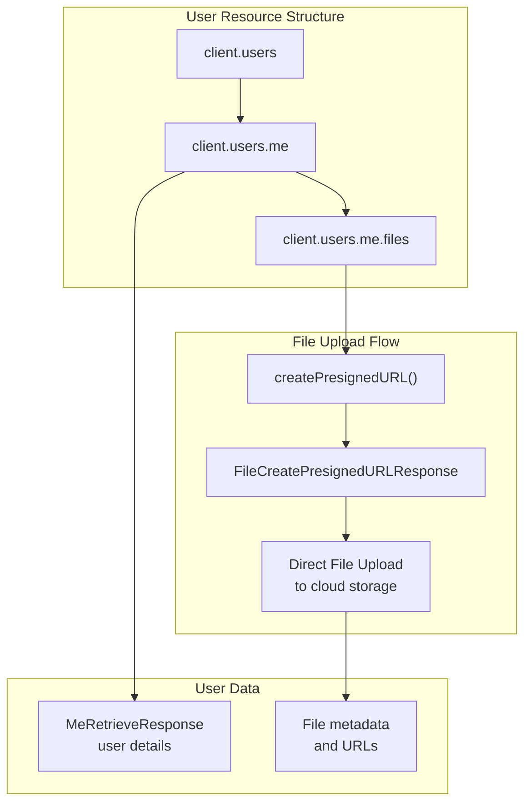

<!-- source: DeepWiki mcp.deepwiki.com · repo browser-use/browser-use-node · page 2.3 API Resources · fetched 2026-10-30 -->

# API Resources

Relevant source files

The following files were used as context for generating this wiki page:

- [api.md](api.md)
- [tests/api-resources/agent-profiles.test.ts](tests/api-resources/agent-profiles.test.ts)
- [tests/api-resources/browser-profiles.test.ts](tests/api-resources/browser-profiles.test.ts)
- [tests/api-resources/sessions/public-share.test.ts](tests/api-resources/sessions/public-share.test.ts)
- [tests/api-resources/sessions/sessions.test.ts](tests/api-resources/sessions/sessions.test.ts)

This document covers the supporting API resources in the browser-use-node SDK, specifically Sessions, Browser Profiles, Agent Profiles, and Users resources. These resources provide the configuration and management infrastructure that supports browser automation tasks.

For comprehensive information about the primary Tasks API resource, see [Tasks API](#2.2). For error handling patterns that apply across all resources, see [Error Handling](#2.4).

## Resource Architecture

The browser-use-node SDK organizes its API functionality into distinct resource classes, each handling a specific domain of operations. All resources follow consistent CRUD patterns and share common error handling and authentication mechanisms.

Sources: [api.md:1-105](), [tests/api-resources/sessions/sessions.test.ts:1-77](), [tests/api-resources/agent-profiles.test.ts:1-94](), [tests/api-resources/browser-profiles.test.ts:1-95](), [tests/api-resources/sessions/public-share.test.ts:1-47]()

## Sessions Resource

The Sessions resource manages browser session lifecycle and provides access to session metadata. Sessions represent active or completed browser automation instances that can be monitored, controlled, and shared.

### Core Operations

| Method | HTTP Route | Purpose |
|--------|------------|---------|
| `retrieve(sessionID)` | `GET /sessions/{session_id}` | Get session details and status |
| `update(sessionID, params)` | `PATCH /sessions/{session_id}` | Control session (stop/start actions) |
| `list(params)` | `GET /sessions` | List sessions with filtering |
| `delete(sessionID)` | `DELETE /sessions/{session_id}` | Permanently delete session |

### Session Management Workflow

The `update` method accepts an `action` parameter to control session state. Common actions include stopping active sessions or modifying session parameters.

Sources: [api.md:48-62](), [tests/api-resources/sessions/sessions.test.ts:10-76](), [src/resources/sessions/sessions.ts]()

### Public Share Sub-resource

Sessions can be shared publicly through the `publicShare` nested resource, enabling external access to session recordings or live views.

| Method | HTTP Route | Purpose |
|--------|------------|---------|
| `publicShare.create(sessionID)` | `POST /sessions/{session_id}/public-share` | Enable public sharing |
| `publicShare.retrieve(sessionID)` | `GET /sessions/{session_id}/public-share` | Get share details |
| `publicShare.delete(sessionID)` | `DELETE /sessions/{session_id}/public-share` | Disable public sharing |

Sources: [api.md:63-73](), [tests/api-resources/sessions/public-share.test.ts:10-46](), [src/resources/sessions/public-share.ts]()

## Browser Profiles Resource

Browser Profiles define the browser environment configuration for task execution, including viewport settings, proxy configuration, and browser behavior options.

### Configuration Options

Browser profiles support comprehensive browser customization through the `BrowserProfileView` type:

| Parameter | Type | Purpose |
|-----------|------|---------|
| `name` | string | Profile identifier (required) |
| `browserViewportWidth` | number | Browser window width |
| `browserViewportHeight` | number | Browser window height |
| `isMobile` | boolean | Mobile browser emulation |
| `proxy` | boolean | Enable proxy usage |
| `proxyCountryCode` | ProxyCountryCode | Proxy location |
| `adBlocker` | boolean | Enable ad blocking |
| `persist` | boolean | Persist browser data |
| `storeCache` | boolean | Enable browser caching |

### Profile Management

All browser profile operations follow standard CRUD patterns with pagination support for listing operations.

Sources: [api.md:75-89](), [tests/api-resources/browser-profiles.test.ts:10-94](), [src/resources/browser-profiles.ts]()

## Agent Profiles Resource

Agent Profiles configure the AI agent behavior for browser automation tasks, including system prompts, execution limits, and capability settings.

### Agent Configuration

Agent profiles control AI agent behavior through the `AgentProfileView` type:

| Parameter | Type | Purpose |
|-----------|------|---------|
| `name` | string | Profile identifier (required) |
| `description` | string | Profile description |
| `customSystemPromptExtension` | string | Additional system prompt text |
| `maxAgentSteps` | number | Maximum execution steps |
| `allowedDomains` | string[] | Domain whitelist |
| `flashMode` | boolean | Fast execution mode |
| `highlightElements` | boolean | Visual element highlighting |
| `thinking` | boolean | Enable reasoning output |
| `vision` | boolean | Enable visual AI capabilities |

### Agent Profile Operations

All agent profile operations mirror the standard resource pattern:

Agent profiles are referenced during task creation to define the AI agent's behavior and capabilities for that specific automation session.

Sources: [api.md:91-104](), [tests/api-resources/agent-profiles.test.ts:10-93](), [src/resources/agent-profiles.ts]()

## Users Resource

The Users resource provides user account management and file handling capabilities. The resource is organized around the current authenticated user through the `me` sub-resource.

### User Information

The `users.me` resource provides access to current user details:

| Method | HTTP Route | Purpose |
|--------|------------|---------|
| `users.me.retrieve()` | `GET /users/me` | Get current user information |

### File Upload Management

The `users.me.files` sub-resource handles file upload operations:

| Method | HTTP Route | Purpose |
|--------|------------|---------|
| `users.me.files.createPresignedURL(params)` | `POST /users/me/files/presigned-url` | Generate upload URLs |

The file upload system uses presigned URLs to enable direct file uploads to cloud storage without exposing credentials or requiring files to pass through the API server.

This pattern enables efficient file handling for browser automation tasks that require file uploads or downloads.

Sources: [api.md:1-22](), [src/resources/users/me/me.ts](), [src/resources/users/me/files.ts]()

## Resource Integration

These API resources work together to provide a complete browser automation platform. The typical integration pattern involves:

1. **Profile Creation**: Create browser and agent profiles with desired configurations
2. **Task Execution**: Reference profiles when creating tasks through the Tasks API
3. **Session Management**: Monitor and control the resulting browser sessions
4. **File Handling**: Use the Users resource for file uploads/downloads as needed
5. **Sharing**: Optionally enable public sharing of session results

All resources follow consistent patterns for error handling, pagination, and authentication, making them straightforward to integrate into applications.

Sources: [api.md:1-105](), [tests/api-resources/sessions/sessions.test.ts:1-77](), [tests/api-resources/agent-profiles.test.ts:1-94](), [tests/api-resources/browser-profiles.test.ts:1-95]()

---

