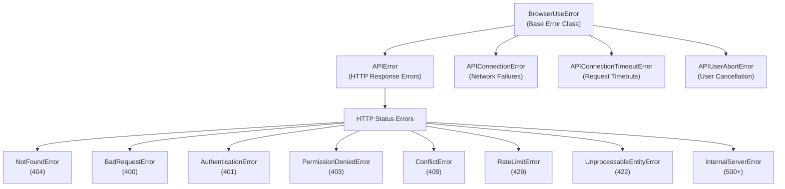
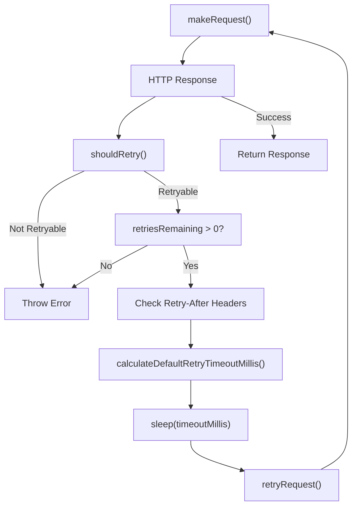
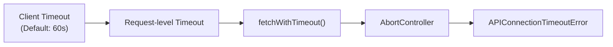
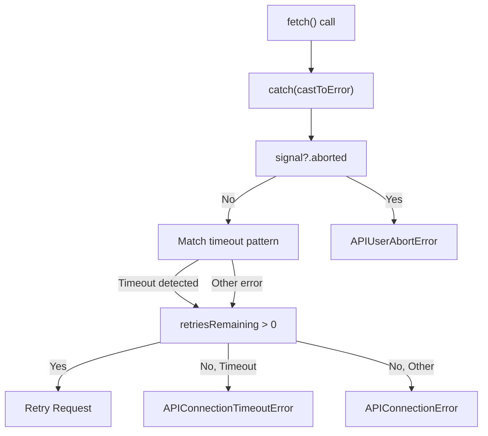
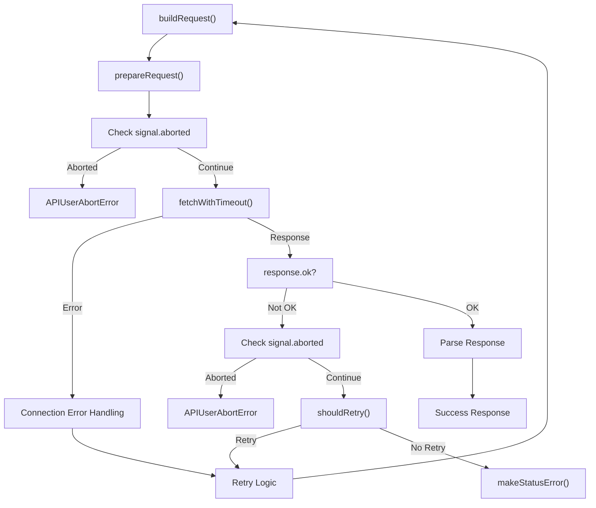
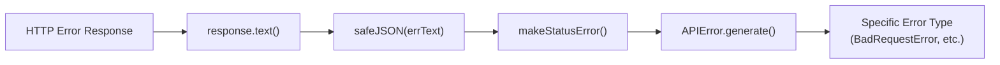

<!-- source: DeepWiki mcp.deepwiki.com · repo browser-use/browser-use-node · page 2.4 Error Handling · fetched 2026-10-30 -->

# Error Handling

<details>
<summary>Relevant source files</summary>

The following files were used as context for generating this wiki page:

- [src/client.ts](src/client.ts)
- [src/internal/detect-platform.ts](src/internal/detect-platform.ts)
- [tests/index.test.ts](tests/index.test.ts)
- [tests/uploads.test.ts](tests/uploads.test.ts)

</details>


This document covers the comprehensive error handling system in the browser-use-node SDK, including automatic retry logic, timeout management, and the error hierarchy. For information about API response validation and structured output handling, see [Structured Output](#5.1). For authentication-related errors, see [Authentication](#5.2).

## Error Types and Hierarchy

The SDK provides a structured hierarchy of error classes that inherit from the base `BrowserUseError` class. Each error type represents different categories of failures that can occur during API interactions.

### Error Class Hierarchy



Sources: [src/client.ts:15](), [src/client.ts:744-756]()

### Error Class Usage

| Error Class | Use Case | When It Occurs |
|-------------|----------|----------------|
| `BrowserUseError` | Base class for all SDK errors | Generic SDK errors, validation failures |
| `APIError` | HTTP response errors | Server returns error status codes |
| `APIConnectionError` | Network connectivity issues | Network failures, DNS resolution errors |
| `APIConnectionTimeoutError` | Request timeout | Request exceeds configured timeout |
| `APIUserAbortError` | User-initiated cancellation | AbortController signal triggered |
| `NotFoundError` | Resource not found | 404 HTTP status |
| `RateLimitError` | Rate limiting | 429 HTTP status |
| `AuthenticationError` | Authentication failure | 401 HTTP status |

Sources: [src/client.ts:744-756]()

## Automatic Retry Logic

The SDK implements intelligent retry logic with exponential backoff for transient failures. Retries are automatically triggered for specific error conditions without user intervention.

### Retry Decision Flow



Sources: [src/client.ts:563-584](), [src/client.ts:586-623](), [src/client.ts:625-638]()

### Retryable Conditions

The `shouldRetry` method determines which responses should trigger automatic retries:

| Condition | HTTP Status | Description |
|-----------|-------------|-------------|
| Server explicit retry | `x-should-retry: true` header | Server indicates retry is appropriate |
| Request timeout | 408 | Request timeout from server |
| Lock timeout | 409 | Resource temporarily locked |
| Rate limiting | 429 | Too many requests |
| Server errors | 500+ | Internal server errors |

Sources: [src/client.ts:563-584]()

### Exponential Backoff Configuration

```typescript
// Default retry timing configuration
const initialRetryDelay = 0.5;  // 500ms
const maxRetryDelay = 8.0;      // 8 seconds
const jitterFactor = 0.25;      // 25% random variation
```

The retry delay calculation uses exponential backoff with jitter to prevent thundering herd problems:

Sources: [src/client.ts:625-638]()

## Timeout Handling

The SDK provides comprehensive timeout management at multiple levels to prevent hanging requests and ensure reliable operation.

### Timeout Architecture



Sources: [src/client.ts:528-561](), [src/client.ts:742]()

### Timeout Configuration

| Timeout Type | Default Value | Configuration |
|--------------|---------------|---------------|
| Client Default | 60,000ms (1 minute) | `ClientOptions.timeout` |
| Request Override | Per-request | `RequestOptions.timeout` |
| Retry Timeout | Exponential backoff | Calculated automatically |

Sources: [src/client.ts:98](), [src/client.ts:742]()

## Connection Error Handling

Network-level failures are handled distinctly from HTTP response errors, with special logic for detecting and categorizing different types of connection failures.

### Connection Error Detection



Sources: [src/client.ts:414-457]()

### Connection Error Patterns

The SDK detects timeout conditions using pattern matching on error messages:

- Native abort errors detected via `isAbortError()`
- Timeout patterns: `/timed? ?out/i` regex matching
- Deno timeout: "tcp connect error: Operation timed out"
- Undici timeout: "ConnectTimeoutError: Connect Timeout Error"

Sources: [src/client.ts:423-425]()

## Request Lifecycle Error Handling

The complete request lifecycle includes multiple error handling checkpoints and recovery mechanisms.

### Request Processing Flow



Sources: [src/client.ts:371-526]()

## Error Response Processing

When the server returns an error response, the SDK processes it through a standardized error creation pipeline.

### Status Error Creation



Sources: [src/client.ts:493-510](), [src/client.ts:284-291]()

## Best Practices

### Error Handling Patterns

1. **Catch Specific Error Types**: Handle different error categories appropriately
2. **Respect Retry Logic**: Allow automatic retries for transient failures
3. **Use AbortController**: Implement proper cancellation for long-running operations
4. **Configure Timeouts**: Set appropriate timeout values for your use case

### Example Error Handling

```typescript
try {
  const task = await client.tasks.create({
    instruction: "Navigate to example.com"
  });
} catch (error) {
  if (error instanceof BrowserUse.RateLimitError) {
    // Handle rate limiting - wait and retry
    console.log('Rate limited, retrying after delay');
  } else if (error instanceof BrowserUse.AuthenticationError) {
    // Handle auth errors - check API key
    console.log('Authentication failed');
  } else if (error instanceof BrowserUse.APIConnectionError) {
    // Handle network errors - check connectivity
    console.log('Network error occurred');
  }
}
```

### Configuration Recommendations

| Use Case | Timeout | Max Retries | Considerations |
|----------|---------|-------------|---------------|
| Interactive UI | 30s | 1 | Fast feedback, minimal delays |
| Background Processing | 300s | 3 | More resilience, longer operations |
| Batch Operations | 600s | 5 | Maximum resilience |

Sources: [src/client.ts:117](), [src/client.ts:209]()

---

