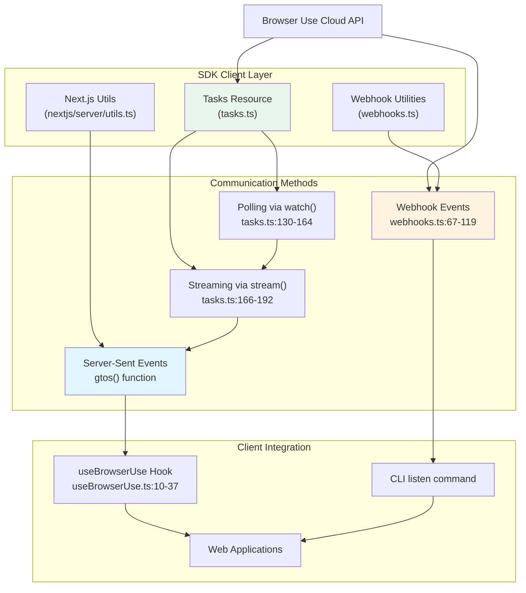
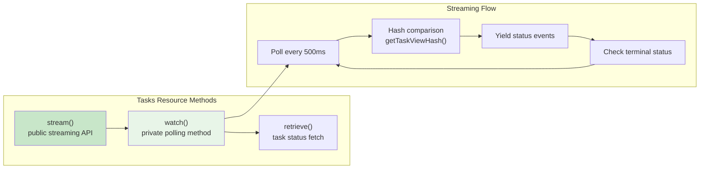
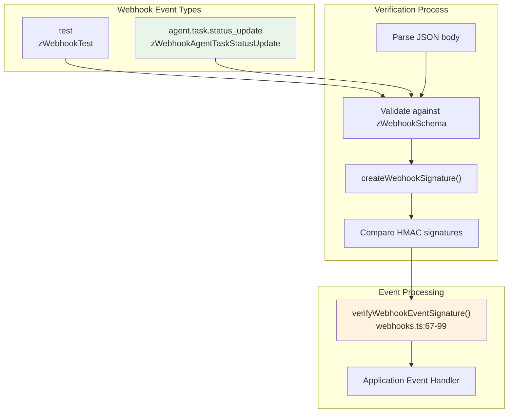
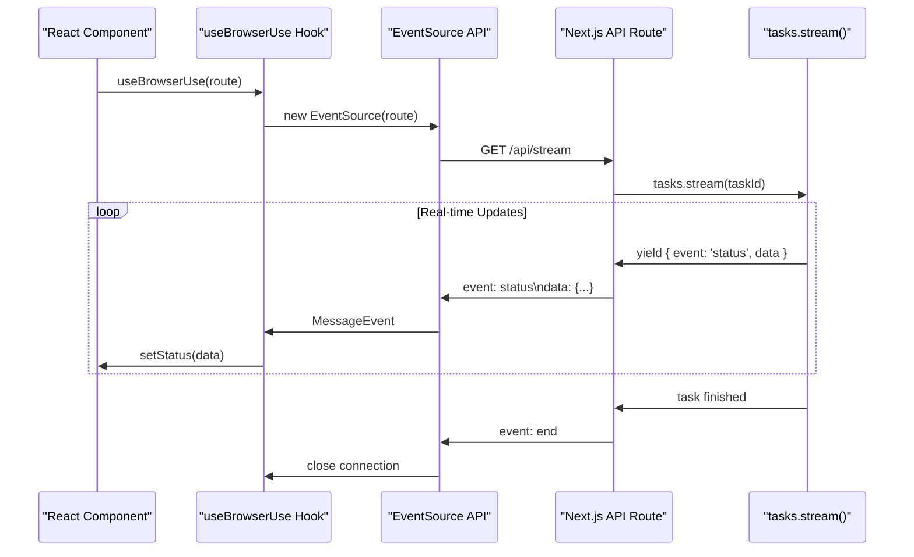

<!-- source: DeepWiki mcp.deepwiki.com · repo browser-use/browser-use-node · page 3 Real-time Features · fetched 2026-10-30 -->

# Real-time Features

Relevant source files

The following files were used as context for generating this wiki page:

- [src/lib/nextjs/hooks/useBrowserUse.ts](src/lib/nextjs/hooks/useBrowserUse.ts)
- [src/lib/nextjs/server/utils.ts](src/lib/nextjs/server/utils.ts)
- [src/lib/webhooks.ts](src/lib/webhooks.ts)
- [src/resources/tasks.ts](src/resources/tasks.ts)
- [tests/lib/webhooks.test.ts](tests/lib/webhooks.test.ts)
- [yarn.lock](yarn.lock)

This document covers the real-time capabilities of the browser-use-node SDK, including task streaming, webhook notifications, and framework integrations. These features enable monitoring of browser automation tasks as they execute, receiving immediate notifications of status changes, and integrating real-time updates into web applications.

For detailed API documentation of the Tasks resource, see [API Documentation](#7.1). For webhook configuration and authentication setup, see [Authentication](#5.2).

## Overview

The browser-use-node SDK provides three primary methods for receiving real-time updates about task execution:

| Method | Use Case | Communication Pattern | Latency |
|--------|----------|----------------------|---------|
| **Task Streaming** | Direct task monitoring | Polling with async generators | ~500ms intervals |
| **Webhooks** | Server-to-server notifications | HTTP POST with signature verification | Near real-time |
| **Server-Sent Events** | Web application integration | EventSource streaming | Real-time |

## Real-time Communication Architecture

**Real-time Communication Flow**

Sources: [src/resources/tasks.ts:130-192](), [src/lib/webhooks.ts:67-119](), [src/lib/nextjs/server/utils.ts:15-69](), [src/lib/nextjs/hooks/useBrowserUse.ts:10-37]()

## Task Streaming Implementation

The core streaming functionality is built around an async generator pattern that polls the Browser Use Cloud API for task status updates.

**Task Streaming Method Chain**

The `stream()` method [src/resources/tasks.ts:174-192]() wraps the private `watch()` method [src/resources/tasks.ts:130-164](), which implements a polling loop that:

1. Calls `retrieve()` to get current task status
2. Compares hash using `getTaskViewHash()` to detect changes
3. Yields events only when status actually changes
4. Terminates when task reaches terminal state (`finished`, `stopped`, `paused`)

Sources: [src/resources/tasks.ts:130-192](), [src/lib/stream.ts:15]()

## Webhook Event System

Webhooks provide server-to-server notifications with cryptographic signature verification for security.

**Webhook Event Processing Pipeline**

The webhook system uses Zod schemas [src/lib/webhooks.ts:13-60]() for type-safe event parsing and HMAC-SHA256 signatures [src/lib/webhooks.ts:104-119]() for security verification.

Sources: [src/lib/webhooks.ts:13-119](), [tests/lib/webhooks.test.ts:58-113]()

## Server-Sent Events Integration

For web applications, the SDK provides utilities to convert async generators into Server-Sent Events streams.

**Server-Sent Events Flow**

The `gtos()` function [src/lib/nextjs/server/utils.ts:15-69]() converts task streaming generators into properly formatted Server-Sent Events, while the `useBrowserUse` hook [src/lib/nextjs/hooks/useBrowserUse.ts:10-37]() provides React integration with automatic connection management.

Sources: [src/lib/nextjs/server/utils.ts:15-69](), [src/lib/nextjs/hooks/useBrowserUse.ts:10-37]()

## Event Data Structures

All real-time communication uses consistent data structures for task status updates:

| Field | Type | Description |
|-------|------|-------------|
| `id` | `string` | Task identifier |
| `status` | `TaskStatus` | Current execution state |
| `sessionId` | `string` | Browser session identifier |
| `steps` | `TaskStepView[]` | Execution steps with screenshots |
| `doneOutput` | `string` | Final task result |
| `metadata` | `Record<string, unknown>` | User-defined metadata |

The `TaskStatus` enum [src/resources/tasks.ts:466]() defines possible states: `started`, `paused`, `finished`, `stopped`.

For webhook events, the payload structure varies by event type but follows the `zWebhookSchema` discriminated union [src/lib/webhooks.ts:54-58]().

Sources: [src/resources/tasks.ts:511-587](), [src/lib/webhooks.ts:54-58]()

## Integration Patterns

The real-time features support multiple integration patterns:

1. **Direct Streaming**: Use `tasks.stream()` for command-line tools and Node.js applications
2. **Webhook Notifications**: Configure HTTP endpoints for server-to-server communication  
3. **React Applications**: Use `useBrowserUse()` hook with Server-Sent Events
4. **CLI Development**: Use `browser-use listen` command for local webhook forwarding

For specific implementation details, see [Task Streaming](#3.1), [Webhook System](#3.2), and [Next.js Integration](#3.3).

Sources: [src/resources/tasks.ts:174-192](), [src/lib/webhooks.ts:67-99](), [src/lib/nextjs/hooks/useBrowserUse.ts:10-37]()

---

