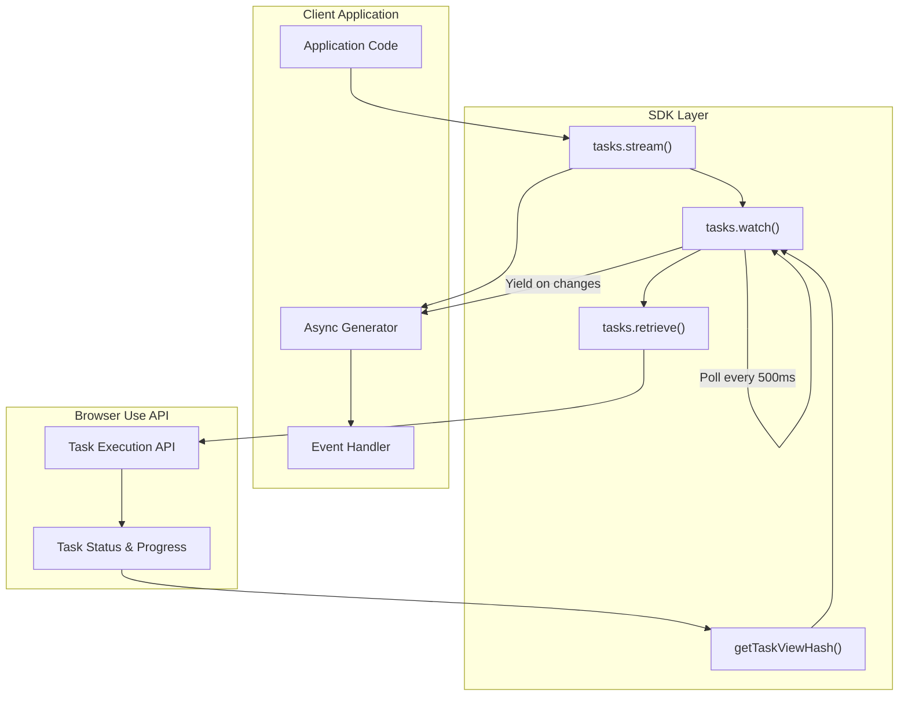
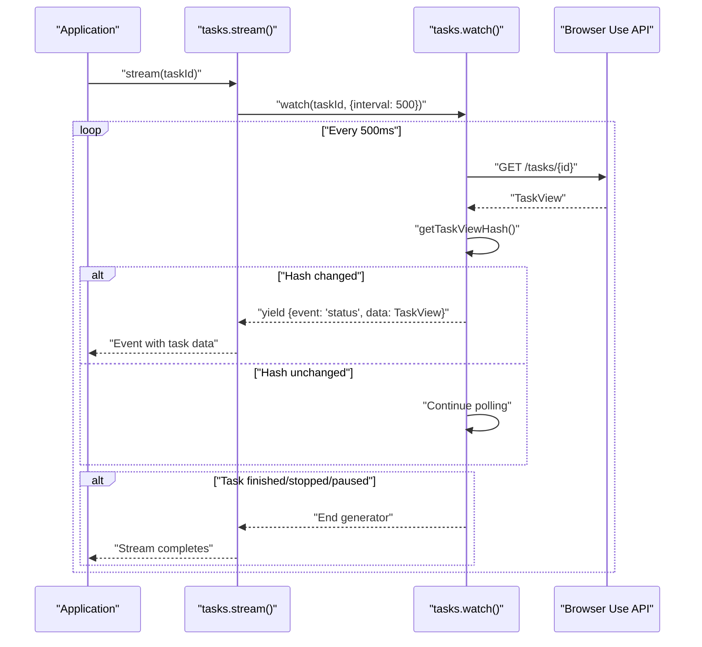
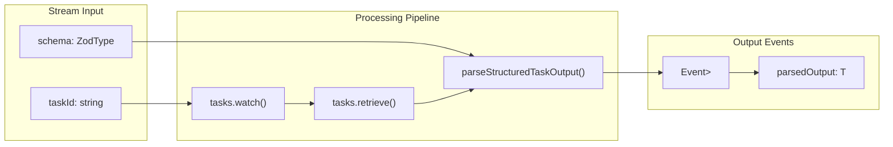
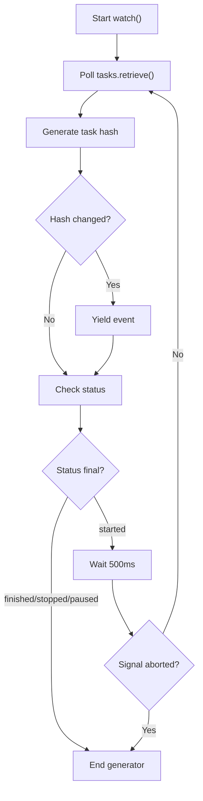
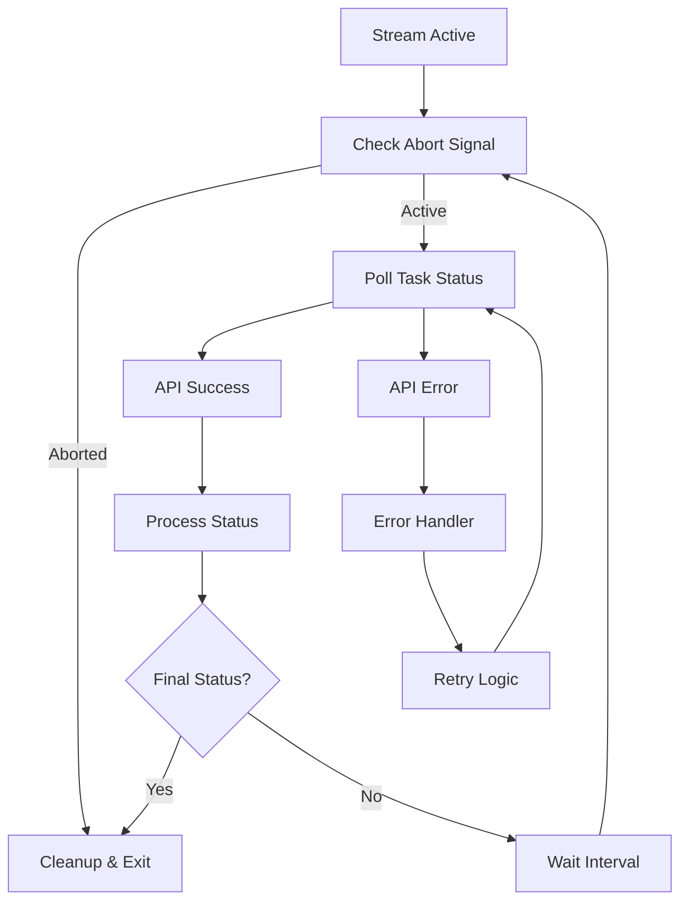

<!-- source: DeepWiki mcp.deepwiki.com · repo browser-use/browser-use-node · page 3.1 Task Streaming · fetched 2026-10-30 -->

# Task Streaming

<details>
<summary>Relevant source files</summary>

The following files were used as context for generating this wiki page:

- [examples/stream.ts](examples/stream.ts)
- [src/lib/stream.ts](src/lib/stream.ts)
- [src/lib/types.ts](src/lib/types.ts)
- [src/resources/tasks.ts](src/resources/tasks.ts)

</details>


Task streaming provides real-time monitoring of browser automation tasks through an async generator interface. This enables applications to receive live updates about task progress, status changes, and completion without manual polling. For webhook-based real-time notifications, see [Webhook System](#3.2). For React integration with streaming, see [Next.js Integration](#3.3).

## Overview

The browser-use-node SDK provides task streaming through the `stream()` method on the `Tasks` resource. This method returns an async generator that yields real-time updates about task execution, including status changes, step progression, and final results. The streaming system uses intelligent polling with hash-based change detection to minimize unnecessary API calls while providing responsive updates.

**Task Streaming Architecture**



Sources: [src/resources/tasks.ts:166-192](), [src/resources/tasks.ts:130-164](), [src/lib/stream.ts:10-14]()

## Basic Task Streaming

The simplest streaming usage involves creating a task and immediately streaming its progress:

```typescript
const task = await browseruse.tasks.create({
  task: 'What is the weather in San Francisco?',
  agentSettings: { llm: 'gemini-2.5-flash' }
});

for await (const msg of browseruse.tasks.stream(task.id)) {
  console.log(`Status: ${msg.data.status}`);
  
  if (msg.data.status === 'finished') {
    console.log(`Result: ${msg.data.doneOutput}`);
    break;
  }
}
```

**Streaming Event Flow**



Sources: [examples/stream.ts:10-35](), [src/resources/tasks.ts:174-192]()

## Structured Output Streaming

When using structured output schemas, the streaming system automatically parses the task output according to the provided Zod schema:

```typescript
const TaskOutput = z.object({
  posts: z.array(z.object({
    title: z.string(),
    url: z.string(),
    score: z.number()
  }))
});

const task = await browseruse.tasks.create({
  task: 'Extract top 10 Hacker News posts',
  schema: TaskOutput,
  agentSettings: { llm: 'gpt-4.1' }
});

const stream = browseruse.tasks.stream({
  taskId: task.id,
  schema: TaskOutput
});

for await (const msg of stream) {
  if (msg.data.status === 'finished') {
    // msg.data.parsedOutput is typed according to TaskOutput schema
    console.log('Posts:', msg.data.parsedOutput.posts);
  }
}
```

**Structured Output Processing**



Sources: [examples/stream.ts:37-90](), [src/resources/tasks.ts:166-172](), [src/resources/tasks.ts:185-187]()

## Streaming Implementation Details

The streaming system is built on top of a polling mechanism with intelligent change detection:

### Polling and Change Detection

The `watch()` method implements the core polling logic:

| Component | Implementation | Purpose |
|-----------|----------------|---------|
| Polling Interval | 500ms | Balance between responsiveness and API load |
| Hash Function | SHA-256 of stable JSON | Detect meaningful changes in task state |
| Termination Conditions | `finished`, `stopped`, `paused` | End streaming when task reaches final state |
| Abort Signal Support | `options?.signal?.aborted` | Allow external cancellation |



Sources: [src/resources/tasks.ts:130-164](), [src/lib/stream.ts:10-14]()

### Event Structure

All streaming events follow a consistent structure:

```typescript
interface StreamEvent {
  event: 'status';
  data: TaskView | TaskViewWithSchema<T>;
}
```

The `TaskView` contains comprehensive task information:

| Field | Type | Description |
|-------|------|-------------|
| `id` | `string` | Task identifier |
| `status` | `TaskStatus` | Current execution state |
| `steps` | `TaskStepView[]` | Execution steps with actions and goals |
| `session` | `Session` | Browser session information |
| `doneOutput` | `string` | Final task output |
| `parsedOutput` | `T` | Structured output (when schema provided) |

Sources: [src/resources/tasks.ts:511-587](), [src/lib/parse.ts]()

## Error Handling and Cancellation

The streaming system supports graceful error handling and cancellation:

### Abort Signal Support

```typescript
const controller = new AbortController();

// Cancel streaming after 30 seconds
setTimeout(() => controller.abort(), 30000);

const stream = browseruse.tasks.stream(taskId, {
  signal: controller.signal
});

try {
  for await (const msg of stream) {
    // Handle events
  }
} catch (error) {
  if (error.name === 'AbortError') {
    console.log('Streaming cancelled');
  }
}
```

### Status-Based Termination

The streaming automatically terminates when tasks reach final states:

| Status | Behavior | Description |
|--------|----------|-------------|
| `started` | Continue polling | Task is actively running |
| `paused` | End stream | Task paused, can be resumed later |
| `finished` | End stream | Task completed successfully |
| `stopped` | End stream | Task manually stopped |

**Error Handling Flow**



Sources: [src/resources/tasks.ts:138-140](), [src/resources/tasks.ts:152-162](), [src/resources/tasks.ts:181-183]()

---

