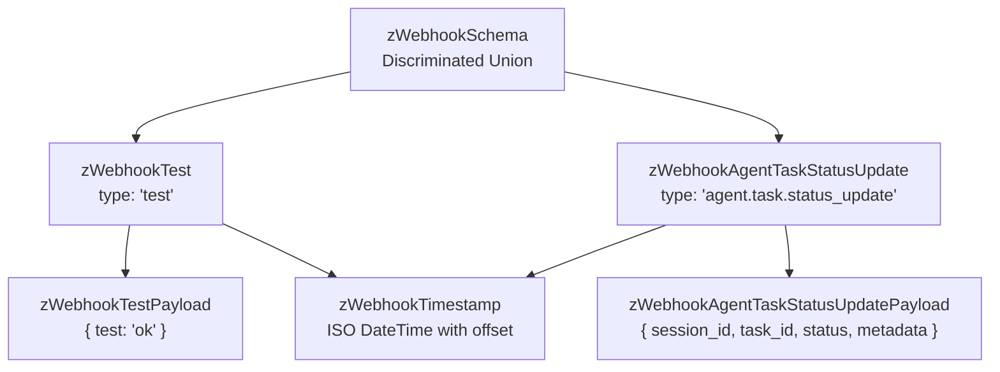
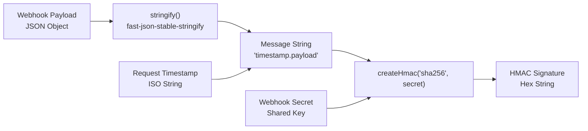
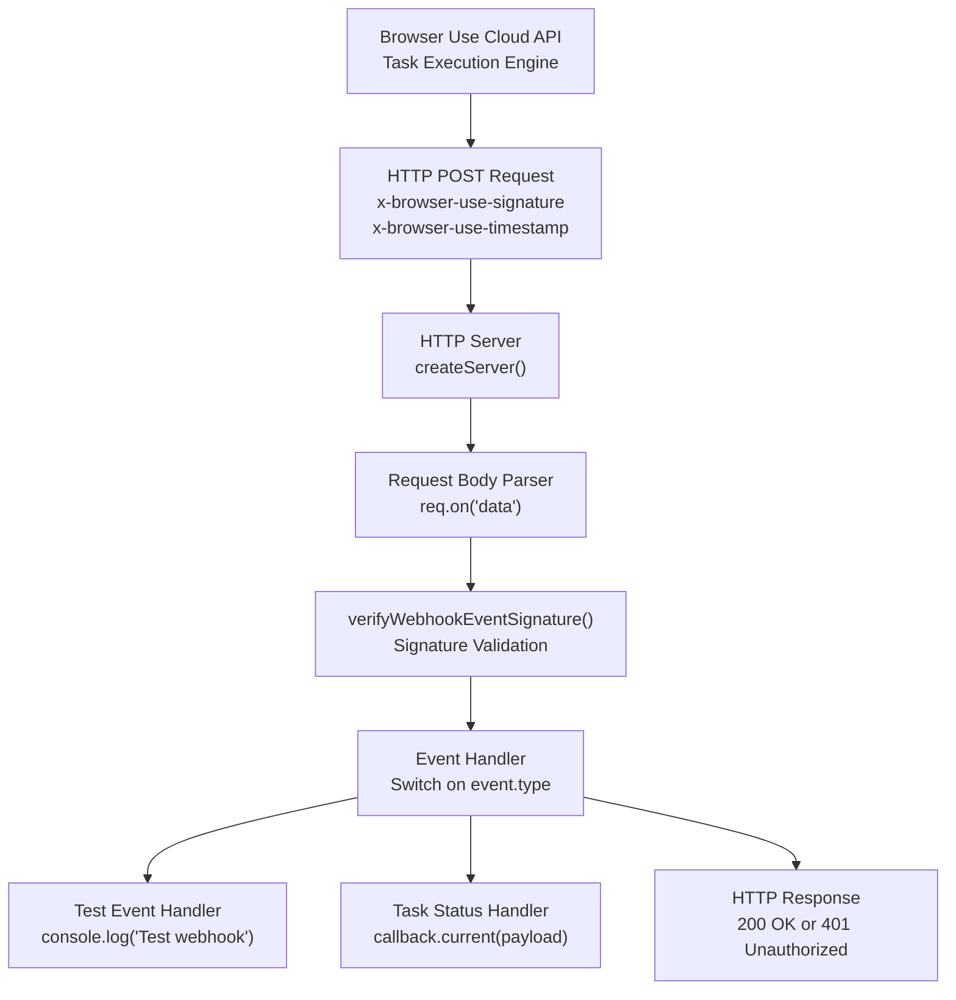

<!-- source: DeepWiki mcp.deepwiki.com · repo browser-use/browser-use-node · page 3.2 Webhook System · fetched 2026-10-30 -->

# Webhook System

<details>
<summary>Relevant source files</summary>

The following files were used as context for generating this wiki page:

- [examples/webhook.ts](examples/webhook.ts)
- [src/lib/webhooks.ts](src/lib/webhooks.ts)
- [tests/lib/webhooks.test.ts](tests/lib/webhooks.test.ts)

</details>


The webhook system provides real-time notifications from the Browser Use Cloud API to your applications. This system enables you to receive instant updates about task status changes and other events without polling. The webhooks use HMAC SHA-256 signature verification for security and support structured event payloads validated with Zod schemas.

For information about task streaming and real-time monitoring, see [Task Streaming](#3.1). For CLI-based webhook forwarding, see [Webhook Forwarding](#4.2).

## Event Types and Schemas

The webhook system supports multiple event types, each with its own payload structure defined using Zod schemas.

### Supported Event Types

| Event Type | Purpose | Payload Schema |
|------------|---------|----------------|
| `test` | Webhook endpoint testing | `zWebhookTestPayload` |
| `agent.task.status_update` | Task status changes | `zWebhookAgentTaskStatusUpdatePayload` |

### Event Schema Structure



**Sources:** [src/lib/webhooks.ts:9-58]()

### Task Status Update Events

The `agent.task.status_update` event provides real-time updates about browser automation task progress:

| Field | Type | Description |
|-------|------|-------------|
| `session_id` | string | Browser session identifier |
| `task_id` | string | Unique task identifier |
| `status` | enum | Current task status |
| `metadata` | object | Optional custom metadata |

**Task Status Values:**
- `initializing` - Task is being prepared
- `started` - Task execution has begun
- `paused` - Task execution is temporarily paused
- `stopped` - Task execution was manually stopped
- `finished` - Task completed successfully

**Sources:** [src/lib/webhooks.ts:25-50]()

## Signature Verification

All webhook events include cryptographic signatures for security verification using HMAC SHA-256.

### Signature Generation Process



**Sources:** [src/lib/webhooks.ts:104-119]()

### Verification Functions

The SDK provides the `verifyWebhookEventSignature` function for secure webhook validation:

```typescript
// Function signature from the codebase
verifyWebhookEventSignature(
  evt: {
    body: string | object;
    signature: string;
    timestamp: string;
  },
  cfg: { secret: string }
): Promise<{ ok: true; event: Webhook } | { ok: false }>
```

The verification process:
1. Parses the webhook body as JSON
2. Validates the event structure using Zod schemas
3. Recreates the expected signature using the payload and timestamp
4. Performs timing-safe signature comparison
5. Returns the validated event or failure indication

**Sources:** [src/lib/webhooks.ts:67-99]()

## Request Headers and Format

Webhook requests from the Browser Use Cloud API include specific headers for security verification:

| Header | Purpose | Example |
|--------|---------|---------|
| `x-browser-use-signature` | HMAC signature | `a1b2c3d4e5f6...` |
| `x-browser-use-timestamp` | Request timestamp | `2025-05-25T09:22:22.269116+00:00` |
| `Content-Type` | Request format | `application/json` |

**Sources:** [examples/webhook.ts:55-56]()

## Implementation Example

### Complete Webhook Server



**Sources:** [examples/webhook.ts:45-112]()

The example implementation demonstrates:

1. **HTTP Server Setup** - Creates an HTTP server listening on a specific port
2. **Request Processing** - Parses incoming webhook requests and extracts headers
3. **Signature Verification** - Uses `verifyWebhookEventSignature` to validate request authenticity
4. **Event Routing** - Handles different event types with appropriate callbacks
5. **Response Handling** - Returns appropriate HTTP status codes

**Key Implementation Points:**

- Server listens on `/webhook` endpoint for POST requests
- Extracts `x-browser-use-signature` and `x-browser-use-timestamp` headers
- Uses callback pattern for handling task status updates
- Includes health check endpoint at `/health`
- Implements graceful shutdown handling

**Sources:** [examples/webhook.ts:30-177]()

## Development Workflow

### Local Development with CLI

For local development, use the CLI webhook forwarding feature to route cloud webhooks to your local server:

```bash
browser-use listen http://localhost:3000/webhook
```

This command:
1. Registers your local endpoint with the Browser Use Cloud API
2. Forwards webhook events to your development server
3. Maintains the same security headers and signatures

**Sources:** [examples/webhook.ts:37]()

### Environment Configuration

Webhook handling requires proper secret key configuration:

| Environment Variable | Purpose | Required |
|---------------------|---------|----------|
| `SECRET_KEY` | Webhook signature verification | Yes |
| `BROWSER_USE_API_KEY` | API authentication | Yes |

**Sources:** [examples/webhook.ts:19-34]()

## Error Handling

The webhook system includes comprehensive error handling:

### Signature Verification Errors

- **Invalid Signature**: Returns `{ ok: false }` when HMAC verification fails
- **Schema Validation**: Rejects events that don't match expected Zod schemas
- **Parsing Errors**: Handles malformed JSON gracefully

### HTTP Response Codes

| Status Code | Condition | Response Body |
|-------------|-----------|---------------|
| 200 | Valid webhook processed | `{ "received": true }` |
| 401 | Invalid signature | `{ "error": "Invalid signature" }` |
| 404 | Unknown endpoint | `{ "error": "Not found" }` |

**Sources:** [examples/webhook.ts:69-111](), [src/lib/webhooks.ts:79-98]()

## Security Considerations

### Timing-Safe Comparison

The signature verification uses direct string comparison for HMAC validation. This approach is suitable for the hex-encoded signatures but developers should be aware of timing attack considerations in security-critical applications.

### Secret Management

- Store webhook secrets securely using environment variables
- Use different secrets for development and production environments
- Rotate secrets periodically following security best practices

### Request Validation

- Always verify webhook signatures before processing events
- Validate event schemas using the provided Zod validators
- Implement proper error handling for malformed requests

**Sources:** [src/lib/webhooks.ts:89-92](), [examples/webhook.ts:31-34]()

---

