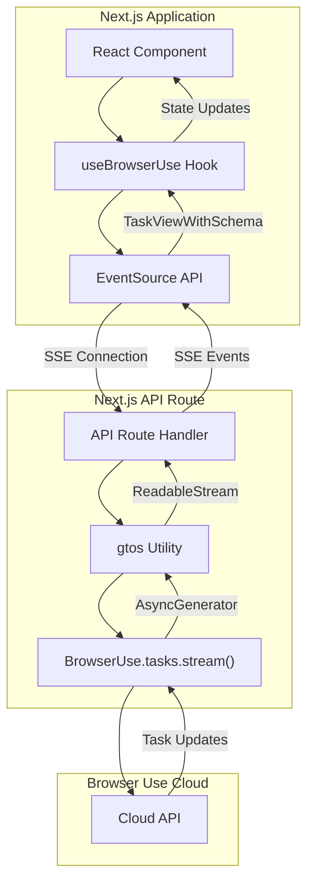
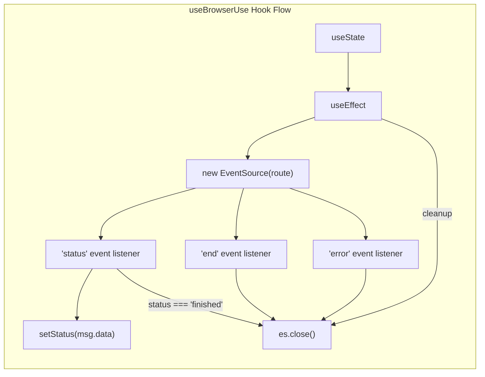
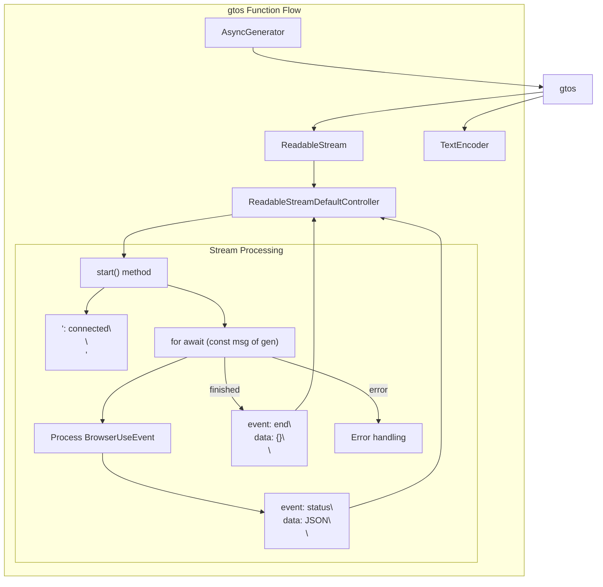
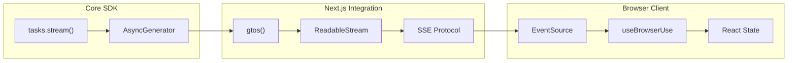

<!-- source: DeepWiki mcp.deepwiki.com · repo browser-use/browser-use-node · page 3.3 Next.js Integration · fetched 2026-10-30 -->

# Next.js Integration

<details>
<summary>Relevant source files</summary>

The following files were used as context for generating this wiki page:

- [README.md](README.md)
- [src/lib/nextjs/hooks/useBrowserUse.ts](src/lib/nextjs/hooks/useBrowserUse.ts)
- [src/lib/nextjs/server/utils.ts](src/lib/nextjs/server/utils.ts)
- [yarn.lock](yarn.lock)

</details>


This document covers how to integrate the browser-use-node SDK with Next.js applications using React hooks and Server-Sent Events (SSE) for real-time task monitoring. This integration provides a seamless way to stream browser automation task updates directly to React components.

For general task streaming concepts, see [Task Streaming](#3.1). For webhook-based real-time updates, see [Webhook System](#3.2).

## Overview

The Next.js integration consists of two main components that work together to provide real-time task updates:

- **Client-side React hook** (`useBrowserUse`) for consuming SSE streams in React components
- **Server-side utilities** (`gtos`) for converting async generators to SSE streams compatible with Next.js API routes



**Sources:** [src/lib/nextjs/hooks/useBrowserUse.ts:1-37](), [src/lib/nextjs/server/utils.ts:1-69]()

## Client-Side Integration

### useBrowserUse Hook

The `useBrowserUse` hook provides a React-friendly interface for consuming real-time task updates via Server-Sent Events. It manages the EventSource connection lifecycle and returns the current task state.



**Key Features:**
- **Type-safe**: Accepts a generic `ZodType` parameter for strongly typed task output
- **Automatic cleanup**: Closes EventSource connections when component unmounts or task completes
- **Error handling**: Gracefully handles connection errors and malformed events

The hook listens for three types of SSE events:
- `status`: Contains task status updates with structured data
- `end`: Signals the end of the stream
- `error`: Indicates connection or processing errors

**Sources:** [src/lib/nextjs/hooks/useBrowserUse.ts:10-37]()

### Hook Usage Pattern

The hook expects an SSE endpoint route and returns the current task state:

```typescript
const taskStatus = useBrowserUse<MySchemaType>('/api/browser-use/stream');
```

The returned state follows the `TaskViewWithSchema<T>` interface, providing access to task status, output data, and parsed results.

**Sources:** [src/lib/nextjs/hooks/useBrowserUse.ts:10-11]()

## Server-Side Integration

### gtos Stream Utility

The `gtos` (generator-to-stream) utility converts async generators from the BrowserUse client into ReadableStream objects compatible with Next.js API routes and the SSE protocol.



**Key Features:**
- **SSE Protocol Compliance**: Formats events according to Server-Sent Events specification
- **Immediate Connection**: Sends connection confirmation to prevent client timeouts
- **Callback Support**: Optional `onEvent` and `onFinished` callbacks for server-side processing
- **Error Resilience**: Properly handles and communicates async generator errors

**Sources:** [src/lib/nextjs/server/utils.ts:15-69]()

### BrowserUseEvent Type

The `BrowserUseEvent` type defines the structure of events flowing through the SSE stream:

```typescript
type BrowserUseEvent<T extends ZodType = ZodType> = {
  event: 'status';
  data: TaskViewWithSchema<T>;
};
```

This type ensures consistency between server-side event generation and client-side event consumption.

**Sources:** [src/lib/nextjs/server/utils.ts:4-7]()

## Complete Integration Example

### API Route Implementation

A typical Next.js API route using the integration components:

```typescript
// pages/api/browser-use/stream.ts or app/api/browser-use/stream/route.ts
export async function GET(request: Request) {
  const taskId = new URL(request.url).searchParams.get('taskId');
  
  const stream = client.tasks.stream({ taskId, schema: MySchema });
  
  return new Response(gtos(stream, {
    onEvent: (data) => console.log('Task update:', data.status),
    onFinished: (data) => console.log('Task completed:', data.doneOutput)
  }), {
    headers: {
      'Content-Type': 'text/event-stream',
      'Cache-Control': 'no-cache',
      'Connection': 'keep-alive'
    }
  });
}
```

### React Component Implementation

A React component consuming the SSE stream:

```typescript
function TaskMonitor({ taskId }: { taskId: string }) {
  const task = useBrowserUse<MySchema>(`/api/browser-use/stream?taskId=${taskId}`);
  
  if (!task) return <div>Connecting...</div>;
  
  return (
    <div>
      <p>Status: {task.status}</p>
      {task.status === 'finished' && (
        <pre>{JSON.stringify(task.parsedOutput, null, 2)}</pre>
      )}
    </div>
  );
}
```

**Sources:** [src/lib/nextjs/hooks/useBrowserUse.ts:10-37](), [src/lib/nextjs/server/utils.ts:15-69]()

## Integration with Real-Time Features

### Relationship to Task Streaming

The Next.js integration builds upon the core task streaming functionality documented in [Task Streaming](#3.1). The `gtos` utility specifically converts the async generators returned by `BrowserUse.tasks.stream()` into a format suitable for web browsers.



### Webhook Integration Compatibility

While this integration focuses on SSE streaming, it can be combined with webhook endpoints for comprehensive real-time coverage. The same task status types are used across both approaches, ensuring consistency.

**Sources:** [src/lib/nextjs/server/utils.ts:1-7](), [README.md:88-122]()

## TypeScript Support

Both components provide full TypeScript support with generic type parameters:

| Component | Generic Parameter | Purpose |
|-----------|------------------|---------|
| `useBrowserUse<T>` | `T extends ZodType` | Type-safe task output parsing |
| `BrowserUseEvent<T>` | `T extends ZodType` | Consistent event typing |
| `gtos()` | Uses `ZodType` internally | Stream type consistency |

The integration leverages the SDK's built-in Zod schema validation for runtime type safety and development-time type checking.

**Sources:** [src/lib/nextjs/hooks/useBrowserUse.ts:10](), [src/lib/nextjs/server/utils.ts:4]()

---

