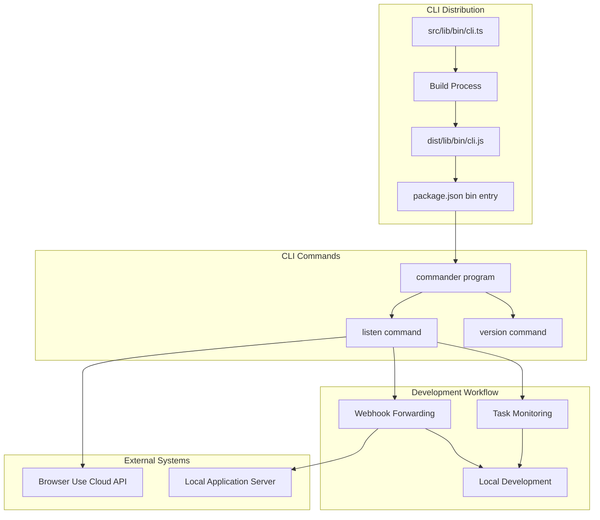
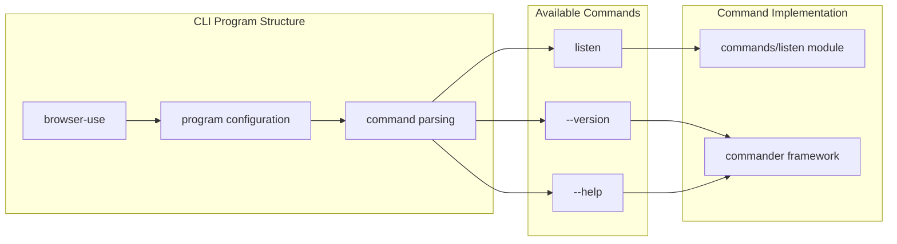
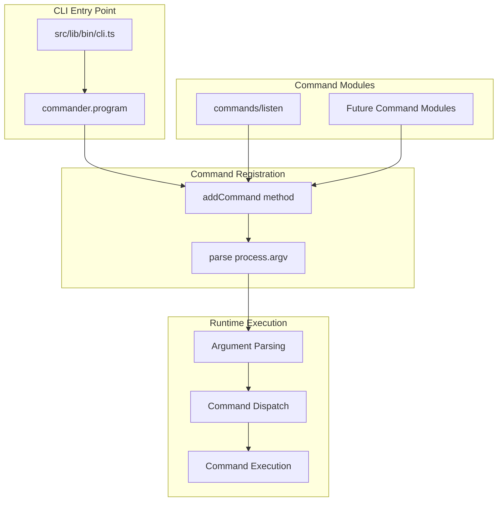
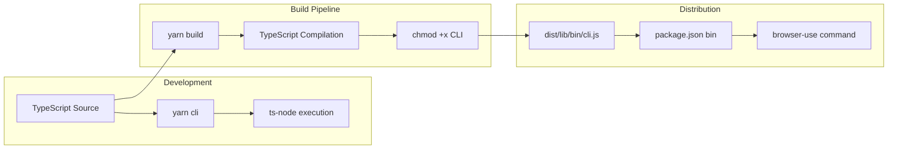

<!-- source: DeepWiki mcp.deepwiki.com · repo browser-use/browser-use-node · page 4 CLI Tools · fetched 2026-10-30 -->

# CLI Tools

Relevant source files

The following files were used as context for generating this wiki page:

- [package.json](package.json)
- [scripts/bootstrap](scripts/bootstrap)
- [src/lib/bin/cli.ts](src/lib/bin/cli.ts)

This page documents the command-line interface (CLI) tools provided by the browser-use-node SDK. The CLI tools enable developers to interact with the Browser Use Cloud API directly from the terminal and facilitate local development workflows, particularly for webhook integration and real-time event handling.

For information about the programmatic SDK client, see [BrowserUse Client](#2.1). For webhook system integration details, see [Webhook System](#3.2).

## Overview

The browser-use-node SDK includes a comprehensive CLI tool that provides command-line access to Browser Use Cloud functionality. The CLI is distributed as an executable binary and supports various development and automation workflows.

**CLI Architecture and Distribution**

Sources: [package.json:31-33](), [src/lib/bin/cli.ts:1-11]()

## Installation and Basic Usage

The CLI is automatically installed when you install the browser-use-sdk package. It becomes available as the `browser-use` command in your terminal.

### Package Installation

The CLI is included with the main SDK package and is configured as an executable binary:

| Configuration | Value | Purpose |
|---------------|-------|---------|
| Binary Name | `browser-use` | Command name in terminal |
| Source File | `src/lib/bin/cli.ts` | TypeScript source |
| Built File | `dist/lib/bin/cli.js` | Executable JavaScript |
| Build Script | `chmod +x ./dist/lib/bin/cli.js` | Makes file executable |

### Command Structure

The CLI uses the `commander` library to provide a structured command interface:

**CLI Command Structure and Implementation**

Sources: [src/lib/bin/cli.ts:3-11](), [package.json:47]()

## CLI Configuration and Metadata

The CLI program is configured with basic metadata and versioning information:

| Property | Value | Source |
|----------|-------|--------|
| Program Name | `browser-use` | [src/lib/bin/cli.ts:7]() |
| Description | `CLI to some JavaScript string utilities` | [src/lib/bin/cli.ts:8]() |
| CLI Version | `0.8.0` | [src/lib/bin/cli.ts:9]() |
| Package Version | `1.2.0` | [package.json:3]() |

### Development Scripts

The package.json includes several scripts for CLI development and usage:

| Script | Command | Purpose |
|--------|---------|---------|
| `cli` | `ts-node -r tsconfig-paths/register --cwd $PWD ./src/lib/bin/cli.ts` | Run CLI in development |
| `postbuild` | `chmod +x ./dist/lib/bin/cli.js` | Make built CLI executable |

Sources: [package.json:22](), [package.json:27](), [src/lib/bin/cli.ts:9]()

## Command Architecture

The CLI follows a modular command structure where individual commands are implemented as separate modules and registered with the main program:

**CLI Command Registration and Execution Flow**

The CLI uses a clean modular architecture where commands are imported and registered with the main commander program. This allows for easy extension with additional commands while maintaining separation of concerns.

Sources: [src/lib/bin/cli.ts:4](), [src/lib/bin/cli.ts:10-11]()

## Development Workflow Integration

The CLI tools are designed to integrate seamlessly with local development workflows, particularly for webhook handling and real-time task monitoring. The build system ensures the CLI is properly configured for both development and production use.

### Build and Distribution

The CLI follows a TypeScript-to-JavaScript build pipeline:

**CLI Build and Distribution Pipeline**

Sources: [package.json:21-22](), [package.json:27](), [package.json:31-33]()

The CLI tools provide essential functionality for local development and webhook integration workflows. For detailed information about specific commands, see [CLI Overview](#4.1) and [Webhook Forwarding](#4.2).

---

