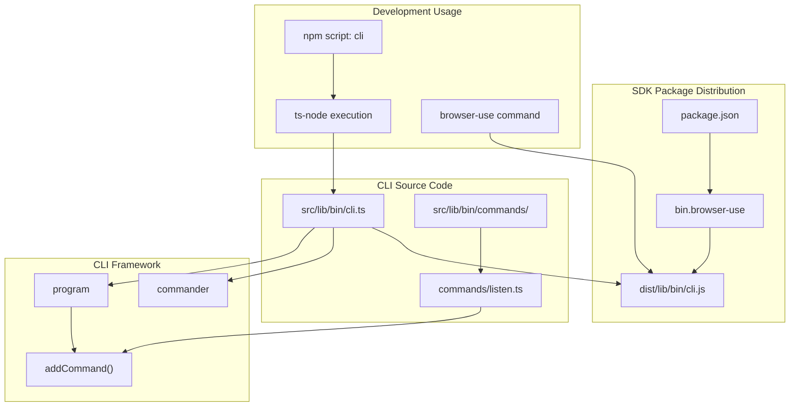
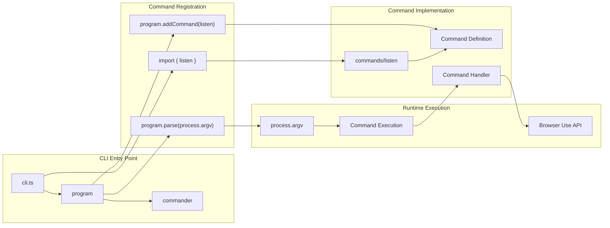

<!-- source: DeepWiki mcp.deepwiki.com · repo browser-use/browser-use-node · page 4.1 CLI Overview · fetched 2026-10-30 -->

# CLI Overview

<details>
<summary>Relevant source files</summary>

The following files were used as context for generating this wiki page:

- [package.json](package.json)
- [scripts/bootstrap](scripts/bootstrap)
- [src/lib/bin/cli.ts](src/lib/bin/cli.ts)

</details>


This document covers the browser-use command-line interface (CLI), which provides command-line access to Browser Use Cloud API functionality. The CLI is primarily used for development workflows, particularly webhook forwarding and local development integration. For detailed information about webhook forwarding specifically, see [Webhook Forwarding](#4.2).

## Purpose and Scope

The browser-use CLI is a command-line tool that ships with the `browser-use-sdk` package. It provides developers with utilities for integrating Browser Use Cloud API services into their local development environments. The CLI is built using the Commander.js framework and is distributed as an executable JavaScript file.

## Installation

The CLI is automatically installed when you install the `browser-use-sdk` package. The CLI becomes available as the `browser-use` command:

```bash
npm install browser-use-sdk
# or
yarn add browser-use-sdk
```

After installation, the CLI is available globally as:

```bash
browser-use --help
```

The CLI binary is defined in the package.json bin field and points to the compiled JavaScript file at `dist/lib/bin/cli.js`.

Sources: [package.json:31-33]()

## CLI Architecture

The following diagram shows how the CLI is structured within the SDK package and its relationship to the development workflow:



Sources: [package.json:31-33](), [src/lib/bin/cli.ts:1-11]()

## Basic Usage

The CLI follows standard command-line conventions with a main program and subcommands:

```bash
# Show help and available commands
browser-use --help

# Show version information
browser-use --version

# Run a specific command
browser-use <command> [options]
```

During development, you can also run the CLI directly from source using the npm script:

```bash
# Run CLI from source during development
npm run cli -- <command> [options]
```

This development script uses `ts-node` to execute the TypeScript source directly without requiring a build step.

Sources: [package.json:27](), [src/lib/bin/cli.ts:6-11]()

## Available Commands

The CLI currently provides the following commands:

| Command | Purpose | Documentation |
|---------|---------|---------------|
| `listen` | Forward webhook events from Browser Use Cloud to local development endpoints | See [Webhook Forwarding](#4.2) |

The CLI is designed with an extensible architecture that allows for additional commands to be added in the future. Each command is implemented as a separate module in the `commands` directory.

## Command Structure

The following diagram illustrates the command registration and execution flow within the CLI:



Sources: [src/lib/bin/cli.ts:3-11]()

## Development and Production Usage

The CLI supports both development and production usage patterns:

### Development Mode
During development, the CLI can be executed directly from TypeScript source:
- Uses `ts-node` for direct TypeScript execution
- Configured with `tsconfig-paths` for module resolution
- Allows rapid iteration without build steps

### Production Mode
In production environments, the CLI runs from the compiled JavaScript:
- Pre-built JavaScript binary at `dist/lib/bin/cli.js`
- Executable permissions set during build process
- Optimized for runtime performance

The build process includes a post-build script that ensures the CLI binary has executable permissions.

Sources: [package.json:22](), [package.json:27]()

---

