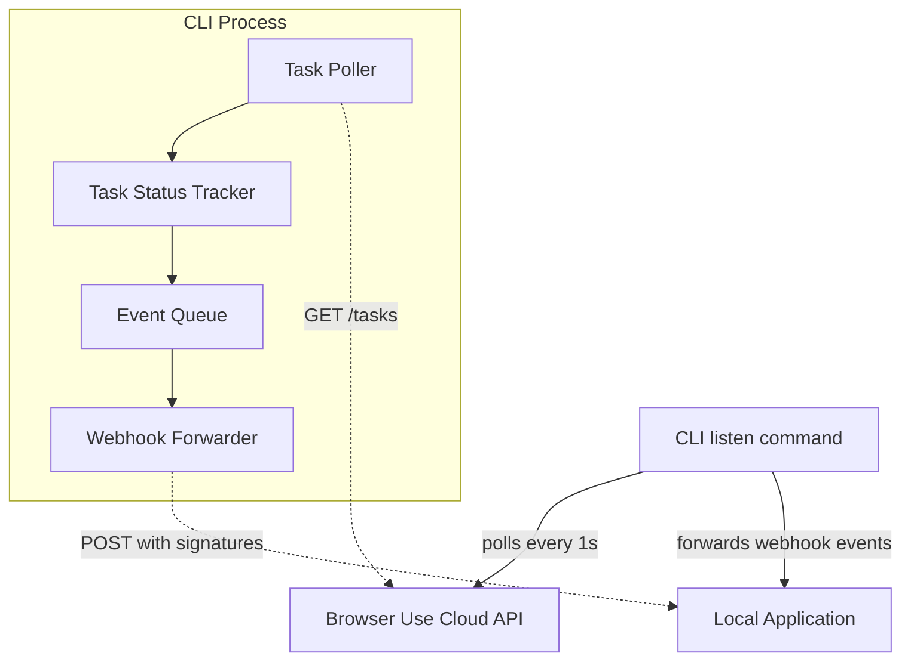
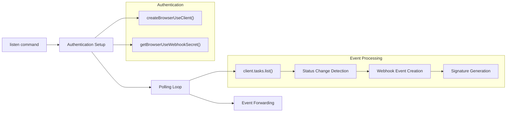
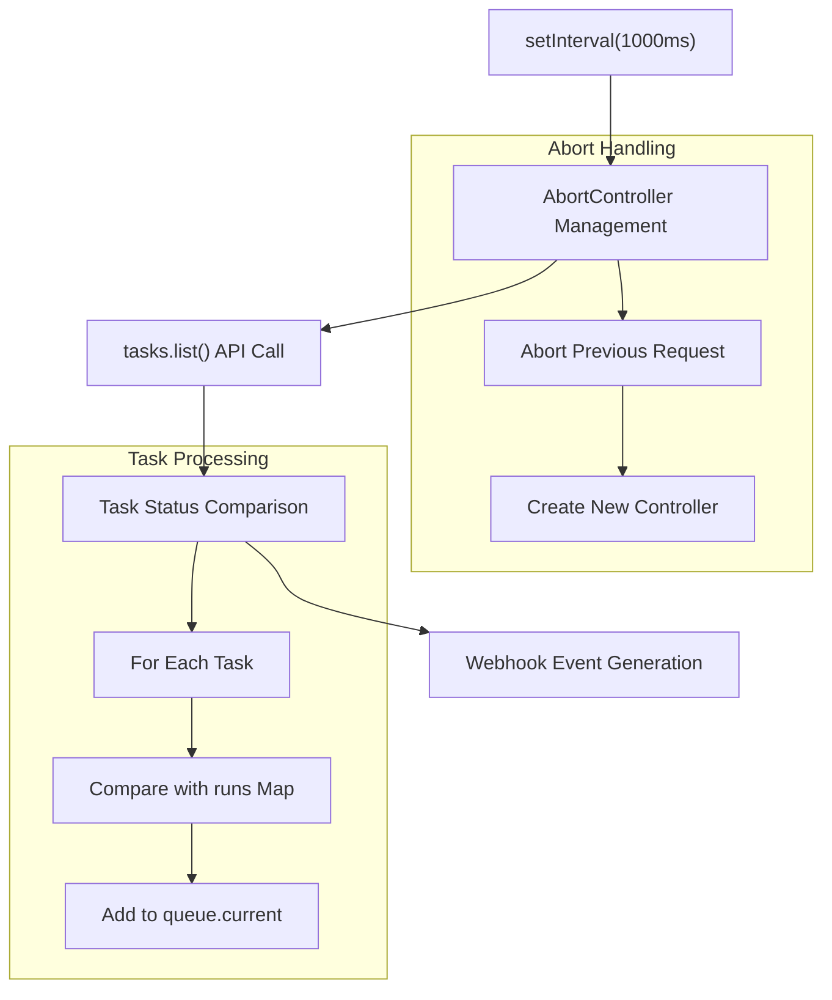
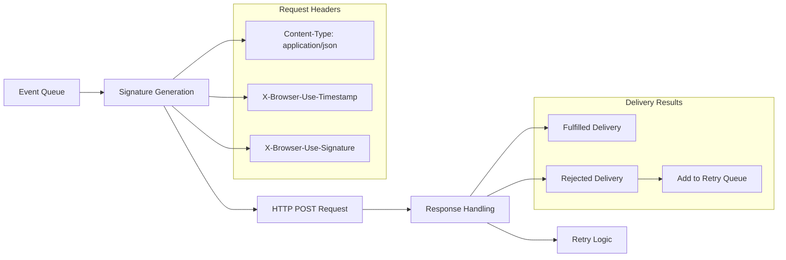

<!-- source: DeepWiki mcp.deepwiki.com · repo browser-use/browser-use-node · page 4.2 Webhook Forwarding · fetched 2026-10-30 -->

# Webhook Forwarding

<details>
<summary>Relevant source files</summary>

The following files were used as context for generating this wiki page:

- [examples/.env.example](examples/.env.example)
- [examples/utils.ts](examples/utils.ts)
- [src/lib/bin/auth.ts](src/lib/bin/auth.ts)
- [src/lib/bin/commands/listen.ts](src/lib/bin/commands/listen.ts)

</details>


This page documents the CLI webhook forwarding system that allows developers to receive real-time Browser Use Cloud API updates during local development. The `browser-use listen` command polls the Cloud API for task status changes and forwards them as properly signed webhook events to a local development endpoint.

For information about webhook event handling and signature verification, see [Webhook System](#3.2). For broader CLI tool documentation, see [CLI Overview](#4.1).

## Purpose and Architecture

The webhook forwarding system bridges the gap between Browser Use Cloud's webhook notifications and local development environments. During development, your local application may not have a publicly accessible webhook endpoint. The CLI `listen` command solves this by:

1. Polling the Browser Use Cloud API for task updates
2. Converting task status changes into webhook events
3. Forwarding events to your local endpoint with proper authentication signatures
4. Providing retry logic for failed deliveries

### System Architecture



Sources: [src/lib/bin/commands/listen.ts:1-184]()

## CLI Listen Command

The `listen` command is implemented as a Commander.js command that takes a single argument - the local endpoint to forward webhook events to.

### Command Structure



The command is defined in [src/lib/bin/commands/listen.ts:13-16]() using Commander.js:

- Takes `<endpoint>` as a required argument
- Provides description for webhook forwarding functionality
- Implements the main action handler

Sources: [src/lib/bin/commands/listen.ts:13-16]()

## Authentication and Setup

### Environment Configuration

The system requires two environment variables for proper operation:

| Variable | Purpose | Source Function |
|----------|---------|----------------|
| `BROWSER_USE_API_KEY` | API authentication | `createBrowserUseClient()` |
| `SECRET_KEY` | Webhook signature generation | `getBrowserUseWebhookSecret()` |

Both authentication functions in [src/lib/bin/auth.ts:10-63]() follow the same pattern:
1. Check process environment variables first
2. Fall back to loading from `.env` file using `@dotenvx/dotenvx`
3. Exit with error if required variables are missing

### Client Initialization

The system initializes the BrowserUse client and retrieves the webhook secret during command startup [src/lib/bin/commands/listen.ts:19-20]():

```typescript
const client = createBrowserUseClient();
const secret = getBrowserUseWebhookSecret();
```

Sources: [src/lib/bin/auth.ts:10-63](), [src/lib/bin/commands/listen.ts:17-21]()

## Polling and Task Tracking

### Polling Mechanism

The system implements a polling-based approach using `setInterval` with a 1-second interval [src/lib/bin/commands/listen.ts:41-170]():



### Task Status Tracking

The system maintains task state using several data structures:

- `runs: Map<string, BrowserUse.TaskStatus>` - Tracks current status of each task ID [src/lib/bin/commands/listen.ts:39]()
- `queue: { current: Webhook[] }` - Holds pending webhook events for delivery [src/lib/bin/commands/listen.ts:38]()
- `startTimeDate` - Filters tasks to only those created after CLI startup [src/lib/bin/commands/listen.ts:37]()

The polling logic [src/lib/bin/commands/listen.ts:76-116]() compares each task's current status against the stored status in the `runs` Map to detect changes.

Sources: [src/lib/bin/commands/listen.ts:37-116]()

## Webhook Event Processing

### Event Creation

When a task status change is detected, the system creates webhook events following the Browser Use Cloud webhook format [src/lib/bin/commands/listen.ts:83-92](), [src/lib/bin/commands/listen.ts:100-109]():

```typescript
{
  type: 'agent.task.status_update',
  timestamp: task.finishedAt || task.startedAt,
  payload: {
    session_id: task.sessionId,
    task_id: task.id,
    status: task.status,
    metadata: task.metadata,
  },
}
```

### Event Delivery System



The delivery process [src/lib/bin/commands/listen.ts:131-162]() includes:
- HMAC signature generation using `createWebhookSignature()`
- Proper webhook headers following Browser Use Cloud standards
- AbortController signal for request cancellation
- Promise-based concurrent delivery for multiple events

### Retry and Error Handling

Failed webhook deliveries are preserved in the queue for retry on subsequent polling cycles [src/lib/bin/commands/listen.ts:166-169]():

- Only rejected deliveries are retained for retry
- Internal events (like ping) are not retried
- Failed events remain in `queue.current` until successfully delivered

Sources: [src/lib/bin/commands/listen.ts:118-170]()

## Process Management

### Signal Handling

The system implements graceful shutdown handling for `SIGINT` signals [src/lib/bin/commands/listen.ts:175-183]():

```typescript
process.on('SIGINT', () => {
  if (tickRef.abort != null) {
    tickRef.abort.abort();
  }
  if (tickRef.timeout) {
    clearInterval(tickRef.timeout);
  }
});
```

This ensures:
- Pending HTTP requests are aborted
- The polling interval is cleared
- Clean process termination

### Resource Management

The system uses a `tickRef` object [src/lib/bin/commands/listen.ts:8-11]() to manage:
- `timeout: NodeJS.Timeout | null` - Reference to the polling interval
- `abort: AbortController | null` - Current request abort controller

This enables proper cleanup and request cancellation across polling cycles.

Sources: [src/lib/bin/commands/listen.ts:8-11](), [src/lib/bin/commands/listen.ts:175-183]()

---

