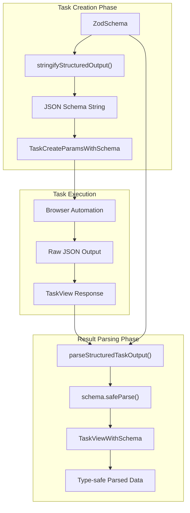
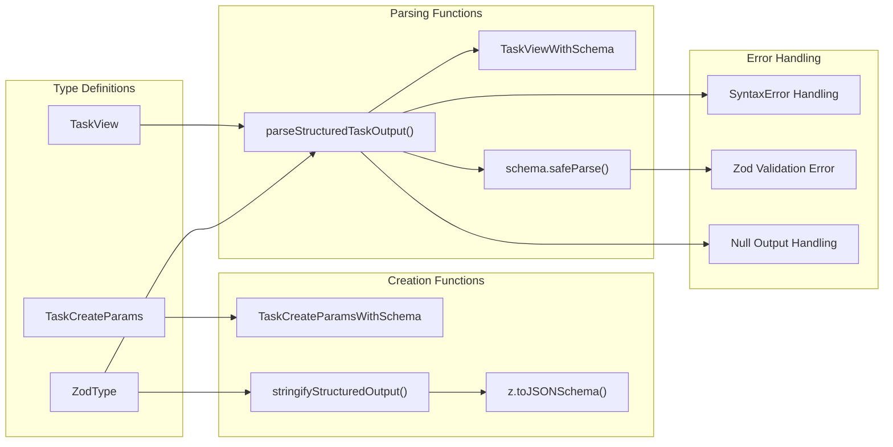
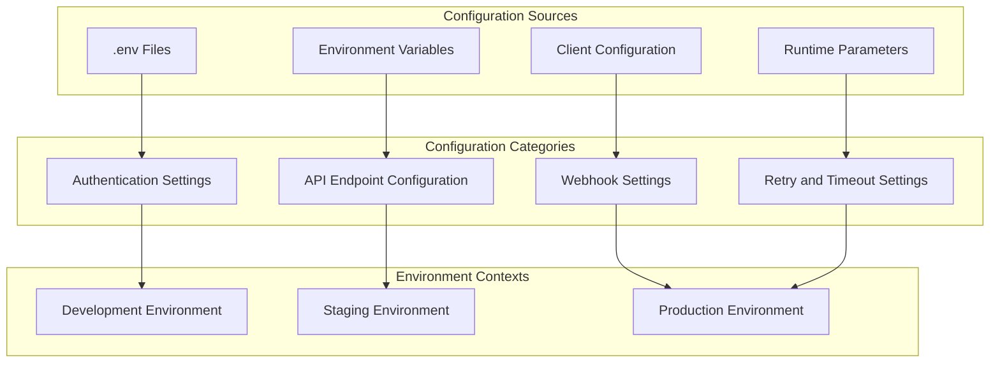

<!-- source: DeepWiki mcp.deepwiki.com · repo browser-use/browser-use-node · page 5 Advanced Features · fetched 2026-10-30 -->

# Advanced Features

Relevant source files

The following files were used as context for generating this wiki page:

- [.gitignore](.gitignore)
- [.nvmrc](.nvmrc)
- [src/lib/parse.ts](src/lib/parse.ts)

This document covers advanced usage patterns and sophisticated capabilities of the browser-use-node SDK beyond basic task creation and execution. These features enable complex automation workflows, structured data extraction, secure integrations, and sophisticated configuration management.

For basic task creation and monitoring, see [Tasks API](#2.2). For real-time streaming capabilities, see [Real-time Features](#3). For CLI usage, see [CLI Tools](#4).

## Overview of Advanced Capabilities

The browser-use-node SDK provides several advanced features for production-grade browser automation:

| Feature Category | Capabilities | Primary Use Cases |
|------------------|-------------|-------------------|
| **Structured Output** | Zod schema validation, type-safe parsing | Data extraction, form processing |
| **Authentication** | API key management, webhook signature verification | Secure integrations, production deployments |
| **File Operations** | Upload/download, log retrieval, output management | Document processing, data workflows |
| **Framework Integration** | React hooks, Next.js SSE, streaming APIs | Web applications, real-time UIs |
| **Configuration Management** | Environment-aware settings, profile management | Multi-environment deployments |

These advanced features build upon the core task execution system to provide enterprise-grade capabilities for complex automation scenarios.

## Structured Output System

The SDK provides a sophisticated structured output system that combines Zod schema validation with type-safe parsing for reliable data extraction from browser automation tasks.

### Structured Output Architecture

**Sources:** [src/lib/parse.ts:1-47]()

### Schema Conversion and Validation Flow

The structured output system operates through a complete type-safe pipeline:

**Sources:** [src/lib/parse.ts:6-8](), [src/lib/parse.ts:10-12](), [src/lib/parse.ts:16-18](), [src/lib/parse.ts:20-46]()

The system provides comprehensive error handling for malformed JSON, validation failures, and null outputs, ensuring robust operation in production environments.

## Authentication and Security Framework

The SDK implements a multi-layered security approach for API authentication and webhook verification:

| Security Component | Implementation | Configuration |
|-------------------|----------------|---------------|
| **API Key Authentication** | Header-based authentication | Environment variables, client config |
| **Webhook Signature Verification** | HMAC SHA-256 signatures | Webhook secret management |
| **Environment-aware Configuration** | Development/production settings | `.env` file support |
| **Secure Defaults** | TLS-only communication | Built-in security policies |

### Authentication Flow

The authentication system supports both development and production workflows with secure credential management and automatic retry logic for authentication failures.

**Sources:** [.gitignore:11]()

## File and Output Management

The SDK provides comprehensive file operation capabilities for handling uploads, downloads, task logs, and structured output files. This system integrates with the task execution pipeline to provide seamless file handling throughout the automation workflow.

### File Operation Patterns

| Operation Type | Capabilities | Integration Points |
|---------------|-------------|-------------------|
| **File Uploads** | Pre-task file preparation | Task creation parameters |
| **Output Downloads** | Post-task result retrieval | Task completion handlers |
| **Log Management** | Real-time log streaming | Webhook events, CLI tools |
| **Structured Output Files** | Type-safe file parsing | Zod schema validation |

The file management system works seamlessly with the structured output framework to provide end-to-end data processing capabilities.

## Advanced Configuration Patterns

The SDK supports sophisticated configuration management for complex deployment scenarios:

### Multi-Environment Configuration

**Sources:** [.gitignore:11](), [.nvmrc:1]()

### Runtime Configuration Management

The configuration system provides hierarchical precedence with environment variables taking priority over file-based configuration, enabling flexible deployment patterns across different environments.

## Framework Integration Architecture

The SDK provides deep integration capabilities with modern JavaScript frameworks through specialized adapters and utilities:

| Framework | Integration Type | Key Features |
|-----------|-----------------|-------------|
| **Next.js** | SSE streaming utilities | Real-time task updates |
| **React** | Custom hooks | Component-level state management |
| **Node.js** | Native CommonJS/ESM | Server-side automation |
| **Edge Runtime** | Lightweight builds | Serverless environments |

### Integration Patterns

The framework integrations leverage the core streaming and webhook systems to provide real-time updates and seamless state management across different application architectures.

This advanced feature set enables the browser-use-node SDK to support enterprise-grade automation workflows with robust error handling, type safety, and production-ready security patterns.

---

