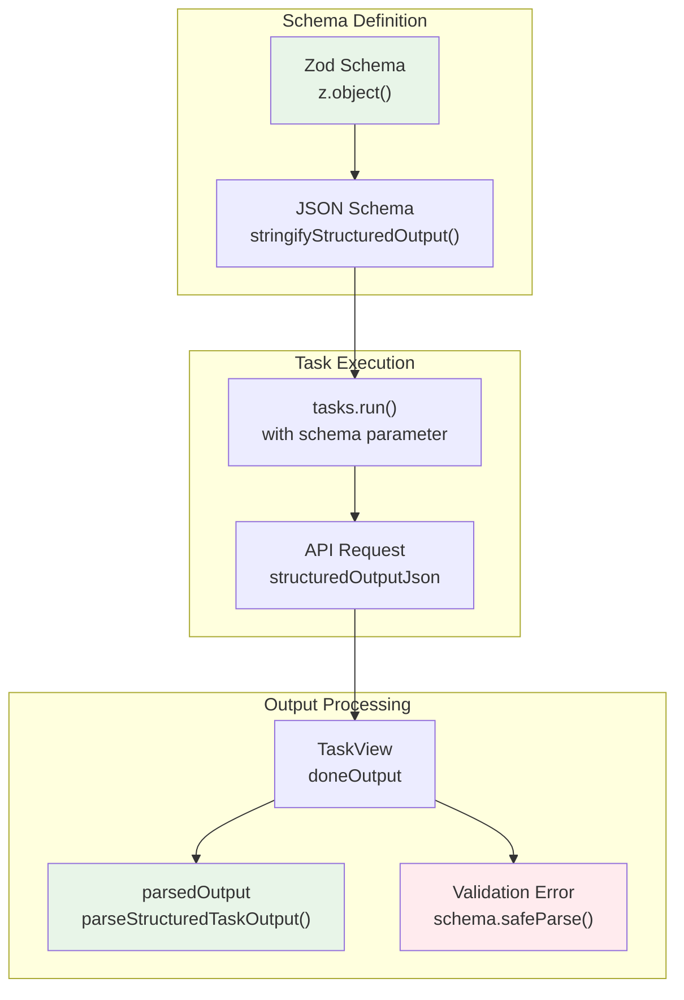
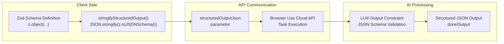
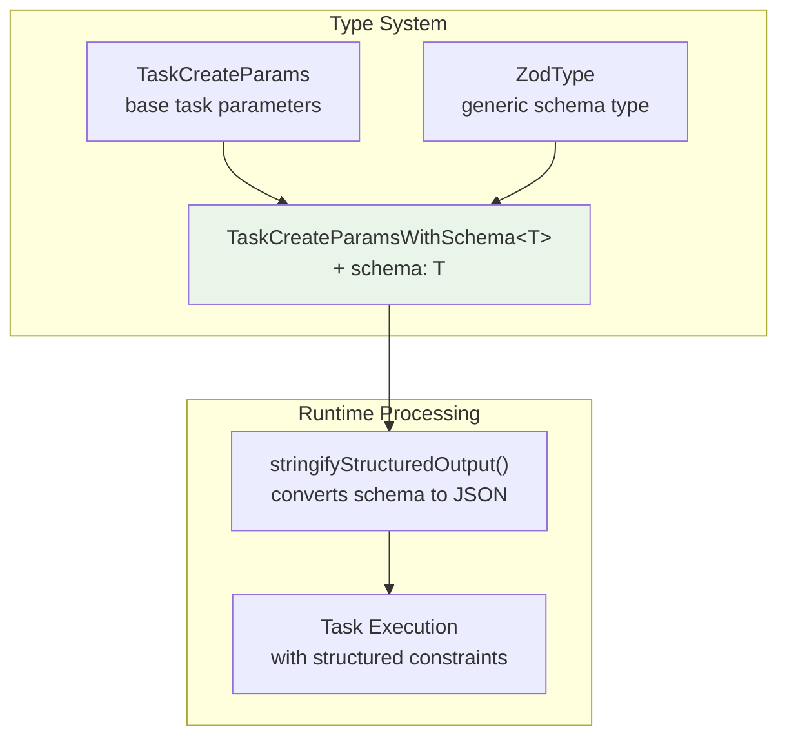
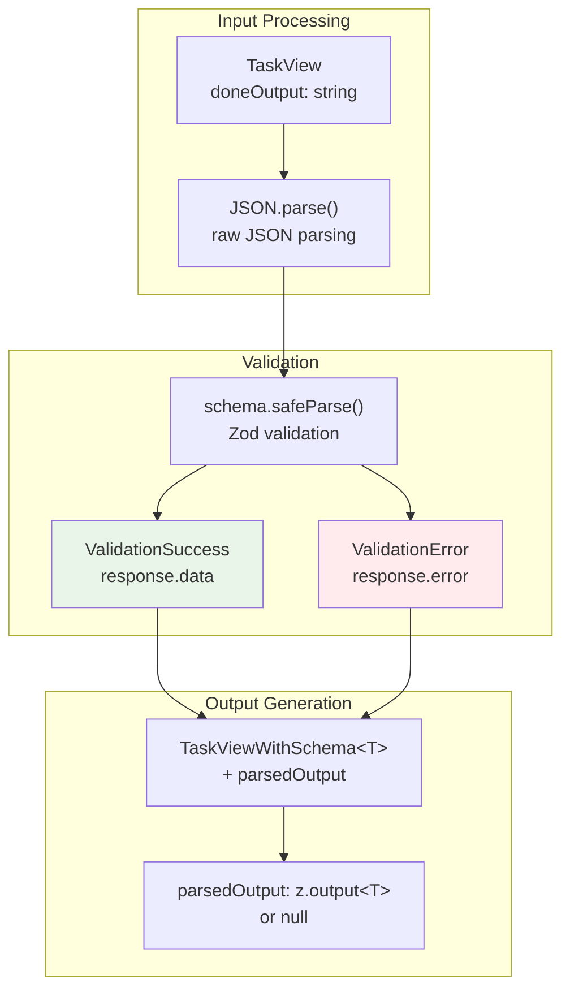
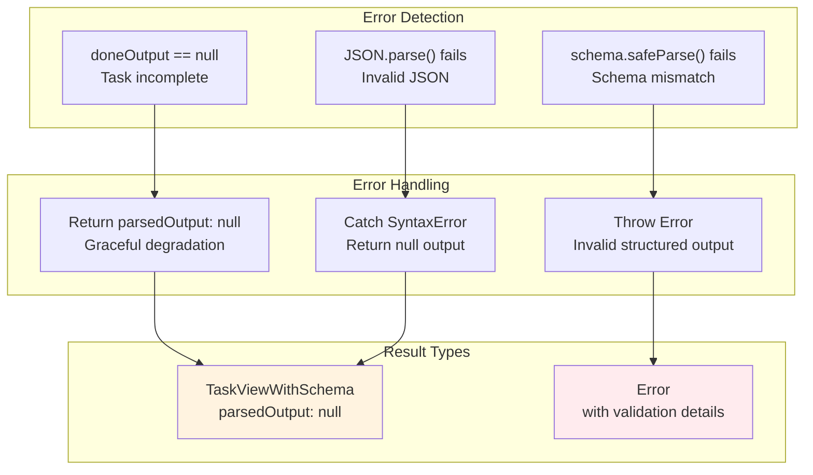

<!-- source: DeepWiki mcp.deepwiki.com · repo browser-use/browser-use-node · page 5.1 Structured Output · fetched 2026-10-30 -->

# Structured Output

<details>
<summary>Relevant source files</summary>

The following files were used as context for generating this wiki page:

- [.gitignore](.gitignore)
- [.nvmrc](.nvmrc)
- [examples/run.ts](examples/run.ts)
- [src/lib/parse.ts](src/lib/parse.ts)

</details>


This document covers how to use Zod schemas to define and validate structured output from browser automation tasks in the browser-use-node SDK. Structured output allows you to specify the exact format and shape of data you want extracted from web pages, ensuring type-safe and predictable results from your automation tasks.

For basic task creation and execution, see [Tasks API](#2.2). For error handling patterns, see [Error Handling](#2.4).

## Overview

Structured output enables you to define schemas that constrain the AI agent's output to match specific data structures. Instead of receiving free-form text responses, you get strongly-typed, validated objects that conform to your predefined schema.

The structured output system consists of three main components:



**Sources:** [src/lib/parse.ts:1-47](), [examples/run.ts:27-59]()

## Schema Definition

Structured output schemas are defined using Zod, a TypeScript-first schema declaration and validation library. The schema defines the shape and validation rules for the data you want to extract.

### Basic Schema Structure

```typescript
import { z } from 'zod';

const ItemSchema = z.object({
  title: z.string(),
  url: z.string(),
  price: z.number().optional(),
});

const ResultSchema = z.object({
  items: z.array(ItemSchema),
  totalCount: z.number(),
});
```

### Schema Conversion Process

The SDK converts Zod schemas to JSON Schema format for the API:



**Sources:** [src/lib/parse.ts:10-12](), [src/lib/parse.ts:6-8]()

## Creating Tasks with Schemas

To create a task with structured output, pass the schema to the `tasks.run()` method using the `schema` parameter:

| Parameter | Type | Description |
|-----------|------|-------------|
| `task` | `string` | The natural language instruction for the browser automation |
| `schema` | `ZodType` | The Zod schema defining the expected output structure |
| `agentSettings` | `object` | Optional agent configuration (LLM model, etc.) |

### Type-Safe Task Creation

The SDK provides `TaskCreateParamsWithSchema<T>` which extends the base task creation parameters:



**Sources:** [src/lib/parse.ts:6-8](), [examples/run.ts:40-44]()

## Output Parsing and Access

After task completion, the structured output is available through the `parsedOutput` property on the enhanced task view object.

### Parsing Process

The `parseStructuredTaskOutput()` function handles the conversion from raw JSON output to typed objects:



**Sources:** [src/lib/parse.ts:20-46](), [src/lib/parse.ts:16-18]()

## Error Handling

The structured output system includes several layers of error handling:

### Parsing Error Types

| Error Type | Cause | Handling |
|------------|-------|----------|
| `SyntaxError` | Invalid JSON in `doneOutput` | Returns `parsedOutput: null` |
| `ZodError` | Schema validation failure | Throws with detailed error message |
| `null doneOutput` | Task not completed | Returns `parsedOutput: null` |

### Error Flow



**Sources:** [src/lib/parse.ts:24-26](), [src/lib/parse.ts:28-46]()

## Implementation Example

The following example demonstrates the complete structured output workflow:

### Schema Definition
From [examples/run.ts:27-34](), the example defines nested schemas:

```typescript
const HackerNewsResponse = z.object({
  title: z.string(),
  url: z.string(),
});

const TaskOutput = z.object({
  posts: z.array(HackerNewsResponse),
});
```

### Task Execution
From [examples/run.ts:40-44](), the task is created with the schema:

```typescript
const rsp = await browseruse.tasks.run({
  task: 'Search for the top 10 Hacker News posts and return the title and url!',
  schema: TaskOutput,
  agentSettings: { llm: 'gpt-4.1' },
});
```

### Type-Safe Access
From [examples/run.ts:46-56](), the parsed output provides full type safety:

```typescript
const posts = rsp.parsedOutput?.posts;

if (posts == null) {
  throw new Error('Structured: No posts found');
}

for (const post of posts) {
  console.log(` - ${post.title} - ${post.url}`);
}
```

**Sources:** [examples/run.ts:36-59]()

---

