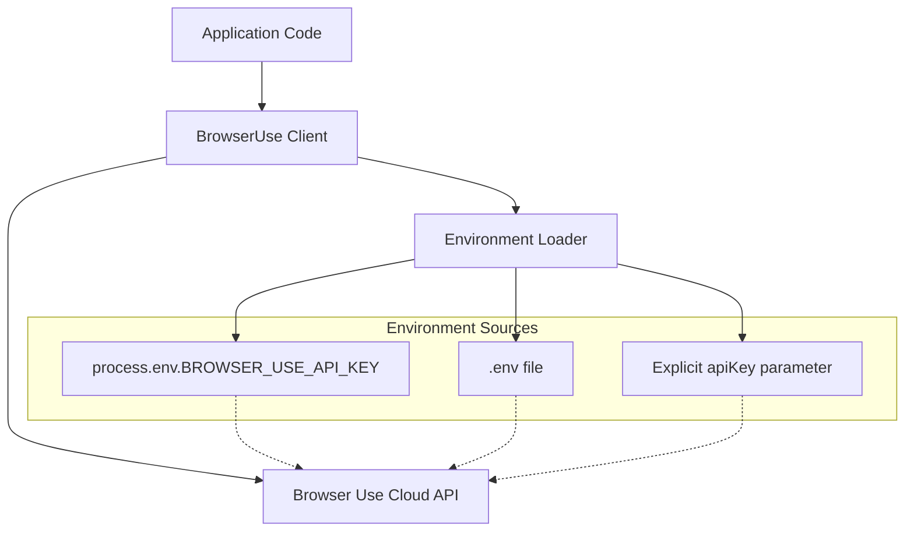
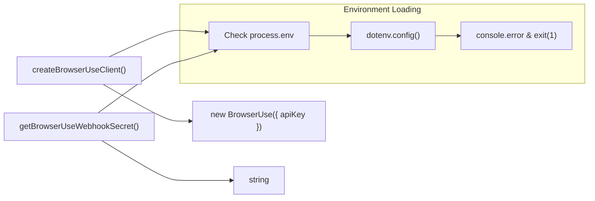
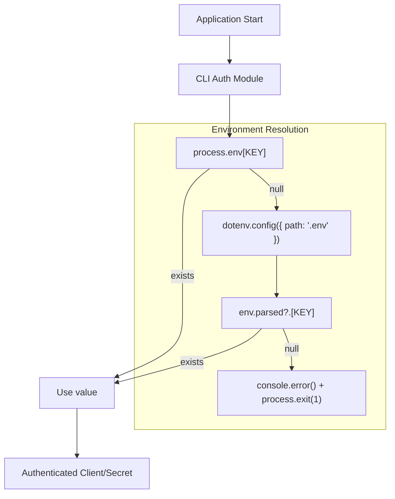

<!-- source: DeepWiki mcp.deepwiki.com · repo browser-use/browser-use-node · page 5.2 Authentication · fetched 2026-10-30 -->

# Authentication

<details>
<summary>Relevant source files</summary>

The following files were used as context for generating this wiki page:

- [README.md](README.md)
- [examples/.env.example](examples/.env.example)
- [examples/utils.ts](examples/utils.ts)
- [src/lib/bin/auth.ts](src/lib/bin/auth.ts)

</details>


This document covers managing API keys, webhook secrets, and environment configuration for both development and production environments. It explains how to securely authenticate with the Browser Use Cloud API and verify webhook signatures.

For information about webhook event handling and integration patterns, see [Webhook System](#3.2). For CLI-specific authentication usage, see [CLI Tools](#4).

## API Key Authentication

The Browser Use SDK requires an API key to authenticate with the Browser Use Cloud API. API keys follow the format `bu_...` and are obtained from the [Browser Use Cloud dashboard](https://cloud.browser-use.com).

### Basic API Key Usage

The primary authentication method is passing the API key when instantiating the `BrowserUse` client:

```ts
import BrowserUse from 'browser-use-sdk';

const client = new BrowserUse({
  apiKey: 'bu_your_api_key_here',
});
```

### Environment Variable Configuration

The recommended approach is to store the API key in the `BROWSER_USE_API_KEY` environment variable:

```bash
export BROWSER_USE_API_KEY="bu_your_api_key_here"
```

When using environment variables, the client can be instantiated without explicitly passing the API key:

```ts
const client = new BrowserUse();
```

Sources: [README.md:13-18](), [src/lib/bin/auth.ts:5]()

## Authentication Flow Diagram



**API Key Resolution Priority**
The SDK resolves API keys in the following order:
1. Explicit `apiKey` parameter in constructor
2. `BROWSER_USE_API_KEY` environment variable
3. `BROWSER_USE_API_KEY` from `.env` file

Sources: [src/lib/bin/auth.ts:10-33]()

## Webhook Secrets

Webhook endpoints require signature verification using a shared secret to ensure requests originate from Browser Use Cloud.

### Secret Configuration

Webhook secrets are configured using the `SECRET_KEY` environment variable:

```bash
export SECRET_KEY="your_webhook_secret"
```

### Development vs Production Secrets

| Environment | Secret Source | Example Value |
|-------------|---------------|---------------|
| Development | Local `.env` file | `"secret"` |
| Production | Browser Use Cloud dashboard | Generated secure string |

The development secret can be a simple string for testing, while production secrets should be cryptographically secure values provided by Browser Use Cloud.

Sources: [examples/.env.example:20](), [src/lib/bin/auth.ts:35]()

## CLI Authentication Utilities

The CLI tool provides helper functions for loading authentication credentials from environment variables with automatic fallback to `.env` files.

### CLI Authentication Functions



### Function Descriptions

| Function | Purpose | Return Type | Environment Variable |
|----------|---------|-------------|---------------------|
| `createBrowserUseClient()` | Creates authenticated BrowserUse client | `BrowserUse` | `BROWSER_USE_API_KEY` |
| `getBrowserUseWebhookSecret()` | Loads webhook secret for signature verification | `string` | `SECRET_KEY` |

Both functions follow the same pattern:
1. Check `process.env` for the required variable
2. If not found, load from `.env` file using `@dotenvx/dotenvx`
3. If still not found, log error and exit with code 1

Sources: [src/lib/bin/auth.ts:8-33](), [src/lib/bin/auth.ts:38-63]()

## Environment Configuration

### Development Setup

For development, create a `.env` file in your project root:

```bash
# API Key for Browser Use Cloud
BROWSER_USE_API_KEY="bu_your_development_api_key"

# Webhook secret for local testing
SECRET_KEY="secret"
```

### Production Considerations

In production environments:

1. **API Keys**: Use secure environment variable injection (AWS Systems Manager, Kubernetes secrets, etc.)
2. **Webhook Secrets**: Obtain production secrets from Browser Use Cloud dashboard
3. **Security**: Never commit `.env` files containing real credentials to version control

### Environment Variable Loading



The environment loading mechanism ensures credentials are available from multiple sources while maintaining security best practices.

Sources: [src/lib/bin/auth.ts:13-25](), [src/lib/bin/auth.ts:43-55](), [examples/.env.example:1-22]()

## Error Handling

### Authentication Errors

The SDK provides specific error types for authentication failures:

| HTTP Status | Error Type | Description |
|-------------|------------|-------------|
| 401 | `AuthenticationError` | Invalid or missing API key |
| 403 | `PermissionDeniedError` | Valid key but insufficient permissions |

### Missing Credentials

When credentials are missing, the CLI utilities will:
1. Log a descriptive error message to `console.error`
2. Exit the process with code 1
3. Specify which environment variable is missing

Example error output:
```
Missing BROWSER_USE_API_KEY environment variable!
```

This prevents applications from starting with incomplete authentication configuration.

Sources: [README.md:149-158](), [src/lib/bin/auth.ts:28-30](), [src/lib/bin/auth.ts:58-60]()

---

