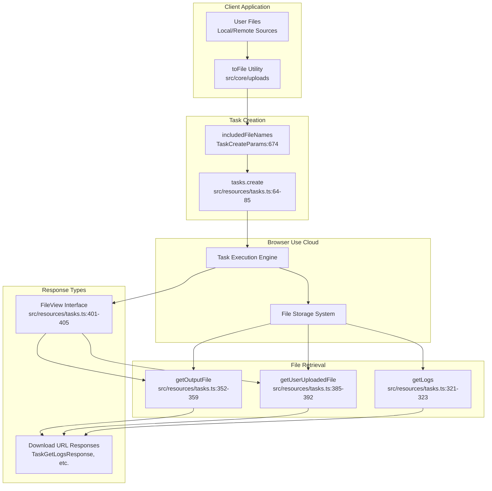
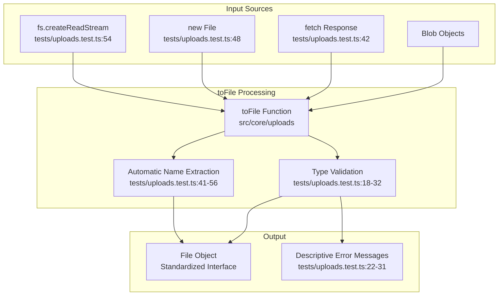

<!-- source: DeepWiki mcp.deepwiki.com · repo browser-use/browser-use-node · page 5.3 File Operations · fetched 2026-10-30 -->

# File Operations

<details>
<summary>Relevant source files</summary>

The following files were used as context for generating this wiki page:

- [src/internal/detect-platform.ts](src/internal/detect-platform.ts)
- [src/resources/tasks.ts](src/resources/tasks.ts)
- [tests/index.test.ts](tests/index.test.ts)
- [tests/uploads.test.ts](tests/uploads.test.ts)

</details>


File operations in the browser-use-node SDK provide comprehensive support for uploading files to tasks, downloading generated outputs, and managing file-related data throughout the automation workflow. This document covers file uploads, downloads, log retrieval, and the underlying file handling utilities.

For structured output configuration, see [Structured Output](#5.1). For authentication and API key management, see [Authentication](#5.2).

## File Operation Workflow

The SDK supports a complete file lifecycle within browser automation tasks, from initial uploads to final output retrieval.



**Sources:** [src/resources/tasks.ts:1-784](), [tests/uploads.test.ts:1-108]()

## File Upload System

File uploads enable tasks to access local documents, images, and other resources during automation. The system provides flexible input handling through the `toFile` utility and task configuration.

### File Input Types

The SDK accepts various file input formats through the `toFile` utility function:

| Input Type | Description | Automatic Name Extraction |
|------------|-------------|---------------------------|
| `File` | Browser File objects | ✓ From `file.name` |
| `ReadStream` | Node.js readable streams | ✓ From file path |
| `Response` | Fetch Response objects | ✓ From URL path |
| `Blob` | Raw binary data | ✗ Requires manual naming |

### Task File Configuration

Files are attached to tasks using the `includedFileNames` parameter during task creation:

```typescript
const task = await client.tasks.create({
  task: "Extract data from the uploaded spreadsheet",
  includedFileNames: ["monthly-report.xlsx", "contacts.csv"],
  agentSettings: {
    llm: "gpt-4o"
  }
});
```

**Sources:** [src/resources/tasks.ts:653-681](), [tests/uploads.test.ts:40-57]()

## Output File Management

Tasks generate various output files during execution, including screenshots, extracted data, and processed documents. These files are accessed through secure download URLs.

```mermaid
graph LR
    subgraph "Task Execution Context"
        TaskView[TaskView<br/>src/resources/tasks.ts:511-559]
        OutputFilesList[outputFiles: Array&lt;FileView&gt;<br/>src/resources/tasks.ts:518]
        UserUploadedList[userUploadedFiles: Array&lt;FileView&gt;<br/>src/resources/tasks.ts:548]
    end
    
    subgraph "File Access Methods"
        GetOutputFile[getOutputFile<br/>src/resources/tasks.ts:352-359]
        GetUserUploaded[getUserUploadedFile<br/>src/resources/tasks.ts:385-392]
    end
    
    subgraph "Response Structure"
        FileViewInterface[FileView<br/>{id, fileName}]
        DownloadResponse["{id, fileName, downloadUrl}"]
    end
    
    TaskView --> OutputFilesList
    TaskView --> UserUploadedList
    OutputFilesList --> FileViewInterface
    UserUploadedList --> FileViewInterface
    
    FileViewInterface --> GetOutputFile
    FileViewInterface --> GetUserUploaded
    
    GetOutputFile --> DownloadResponse
    GetUserUploaded --> DownloadResponse
```

### Accessing Output Files

Output files are retrieved using their file ID and the associated task ID:

```typescript
// Get task details to see available files
const task = await client.tasks.retrieve("task_123");

// Access each output file
for (const file of task.outputFiles) {
  const downloadInfo = await client.tasks.getOutputFile(file.id, {
    task_id: task.id
  });
  
  console.log(`File: ${downloadInfo.fileName}`);
  console.log(`Download URL: ${downloadInfo.downloadUrl}`);
}
```

### File Metadata Structure

The `FileView` interface represents file metadata throughout the system:

| Property | Type | Description |
|----------|------|-------------|
| `id` | `string` | Unique file identifier |
| `fileName` | `string` | Original or generated filename |

**Sources:** [src/resources/tasks.ts:395-405](), [src/resources/tasks.ts:625-637]()

## Task Log Retrieval

Task execution logs provide detailed information about agent decision-making, actions performed, and debugging data. Logs are accessed through presigned download URLs.

### Log Access Pattern

```typescript
const logInfo = await client.tasks.getLogs("task_123");

// Download the log file
const response = await fetch(logInfo.downloadUrl);
const logContent = await response.text();

console.log("Agent execution details:", logContent);
```

### Log Content Structure

Task logs contain comprehensive execution information:

- Step-by-step agent reasoning and decisions
- Actions taken on web pages (clicks, typing, navigation)
- Error messages and debugging information
- Performance metrics and timing data
- Screenshot references and browser state

**Sources:** [src/resources/tasks.ts:290-323](), [src/resources/tasks.ts:617-623]()

## File Handling Utilities

The SDK provides robust file handling through the `toFile` utility, which normalizes different input types into File objects with proper metadata.



### File Name Extraction

The `toFile` utility automatically extracts meaningful filenames from different sources:

- **ReadStream**: Extracts filename from the file path
- **Response**: Extracts filename from the URL path  
- **File**: Uses the existing `name` property
- **Blob**: Requires explicit filename specification

### Error Handling

The utility provides descriptive error messages for unsupported input types, helping developers identify issues during development.

**Sources:** [tests/uploads.test.ts:1-108](), [src/core/uploads]()

## Security Considerations

File operations in the SDK implement several security measures:

- **Presigned URLs**: All download URLs are time-limited and secure
- **Input Validation**: File inputs are validated and sanitized
- **Access Control**: Files are scoped to specific tasks and users
- **Type Checking**: Runtime validation prevents invalid file operations

File download URLs expire after a short time period for security, requiring fresh requests for continued access.

**Sources:** [src/resources/tasks.ts:313-320](), [src/resources/tasks.ts:335-350]()

---

