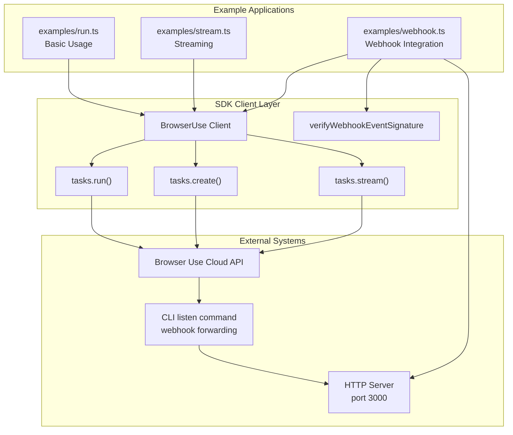
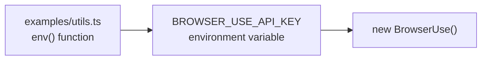
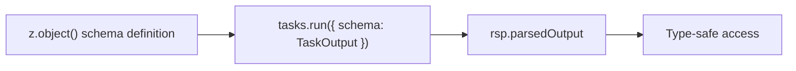

<!-- source: DeepWiki mcp.deepwiki.com · repo browser-use/browser-use-node · page 6 Examples and Guides · fetched 2026-10-30 -->

# Examples and Guides

Relevant source files

The following files were used as context for generating this wiki page:

- [examples/run.ts](examples/run.ts)
- [examples/stream.ts](examples/stream.ts)
- [examples/webhook.ts](examples/webhook.ts)

This document provides an overview of practical examples and step-by-step guides for common browser automation use cases with the browser-use-node SDK. The examples demonstrate real-world implementation patterns, from basic task execution to advanced streaming and webhook integrations.

The examples are organized into three main categories: basic usage patterns, real-time streaming implementations, and webhook-based integrations. For detailed API reference documentation, see [API Documentation](#7.1). For configuration details, see [Configuration Reference](#7.2).

## Example Categories Overview

The SDK includes three primary example implementations that demonstrate different interaction patterns with the Browser Use Cloud API:

| Example Type | File Location | Primary Use Case | Key Components |
|--------------|---------------|------------------|----------------|
| Basic Usage | `examples/run.ts` | Direct task execution and structured output | `BrowserUse`, `tasks.run()`, Zod schemas |
| Streaming | `examples/stream.ts` | Real-time task monitoring | `tasks.create()`, `tasks.stream()`, async generators |
| Webhooks | `examples/webhook.ts` | Event-driven integrations | `verifyWebhookEventSignature`, HTTP server |

## Common Implementation Patterns

The following diagram illustrates how the example implementations interact with core SDK components and the Browser Use Cloud API:

Sources: [examples/run.ts:1-64](), [examples/stream.ts:1-95](), [examples/webhook.ts:1-178]()

## Example Workflow Patterns

The examples demonstrate three distinct workflow patterns for browser automation tasks:

```mermaid
graph TD
    subgraph "Synchronous Pattern"
        CreateTask1["browseruse.tasks.run()"]
        WaitComplete1["Wait for completion"]
        GetResult1["Access doneOutput"]
    end
    
    subgraph "Asynchronous Streaming Pattern"
        CreateTask2["browseruse.tasks.create()"]
        StartStream["browseruse.tasks.stream(taskId)"]
        ProcessEvents["for await (msg of stream)"]
        CheckStatus["if (msg.data.status === 'finished')"]
    end
    
    subgraph "Event-Driven Pattern"
        SetupServer["createServer() on port 3000"]
        VerifySignature["verifyWebhookEventSignature()"]
        HandleEvent["Process WebhookAgentTaskStatusUpdatePayload"]
        CreateTask3["browseruse.tasks.create()"]
    end
    
    CreateTask1 --> WaitComplete1
    WaitComplete1 --> GetResult1
    
    CreateTask2 --> StartStream
    StartStream --> ProcessEvents
    ProcessEvents --> CheckStatus
    
    SetupServer --> CreateTask3
    CreateTask3 --> VerifySignature
    VerifySignature --> HandleEvent
```

Sources: [examples/run.ts:17-22](), [examples/stream.ts:17-34](), [examples/webhook.ts:125-150]()

## Environment Setup

All examples use a common environment setup pattern for API key management:

The `env()` utility function loads environment variables, and the `BrowserUse` constructor automatically detects the `BROWSER_USE_API_KEY` from the environment.

Sources: [examples/run.ts:6-11](), [examples/stream.ts:8-12](), [examples/webhook.ts:10-24]()

## Structured Output Implementation

The examples demonstrate two approaches to handling task outputs:

| Pattern | Implementation | Use Case |
|---------|---------------|----------|
| Simple Output | `rsp.doneOutput` | Plain text results |
| Structured Output | `rsp.parsedOutput` with Zod schema | Type-safe structured data |

The structured output pattern uses Zod schemas for validation:

Sources: [examples/run.ts:27-46](), [examples/stream.ts:37-58]()

## Navigation to Detailed Examples

For complete implementation details and code walkthroughs:

- **[Basic Usage Examples](#6.1)** - Simple task execution and structured output patterns
- **[Streaming Examples](#6.2)** - Real-time task monitoring and async generator usage  
- **[Webhook Integration Examples](#6.3)** - Event-driven integrations with signature verification

Each sub-page includes complete working code examples, error handling patterns, and best practices for production use.

---

