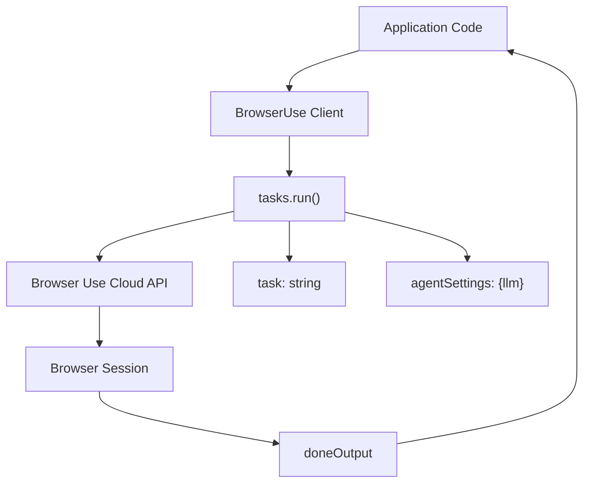
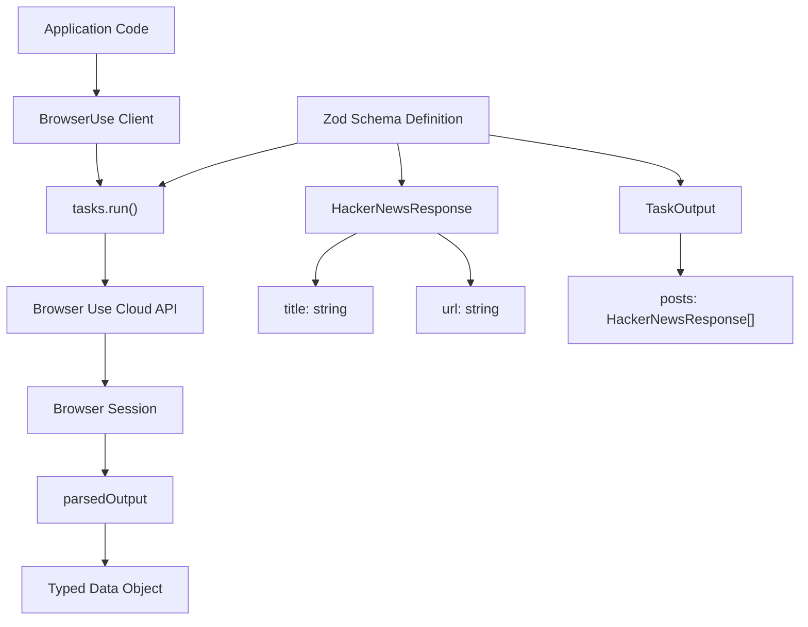
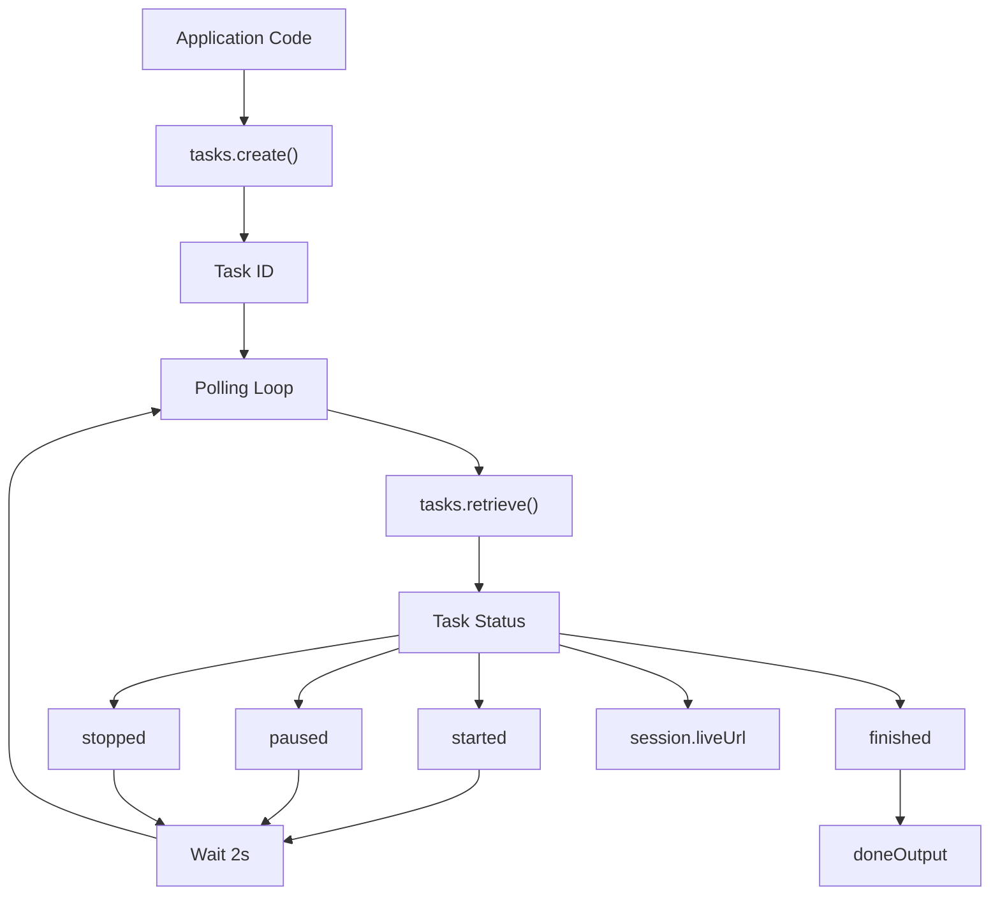
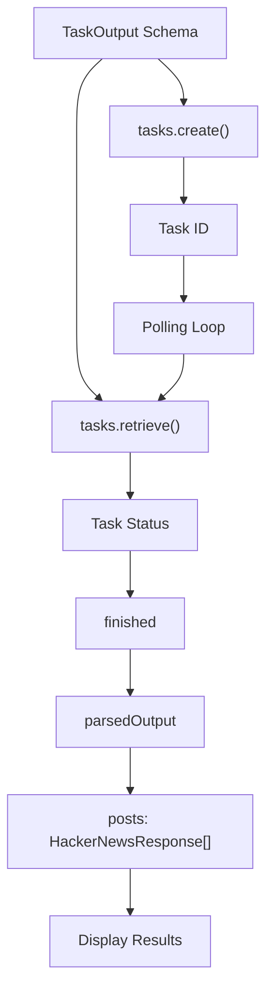

<!-- source: DeepWiki mcp.deepwiki.com · repo browser-use/browser-use-node · page 6.1 Basic Usage Examples · fetched 2026-10-30 -->

# Basic Usage Examples

<details>
<summary>Relevant source files</summary>

The following files were used as context for generating this wiki page:

- [examples/retrieve.ts](examples/retrieve.ts)
- [examples/run.ts](examples/run.ts)

</details>


This page provides simple, practical examples demonstrating the core functionality of the browser-use-node SDK. These examples show how to create and execute browser automation tasks using the most common patterns. 

For comprehensive documentation of the Tasks API and all its methods, see [Tasks API](#2.2). For real-time streaming examples, see [Streaming Examples](#6.2). For detailed information about structured output capabilities, see [Structured Output](#5.1).

## Simple Task Execution

The most straightforward way to use the browser-use-node SDK is with the `run` method, which creates a task and waits for completion in a single operation.

### Basic Task with Text Output



The basic pattern involves instantiating a `BrowserUse` client and calling `tasks.run()` with a natural language task description. The [examples/run.ts:10-25]() demonstrates this pattern:

- Initialize client with API key from environment
- Call `browseruse.tasks.run()` with task description and agent settings
- Access the result through `rsp.doneOutput`

Sources: [examples/run.ts:1-64]()

### Structured Output with Zod Schema

For tasks requiring structured data extraction, define a Zod schema and pass it to the `schema` parameter:



The [examples/run.ts:27-59]() shows how to extract structured data from Hacker News by defining schemas and accessing `rsp.parsedOutput` for typed results.

Sources: [examples/run.ts:27-64]()

## Manual Task Management

For more control over task execution, use the `create` and `retrieve` pattern to manually monitor task progress.

### Task Creation and Polling



This pattern provides real-time visibility into task execution. The [examples/retrieve.ts:13-43]() demonstrates:

- Creating a task with `browseruse.tasks.create()`
- Polling task status with `browseruse.tasks.retrieve()`
- Handling different status states (`started`, `paused`, `stopped`, `finished`)
- Accessing live session URL for monitoring

Sources: [examples/retrieve.ts:1-107]()

### Structured Output with Manual Polling

When combining structured output with manual task management, pass the schema to both `create` and `retrieve` operations:



The [examples/retrieve.ts:56-102]() shows this pattern with Hacker News data extraction, including:

- Schema definition for `HackerNewsResponse` and `TaskOutput`
- Passing schema to both `create` and `retrieve` calls
- Type-safe access to `status.parsedOutput`

Sources: [examples/retrieve.ts:45-107]()

## Key Configuration Options

### Agent Settings

Both examples demonstrate configuring the LLM model through `agentSettings`:

| Model | Usage |
|-------|-------|
| `gemini-2.5-flash` | Fast, cost-effective for simple tasks |
| `gpt-4.1` | Advanced reasoning for complex tasks |

### Task Parameters

| Parameter | Type | Purpose |
|-----------|------|---------|
| `task` | `string` | Natural language task description |
| `schema` | `ZodSchema` | Optional structured output schema |
| `agentSettings` | `object` | LLM and browser configuration |

Sources: [examples/run.ts:17-20](), [examples/run.ts:40-44](), [examples/retrieve.ts:18-21](), [examples/retrieve.ts:61-65]()

## Environment Setup

All examples assume proper environment configuration with the `BROWSER_USE_API_KEY` environment variable set. The [examples/run.ts:6-11]() and [examples/retrieve.ts:5-11]() show the standard setup pattern:

```typescript
import { env } from './utils';
env();
const browseruse = new BrowserUse();
```

Sources: [examples/run.ts:6-11](), [examples/retrieve.ts:5-11]()

---

