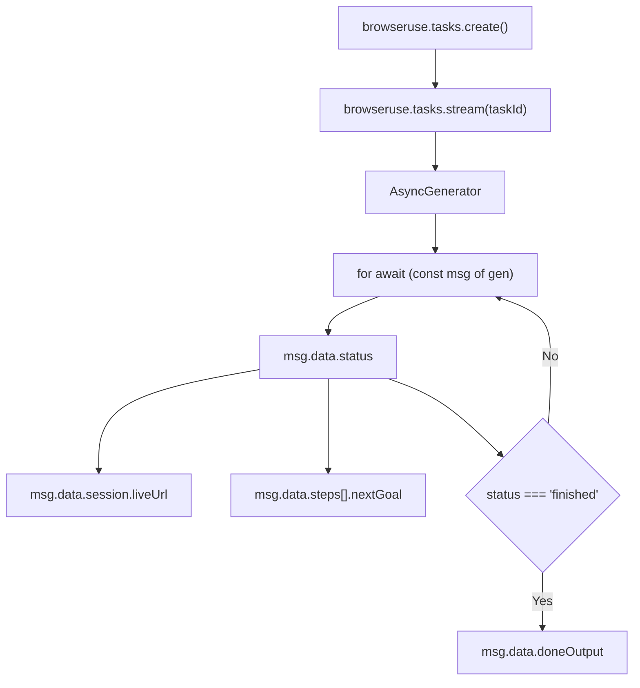
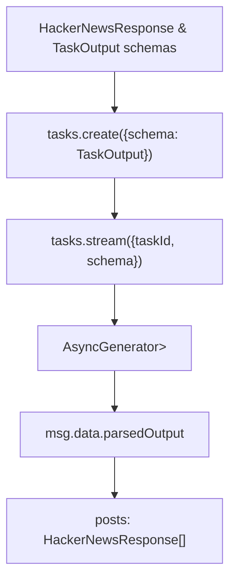
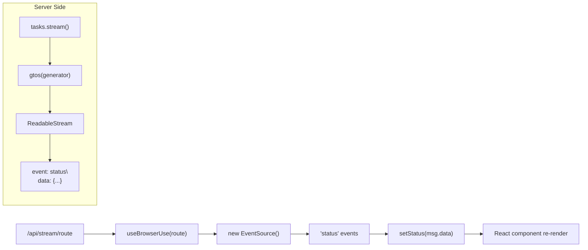
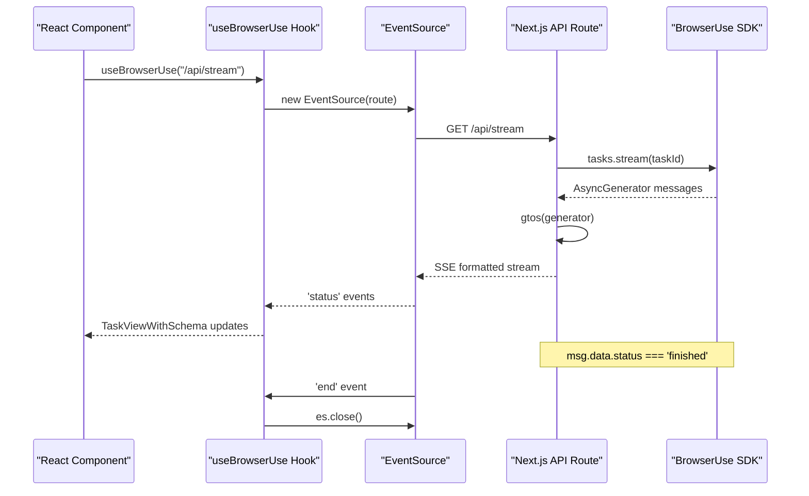

<!-- source: DeepWiki mcp.deepwiki.com · repo browser-use/browser-use-node · page 6.2 Streaming Examples · fetched 2026-10-30 -->

# Streaming Examples

<details>
<summary>Relevant source files</summary>

The following files were used as context for generating this wiki page:

- [examples/stream.ts](examples/stream.ts)
- [src/lib/nextjs/hooks/useBrowserUse.ts](src/lib/nextjs/hooks/useBrowserUse.ts)
- [src/lib/nextjs/server/utils.ts](src/lib/nextjs/server/utils.ts)
- [yarn.lock](yarn.lock)

</details>


This page provides practical examples of real-time task monitoring using the browser-use-node SDK's streaming capabilities. It demonstrates how to stream task updates, handle structured output, and integrate streaming into web applications.

For technical details about the streaming API, see [Task Streaming](#3.1). For basic task creation without streaming, see [Basic Usage Examples](#6.1). For webhook-based real-time updates, see [Webhook Integration Examples](#6.3).

## Basic Task Streaming

The most common streaming pattern involves creating a task and monitoring its progress in real-time using an async generator.

### Simple Status Monitoring



**Basic Streaming Flow Diagram**

The example in [examples/stream.ts:10-35]() demonstrates the fundamental streaming pattern:

1. **Task Creation**: `browseruse.tasks.create()` creates a new automation task
2. **Stream Initialization**: `browseruse.tasks.stream(task.id)` returns an async generator
3. **Real-time Updates**: The `for await` loop processes each update message
4. **Status Monitoring**: Each message contains `status`, `liveUrl`, and step information
5. **Completion Detection**: Stream ends when `status === 'finished'`

The basic example monitors three key pieces of information:
- **Task Status**: Current execution state (`running`, `finished`, `failed`)
- **Live URL**: Browser session viewing URL for real-time observation
- **Next Goal**: Current step description from the automation agent

Sources: [examples/stream.ts:10-35]()

## Structured Output Streaming

For applications requiring validated, typed output, the SDK supports streaming with Zod schema validation.

### Schema-Based Streaming



**Structured Output Streaming Architecture**

The structured streaming example in [examples/stream.ts:37-90]() shows how to:

1. **Define Schemas**: Create Zod schemas for expected output structure
2. **Type-Safe Creation**: Pass schema to `tasks.create()` for validation
3. **Typed Streaming**: Use `tasks.stream({taskId, schema})` for typed updates
4. **Parsed Access**: Access validated data via `msg.data.parsedOutput`

Key schema definitions from the example:
- `HackerNewsResponse`: Individual post structure with `title`, `url`, `score`
- `TaskOutput`: Container with `posts` array for multiple items

The typed stream provides both raw task updates and validated parsed output, enabling type-safe access to structured data as the task progresses.

Sources: [examples/stream.ts:37-90]()

## Next.js Integration Examples

The SDK provides specialized utilities for integrating streaming into Next.js applications using Server-Sent Events.

### React Hook Streaming



**Next.js Streaming Integration Architecture**

The `useBrowserUse` hook in [src/lib/nextjs/hooks/useBrowserUse.ts:10-37]() provides a React-friendly streaming interface:

1. **EventSource Connection**: Establishes SSE connection to streaming endpoint
2. **Event Handling**: Listens for `status` events and parses JSON data
3. **State Management**: Updates React state with latest task information
4. **Automatic Cleanup**: Closes connection when task finishes or component unmounts

The server-side `gtos` utility in [src/lib/nextjs/server/utils.ts:15-69]() converts async generators to web streams:

1. **Stream Conversion**: Transforms `AsyncGenerator` to `ReadableStream`
2. **SSE Formatting**: Encodes messages in Server-Sent Events format
3. **Event Callbacks**: Supports `onEvent` and `onFinished` handlers
4. **Error Handling**: Gracefully handles errors and closes streams

Sources: [src/lib/nextjs/hooks/useBrowserUse.ts:10-37](), [src/lib/nextjs/server/utils.ts:15-69]()

### Server-Sent Events Flow



**SSE Communication Sequence**

The sequence shows the complete flow from React component to SDK streaming, highlighting the key integration points:

- **Client Initialization**: Component calls `useBrowserUse` with API route
- **Stream Establishment**: EventSource connects to Next.js API endpoint
- **SDK Integration**: API route uses SDK's `tasks.stream()` method
- **Format Conversion**: `gtos` utility converts generator to SSE format
- **Real-time Updates**: Client receives typed updates via hook state
- **Automatic Termination**: Stream closes when task completes

Sources: [src/lib/nextjs/hooks/useBrowserUse.ts:14-34](), [src/lib/nextjs/server/utils.ts:34-66]()

## Stream Processing Patterns

### Async Generator Pattern

The core streaming mechanism uses async generators to provide a pull-based streaming model:

```typescript
// From examples/stream.ts
const gen = browseruse.tasks.stream(task.id);
for await (const msg of gen) {
  // Process each update
  console.log(msg.data.status, msg.data.session.liveUrl);
}
```

This pattern provides:
- **Backpressure Control**: Consumer controls iteration pace
- **Error Propagation**: Exceptions bubble up through the generator
- **Resource Cleanup**: Automatic cleanup when loop exits

### Event-Driven Pattern

For web applications, the SDK converts generators to event streams:

```typescript
// From src/lib/nextjs/server/utils.ts
export function gtos(gen: AsyncGenerator<BrowserUseEvent>) {
  return new ReadableStream({
    async start(controller) {
      for await (const msg of gen) {
        const payload = `event: ${msg.event}\ndata: ${JSON.stringify(msg.data)}\n\n`;
        controller.enqueue(enc.encode(payload));
      }
    }
  });
}
```

Key features:
- **SSE Compatibility**: Formats messages for EventSource consumption
- **JSON Serialization**: Automatic data encoding for web transport
- **Stream Control**: Proper start/close lifecycle management

Sources: [examples/stream.ts:22-32](), [src/lib/nextjs/server/utils.ts:34-66]()

### Message Structure

All streaming messages follow a consistent structure defined in [src/lib/nextjs/server/utils.ts:4-7]():

```typescript
export type BrowserUseEvent<T extends ZodType = ZodType> = {
  event: 'status';
  data: TaskViewWithSchema<T>;
};
```

The `TaskViewWithSchema<T>` provides:
- **Status Information**: Current task state and progress
- **Session Data**: Browser session details and live viewing URL
- **Step Tracking**: Individual automation steps and goals
- **Parsed Output**: Validated structured data (when schema provided)
- **Error Information**: Failure details and error messages

This unified message structure enables consistent handling across different streaming patterns while maintaining type safety through generic schema support.

Sources: [src/lib/nextjs/server/utils.ts:4-7](), [src/lib/parse.ts]()

---

