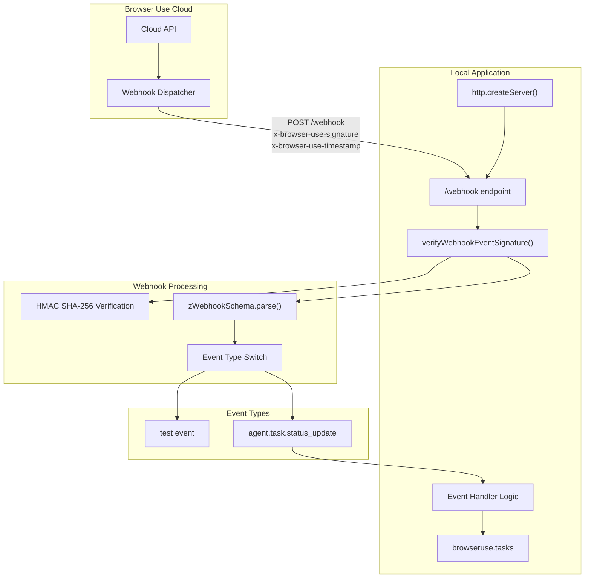
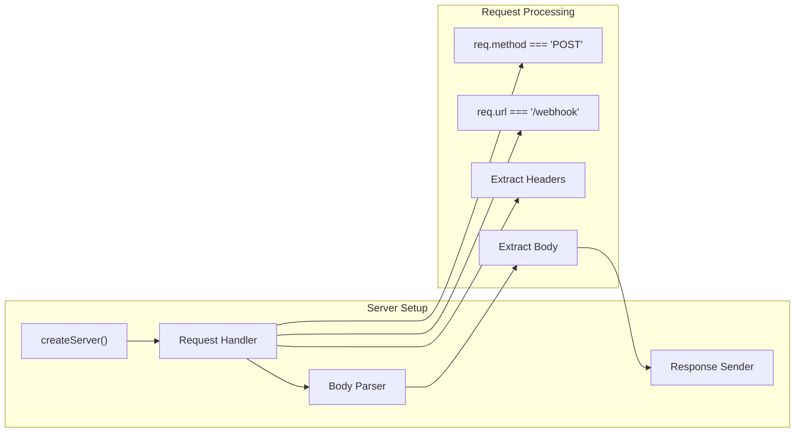
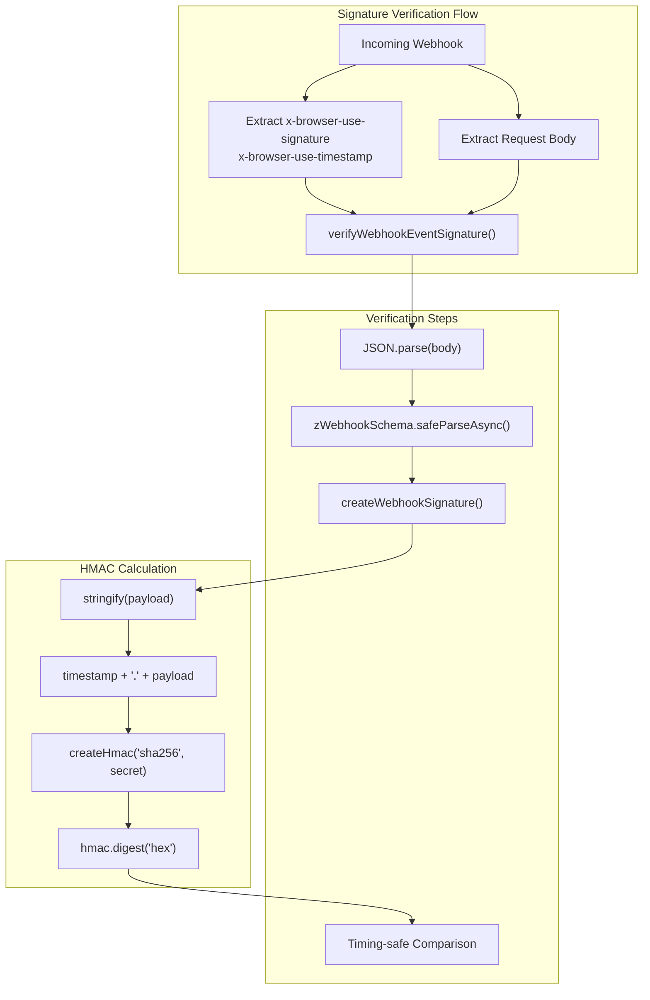
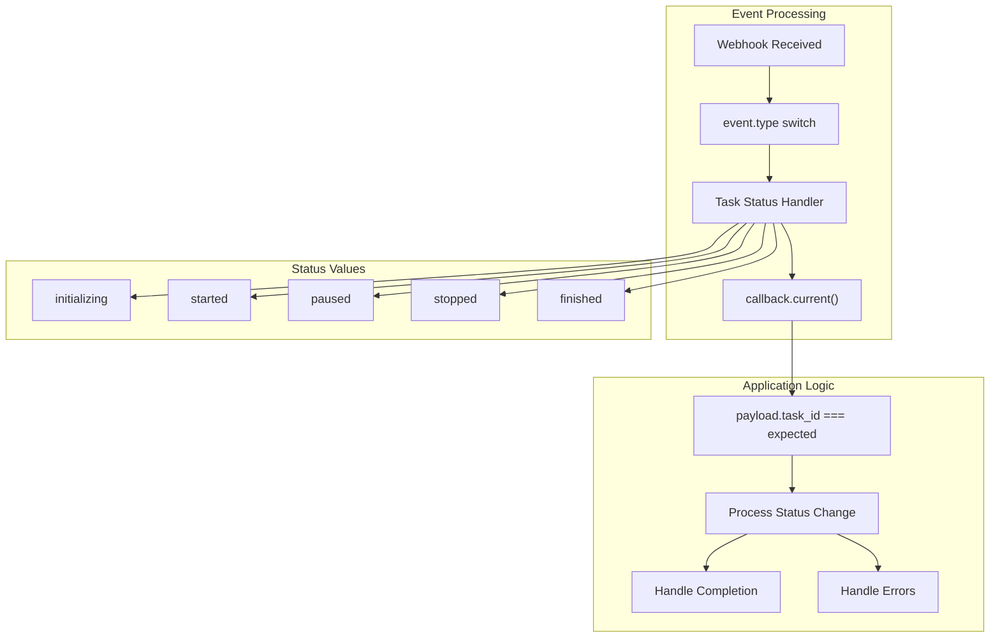
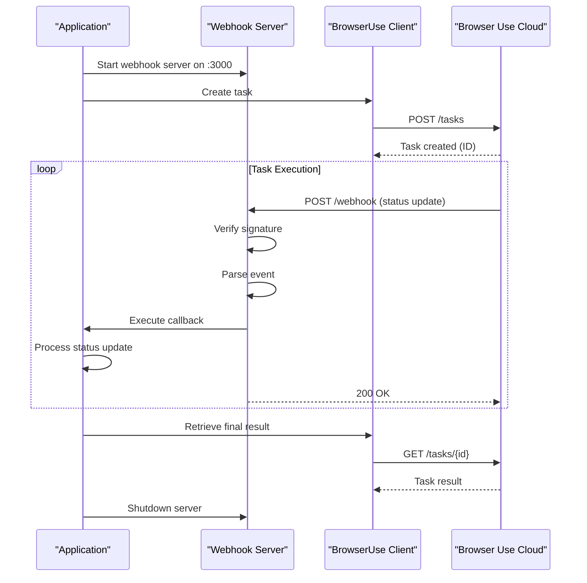

<!-- source: DeepWiki mcp.deepwiki.com · repo browser-use/browser-use-node · page 6.3 Webhook Integration Examples · fetched 2026-10-30 -->

# Webhook Integration Examples

Relevant source files

The following files were used as context for generating this wiki page:

- [examples/webhook.ts](examples/webhook.ts)
- [src/lib/webhooks.ts](src/lib/webhooks.ts)
- [tests/lib/webhooks.test.ts](tests/lib/webhooks.test.ts)

This page provides complete examples demonstrating how to set up and handle webhook events in your applications using the browser-use-node SDK. The examples cover webhook server setup, signature verification, event processing, and integration with task management workflows.

For general webhook concepts and configuration, see [Webhook System](#3.2). For CLI-based webhook forwarding during development, see [Webhook Forwarding](#4.2).

## Overview

The browser-use-node SDK provides a comprehensive webhook system that enables real-time notifications from the Browser Use Cloud API. Webhooks are particularly useful for monitoring task progress, handling completion events, and integrating browser automation into larger application workflows.

## Webhook Server Architecture

The following diagram shows the complete webhook integration architecture, mapping the key code entities to their roles in the system:

Sources: [examples/webhook.ts:1-177](), [src/lib/webhooks.ts:1-120]()

## Basic Webhook Server Setup

### Simple HTTP Server

The foundation of webhook integration is an HTTP server that can receive POST requests from the Browser Use Cloud API. Here's the basic server structure:

The webhook server implementation requires handling incoming HTTP POST requests and extracting the necessary headers and body content for signature verification.

Sources: [examples/webhook.ts:45-112]()

### Environment Configuration

Webhook integration requires proper environment setup:

| Variable | Purpose | Example |
|----------|---------|---------|
| `SECRET_KEY` | Webhook signature verification | `wh_secret_abc123...` |
| `BROWSER_USE_API_KEY` | API authentication | `bru_key_xyz789...` |
| `PORT` | Server listening port | `3000` |

Sources: [examples/webhook.ts:19-24]()

## Signature Verification

### Verification Process

The `verifyWebhookEventSignature` function implements HMAC SHA-256 signature verification to ensure webhook authenticity:

The verification process ensures both payload integrity and authenticity by validating the HMAC signature against the expected value.

Sources: [src/lib/webhooks.ts:67-99](), [src/lib/webhooks.ts:104-119]()

### Event Schema Validation

Webhook events are validated using Zod schemas that define the expected structure:

| Event Type | Schema | Payload Fields |
|------------|---------|---------------|
| `test` | `zWebhookTest` | `test: "ok"` |
| `agent.task.status_update` | `zWebhookAgentTaskStatusUpdate` | `session_id`, `task_id`, `status`, `metadata` |

The discriminated union `zWebhookSchema` ensures type-safe event processing across all supported webhook types.

Sources: [src/lib/webhooks.ts:54-58](), [src/lib/webhooks.ts:13-50]()

## Event Handling Patterns

### Task Status Update Processing

The primary webhook event type is `agent.task.status_update`, which provides real-time task progress updates:

Sources: [examples/webhook.ts:81-100](), [examples/webhook.ts:139-150]()

### Callback Pattern Implementation

The example demonstrates a callback pattern for handling asynchronous task completion:

The callback system allows the webhook handler to communicate with the main application logic without tight coupling between the HTTP server and task management code.

Sources: [examples/webhook.ts:41-43](), [examples/webhook.ts:139-150]()

## Complete Integration Example

### Full Workflow Implementation

The complete webhook integration example demonstrates the entire lifecycle from task creation to completion handling:

### Key Implementation Details

The complete example includes several important implementation patterns:

1. **Graceful Shutdown**: Proper cleanup of server resources on process termination
2. **Timeout Handling**: Prevention of indefinite waiting for task completion
3. **Error Recovery**: Robust error handling throughout the webhook processing pipeline
4. **Health Checks**: Basic health endpoint for monitoring server status

Sources: [examples/webhook.ts:166-171](), [examples/webhook.ts:131-154](), [examples/webhook.ts:105-111]()

### Environment Setup

The example uses a utility function to load environment variables and configure the application properly:

Sources: [examples/webhook.ts:10-12]()

## Production Considerations

### Security Best Practices

| Practice | Implementation | Purpose |
|----------|---------------|---------|
| Signature Verification | Always verify `x-browser-use-signature` | Prevent spoofed webhooks |
| Timestamp Validation | Check `x-browser-use-timestamp` freshness | Prevent replay attacks |
| HTTPS Endpoints | Use TLS in production | Protect webhook data in transit |
| Secret Rotation | Regularly update webhook secrets | Minimize exposure risk |

### Error Handling Strategies

The webhook system should implement comprehensive error handling:

- **Invalid Signatures**: Return 401 status code and log security events
- **Malformed Payloads**: Return 400 status code and log parsing errors
- **Processing Failures**: Return 500 status code while ensuring webhook acknowledgment
- **Network Issues**: Implement retry logic with exponential backoff

Sources: [examples/webhook.ts:69-79](), [examples/webhook.ts:101-103]()

### Testing and Validation

The SDK includes comprehensive test coverage for webhook functionality, including signature verification, payload parsing, and error scenarios:

Sources: [tests/lib/webhooks.test.ts:1-114]()

---

