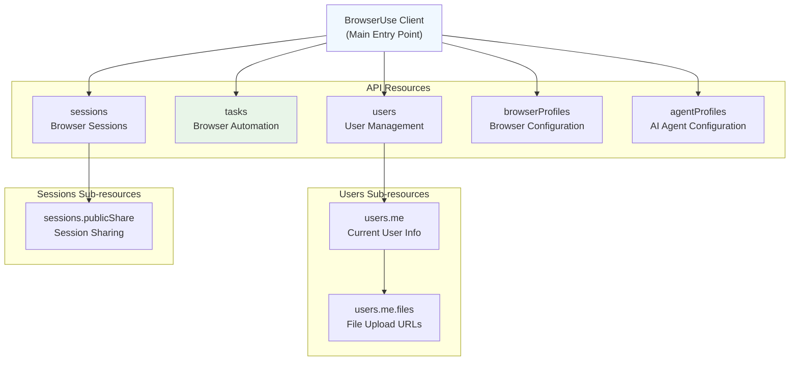
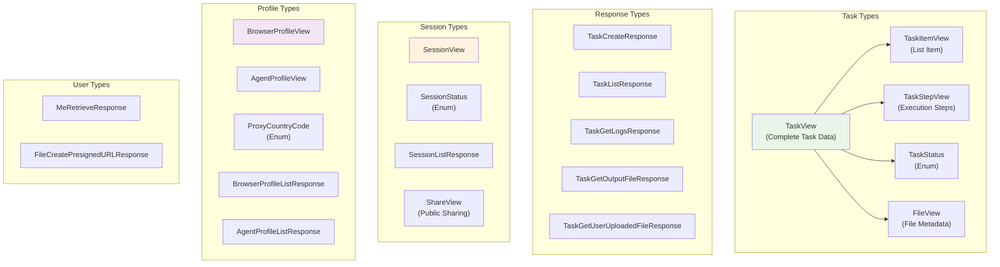
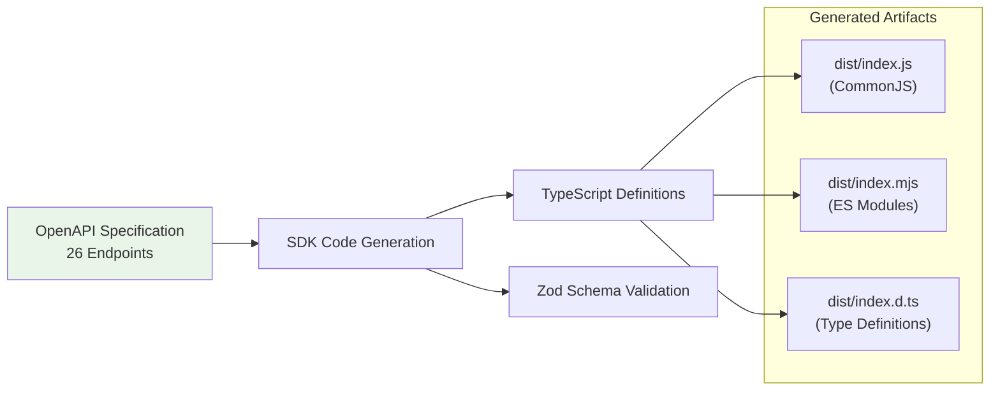

<!-- source: DeepWiki mcp.deepwiki.com · repo browser-use/browser-use-node · page 7 Reference · fetched 2026-10-30 -->

# Reference

Relevant source files

The following files were used as context for generating this wiki page:

- [.stats.yml](.stats.yml)
- [api.md](api.md)

This section provides comprehensive technical reference documentation for the browser-use-node SDK. It covers the complete API surface, configuration options, and release management details. This reference is intended for developers who need detailed technical specifications and complete API documentation.

For practical usage examples, see [Examples and Guides](#6). For conceptual explanations of the SDK architecture, see [Core Concepts](#2).

## API Structure Overview

The browser-use-node SDK provides access to the Browser Use Cloud API through a resource-oriented client architecture. The SDK exposes 26 configured endpoints across five main resource categories, each handling specific aspects of browser automation and management.

### Core Resource Architecture

**Sources:** [api.md:1-105](), [.stats.yml:1-5]()

### API Method Categories

The SDK implements standard CRUD operations across resources with consistent naming patterns:

| Operation | Method Pattern | Example |
|-----------|----------------|---------|
| Create | `resource.create(params)` | `client.tasks.create({...})` |
| Read | `resource.retrieve(id)` | `client.tasks.retrieve(taskId)` |
| Update | `resource.update(id, params)` | `client.tasks.update(taskId, {...})` |
| List | `resource.list(params)` | `client.tasks.list({...})` |
| Delete | `resource.delete(id)` | `client.sessions.delete(sessionId)` |

**Sources:** [api.md:40-104]()

## Type System and Response Objects

The SDK uses a comprehensive type system built on TypeScript definitions and Zod schemas for runtime validation. Each API resource defines specific view types and response objects.

### Core Type Hierarchy

**Sources:** [api.md:25-37](), [api.md:50-54](), [api.md:77-82](), [api.md:95-96](), [api.md:5-7](), [api.md:15-17]()

## Reference Documentation Structure

The complete reference documentation is organized into three main subsections:

### API Documentation ([7.1](#7.1))
Complete method signatures, parameter specifications, and response type definitions for all API resources. Includes detailed information about:
- Method parameters and validation rules
- Response object structures
- Error conditions and status codes
- Authentication requirements

### Configuration Reference ([7.2](#7.2))
Comprehensive guide to SDK configuration including:
- Client initialization options
- Environment variable configuration
- Authentication setup (API keys, webhook secrets)
- Retry policies and timeout settings
- Logging configuration

### Release Management ([7.3](#7.3))
Information about SDK versioning and release processes:
- Semantic versioning strategy
- Automated release process using release-please
- Breaking change policies
- Migration guides between versions

**Sources:** [.stats.yml:1-5]()

## OpenAPI Specification

The SDK is automatically generated from an OpenAPI specification that defines 26 configured endpoints. The specification ensures type safety and consistency across all API operations.

**Sources:** [.stats.yml:1-5]()

The OpenAPI specification hash (`0dae4d4d33a3ec93e470f9546e43fad3`) and configuration hash (`dd3e22b635fa0eb9a7c741a8aaca2a7f`) ensure version consistency and enable automated validation of SDK compatibility with the API service.

---

