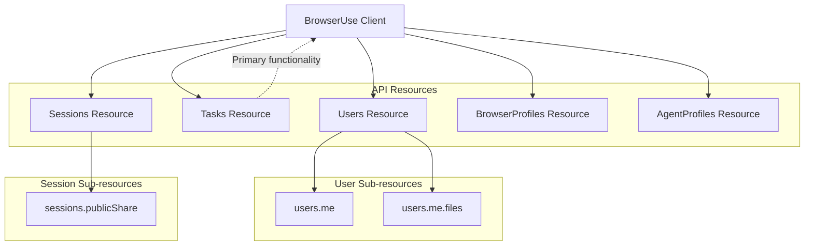
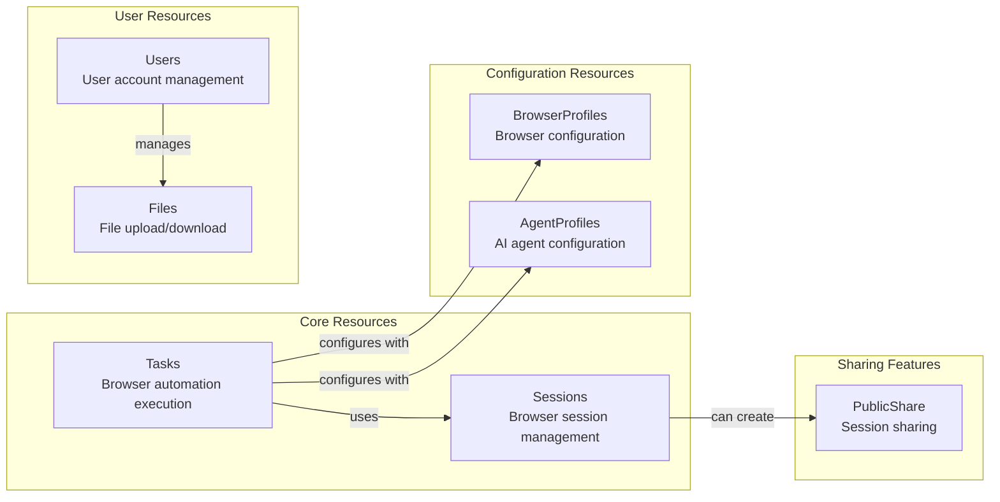
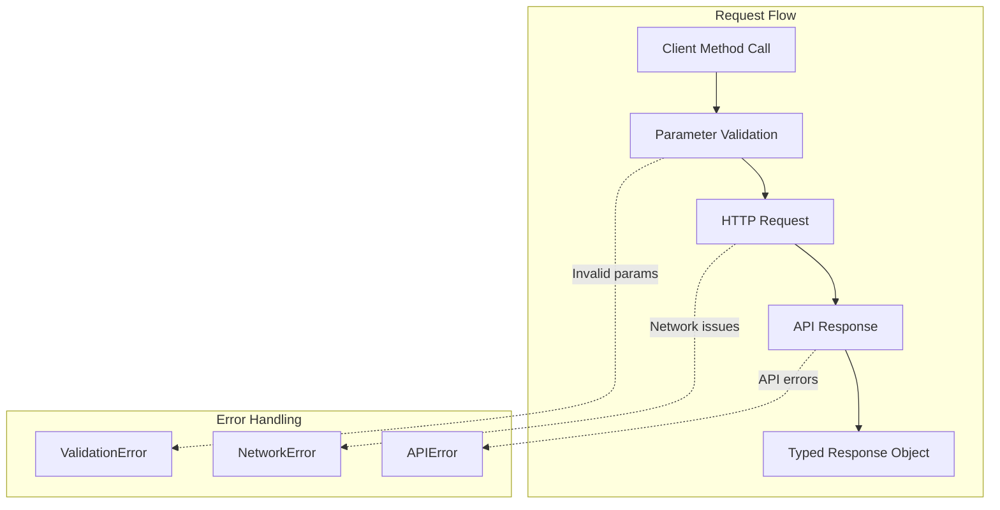

<!-- source: DeepWiki mcp.deepwiki.com · repo browser-use/browser-use-node · page 7.1 API Documentation · fetched 2026-10-30 -->

# API Documentation

Relevant source files

The following files were used as context for generating this wiki page:

- [api.md](api.md)
- [src/resources/index.ts](src/resources/index.ts)

This document provides a complete API reference for all client methods, parameters, and response types in the browser-use-node SDK. It covers the core `BrowserUse` client class and all available API resources for browser automation, session management, and profile configuration.

For setup and authentication information, see [Authentication](#5.2). For basic usage examples, see [Basic Usage Examples](#6.1). For streaming and real-time features, see [Task Streaming](#3.1).

## Client Architecture

The SDK is organized around a resource-based architecture where the main `BrowserUse` client provides access to specialized resource classes for different API functionality.

**Sources:** [src/resources/index.ts:1-47](), [api.md:1-105]()

## API Resource Hierarchy

The API is organized into logical resource groups that correspond to different aspects of browser automation and management.

**Sources:** [api.md:23-105](), [src/resources/index.ts:3-46]()

## Tasks Resource

The `Tasks` resource is the primary interface for browser automation. It provides methods for creating, monitoring, and managing browser automation tasks.

### Methods

| Method | HTTP Endpoint | Purpose |
|--------|---------------|---------|
| `create()` | `POST /tasks` | Create a new browser automation task |
| `retrieve(taskID)` | `GET /tasks/{task_id}` | Get details of a specific task |
| `update(taskID, params)` | `PATCH /tasks/{task_id}` | Update task configuration |
| `list(params)` | `GET /tasks` | List tasks with optional filtering |
| `getLogs(taskID)` | `GET /tasks/{task_id}/logs` | Retrieve task execution logs |
| `getOutputFile(fileID, params)` | `GET /tasks/{task_id}/output-files/{file_id}` | Download task output files |
| `getUserUploadedFile(fileID, params)` | `GET /tasks/{task_id}/user-uploaded-files/{file_id}` | Download user-uploaded files |

### Key Types

| Type | Purpose |
|------|---------|
| `TaskView` | Complete task information including status and steps |
| `TaskStatus` | Task execution status enumeration |
| `TaskItemView` | Summary view for task listings |
| `TaskStepView` | Individual step information within a task |
| `FileView` | File metadata and access information |
| `TaskCreateResponse` | Response from task creation |
| `TaskListResponse` | Paginated list of tasks |

**Sources:** [api.md:23-47](), [src/resources/index.ts:29-45]()

## Sessions Resource

The `Sessions` resource manages browser session lifecycle and configuration.

### Methods

| Method | HTTP Endpoint | Purpose |
|--------|---------------|---------|
| `retrieve(sessionID)` | `GET /sessions/{session_id}` | Get session details |
| `update(sessionID, params)` | `PATCH /sessions/{session_id}` | Update session configuration |
| `list(params)` | `GET /sessions` | List sessions with filtering |
| `delete(sessionID)` | `DELETE /sessions/{session_id}` | Terminate a session |

### PublicShare Sub-resource

The `publicShare` sub-resource enables sharing sessions publicly.

| Method | HTTP Endpoint | Purpose |
|--------|---------------|---------|
| `create(sessionID)` | `POST /sessions/{session_id}/public-share` | Create public share for session |
| `retrieve(sessionID)` | `GET /sessions/{session_id}/public-share` | Get public share details |
| `delete(sessionID)` | `DELETE /sessions/{session_id}/public-share` | Remove public sharing |

### Key Types

| Type | Purpose |
|------|---------|
| `SessionView` | Complete session information |
| `SessionStatus` | Session state enumeration |
| `SessionListResponse` | Paginated session listings |
| `ShareView` | Public share configuration and URLs |

**Sources:** [api.md:48-73](), [src/resources/index.ts:21-27]()

## Browser Profiles Resource

The `BrowserProfiles` resource manages browser configuration profiles that can be reused across tasks.

### Methods

| Method | HTTP Endpoint | Purpose |
|--------|---------------|---------|
| `create(params)` | `POST /browser-profiles` | Create new browser profile |
| `retrieve(profileID)` | `GET /browser-profiles/{profile_id}` | Get profile details |
| `update(profileID, params)` | `PATCH /browser-profiles/{profile_id}` | Update profile configuration |
| `list(params)` | `GET /browser-profiles` | List available profiles |
| `delete(profileID)` | `DELETE /browser-profiles/{profile_id}` | Delete profile |

### Key Types

| Type | Purpose |
|------|---------|
| `BrowserProfileView` | Complete browser profile configuration |
| `ProxyCountryCode` | Supported proxy country codes |
| `BrowserProfileListResponse` | Paginated profile listings |

**Sources:** [api.md:75-89](), [src/resources/index.ts:12-19]()

## Agent Profiles Resource

The `AgentProfiles` resource manages AI agent configuration profiles for browser automation behavior.

### Methods

| Method | HTTP Endpoint | Purpose |
|--------|---------------|---------|
| `create(params)` | `POST /agent-profiles` | Create new agent profile |
| `retrieve(profileID)` | `GET /agent-profiles/{profile_id}` | Get profile details |
| `update(profileID, params)` | `PATCH /agent-profiles/{profile_id}` | Update profile configuration |
| `list(params)` | `GET /agent-profiles` | List available profiles |
| `delete(profileID)` | `DELETE /agent-profiles/{profile_id}` | Delete profile |

### Key Types

| Type | Purpose |
|------|---------|
| `AgentProfileView` | Complete agent profile configuration |
| `AgentProfileListResponse` | Paginated profile listings |

**Sources:** [api.md:91-105](), [src/resources/index.ts:4-10]()

## Users Resource

The `Users` resource provides user account management and file operations.

### Me Sub-resource

The `me` sub-resource provides access to current user information.

| Method | HTTP Endpoint | Purpose |
|--------|---------------|---------|
| `retrieve()` | `GET /users/me` | Get current user details |

### Files Sub-resource

The `files` sub-resource manages file uploads through presigned URLs.

| Method | HTTP Endpoint | Purpose |
|--------|---------------|---------|
| `createPresignedURL(params)` | `POST /users/me/files/presigned-url` | Generate presigned URL for file upload |

### Key Types

| Type | Purpose |
|------|---------|
| `MeRetrieveResponse` | Current user information |
| `FileCreatePresignedURLResponse` | Presigned URL details for uploads |

**Sources:** [api.md:1-21](), [src/resources/index.ts:46]()

## Common API Patterns

All API resources follow consistent patterns for parameter handling, response formatting, and error handling.

### Parameter Types

Most API methods accept parameter objects with the following suffixes:
- `*CreateParams` - Parameters for creating resources
- `*UpdateParams` - Parameters for updating existing resources  
- `*ListParams` - Parameters for listing/filtering resources

### Response Types

API responses follow consistent naming patterns:
- `*View` - Complete resource representation
- `*Response` - Specific operation response (often includes metadata)
- `*ListResponse` - Paginated list responses with items and pagination info

**Sources:** [src/resources/index.ts:1-47](), [api.md:1-105]()

---

