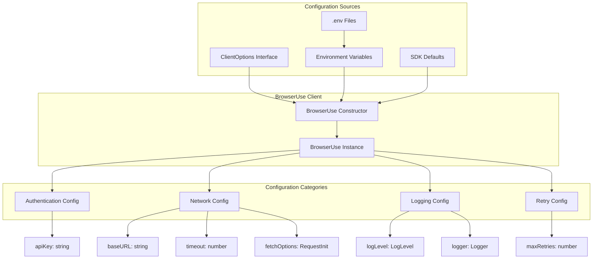
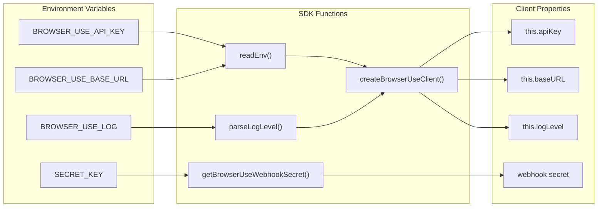
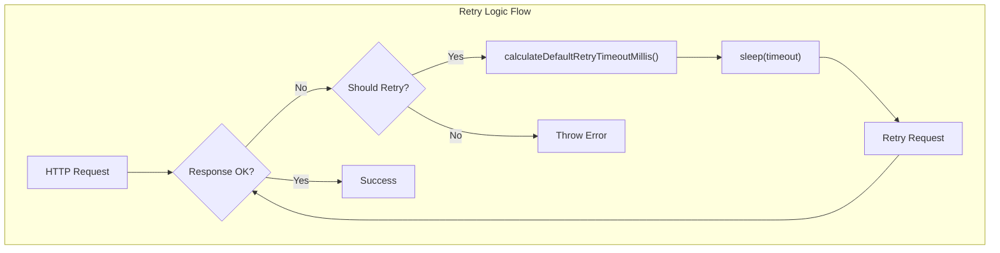
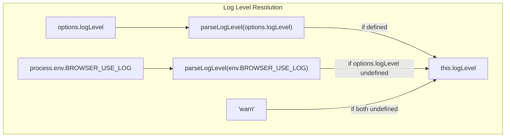
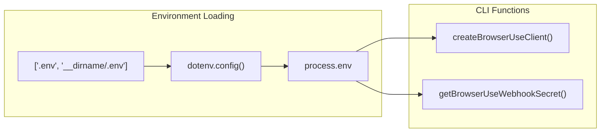
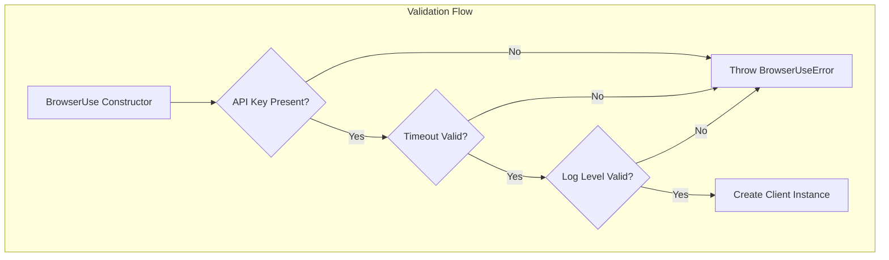

<!-- source: DeepWiki mcp.deepwiki.com · repo browser-use/browser-use-node · page 7.2 Configuration Reference · fetched 2026-10-30 -->

# Configuration Reference

<details>
<summary>Relevant source files</summary>

The following files were used as context for generating this wiki page:

- [examples/.env.example](examples/.env.example)
- [examples/utils.ts](examples/utils.ts)
- [src/client.ts](src/client.ts)
- [src/lib/bin/auth.ts](src/lib/bin/auth.ts)

</details>


This document provides a comprehensive reference for configuring the browser-use-node SDK. It covers all available configuration options, environment variables, and client settings used to customize the SDK's behavior across different environments and use cases.

For information about using these configurations in practice, see [Getting Started](#1.2). For authentication setup specifically, see [Authentication](#5.2).

## Configuration Architecture

The SDK uses a layered configuration approach where settings can be provided through environment variables, client options, or configuration files. The priority order is: explicit client options > environment variables > defaults.



**Sources:** [src/client.ts:76-149](), [src/client.ts:181-216]()

## Environment Variables

The SDK recognizes several environment variables for configuration. These are automatically loaded when creating a client instance.

| Variable | Purpose | Default | Example |
|----------|---------|---------|---------|
| `BROWSER_USE_API_KEY` | API authentication key | Required | `bu_abc123...` |
| `BROWSER_USE_BASE_URL` | API base URL override | `https://api.browser-use.com/api/v2` | `https://custom-api.example.com` |
| `BROWSER_USE_LOG` | Logging level | `warn` | `debug`, `info`, `warn`, `error` |
| `SECRET_KEY` | Webhook signature secret | None | `your-webhook-secret` |



**Sources:** [src/client.ts:182-183](), [src/client.ts:204-207](), [src/lib/bin/auth.ts:5-33](), [src/lib/bin/auth.ts:35-63]()

## ClientOptions Interface

The `ClientOptions` interface defines all configuration parameters that can be passed to the `BrowserUse` constructor.

### Authentication Options

```typescript
interface ClientOptions {
  apiKey?: string | undefined;
}
```

- **`apiKey`**: Your Browser Use API key. If not provided, the SDK will look for `BROWSER_USE_API_KEY` environment variable.

**Sources:** [src/client.ts:77-80](), [src/client.ts:186-190]()

### Network Configuration

```typescript
interface ClientOptions {
  baseURL?: string | null | undefined;
  timeout?: number | undefined;
  fetchOptions?: MergedRequestInit | undefined;
  fetch?: Fetch | undefined;
}
```

- **`baseURL`**: Override the default API endpoint. Defaults to `process.env['BROWSER_USE_BASE_URL']` or `https://api.browser-use.com/api/v2`
- **`timeout`**: Request timeout in milliseconds. Default: `60000` (1 minute)
- **`fetchOptions`**: Additional `RequestInit` options passed to fetch calls
- **`fetch`**: Custom fetch implementation. Uses global fetch if not provided

**Sources:** [src/client.ts:82-110](), [src/client.ts:195-210](), [src/client.ts:742]()

### Retry Configuration

```typescript
interface ClientOptions {
  maxRetries?: number | undefined;
}
```

- **`maxRetries`**: Maximum number of retry attempts for failed requests. Default: `2`

The SDK implements exponential backoff with jitter for retries:



**Sources:** [src/client.ts:113-118](), [src/client.ts:209](), [src/client.ts:563-584](), [src/client.ts:625-638]()

### Headers and Query Parameters

```typescript
interface ClientOptions {
  defaultHeaders?: HeadersLike | undefined;
  defaultQuery?: Record<string, string | undefined> | undefined;
}
```

- **`defaultHeaders`**: Headers included with every request. Can be overridden per request by setting to `null`
- **`defaultQuery`**: Query parameters included with every request. Can be removed per request by setting to `undefined`

**Sources:** [src/client.ts:121-134](), [src/client.ts:244-246]()

### Logging Configuration

```typescript
interface ClientOptions {
  logLevel?: LogLevel | undefined;
  logger?: Logger | undefined;
}
```

- **`logLevel`**: Controls logging verbosity. Values: `debug`, `info`, `warn`, `error`
- **`logger`**: Custom logger implementation. Defaults to `globalThis.console`

Log level resolution priority:
1. Explicit `logLevel` option
2. `BROWSER_USE_LOG` environment variable  
3. Default: `warn`



**Sources:** [src/client.ts:137-148](), [src/client.ts:200-207]()

## Environment File Configuration

The SDK supports loading configuration from `.env` files in development environments.

### Basic .env Setup

Create a `.env` file in your project root:

```bash
# API Configuration
BROWSER_USE_API_KEY=your_api_key_here

# Optional: Custom API endpoint
BROWSER_USE_BASE_URL=https://api.browser-use.com/api/v2

# Optional: Logging level
BROWSER_USE_LOG=info

# Webhook Configuration
SECRET_KEY=your_webhook_secret
```

### Environment File Loading

The CLI tools automatically load environment variables from `.env` files:



**Sources:** [examples/.env.example:1-22](), [src/lib/bin/auth.ts:17-25](), [src/lib/bin/auth.ts:47-55](), [examples/utils.ts:32-34]()

## Configuration Examples

### Basic Client Configuration

```typescript
import { BrowserUse } from 'browser-use';

const client = new BrowserUse({
  apiKey: 'your-api-key',
  timeout: 30000,
  maxRetries: 3,
  logLevel: 'info'
});
```

### Advanced Network Configuration

```typescript
const client = new BrowserUse({
  apiKey: process.env.BROWSER_USE_API_KEY,
  baseURL: 'https://custom-api.example.com',
  fetchOptions: {
    headers: {
      'Custom-Header': 'value'
    }
  },
  defaultHeaders: {
    'X-Client-Version': '1.0.0'
  }
});
```

### Custom Logger Configuration

```typescript
const customLogger = {
  debug: (msg: string) => console.debug(`[DEBUG] ${msg}`),
  info: (msg: string) => console.info(`[INFO] ${msg}`),
  warn: (msg: string) => console.warn(`[WARN] ${msg}`),
  error: (msg: string) => console.error(`[ERROR] ${msg}`)
};

const client = new BrowserUse({
  apiKey: process.env.BROWSER_USE_API_KEY,
  logger: customLogger,
  logLevel: 'debug'
});
```

**Sources:** [src/client.ts:154-216](), [src/internal/utils/log.ts]()

## Runtime Configuration Updates

### Creating Client Variants

Use `withOptions()` to create new client instances with modified configuration:

```typescript
const baseClient = new BrowserUse({ apiKey: 'key' });

const debugClient = baseClient.withOptions({
  logLevel: 'debug',
  timeout: 10000
});
```

The `withOptions()` method preserves all existing configuration while applying the specified overrides.

**Sources:** [src/client.ts:218-235]()

## Configuration Validation

The SDK performs validation on configuration values:

- **API Key**: Required, throws `BrowserUseError` if missing
- **Timeout**: Must be positive integer when specified
- **Base URL**: Validates URL format and handles trailing slashes
- **Log Level**: Validates against known levels with helpful error messages



**Sources:** [src/client.ts:186-190](), [src/client.ts:648](), [src/internal/utils/log.ts]()

---

