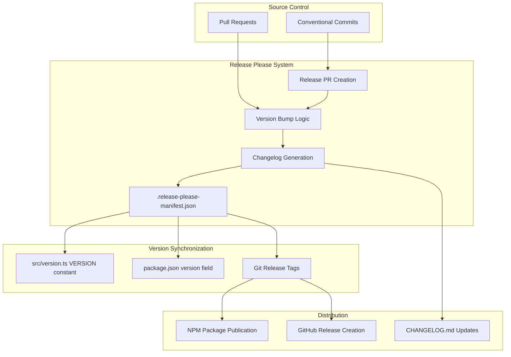
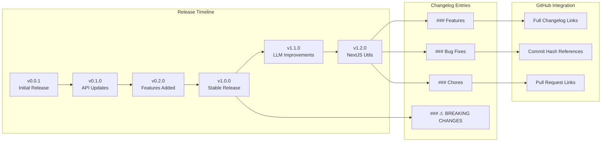

<!-- source: DeepWiki mcp.deepwiki.com · repo browser-use/browser-use-node · page 7.3 Release Management · fetched 2026-10-30 -->

# Release Management

<details>
<summary>Relevant source files</summary>

The following files were used as context for generating this wiki page:

- [.release-please-manifest.json](.release-please-manifest.json)
- [CHANGELOG.md](CHANGELOG.md)
- [src/version.ts](src/version.ts)

</details>


This document covers the versioning strategy, automated release processes, and changelog management for the browser-use-node SDK. It explains how version numbers are tracked, how releases are automated using release-please, and how changelog entries are generated and maintained.

For information about package distribution and build artifacts, see [Package Structure](#1.1). For details about CLI tools and their versioning, see [CLI Overview](#4.1).

## Versioning Strategy

The browser-use-node SDK follows semantic versioning (semver) principles with automated version management through the release-please system. The current version is maintained in multiple synchronized locations to ensure consistency across the codebase.

### Version Tracking

The SDK uses a centralized version constant that serves as the single source of truth for the current package version:

```typescript
export const VERSION = '1.2.0'; // x-release-please-version
```

The special comment `// x-release-please-version` enables automated version updates by the release-please tool, which parses this marker to identify where version numbers should be updated during releases.

**Sources:** [src/version.ts:1-2]()

### Release Manifest

The release-please configuration maintains a manifest file that tracks the current version for automated release management:

```json
{
  ".": "1.2.0"
}
```

This manifest file coordinates version bumps across the entire package and ensures that all version references remain synchronized during automated releases.

**Sources:** [.release-please-manifest.json:1-3]()

## Automated Release Process

The release management system uses release-please to automate version bumping, changelog generation, and release creation based on conventional commit patterns.

### Release Please Integration



The automated system analyzes commit messages to determine the appropriate version bump (patch, minor, or major) and generates corresponding changelog entries.

**Sources:** [src/version.ts:1](), [.release-please-manifest.json:1-3]()

### Commit Convention Analysis

The release system processes different types of commits to determine version increments:

| Commit Type | Version Bump | Example |
|-------------|--------------|---------|
| `feat:` | Minor version | `feat: NextJS Utils` |
| `fix:` | Patch version | `fix: stream completion` |
| `BREAKING CHANGE:` | Major version | Performance improvements with breaking changes |
| `chore:` | No version bump | `chore: add package to package.json` |

**Sources:** [CHANGELOG.md:9](), [CHANGELOG.md:24](), [CHANGELOG.md:45-47]()

## Changelog Management

The SDK maintains a comprehensive changelog that documents all releases with detailed commit information and GitHub comparison links.

### Changelog Structure

Each release entry includes:
- Version number and release date
- Full changelog comparison link to GitHub
- Categorized changes (Features, Bug Fixes, Chores, Breaking Changes)
- Individual commit references with links

### Version History Tracking



**Sources:** [CHANGELOG.md:3-5](), [CHANGELOG.md:32-34](), [CHANGELOG.md:41-43]()

### Recent Release Example

The latest release (v1.2.0) demonstrates the changelog format:

```markdown
## 1.2.0 (2025-08-22)

Full Changelog: [v1.1.3...v1.2.0](https://github.com/browser-use/browser-use-node/compare/v1.1.3...v1.2.0)

### Features

* NextJS Utils ([b5e1006](https://github.com/browser-use/browser-use-node/commit/b5e10060a064de9a9454fa90e461f09154094742))
```

Each entry includes the GitHub comparison link and individual commit references with their hash identifiers.

**Sources:** [CHANGELOG.md:3-9]()

## Release Workflow

The complete release process integrates version management, changelog generation, and package publication into a streamlined workflow.

### Version Constant Updates

When releases are created, the `VERSION` constant in `src/version.ts` is automatically updated by release-please, maintaining synchronization between the codebase and published package versions. This constant can be imported and used throughout the SDK for version reporting and compatibility checks.

### Breaking Change Management

Major version releases include breaking change documentation with clear migration guidance. The v1.0.0 release exemplifies this approach:

```markdown
### ⚠ BREAKING CHANGES

* This PR creates a v1 release of the Browser Use Node SDK
```

This ensures users understand the impact of upgrading and can plan their migration accordingly.

**Sources:** [CHANGELOG.md:45-47](), [src/version.ts:1](), [.release-please-manifest.json:2]()