# Page: Overview

# Overview

<details>
<summary>Relevant source files</summary>

The following files were used as context for generating this wiki page:

- [CHANGELOG.md](CHANGELOG.md)
- [README.md](README.md)
- [package.json](package.json)
- [scripts/bootstrap](scripts/bootstrap)

</details>


This document provides a comprehensive overview of the browser-use-node SDK, covering its purpose, architecture, and core capabilities. The browser-use-node SDK is the official TypeScript/JavaScript library for interacting with the Browser Use Cloud API, enabling developers to automate web browsers programmatically through AI-powered agents.

For detailed implementation guides, see [Getting Started](#1.2). For specific API usage patterns, see [Tasks API](#2.2) and [Real-time Features](#3).

## Purpose and Capabilities

The browser-use-node SDK serves as a client library that abstracts the complexity of browser automation by providing a simple, type-safe interface to the Browser Use Cloud service. The SDK enables developers to:

- **Create and manage browser automation tasks** through natural language instructions
- **Stream real-time updates** from running browser automation sessions
- **Handle structured output** using Zod schema validation
- **Receive webhook notifications** for task status changes
- **Manage browser sessions and profiles** for consistent automation environments
- **Execute tasks through a CLI interface** for development and testing workflows

The SDK is designed to work across multiple JavaScript runtime environments and provides both CommonJS and ES Module exports for maximum compatibility.

## Core Architecture

The SDK follows a resource-oriented architecture centered around the `BrowserUse` client class, which provides access to specialized API resources for different aspects of browser automation.

### Client and Resource Structure

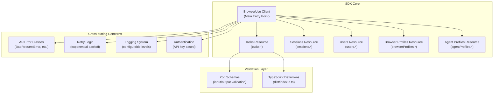

**Sources:** [package.json:1-86](), [README.md:14-25]()

### Task Management and Communication Patterns

The SDK provides multiple communication patterns for interacting with browser automation tasks, supporting both synchronous and asynchronous workflows.

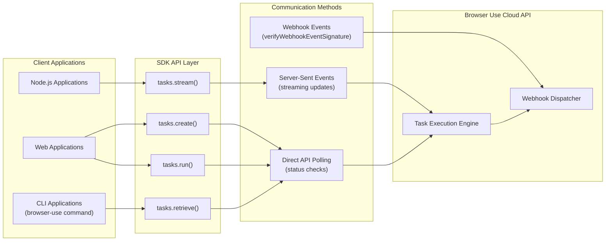

**Sources:** [README.md:54-82](), [README.md:88-122](), [package.json:31-33]()

## Distribution and Runtime Support

The SDK is packaged with multiple distribution formats to support diverse JavaScript environments and build systems.

| Distribution Format | File Path | Usage |
|---------------------|-----------|-------|
| CommonJS | `dist/index.js` | Node.js, traditional bundlers |
| ES Modules | `dist/index.mjs` | Modern browsers, Deno, Bun |
| TypeScript Definitions | `dist/index.d.ts` | Type checking and IDE support |
| CLI Executable | `dist/lib/bin/cli.js` | Command-line automation |

**Runtime Environment Compatibility:**

- **Node.js** 20 LTS or later
- **Modern Browsers** (Chrome, Firefox, Safari, Edge)
- **Alternative Runtimes** (Deno v1.28.0+, Bun 1.0+)
- **Edge Computing** (Cloudflare Workers, Vercel Edge Runtime)
- **Testing Frameworks** (Jest 28+ with "node" environment)

The build system uses TypeScript compilation with dual-format output, ensuring compatibility across the JavaScript ecosystem while maintaining type safety.

**Sources:** [package.json:6-8](), [package.json:70-85](), [README.md:366-376]()

## Key Features

### Structured Output Validation

The SDK integrates with Zod schemas to provide type-safe, validated output from browser automation tasks. This ensures that the data returned from AI agents matches expected structures and types.

### Real-time Streaming

Tasks can be monitored in real-time through async generator patterns, allowing applications to respond immediately to browser automation progress and results.

### Webhook Integration

The SDK includes utilities for verifying webhook signatures and parsing webhook events, enabling secure real-time notifications for task status changes.

### CLI Tooling

A command-line interface provides development and testing capabilities, including webhook forwarding for local development environments.

### Error Handling and Resilience

Built-in retry logic with exponential backoff, comprehensive error types, and configurable timeout handling ensure robust operation in production environments.

**Sources:** [README.md:29-50](), [README.md:160-200](), [README.md:227-278]()

---

# Page: Package Structure

# Package Structure

<details>
<summary>Relevant source files</summary>

The following files were used as context for generating this wiki page:

- [package.json](package.json)
- [scripts/bootstrap](scripts/bootstrap)
- [src/resources/index.ts](src/resources/index.ts)

</details>


This document explains the organization and distribution structure of the browser-use-node SDK, including its multiple output formats, source code layout, and CLI tooling. This covers the physical packaging and distribution mechanisms of the SDK.

For information about the logical architecture and API resources, see [Core Concepts](#2). For details about the CLI functionality, see [CLI Tools](#4).

## Distribution Formats

The browser-use-node SDK is distributed as a multi-format package that supports both CommonJS and ES Module environments. The package provides multiple entry points to ensure compatibility across different JavaScript runtimes and bundlers.

### Entry Points

The SDK provides several entry points configured through the `exports` field:

| Format | Entry Point | Target Environment |
|--------|-------------|-------------------|
| CommonJS | `dist/index.js` | Node.js, older bundlers |
| ES Modules | `dist/index.mjs` | Modern browsers, modern bundlers |
| TypeScript Definitions | `dist/index.d.ts` | TypeScript development |
| CLI Binary | `dist/lib/bin/cli.js` | Command-line usage |

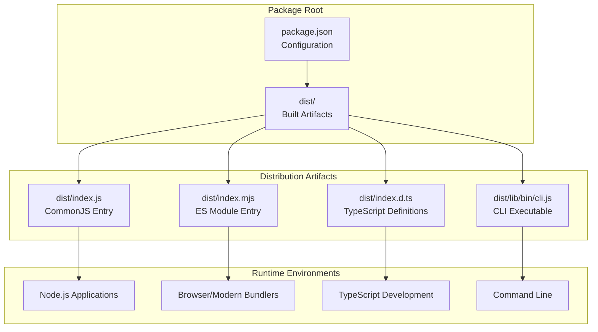

**Package Entry Point Configuration**

Sources: [package.json:6-8](), [package.json:70-85](), [package.json:31-33]()

### Package Metadata

The package is configured with the following key metadata:

- **Name**: `browser-use-sdk` - The published npm package name
- **Version**: Managed through automated release process (currently `1.2.0`)
- **Type**: `commonjs` - Default module system for Node.js compatibility
- **License**: Apache-2.0
- **Repository**: `github:browser-use/browser-use-node`

The `files` field is set to `["**/*"]`, meaning all built files in the `dist` directory are included in the published package.

Sources: [package.json:1-18]()

## Source Code Organization

The SDK source code is organized into logical modules that map directly to the built distribution artifacts.

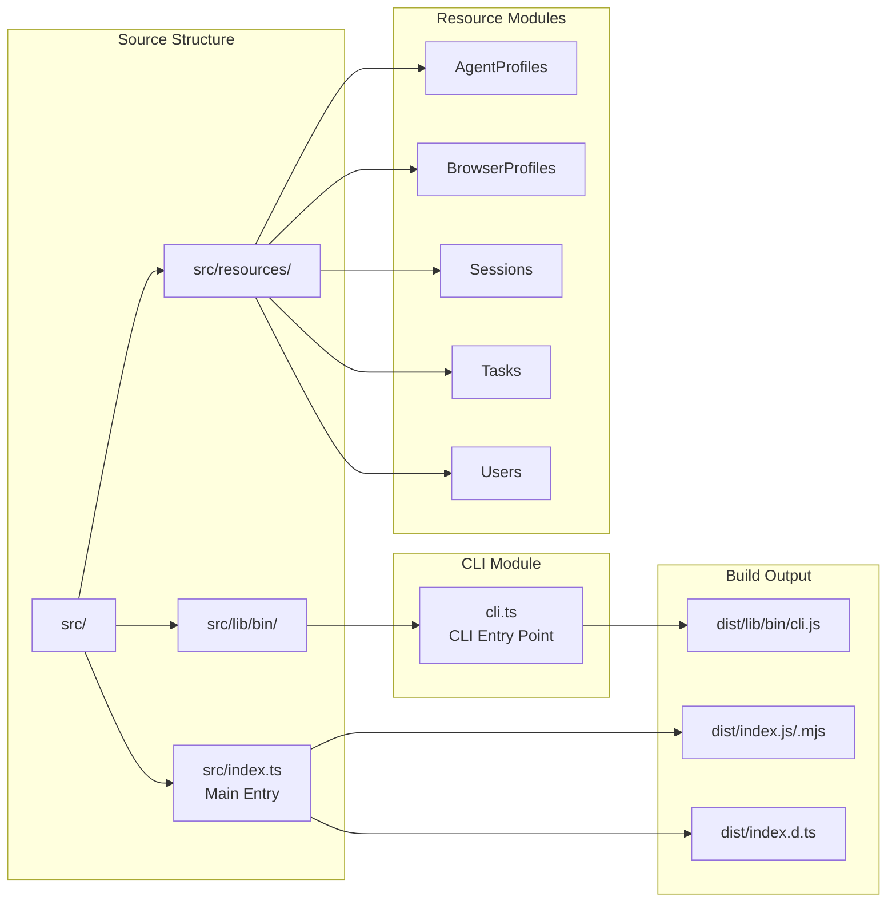

**Source to Distribution Mapping**

### Core API Resources

The main API functionality is organized into resource modules under `src/resources/`:

| Resource | Exported Types | Purpose |
|----------|---------------|---------|
| `AgentProfiles` | `AgentProfileView`, `AgentProfileCreateParams` | AI agent configuration management |
| `BrowserProfiles` | `BrowserProfileView`, `ProxyCountryCode` | Browser session configuration |
| `Sessions` | `SessionView`, `SessionStatus` | Browser session lifecycle |
| `Tasks` | `TaskView`, `TaskStatus`, `TaskStepView` | Browser automation tasks |
| `Users` | `Users` | User account management |

These resources are re-exported through the main index file to provide a clean public API surface.

Sources: [src/resources/index.ts:1-47]()

### CLI Structure

The CLI functionality is organized separately under `src/lib/bin/` and built to `dist/lib/bin/cli.js`. The built CLI file is made executable through a post-build script and configured as a binary in the package.json.

Sources: [package.json:22](), [package.json:31-33]()

## Build System

The package uses a custom build system that produces multiple output formats from TypeScript source code.

### Build Scripts

| Script | Purpose |
|--------|---------|
| `build` | Compiles TypeScript to JavaScript for both CommonJS and ESM |
| `postbuild` | Makes CLI executable and performs post-processing |
| `prepare` | Git-aware build for development installations |

### Build Artifacts

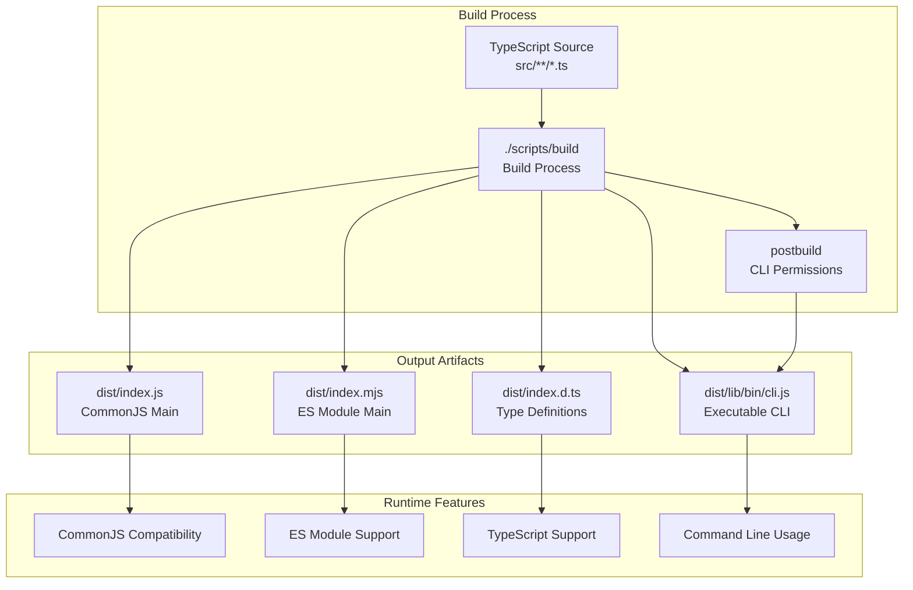

**Build Process and Artifacts**

The build process ensures that:
- CommonJS and ES Module formats are both generated from the same source
- TypeScript definitions are preserved for development-time type checking
- CLI binary is properly marked as executable
- All artifacts maintain consistent APIs across formats

Sources: [package.json:19-29]()

## Development Environment

### Dependencies

The package maintains a clean separation between runtime and development dependencies:

- **Runtime Dependencies**: Minimal dependencies including `@dotenvx/dotenvx` and `fast-json-stable-stringify`
- **Peer Dependencies**: `react` (for React integration) and `zod` (for schema validation)
- **Development Dependencies**: Comprehensive tooling for TypeScript, testing, linting, and building

### Bootstrap Process

The development environment setup is handled by the bootstrap script, which:
1. Installs Homebrew dependencies on macOS (if `Brewfile` exists)
2. Detects and uses the appropriate package manager (`yarn` or `npm`)
3. Installs all Node.js dependencies

Sources: [scripts/bootstrap:1-19](), [package.json:34-69]()

---

# Page: Getting Started

# Getting Started

<details>
<summary>Relevant source files</summary>

The following files were used as context for generating this wiki page:

- [README.md](README.md)
- [examples/.env.example](examples/.env.example)
- [examples/run.ts](examples/run.ts)
- [examples/utils.ts](examples/utils.ts)
- [src/lib/bin/auth.ts](src/lib/bin/auth.ts)

</details>


This page covers the essential steps to install the browser-use-node SDK, configure authentication, and run your first browser automation task. For detailed information about specific API resources, see [API Resources](#2.3). For advanced configuration options, see [Configuration Reference](#7.2).

## Installation

Install the SDK using your preferred package manager:

```bash
npm install browser-use-sdk
```

```bash
pnpm add browser-use-sdk
```

```bash
yarn add browser-use-sdk
```

The SDK supports multiple JavaScript runtimes and distribution formats. It provides both CommonJS and ES Module exports, ensuring compatibility across Node.js, browsers, Deno, Bun, and edge runtime environments.

**Sources:** [README.md:4](), [README.md:365-375]()

## Authentication Setup

### API Key Configuration

Before using the SDK, you need to obtain an API key from Browser Use Cloud and configure it in your environment.

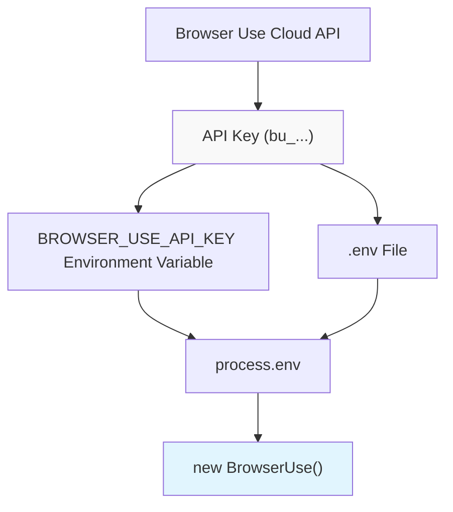

**Authentication Flow Diagram**

The SDK automatically loads the API key from the `BROWSER_USE_API_KEY` environment variable. You can configure this in several ways:

### Environment Variable Method

Set the environment variable directly:

```bash
export BROWSER_USE_API_KEY="bu_your_api_key_here"
```

### .env File Method

Create a `.env` file in your project root:

```env
BROWSER_USE_API_KEY="bu_your_api_key_here"
```

The SDK's authentication module at [src/lib/bin/auth.ts:10-33]() automatically loads environment variables from `.env` files using the `@dotenvx/dotenvx` package.

### Manual Configuration

You can also pass the API key directly when creating the client:

```typescript
import BrowserUse from 'browser-use-sdk';

const client = new BrowserUse({
  apiKey: 'bu_your_api_key_here',
});
```

**Sources:** [README.md:9-18](), [examples/.env.example:14](), [src/lib/bin/auth.ts:5-33]()

## Basic Client Initialization

### Automatic Configuration

The simplest way to initialize the client is to let it automatically load the API key from environment variables:

```typescript
import BrowserUse from 'browser-use-sdk';

// Automatically loads BROWSER_USE_API_KEY from environment
const client = new BrowserUse();
```

### Manual Configuration

For more control over client configuration, you can specify options explicitly:

```typescript
import BrowserUse from 'browser-use-sdk';

const client = new BrowserUse({
  apiKey: 'bu_your_api_key_here',
  timeout: 60000, // 60 seconds
  maxRetries: 2,
  logLevel: 'info'
});
```

**Sources:** [README.md:16-18](), [examples/run.ts:11](), [README.md:171-179]()

## Running Your First Task

### Simple Task Execution

The most basic way to run a browser automation task is using the `tasks.run()` method:

```typescript
import BrowserUse from 'browser-use-sdk';

const client = new BrowserUse({
  apiKey: 'bu_your_api_key_here',
});

const result = await client.tasks.run({
  task: 'Search for the top 10 Hacker News posts and return the title and url.',
});

console.log(result.doneOutput);
```

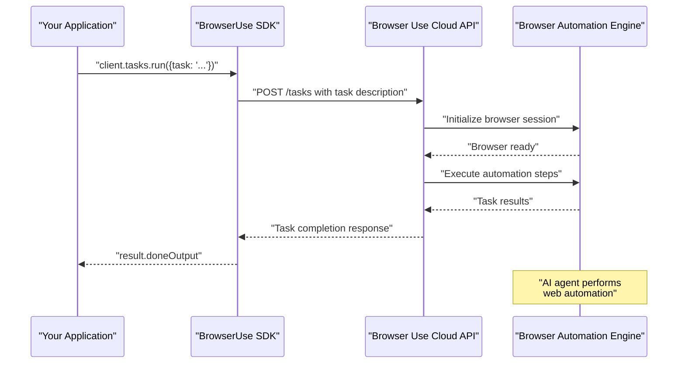

**Task Execution Flow**

### Task Configuration Options

You can customize task execution with additional parameters:

```typescript
const result = await client.tasks.run({
  task: "What's the weather like in SF and what's the temperature?",
  agentSettings: { 
    llm: 'gemini-2.5-flash' 
  },
  // Additional configuration options available
});
```

**Sources:** [README.md:20-25](), [examples/run.ts:17-20]()

## Working with Structured Output

### Defining Output Schema

Use Zod schemas to define structured output formats for your tasks:

```typescript
import { z } from 'zod';

const TaskOutput = z.object({
  posts: z.array(
    z.object({
      title: z.string(),
      url: z.string(),
    }),
  ),
});

const result = await client.tasks.run({
  task: 'Search for the top 10 Hacker News posts and return the title and url.',
  schema: TaskOutput,
});

// Access parsed, type-safe output
for (const post of result.parsedOutput.posts) {
  console.log(`${post.title} - ${post.url}`);
}
```

The SDK automatically validates and parses the AI agent's output against your schema, providing type-safe access to structured data.

**Sources:** [README.md:32-50](), [examples/run.ts:27-56]()

## Complete Example

Here's a complete example that demonstrates the full setup process:

```typescript
#!/usr/bin/env -S npm run tsn -T

import { BrowserUse } from 'browser-use-sdk';
import { z } from 'zod';
import dotenv from '@dotenvx/dotenvx';

// Load environment variables
dotenv.config({ path: '.env' });

// Initialize client
const browseruse = new BrowserUse();

// Define output schema
const TaskOutput = z.object({
  posts: z.array(z.object({
    title: z.string(),
    url: z.string(),
  })),
});

async function runExample() {
  console.log('Running browser automation task...');

  const result = await browseruse.tasks.run({
    task: 'Search for the top 10 Hacker News posts and return the title and url!',
    schema: TaskOutput,
    agentSettings: { llm: 'gpt-4.1' },
  });

  const posts = result.parsedOutput?.posts;
  
  if (posts) {
    console.log('Top Hacker News posts:');
    for (const post of posts) {
      console.log(` - ${post.title} - ${post.url}`);
    }
  }
}

runExample().catch(console.error);
```

**Sources:** [examples/run.ts:1-63](), [examples/utils.ts:32-34]()

## Next Steps

Once you have basic task execution working, you can explore:

- **Real-time Task Monitoring**: See [Task Streaming](#3.1) for monitoring task progress in real-time
- **Webhook Integration**: See [Webhook System](#3.2) for receiving notifications about task completion
- **Advanced Task Configuration**: See [Tasks API](#2.2) for detailed task configuration options
- **Error Handling**: See [Error Handling](#2.4) for robust error management patterns

**Sources:** [README.md:52-82](), [README.md:84-122]()

---

# Page: Core Concepts

# Core Concepts

<details>
<summary>Relevant source files</summary>

The following files were used as context for generating this wiki page:

- [src/client.ts](src/client.ts)
- [src/resources/tasks.ts](src/resources/tasks.ts)

</details>


This document covers the fundamental architecture and design patterns of the browser-use-node SDK. It explains how the main components work together to provide browser automation capabilities through AI agents.

For detailed usage examples, see [Basic Usage Examples](#6.1). For specific API method documentation, see [API Documentation](#7.1).

## Architecture Overview

The browser-use-node SDK follows a resource-oriented client architecture where a central `BrowserUse` client provides access to specialized API resources. Each resource handles a specific domain of functionality.

**Client-Resource Architecture**

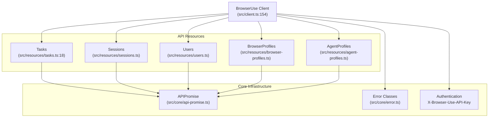

Sources: [src/client.ts:154-765](), [src/resources/tasks.ts:18]()

## Core Components

### BrowserUse Client

The `BrowserUse` class serves as the main entry point and handles client configuration, authentication, and request infrastructure.

**Key Configuration Options**

| Option | Purpose | Default |
|--------|---------|---------|
| `apiKey` | Authentication credential | `process.env.BROWSER_USE_API_KEY` |
| `baseURL` | API endpoint | `https://api.browser-use.com/api/v2` |
| `timeout` | Request timeout (ms) | `60000` |
| `maxRetries` | Retry attempts | `2` |
| `logLevel` | Logging verbosity | `warn` |

Sources: [src/client.ts:76-149](), [src/client.ts:181-216]()

### Resource Hierarchy

Each API resource extends `APIResource` and provides domain-specific functionality through a consistent interface pattern.

**Resource Method Patterns**

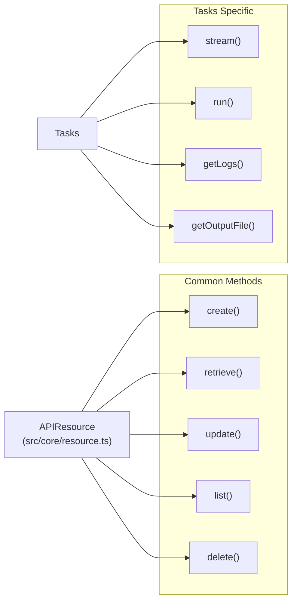

Sources: [src/resources/tasks.ts:18-393]()

## Tasks: The Central Concept

Tasks represent individual browser automation jobs executed by AI agents. They are the primary unit of work in the system.

**Task Lifecycle States**

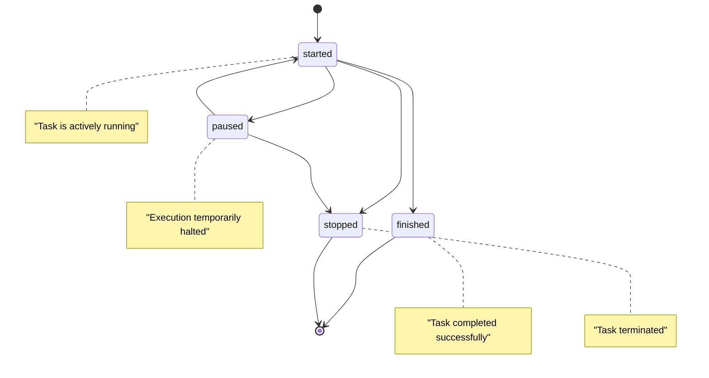

**Task Data Model**

| Field | Type | Description |
|-------|------|-------------|
| `id` | `string` | Unique task identifier |
| `sessionId` | `string` | Associated browser session |
| `status` | `TaskStatus` | Current execution state |
| `task` | `string` | Task instruction/prompt |
| `steps` | `TaskStepView[]` | Execution steps taken |
| `doneOutput` | `string` | Final task result |

Sources: [src/resources/tasks.ts:511-559](), [src/resources/tasks.ts:466]()

## Sessions and Profiles

Sessions represent browser instances, while profiles define configuration for both browsers and AI agents.

**Profile System Architecture**

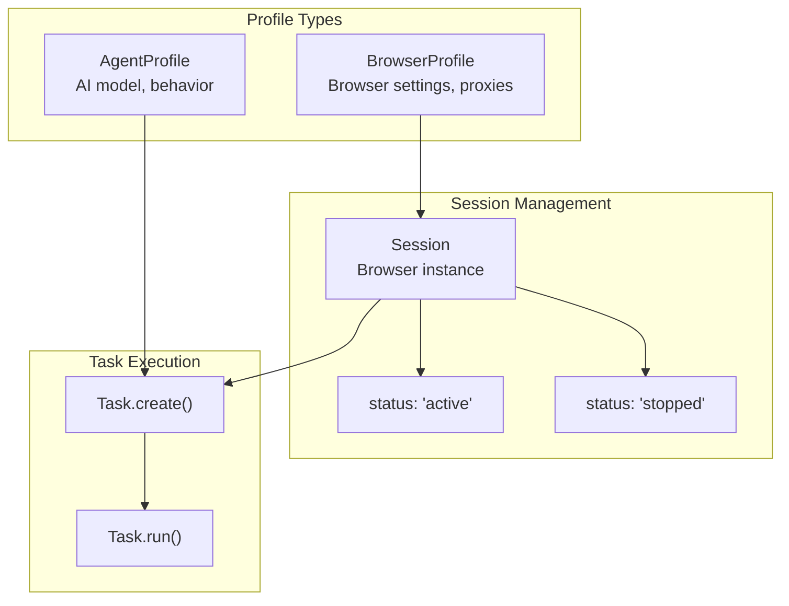

Sources: [src/resources/browser-profiles.ts](), [src/resources/agent-profiles.ts](), [src/resources/sessions.ts]()

## Authentication and Configuration

The SDK uses API key authentication with configurable client options for different deployment environments.

**Configuration Sources**

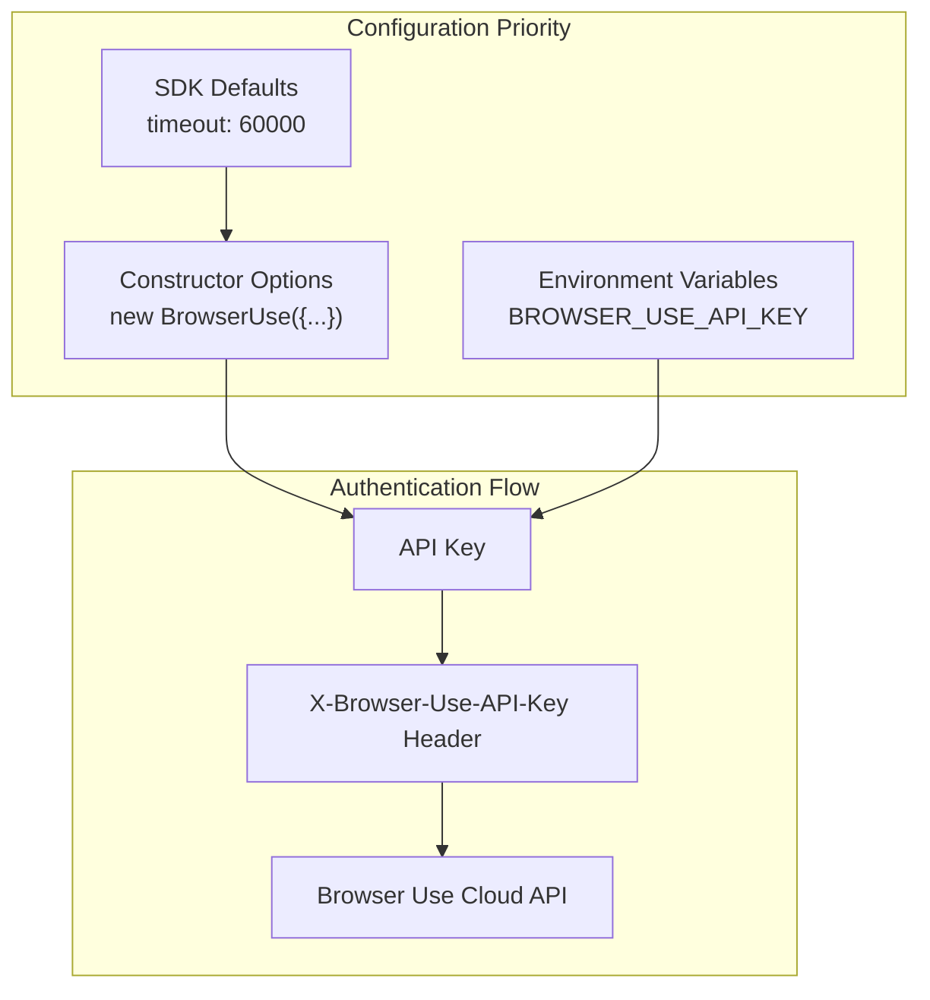

Sources: [src/client.ts:182-196](), [src/client.ts:252-254]()

## Error Handling Architecture

The SDK implements a hierarchical error system with automatic retry logic for transient failures.

**Error Class Hierarchy**

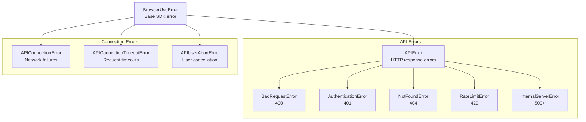

**Retry Logic**

The client automatically retries requests for specific conditions:
- HTTP 408 (Request Timeout)
- HTTP 409 (Conflict/Lock Timeout) 
- HTTP 429 (Rate Limited)
- HTTP 5XX (Server Errors)
- Network connection failures

Retry behavior uses exponential backoff with jitter, respecting `Retry-After` headers when provided.

Sources: [src/client.ts:744-756](), [src/client.ts:563-638](), [src/core/error.ts]()

---

# Page: BrowserUse Client

# BrowserUse Client

<details>
<summary>Relevant source files</summary>

The following files were used as context for generating this wiki page:

- [src/client.ts](src/client.ts)
- [src/internal/detect-platform.ts](src/internal/detect-platform.ts)
- [tests/index.test.ts](tests/index.test.ts)
- [tests/uploads.test.ts](tests/uploads.test.ts)

</details>


The BrowserUse client is the main entry point for interacting with the Browser Use Cloud API. It provides a unified interface for browser automation tasks, session management, profile configuration, and other API resources. The client handles authentication, request/response processing, error handling, retries, and logging automatically.

For information about specific API operations like creating and managing browser automation tasks, see [Tasks API](#2.2). For details about other API resources like sessions and profiles, see [API Resources](#2.3).

## Client Architecture

The `BrowserUse` class serves as the central coordinator for all API interactions, with each resource type exposed as a dedicated property.

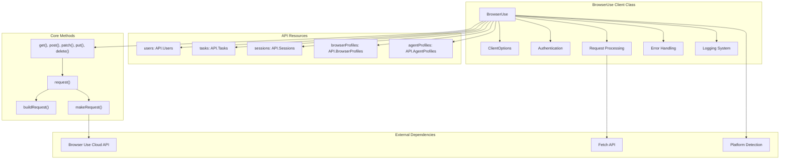

**Sources:** [src/client.ts:154-765]()

## Configuration and Instantiation

The client is configured through the `ClientOptions` interface, which provides comprehensive control over API behavior, networking, and logging.

### ClientOptions Interface

| Option | Type | Default | Description |
|--------|------|---------|-------------|
| `apiKey` | `string` | `process.env['BROWSER_USE_API_KEY']` | API authentication key |
| `baseURL` | `string` | `process.env['BROWSER_USE_BASE_URL']` or `https://api.browser-use.com/api/v2` | API base URL |
| `timeout` | `number` | `60000` (1 minute) | Request timeout in milliseconds |
| `maxRetries` | `number` | `2` | Maximum retry attempts for failed requests |
| `fetchOptions` | `MergedRequestInit` | `undefined` | Additional fetch configuration |
| `fetch` | `Fetch` | Global fetch | Custom fetch implementation |
| `defaultHeaders` | `HeadersLike` | `undefined` | Headers included with every request |
| `defaultQuery` | `Record<string, string>` | `undefined` | Query parameters included with every request |
| `logLevel` | `LogLevel` | `'warn'` | Logging verbosity level |
| `logger` | `Logger` | `console` | Custom logger implementation |

### Basic Instantiation

```typescript
// Using environment variables
const client = new BrowserUse();

// Explicit configuration
const client = new BrowserUse({
  apiKey: 'your-api-key',
  baseURL: 'https://api.browser-use.com/api/v2',
  timeout: 30000,
  maxRetries: 3,
  logLevel: 'info'
});
```

The constructor validates that an API key is provided either via the `apiKey` option or the `BROWSER_USE_API_KEY` environment variable, throwing a `BrowserUseError` if neither is available.

**Sources:** [src/client.ts:76-149](), [src/client.ts:181-216]()

## API Resource Properties

The client exposes five main API resource collections as properties, each providing methods for interacting with specific parts of the Browser Use API.

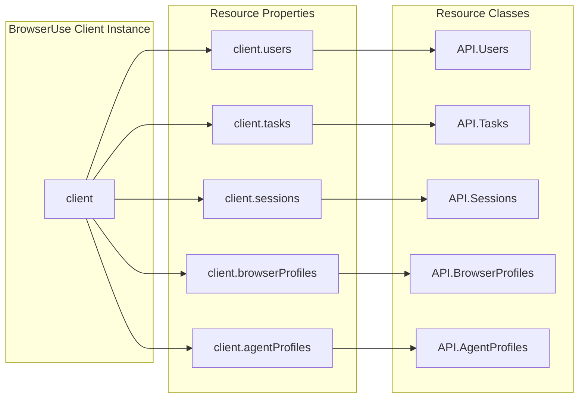

### Resource Overview

- **`users`**: User account management and information
- **`tasks`**: Browser automation task creation, monitoring, and control
- **`sessions`**: Browser session lifecycle management
- **`browserProfiles`**: Browser configuration and proxy settings
- **`agentProfiles`**: AI agent behavior and capability configuration

Each resource is instantiated with a reference to the parent client, allowing them to inherit authentication, retry logic, and other client-level configuration.

**Sources:** [src/client.ts:760-764](), [src/client.ts:767-771]()

## Core Functionality

### Authentication

The client uses API key authentication via the `X-Browser-Use-API-Key` header. Authentication headers are automatically added to all requests through the `authHeaders()` method.

```typescript
protected async authHeaders(opts: FinalRequestOptions): Promise<NullableHeaders | undefined> {
  return buildHeaders([{ 'X-Browser-Use-API-Key': this.apiKey }]);
}
```

**Sources:** [src/client.ts:252-254]()

### Request Processing

The client provides both high-level HTTP method shortcuts and a flexible low-level `request()` method:

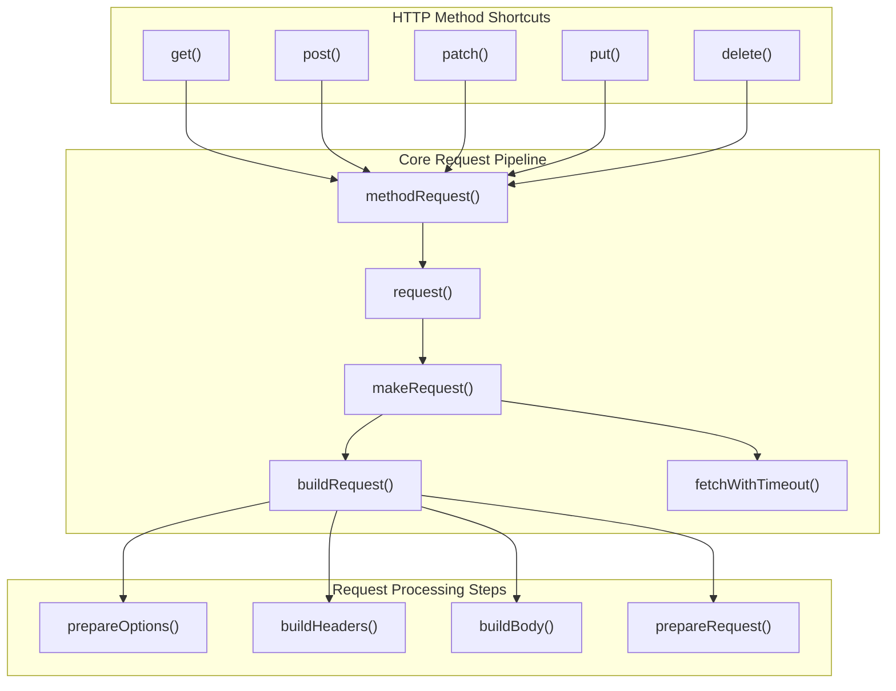

**Sources:** [src/client.ts:332-362](), [src/client.ts:371-526](), [src/client.ts:640-665]()

### Retry Logic

The client implements exponential backoff retry logic with jitter for handling temporary failures:

- **Automatic Retry Conditions**: Timeouts (408), conflicts (409), rate limits (429), and 5xx server errors
- **Retry Headers**: Respects `Retry-After` and `retry-after-ms` headers from the server
- **Exponential Backoff**: Initial delay of 0.5 seconds, doubling up to 8 seconds maximum
- **Jitter**: Random variance up to 25% to prevent thundering herd

```typescript
private calculateDefaultRetryTimeoutMillis(retriesRemaining: number, maxRetries: number): number {
  const initialRetryDelay = 0.5;
  const maxRetryDelay = 8.0;
  const numRetries = maxRetries - retriesRemaining;
  const sleepSeconds = Math.min(initialRetryDelay * Math.pow(2, numRetries), maxRetryDelay);
  const jitter = 1 - Math.random() * 0.25;
  return sleepSeconds * jitter * 1000;
}
```

**Sources:** [src/client.ts:563-584](), [src/client.ts:586-623](), [src/client.ts:625-638]()

### Logging and Platform Detection

The client includes configurable logging with request correlation IDs and platform detection for proper User-Agent headers:

- **Log Levels**: `off`, `error`, `warn`, `info`, `debug`
- **Platform Detection**: Automatically detects Node.js, Deno, edge runtime, or browser environment
- **Request Correlation**: Each request gets a unique log ID for tracing

**Sources:** [src/client.ts:8](), [src/client.ts:68-73](), [src/client.ts:391-404](), [src/internal/detect-platform.ts:5-196]()

### Error Handling

The client provides a hierarchy of error classes for different failure scenarios:

- **`BrowserUseError`**: Base error class
- **`APIError`**: General API errors with status codes
- **`APIConnectionError`**: Network connectivity issues
- **`APIConnectionTimeoutError`**: Request timeouts
- **`APIUserAbortError`**: User-initiated request cancellation
- **Status-specific errors**: `NotFoundError`, `RateLimitError`, `AuthenticationError`, etc.

**Sources:** [src/client.ts:744-756](), [src/client.ts:284-291]()

## Request Lifecycle

The following diagram shows the complete flow of a request from method call to response processing:

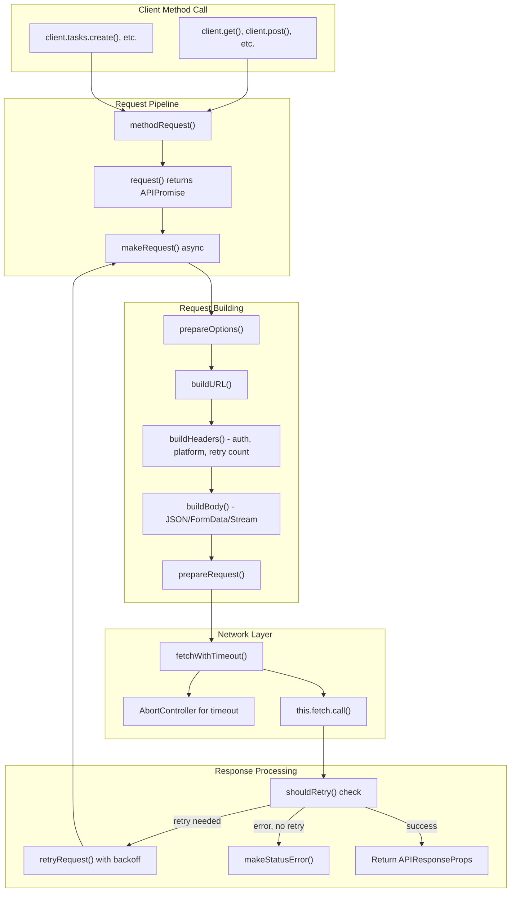

**Sources:** [src/client.ts:352-362](), [src/client.ts:364-369](), [src/client.ts:371-526](), [src/client.ts:528-561]()

## Client Creation Patterns

### Environment-based Configuration

```typescript
// Reads from BROWSER_USE_API_KEY and BROWSER_USE_BASE_URL
const client = new BrowserUse();
```

### Explicit Configuration

```typescript
const client = new BrowserUse({
  apiKey: 'bru-key-xxx',
  baseURL: 'https://api.browser-use.com/api/v2',
  timeout: 30000,
  maxRetries: 3,
  logLevel: 'debug',
  defaultHeaders: { 'X-Custom-Header': 'value' }
});
```

### Client Inheritance with `withOptions()`

The `withOptions()` method creates a new client instance with modified configuration while preserving the original:

```typescript
const baseClient = new BrowserUse({ apiKey: 'key', timeout: 30000 });
const debugClient = baseClient.withOptions({ logLevel: 'debug' });
const fastClient = baseClient.withOptions({ timeout: 5000, maxRetries: 1 });
```

**Sources:** [src/client.ts:221-235](), [tests/index.test.ts:350-424]()

---

# Page: Tasks API

# Tasks API

<details>
<summary>Relevant source files</summary>

The following files were used as context for generating this wiki page:

- [src/resources/tasks.ts](src/resources/tasks.ts)
- [tests/api-resources/tasks.test.ts](tests/api-resources/tasks.test.ts)

</details>


The Tasks API is the core functionality of the browser-use-node SDK, providing comprehensive browser automation capabilities through AI agents. This API allows you to create, monitor, and control browser automation tasks that can navigate websites, extract data, fill forms, and perform complex web interactions.

For information about real-time task monitoring and streaming capabilities, see [Task Streaming](#3.1). For webhook-based task notifications, see [Webhook System](#3.2). For basic client setup and authentication, see [BrowserUse Client](#2.1).

## Core Task Operations

The `Tasks` class provides the primary interface for browser automation through several key methods. All task operations are accessed through the client's `tasks` resource.

### Task Creation and Execution

The fundamental operation is creating and running browser automation tasks. The API supports two primary patterns:

**Immediate Execution with `run()`**
The `run()` method creates a task and waits for completion, returning the final result. This is ideal for simple automation scripts where you want to block until the task finishes.

**Asynchronous Creation with `create()`**
The `create()` method starts a task and immediately returns a task ID, allowing you to monitor progress separately using streaming or polling. This pattern supports more complex workflows with real-time monitoring.

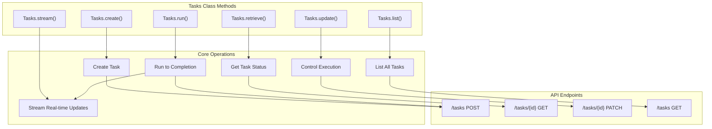

Sources: [src/resources/tasks.ts:64-85](), [src/resources/tasks.ts:199-233](), [src/resources/tasks.ts:113-128]()

### Session Management

Tasks operate within browser sessions, which maintain browser state across multiple tasks. You can either start a new session or continue an existing one:

- **New Session**: Specify `browserSettings.profileId` to start with a fresh browser instance
- **Existing Session**: Specify `browserSettings.sessionId` to continue in an active browser session

This session model enables complex multi-step workflows where subsequent tasks can build on previous work within the same browser context.

Sources: [src/resources/tasks.ts:24-39](), [src/resources/tasks.ts:667-722]()

## Task Lifecycle and Status Management

Tasks progress through defined states during execution. The API provides precise control over task lifecycle and real-time status monitoring.

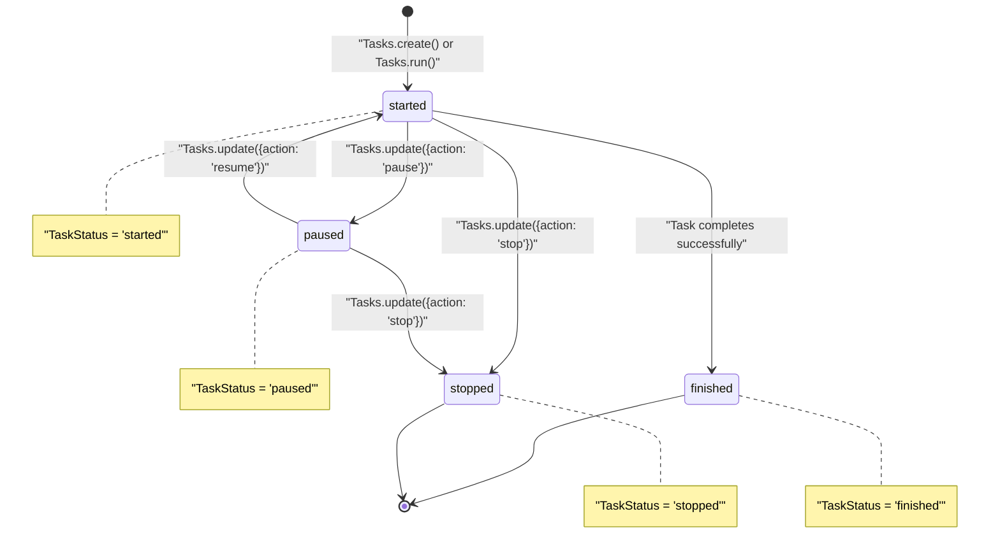

Sources: [src/resources/tasks.ts:466](), [src/resources/tasks.ts:235-267](), [src/resources/tasks.ts:724-733]()

### Task Control Operations

The `update()` method provides granular control over task execution with these actions:

| Action | Description | Effect |
|--------|-------------|--------|
| `stop` | Halt current task | Task enters `stopped` state |
| `pause` | Temporarily suspend | Task enters `paused` state |
| `resume` | Continue paused task | Task returns to `started` state |
| `stop_task_and_session` | Halt task and end session | Both task and browser session terminate |

Sources: [src/resources/tasks.ts:724-733](), [src/resources/tasks.ts:265-267]()

## Real-time Task Monitoring

The Tasks API provides multiple approaches for monitoring task progress in real-time through streaming and polling mechanisms.

### Streaming Interface

The `stream()` method returns an async generator that yields task status updates as they occur. This provides the most responsive monitoring with minimal network overhead.

```mermaid
sequenceDiagram
    participant Client
    participant TasksStream as "Tasks.stream()"
    participant TasksWatch as "Tasks.watch()"
    participant TasksRetrieve as "Tasks.retrieve()"
    participant API as "Cloud API"
    
    Client->>TasksStream: "stream(taskId)"
    TasksStream->>TasksWatch: "watch(taskId, {interval: 500})"
    
    loop "Every 500ms"
        TasksWatch->>TasksRetrieve: "retrieve(taskId)"
        TasksRetrieve->>API: "GET /tasks/{id}"
        API-->>TasksRetrieve: "TaskView response"
        TasksRetrieve-->>TasksWatch: "TaskView"
        
        alt "Status changed"
            TasksWatch-->>TasksStream: "yield {event: 'status', data: TaskView}"
            TasksStream-->>Client: "Status update"
        else "No change"
            Note over TasksWatch: "Skip yield, continue polling"
        end
        
        alt "Task finished/stopped/paused"
            break "Exit polling loop"
        end
    end
```

Sources: [src/resources/tasks.ts:166-192](), [src/resources/tasks.ts:130-164]()

### Structured Output Support

Both `retrieve()` and `stream()` methods support structured output parsing using Zod schemas. When a schema is provided, the API automatically validates and parses the task's output according to the defined structure.

Sources: [src/resources/tasks.ts:113-128](), [src/resources/tasks.ts:166-192](), [src/lib/parse.ts:10-14]()

## File Operations

The Tasks API handles multiple types of files throughout the task lifecycle, providing secure access through presigned download URLs.

### File Types and Access Methods

| File Type | Method | Purpose |
|-----------|--------|---------|
| Task Logs | `getLogs()` | Detailed execution logs and debugging information |
| Output Files | `getOutputFile()` | Files generated by the agent during task execution |
| User Uploads | `getUserUploadedFile()` | Files uploaded by user for agent to process |

```mermaid
graph LR
    subgraph "File Access Methods"
        GetLogs["Tasks.getLogs(taskId)"]
        GetOutput["Tasks.getOutputFile(fileId, {task_id})"]
        GetUploaded["Tasks.getUserUploadedFile(fileId, {task_id})"]
    end
    
    subgraph "API Endpoints"
        LogsEndpoint["/tasks/{id}/logs"]
        OutputEndpoint["/tasks/{task_id}/output-files/{file_id}"]
        UploadedEndpoint["/tasks/{task_id}/user-uploaded-files/{file_id}"]
    end
    
    subgraph "Response Types"
        LogsResponse["TaskGetLogsResponse"]
        OutputResponse["TaskGetOutputFileResponse"]
        UploadedResponse["TaskGetUserUploadedFileResponse"]
    end
    
    GetLogs --> LogsEndpoint
    GetOutput --> OutputEndpoint
    GetUploaded --> UploadedEndpoint
    
    LogsEndpoint --> LogsResponse
    OutputEndpoint --> OutputResponse
    UploadedEndpoint --> UploadedResponse
```

Sources: [src/resources/tasks.ts:321-323](), [src/resources/tasks.ts:352-359](), [src/resources/tasks.ts:385-392]()

### File Information in Task Views

Task data includes comprehensive file information through the `TaskView` interface:

- `outputFiles`: Array of `FileView` objects for agent-generated files
- `userUploadedFiles`: Array of `FileView` objects for user-provided files

Each `FileView` contains the file ID and name needed for downloading through the respective file access methods.

Sources: [src/resources/tasks.ts:518](), [src/resources/tasks.ts:548](), [src/resources/tasks.ts:401-405]()

## Configuration and Settings

Task creation supports extensive configuration through agent settings, browser settings, and additional parameters.

### Agent Configuration

Agent settings control the AI model and behavior:

```typescript
agentSettings: {
  llm: 'gpt-4.1' | 'gpt-4.1-mini' | 'claude-3-7-sonnet-20250219' | /* other models */,
  profileId: string,  // Reference to saved agent profile
  startUrl: string    // Initial URL for the browser session
}
```

### Browser Configuration

Browser settings determine session handling:

```typescript
browserSettings: {
  sessionId: string,  // Continue existing session
  profileId: string   // Start new session with browser profile
}
```

Note: `sessionId` and `profileId` are mutually exclusive - use `sessionId` to continue existing sessions or `profileId` to start new ones.

Sources: [src/resources/tasks.ts:684-722]()

### Additional Parameters

| Parameter | Type | Purpose |
|-----------|------|---------|
| `includedFileNames` | `string[]` | Names of uploaded files to include in task |
| `metadata` | `Record<string, string>` | Custom metadata for organization and tracking |
| `secrets` | `Record<string, string>` | Secure key-value pairs for sensitive data |
| `structuredOutputJson` | `string` | Serialized Zod schema for output validation |

Sources: [src/resources/tasks.ts:674-681]()

## Data Models

The Tasks API uses several key data structures to represent task information and execution details.

### Core Task Data

**TaskView**: Complete task information including execution details
- `id`, `sessionId`: Identifiers
- `status`: Current execution state (`TaskStatus`)
- `task`: Original task description
- `startedAt`, `finishedAt`: Timestamps
- `steps`: Array of `TaskStepView` for execution history
- `doneOutput`: Final task result
- `isSuccess`: Agent-reported success status

**TaskStepView**: Individual execution step details
- `number`: Sequential step number
- `memory`: Agent's memory state
- `nextGoal`: Current objective
- `url`: Browser URL at this step
- `actions`: Array of agent actions performed
- `screenshotUrl`: Optional screenshot of browser state

Sources: [src/resources/tasks.ts:511-559](), [src/resources/tasks.ts:478-492]()

### Pagination and Listing

**TaskListResponse**: Paginated task collection
- `items`: Array of `TaskItemView` (summary information)
- `pageNumber`, `pageSize`: Pagination controls
- `totalItems`: Total count across all pages

**TaskListParams**: Query parameters for filtering and pagination
- `filterBy`: Filter by `TaskStatus`
- `sessionId`: Filter by session
- `before`, `after`: Date range filtering
- `pageNumber`, `pageSize`: Pagination controls

Sources: [src/resources/tasks.ts:606-614](), [src/resources/tasks.ts:735-755]()

---

# Page: API Resources

# API Resources

<details>
<summary>Relevant source files</summary>

The following files were used as context for generating this wiki page:

- [api.md](api.md)
- [tests/api-resources/agent-profiles.test.ts](tests/api-resources/agent-profiles.test.ts)
- [tests/api-resources/browser-profiles.test.ts](tests/api-resources/browser-profiles.test.ts)
- [tests/api-resources/sessions/public-share.test.ts](tests/api-resources/sessions/public-share.test.ts)
- [tests/api-resources/sessions/sessions.test.ts](tests/api-resources/sessions/sessions.test.ts)

</details>


This document covers the supporting API resources in the browser-use-node SDK, specifically Sessions, Browser Profiles, Agent Profiles, and Users resources. These resources provide the configuration and management infrastructure that supports browser automation tasks.

For comprehensive information about the primary Tasks API resource, see [Tasks API](#2.2). For error handling patterns that apply across all resources, see [Error Handling](#2.4).

## Resource Architecture

The browser-use-node SDK organizes its API functionality into distinct resource classes, each handling a specific domain of operations. All resources follow consistent CRUD patterns and share common error handling and authentication mechanisms.

```mermaid
graph TB
    subgraph "BrowserUse Client"
        Client["BrowserUse"]
    end
    
    subgraph "Core Resources"
        Tasks["client.tasks"]
        Sessions["client.sessions"]
        BrowserProfiles["client.browserProfiles"]
        AgentProfiles["client.agentProfiles"]
        Users["client.users"]
    end
    
    subgraph "Nested Resources"
        PublicShare["client.sessions.publicShare"]
        UserMe["client.users.me"]
        UserFiles["client.users.me.files"]
    end
    
    subgraph "Resource Files"
        TasksFile["src/resources/tasks.ts"]
        SessionsFile["src/resources/sessions/sessions.ts"]
        PublicShareFile["src/resources/sessions/public-share.ts"]
        BrowserProfilesFile["src/resources/browser-profiles.ts"]
        AgentProfilesFile["src/resources/agent-profiles.ts"]
        UserMeFile["src/resources/users/me/me.ts"]
        UserFilesFile["src/resources/users/me/files.ts"]
    end
    
    Client --> Tasks
    Client --> Sessions
    Client --> BrowserProfiles
    Client --> AgentProfiles
    Client --> Users
    
    Sessions --> PublicShare
    Users --> UserMe
    UserMe --> UserFiles
    
    Tasks --> TasksFile
    Sessions --> SessionsFile
    PublicShare --> PublicShareFile
    BrowserProfiles --> BrowserProfilesFile
    AgentProfiles --> AgentProfilesFile
    UserMe --> UserMeFile
    UserFiles --> UserFilesFile
```

Sources: [api.md:1-105](), [tests/api-resources/sessions/sessions.test.ts:1-77](), [tests/api-resources/agent-profiles.test.ts:1-94](), [tests/api-resources/browser-profiles.test.ts:1-95](), [tests/api-resources/sessions/public-share.test.ts:1-47]()

## Sessions Resource

The Sessions resource manages browser session lifecycle and provides access to session metadata. Sessions represent active or completed browser automation instances that can be monitored, controlled, and shared.

### Core Operations

| Method | HTTP Route | Purpose |
|--------|------------|---------|
| `retrieve(sessionID)` | `GET /sessions/{session_id}` | Get session details and status |
| `update(sessionID, params)` | `PATCH /sessions/{session_id}` | Control session (stop/start actions) |
| `list(params)` | `GET /sessions` | List sessions with filtering |
| `delete(sessionID)` | `DELETE /sessions/{session_id}` | Permanently delete session |

### Session Management Workflow

```mermaid
graph TD
    subgraph "Session Operations"
        Create["Task Creation<br/>(creates session)"]
        Retrieve["client.sessions.retrieve()"]
        Update["client.sessions.update()"]
        List["client.sessions.list()"]
        Delete["client.sessions.delete()"]
    end
    
    subgraph "Session States"
        Active["Active Session<br/>SessionStatus"]
        Stopped["Stopped Session"]
        Completed["Completed Session"]
    end
    
    subgraph "Session Data"
        SessionView["SessionView<br/>response type"]
        SessionListResponse["SessionListResponse<br/>paginated results"]
    end
    
    Create --> Active
    Active --> Retrieve
    Active --> Update
    Update --> Stopped
    Completed --> List
    Stopped --> Delete
    
    Retrieve --> SessionView
    List --> SessionListResponse
    Update --> SessionView
```

The `update` method accepts an `action` parameter to control session state. Common actions include stopping active sessions or modifying session parameters.

Sources: [api.md:48-62](), [tests/api-resources/sessions/sessions.test.ts:10-76](), [src/resources/sessions/sessions.ts]()

### Public Share Sub-resource

Sessions can be shared publicly through the `publicShare` nested resource, enabling external access to session recordings or live views.

| Method | HTTP Route | Purpose |
|--------|------------|---------|
| `publicShare.create(sessionID)` | `POST /sessions/{session_id}/public-share` | Enable public sharing |
| `publicShare.retrieve(sessionID)` | `GET /sessions/{session_id}/public-share` | Get share details |
| `publicShare.delete(sessionID)` | `DELETE /sessions/{session_id}/public-share` | Disable public sharing |

Sources: [api.md:63-73](), [tests/api-resources/sessions/public-share.test.ts:10-46](), [src/resources/sessions/public-share.ts]()

## Browser Profiles Resource

Browser Profiles define the browser environment configuration for task execution, including viewport settings, proxy configuration, and browser behavior options.

### Configuration Options

Browser profiles support comprehensive browser customization through the `BrowserProfileView` type:

| Parameter | Type | Purpose |
|-----------|------|---------|
| `name` | string | Profile identifier (required) |
| `browserViewportWidth` | number | Browser window width |
| `browserViewportHeight` | number | Browser window height |
| `isMobile` | boolean | Mobile browser emulation |
| `proxy` | boolean | Enable proxy usage |
| `proxyCountryCode` | ProxyCountryCode | Proxy location |
| `adBlocker` | boolean | Enable ad blocking |
| `persist` | boolean | Persist browser data |
| `storeCache` | boolean | Enable browser caching |

### Profile Management

```mermaid
graph LR
    subgraph "Profile Lifecycle"
        Create["client.browserProfiles.create()"]
        Retrieve["client.browserProfiles.retrieve()"]
        Update["client.browserProfiles.update()"]
        List["client.browserProfiles.list()"]
        Delete["client.browserProfiles.delete()"]
    end
    
    subgraph "Profile Data Types"
        BrowserProfileView["BrowserProfileView"]
        ProxyCountryCode["ProxyCountryCode"]
        BrowserProfileListResponse["BrowserProfileListResponse"]
    end
    
    subgraph "Usage Context"
        TaskExecution["Task Execution<br/>with profile"]
        SessionCreation["Session Creation<br/>with profile"]
    end
    
    Create --> BrowserProfileView
    Retrieve --> BrowserProfileView
    Update --> BrowserProfileView
    List --> BrowserProfileListResponse
    
    BrowserProfileView --> TaskExecution
    BrowserProfileView --> SessionCreation
```

All browser profile operations follow standard CRUD patterns with pagination support for listing operations.

Sources: [api.md:75-89](), [tests/api-resources/browser-profiles.test.ts:10-94](), [src/resources/browser-profiles.ts]()

## Agent Profiles Resource

Agent Profiles configure the AI agent behavior for browser automation tasks, including system prompts, execution limits, and capability settings.

### Agent Configuration

Agent profiles control AI agent behavior through the `AgentProfileView` type:

| Parameter | Type | Purpose |
|-----------|------|---------|
| `name` | string | Profile identifier (required) |
| `description` | string | Profile description |
| `customSystemPromptExtension` | string | Additional system prompt text |
| `maxAgentSteps` | number | Maximum execution steps |
| `allowedDomains` | string[] | Domain whitelist |
| `flashMode` | boolean | Fast execution mode |
| `highlightElements` | boolean | Visual element highlighting |
| `thinking` | boolean | Enable reasoning output |
| `vision` | boolean | Enable visual AI capabilities |

### Agent Profile Operations

All agent profile operations mirror the standard resource pattern:

```mermaid
graph TB
    subgraph "Agent Profile API"
        AgentCreate["client.agentProfiles.create(params)"]
        AgentRetrieve["client.agentProfiles.retrieve(profileID)"]
        AgentUpdate["client.agentProfiles.update(profileID, params)"]
        AgentList["client.agentProfiles.list(params)"]
        AgentDelete["client.agentProfiles.delete(profileID)"]
    end
    
    subgraph "Response Types"
        AgentProfileView["AgentProfileView"]
        AgentProfileListResponse["AgentProfileListResponse"]
    end
    
    subgraph "Agent Capabilities"
        SystemPrompt["Custom System Prompt"]
        DomainControl["Domain Restrictions"]
        ExecutionLimits["Step Limits"]
        VisualFeatures["Vision & Highlighting"]
    end
    
    AgentCreate --> AgentProfileView
    AgentRetrieve --> AgentProfileView
    AgentUpdate --> AgentProfileView
    AgentList --> AgentProfileListResponse
    
    AgentProfileView --> SystemPrompt
    AgentProfileView --> DomainControl
    AgentProfileView --> ExecutionLimits
    AgentProfileView --> VisualFeatures
```

Agent profiles are referenced during task creation to define the AI agent's behavior and capabilities for that specific automation session.

Sources: [api.md:91-104](), [tests/api-resources/agent-profiles.test.ts:10-93](), [src/resources/agent-profiles.ts]()

## Users Resource

The Users resource provides user account management and file handling capabilities. The resource is organized around the current authenticated user through the `me` sub-resource.

### User Information

The `users.me` resource provides access to current user details:

| Method | HTTP Route | Purpose |
|--------|------------|---------|
| `users.me.retrieve()` | `GET /users/me` | Get current user information |

### File Upload Management

The `users.me.files` sub-resource handles file upload operations:

| Method | HTTP Route | Purpose |
|--------|------------|---------|
| `users.me.files.createPresignedURL(params)` | `POST /users/me/files/presigned-url` | Generate upload URLs |

The file upload system uses presigned URLs to enable direct file uploads to cloud storage without exposing credentials or requiring files to pass through the API server.

```mermaid
graph TD
    subgraph "User Resource Structure"
        Users["client.users"]
        Me["client.users.me"]
        Files["client.users.me.files"]
    end
    
    subgraph "File Upload Flow"
        CreateURL["createPresignedURL()"]
        PresignedResponse["FileCreatePresignedURLResponse"]
        DirectUpload["Direct File Upload<br/>to cloud storage"]
    end
    
    subgraph "User Data"
        UserInfo["MeRetrieveResponse<br/>user details"]
        FileData["File metadata<br/>and URLs"]
    end
    
    Users --> Me
    Me --> Files
    Me --> UserInfo
    Files --> CreateURL
    CreateURL --> PresignedResponse
    PresignedResponse --> DirectUpload
    DirectUpload --> FileData
```

This pattern enables efficient file handling for browser automation tasks that require file uploads or downloads.

Sources: [api.md:1-22](), [src/resources/users/me/me.ts](), [src/resources/users/me/files.ts]()

## Resource Integration

These API resources work together to provide a complete browser automation platform. The typical integration pattern involves:

1. **Profile Creation**: Create browser and agent profiles with desired configurations
2. **Task Execution**: Reference profiles when creating tasks through the Tasks API
3. **Session Management**: Monitor and control the resulting browser sessions
4. **File Handling**: Use the Users resource for file uploads/downloads as needed
5. **Sharing**: Optionally enable public sharing of session results

All resources follow consistent patterns for error handling, pagination, and authentication, making them straightforward to integrate into applications.

Sources: [api.md:1-105](), [tests/api-resources/sessions/sessions.test.ts:1-77](), [tests/api-resources/agent-profiles.test.ts:1-94](), [tests/api-resources/browser-profiles.test.ts:1-95]()

---

# Page: Error Handling

# Error Handling

<details>
<summary>Relevant source files</summary>

The following files were used as context for generating this wiki page:

- [src/client.ts](src/client.ts)
- [src/internal/detect-platform.ts](src/internal/detect-platform.ts)
- [tests/index.test.ts](tests/index.test.ts)
- [tests/uploads.test.ts](tests/uploads.test.ts)

</details>


This document covers the comprehensive error handling system in the browser-use-node SDK, including automatic retry logic, timeout management, and the error hierarchy. For information about API response validation and structured output handling, see [Structured Output](#5.1). For authentication-related errors, see [Authentication](#5.2).

## Error Types and Hierarchy

The SDK provides a structured hierarchy of error classes that inherit from the base `BrowserUseError` class. Each error type represents different categories of failures that can occur during API interactions.

### Error Class Hierarchy

```mermaid
graph TD
    BrowserUseError["BrowserUseError<br/>(Base Error Class)"]
    APIError["APIError<br/>(HTTP Response Errors)"]
    APIConnectionError["APIConnectionError<br/>(Network Failures)"]
    APIConnectionTimeoutError["APIConnectionTimeoutError<br/>(Request Timeouts)"]
    APIUserAbortError["APIUserAbortError<br/>(User Cancellation)"]
    
    StatusErrors["HTTP Status Errors"]
    NotFoundError["NotFoundError<br/>(404)"]
    BadRequestError["BadRequestError<br/>(400)"]
    AuthenticationError["AuthenticationError<br/>(401)"]
    PermissionDeniedError["PermissionDeniedError<br/>(403)"]
    ConflictError["ConflictError<br/>(409)"]
    RateLimitError["RateLimitError<br/>(429)"]
    UnprocessableEntityError["UnprocessableEntityError<br/>(422)"]
    InternalServerError["InternalServerError<br/>(500+)"]
    
    BrowserUseError --> APIError
    BrowserUseError --> APIConnectionError
    BrowserUseError --> APIConnectionTimeoutError
    BrowserUseError --> APIUserAbortError
    
    APIError --> StatusErrors
    StatusErrors --> NotFoundError
    StatusErrors --> BadRequestError
    StatusErrors --> AuthenticationError
    StatusErrors --> PermissionDeniedError
    StatusErrors --> ConflictError
    StatusErrors --> RateLimitError
    StatusErrors --> UnprocessableEntityError
    StatusErrors --> InternalServerError
```

Sources: [src/client.ts:15](), [src/client.ts:744-756]()

### Error Class Usage

| Error Class | Use Case | When It Occurs |
|-------------|----------|----------------|
| `BrowserUseError` | Base class for all SDK errors | Generic SDK errors, validation failures |
| `APIError` | HTTP response errors | Server returns error status codes |
| `APIConnectionError` | Network connectivity issues | Network failures, DNS resolution errors |
| `APIConnectionTimeoutError` | Request timeout | Request exceeds configured timeout |
| `APIUserAbortError` | User-initiated cancellation | AbortController signal triggered |
| `NotFoundError` | Resource not found | 404 HTTP status |
| `RateLimitError` | Rate limiting | 429 HTTP status |
| `AuthenticationError` | Authentication failure | 401 HTTP status |

Sources: [src/client.ts:744-756]()

## Automatic Retry Logic

The SDK implements intelligent retry logic with exponential backoff for transient failures. Retries are automatically triggered for specific error conditions without user intervention.

### Retry Decision Flow

```mermaid
graph TD
    Request["makeRequest()"]
    Response["HTTP Response"]
    CheckRetryable["shouldRetry()"]
    CheckRetries["retriesRemaining > 0?"]
    ExponentialBackoff["calculateDefaultRetryTimeoutMillis()"]
    RetryAfterHeader["Check Retry-After Headers"]
    Sleep["sleep(timeoutMillis)"]
    RetryRequest["retryRequest()"]
    ThrowError["Throw Error"]
    Success["Return Response"]
    
    Request --> Response
    Response --> CheckRetryable
    CheckRetryable -->|"Not Retryable"| ThrowError
    CheckRetryable -->|"Retryable"| CheckRetries
    CheckRetries -->|"No"| ThrowError
    CheckRetries -->|"Yes"| RetryAfterHeader
    RetryAfterHeader --> ExponentialBackoff
    ExponentialBackoff --> Sleep
    Sleep --> RetryRequest
    RetryRequest --> Request
    Response -->|"Success"| Success
```

Sources: [src/client.ts:563-584](), [src/client.ts:586-623](), [src/client.ts:625-638]()

### Retryable Conditions

The `shouldRetry` method determines which responses should trigger automatic retries:

| Condition | HTTP Status | Description |
|-----------|-------------|-------------|
| Server explicit retry | `x-should-retry: true` header | Server indicates retry is appropriate |
| Request timeout | 408 | Request timeout from server |
| Lock timeout | 409 | Resource temporarily locked |
| Rate limiting | 429 | Too many requests |
| Server errors | 500+ | Internal server errors |

Sources: [src/client.ts:563-584]()

### Exponential Backoff Configuration

```typescript
// Default retry timing configuration
const initialRetryDelay = 0.5;  // 500ms
const maxRetryDelay = 8.0;      // 8 seconds
const jitterFactor = 0.25;      // 25% random variation
```

The retry delay calculation uses exponential backoff with jitter to prevent thundering herd problems:

Sources: [src/client.ts:625-638]()

## Timeout Handling

The SDK provides comprehensive timeout management at multiple levels to prevent hanging requests and ensure reliable operation.

### Timeout Architecture

```mermaid
graph LR
    ClientTimeout["Client Timeout<br/>(Default: 60s)"]
    AbortController["AbortController"]
    FetchTimeout["fetchWithTimeout()"]
    RequestTimeout["Request-level Timeout"]
    
    ClientTimeout --> RequestTimeout
    RequestTimeout --> FetchTimeout
    FetchTimeout --> AbortController
    AbortController --> TimeoutError["APIConnectionTimeoutError"]
```

Sources: [src/client.ts:528-561](), [src/client.ts:742]()

### Timeout Configuration

| Timeout Type | Default Value | Configuration |
|--------------|---------------|---------------|
| Client Default | 60,000ms (1 minute) | `ClientOptions.timeout` |
| Request Override | Per-request | `RequestOptions.timeout` |
| Retry Timeout | Exponential backoff | Calculated automatically |

Sources: [src/client.ts:98](), [src/client.ts:742]()

## Connection Error Handling

Network-level failures are handled distinctly from HTTP response errors, with special logic for detecting and categorizing different types of connection failures.

### Connection Error Detection

```mermaid
graph TD
    FetchCall["fetch() call"]
    CatchError["catch(castToError)"]
    CheckAborted["signal?.aborted"]
    TimeoutPattern["Match timeout pattern"]
    RetryAvailable["retriesRemaining > 0"]
    
    ConnectionTimeout["APIConnectionTimeoutError"]
    ConnectionError["APIConnectionError"]
    UserAbort["APIUserAbortError"]
    RetryConnection["Retry Request"]
    
    FetchCall --> CatchError
    CatchError --> CheckAborted
    CheckAborted -->|"Yes"| UserAbort
    CheckAborted -->|"No"| TimeoutPattern
    TimeoutPattern -->|"Timeout detected"| RetryAvailable
    TimeoutPattern -->|"Other error"| RetryAvailable
    RetryAvailable -->|"Yes"| RetryConnection
    RetryAvailable -->|"No, Timeout"| ConnectionTimeout
    RetryAvailable -->|"No, Other"| ConnectionError
```

Sources: [src/client.ts:414-457]()

### Connection Error Patterns

The SDK detects timeout conditions using pattern matching on error messages:

- Native abort errors detected via `isAbortError()`
- Timeout patterns: `/timed? ?out/i` regex matching
- Deno timeout: "tcp connect error: Operation timed out"
- Undici timeout: "ConnectTimeoutError: Connect Timeout Error"

Sources: [src/client.ts:423-425]()

## Request Lifecycle Error Handling

The complete request lifecycle includes multiple error handling checkpoints and recovery mechanisms.

### Request Processing Flow

```mermaid
graph TD
    BuildRequest["buildRequest()"]
    PrepareRequest["prepareRequest()"]
    CheckAborted1["Check signal.aborted"]
    FetchWithTimeout["fetchWithTimeout()"]
    CheckResponse["response.ok?"]
    CheckAborted2["Check signal.aborted"]
    ShouldRetry["shouldRetry()"]
    ParseResponse["Parse Response"]
    
    UserAbortError1["APIUserAbortError"]
    UserAbortError2["APIUserAbortError"]
    ConnectionHandling["Connection Error Handling"]
    StatusError["makeStatusError()"]
    RetryLogic["Retry Logic"]
    SuccessResponse["Success Response"]
    
    BuildRequest --> PrepareRequest
    PrepareRequest --> CheckAborted1
    CheckAborted1 -->|"Aborted"| UserAbortError1
    CheckAborted1 -->|"Continue"| FetchWithTimeout
    FetchWithTimeout -->|"Error"| ConnectionHandling
    FetchWithTimeout -->|"Response"| CheckResponse
    CheckResponse -->|"Not OK"| CheckAborted2
    CheckResponse -->|"OK"| ParseResponse
    CheckAborted2 -->|"Aborted"| UserAbortError2
    CheckAborted2 -->|"Continue"| ShouldRetry
    ShouldRetry -->|"Retry"| RetryLogic
    ShouldRetry -->|"No Retry"| StatusError
    ParseResponse --> SuccessResponse
    ConnectionHandling --> RetryLogic
    RetryLogic --> BuildRequest
```

Sources: [src/client.ts:371-526]()

## Error Response Processing

When the server returns an error response, the SDK processes it through a standardized error creation pipeline.

### Status Error Creation

```mermaid
graph LR
    ErrorResponse["HTTP Error Response"]
    ExtractText["response.text()"]
    SafeJSON["safeJSON(errText)"]
    MakeStatusError["makeStatusError()"]
    APIErrorGenerate["APIError.generate()"]
    
    ErrorResponse --> ExtractText
    ExtractText --> SafeJSON
    SafeJSON --> MakeStatusError
    MakeStatusError --> APIErrorGenerate
    APIErrorGenerate --> SpecificError["Specific Error Type<br/>(BadRequestError, etc.)"]
```

Sources: [src/client.ts:493-510](), [src/client.ts:284-291]()

## Best Practices

### Error Handling Patterns

1. **Catch Specific Error Types**: Handle different error categories appropriately
2. **Respect Retry Logic**: Allow automatic retries for transient failures
3. **Use AbortController**: Implement proper cancellation for long-running operations
4. **Configure Timeouts**: Set appropriate timeout values for your use case

### Example Error Handling

```typescript
try {
  const task = await client.tasks.create({
    instruction: "Navigate to example.com"
  });
} catch (error) {
  if (error instanceof BrowserUse.RateLimitError) {
    // Handle rate limiting - wait and retry
    console.log('Rate limited, retrying after delay');
  } else if (error instanceof BrowserUse.AuthenticationError) {
    // Handle auth errors - check API key
    console.log('Authentication failed');
  } else if (error instanceof BrowserUse.APIConnectionError) {
    // Handle network errors - check connectivity
    console.log('Network error occurred');
  }
}
```

### Configuration Recommendations

| Use Case | Timeout | Max Retries | Considerations |
|----------|---------|-------------|---------------|
| Interactive UI | 30s | 1 | Fast feedback, minimal delays |
| Background Processing | 300s | 3 | More resilience, longer operations |
| Batch Operations | 600s | 5 | Maximum resilience |

Sources: [src/client.ts:117](), [src/client.ts:209]()

---

# Page: Real-time Features

# Real-time Features

<details>
<summary>Relevant source files</summary>

The following files were used as context for generating this wiki page:

- [src/lib/nextjs/hooks/useBrowserUse.ts](src/lib/nextjs/hooks/useBrowserUse.ts)
- [src/lib/nextjs/server/utils.ts](src/lib/nextjs/server/utils.ts)
- [src/lib/webhooks.ts](src/lib/webhooks.ts)
- [src/resources/tasks.ts](src/resources/tasks.ts)
- [tests/lib/webhooks.test.ts](tests/lib/webhooks.test.ts)
- [yarn.lock](yarn.lock)

</details>


This document covers the real-time capabilities of the browser-use-node SDK, including task streaming, webhook notifications, and framework integrations. These features enable monitoring of browser automation tasks as they execute, receiving immediate notifications of status changes, and integrating real-time updates into web applications.

For detailed API documentation of the Tasks resource, see [API Documentation](#7.1). For webhook configuration and authentication setup, see [Authentication](#5.2).

## Overview

The browser-use-node SDK provides three primary methods for receiving real-time updates about task execution:

| Method | Use Case | Communication Pattern | Latency |
|--------|----------|----------------------|---------|
| **Task Streaming** | Direct task monitoring | Polling with async generators | ~500ms intervals |
| **Webhooks** | Server-to-server notifications | HTTP POST with signature verification | Near real-time |
| **Server-Sent Events** | Web application integration | EventSource streaming | Real-time |

## Real-time Communication Architecture

```mermaid
graph TD
    CloudAPI["Browser Use Cloud API"]
    
    subgraph "SDK Client Layer"
        TasksResource["Tasks Resource<br/>(tasks.ts)"]
        WebhookUtils["Webhook Utilities<br/>(webhooks.ts)"]
        NextJSUtils["Next.js Utils<br/>(nextjs/server/utils.ts)"]
    end
    
    subgraph "Communication Methods"
        Polling["Polling via watch()<br/>tasks.ts:130-164"]
        Streaming["Streaming via stream()<br/>tasks.ts:166-192"]
        WebhookEvents["Webhook Events<br/>webhooks.ts:67-119"]
        SSE["Server-Sent Events<br/>gtos() function"]
    end
    
    subgraph "Client Integration"
        ReactHook["useBrowserUse Hook<br/>useBrowserUse.ts:10-37"]
        CLIListen["CLI listen command"]
        WebApp["Web Applications"]
    end
    
    CloudAPI --> TasksResource
    CloudAPI --> WebhookEvents
    
    TasksResource --> Polling
    TasksResource --> Streaming
    WebhookUtils --> WebhookEvents
    NextJSUtils --> SSE
    
    Polling --> Streaming
    Streaming --> SSE
    SSE --> ReactHook
    WebhookEvents --> CLIListen
    
    ReactHook --> WebApp
    CLIListen --> WebApp
    
    style TasksResource fill:#e8f5e8
    style WebhookEvents fill:#fff3e0
    style SSE fill:#e1f5fe
```

**Real-time Communication Flow**

Sources: [src/resources/tasks.ts:130-192](), [src/lib/webhooks.ts:67-119](), [src/lib/nextjs/server/utils.ts:15-69](), [src/lib/nextjs/hooks/useBrowserUse.ts:10-37]()

## Task Streaming Implementation

The core streaming functionality is built around an async generator pattern that polls the Browser Use Cloud API for task status updates.

```mermaid
graph LR
    subgraph "Tasks Resource Methods"
        watch["watch()<br/>private polling method"]
        stream["stream()<br/>public streaming API"]
        retrieve["retrieve()<br/>task status fetch"]
    end
    
    subgraph "Streaming Flow"
        poll["Poll every 500ms"]
        hash["Hash comparison<br/>getTaskViewHash()"]
        yield["Yield status events"]
        check["Check terminal status"]
    end
    
    stream --> watch
    watch --> retrieve
    watch --> poll
    poll --> hash
    hash --> yield
    yield --> check
    check --> poll
    
    style watch fill:#e8f5e8
    style stream fill:#c8e6c9
```

**Task Streaming Method Chain**

The `stream()` method [src/resources/tasks.ts:174-192]() wraps the private `watch()` method [src/resources/tasks.ts:130-164](), which implements a polling loop that:

1. Calls `retrieve()` to get current task status
2. Compares hash using `getTaskViewHash()` to detect changes
3. Yields events only when status actually changes
4. Terminates when task reaches terminal state (`finished`, `stopped`, `paused`)

Sources: [src/resources/tasks.ts:130-192](), [src/lib/stream.ts:15]()

## Webhook Event System

Webhooks provide server-to-server notifications with cryptographic signature verification for security.

```mermaid
graph TD
    subgraph "Webhook Event Types"
        TestEvent["test<br/>zWebhookTest"]
        TaskStatusEvent["agent.task.status_update<br/>zWebhookAgentTaskStatusUpdate"]
    end
    
    subgraph "Verification Process"
        ParseBody["Parse JSON body"]
        ValidateSchema["Validate against zWebhookSchema"]
        CreateSignature["createWebhookSignature()"]
        CompareSignature["Compare HMAC signatures"]
    end
    
    subgraph "Event Processing"
        verifyWebhookEventSignature["verifyWebhookEventSignature()<br/>webhooks.ts:67-99"]
        EventHandler["Application Event Handler"]
    end
    
    TestEvent --> ValidateSchema
    TaskStatusEvent --> ValidateSchema
    
    ParseBody --> ValidateSchema
    ValidateSchema --> CreateSignature
    CreateSignature --> CompareSignature
    CompareSignature --> verifyWebhookEventSignature
    verifyWebhookEventSignature --> EventHandler
    
    style verifyWebhookEventSignature fill:#fff3e0
    style TaskStatusEvent fill:#e8f5e8
```

**Webhook Event Processing Pipeline**

The webhook system uses Zod schemas [src/lib/webhooks.ts:13-60]() for type-safe event parsing and HMAC-SHA256 signatures [src/lib/webhooks.ts:104-119]() for security verification.

Sources: [src/lib/webhooks.ts:13-119](), [tests/lib/webhooks.test.ts:58-113]()

## Server-Sent Events Integration

For web applications, the SDK provides utilities to convert async generators into Server-Sent Events streams.

```mermaid
sequenceDiagram
    participant Client as "React Component"
    participant Hook as "useBrowserUse Hook"
    participant EventSource as "EventSource API"
    participant Server as "Next.js API Route"
    participant Generator as "tasks.stream()"
    
    Client->>Hook: useBrowserUse(route)
    Hook->>EventSource: new EventSource(route)
    EventSource->>Server: GET /api/stream
    Server->>Generator: tasks.stream(taskId)
    
    loop Real-time Updates
        Generator->>Server: yield { event: 'status', data }
        Server->>EventSource: event: status\ndata: {...}
        EventSource->>Hook: MessageEvent
        Hook->>Client: setStatus(data)
    end
    
    Generator->>Server: task finished
    Server->>EventSource: event: end
    EventSource->>Hook: close connection
```

**Server-Sent Events Flow**

The `gtos()` function [src/lib/nextjs/server/utils.ts:15-69]() converts task streaming generators into properly formatted Server-Sent Events, while the `useBrowserUse` hook [src/lib/nextjs/hooks/useBrowserUse.ts:10-37]() provides React integration with automatic connection management.

Sources: [src/lib/nextjs/server/utils.ts:15-69](), [src/lib/nextjs/hooks/useBrowserUse.ts:10-37]()

## Event Data Structures

All real-time communication uses consistent data structures for task status updates:

| Field | Type | Description |
|-------|------|-------------|
| `id` | `string` | Task identifier |
| `status` | `TaskStatus` | Current execution state |
| `sessionId` | `string` | Browser session identifier |
| `steps` | `TaskStepView[]` | Execution steps with screenshots |
| `doneOutput` | `string` | Final task result |
| `metadata` | `Record<string, unknown>` | User-defined metadata |

The `TaskStatus` enum [src/resources/tasks.ts:466]() defines possible states: `started`, `paused`, `finished`, `stopped`.

For webhook events, the payload structure varies by event type but follows the `zWebhookSchema` discriminated union [src/lib/webhooks.ts:54-58]().

Sources: [src/resources/tasks.ts:511-587](), [src/lib/webhooks.ts:54-58]()

## Integration Patterns

The real-time features support multiple integration patterns:

1. **Direct Streaming**: Use `tasks.stream()` for command-line tools and Node.js applications
2. **Webhook Notifications**: Configure HTTP endpoints for server-to-server communication  
3. **React Applications**: Use `useBrowserUse()` hook with Server-Sent Events
4. **CLI Development**: Use `browser-use listen` command for local webhook forwarding

For specific implementation details, see [Task Streaming](#3.1), [Webhook System](#3.2), and [Next.js Integration](#3.3).

Sources: [src/resources/tasks.ts:174-192](), [src/lib/webhooks.ts:67-99](), [src/lib/nextjs/hooks/useBrowserUse.ts:10-37]()

---

# Page: Task Streaming

# Task Streaming

<details>
<summary>Relevant source files</summary>

The following files were used as context for generating this wiki page:

- [examples/stream.ts](examples/stream.ts)
- [src/lib/stream.ts](src/lib/stream.ts)
- [src/lib/types.ts](src/lib/types.ts)
- [src/resources/tasks.ts](src/resources/tasks.ts)

</details>


Task streaming provides real-time monitoring of browser automation tasks through an async generator interface. This enables applications to receive live updates about task progress, status changes, and completion without manual polling. For webhook-based real-time notifications, see [Webhook System](#3.2). For React integration with streaming, see [Next.js Integration](#3.3).

## Overview

The browser-use-node SDK provides task streaming through the `stream()` method on the `Tasks` resource. This method returns an async generator that yields real-time updates about task execution, including status changes, step progression, and final results. The streaming system uses intelligent polling with hash-based change detection to minimize unnecessary API calls while providing responsive updates.

**Task Streaming Architecture**

```mermaid
graph TB
    subgraph "Client Application"
        App["Application Code"]
        AsyncGen["Async Generator"]
        EventHandler["Event Handler"]
    end
    
    subgraph "SDK Layer"
        TasksStream["tasks.stream()"]
        TasksWatch["tasks.watch()"]
        TasksRetrieve["tasks.retrieve()"]
        HashUtil["getTaskViewHash()"]
    end
    
    subgraph "Browser Use API"
        TaskAPI["Task Execution API"]
        TaskData["Task Status & Progress"]
    end
    
    App --> TasksStream
    TasksStream --> AsyncGen
    AsyncGen --> EventHandler
    
    TasksStream --> TasksWatch
    TasksWatch --> TasksRetrieve
    TasksRetrieve --> TaskAPI
    TaskAPI --> TaskData
    TaskData --> HashUtil
    HashUtil --> TasksWatch
    
    TasksWatch -->|"Poll every 500ms"| TasksWatch
    TasksWatch -->|"Yield on changes"| AsyncGen
```

Sources: [src/resources/tasks.ts:166-192](), [src/resources/tasks.ts:130-164](), [src/lib/stream.ts:10-14]()

## Basic Task Streaming

The simplest streaming usage involves creating a task and immediately streaming its progress:

```typescript
const task = await browseruse.tasks.create({
  task: 'What is the weather in San Francisco?',
  agentSettings: { llm: 'gemini-2.5-flash' }
});

for await (const msg of browseruse.tasks.stream(task.id)) {
  console.log(`Status: ${msg.data.status}`);
  
  if (msg.data.status === 'finished') {
    console.log(`Result: ${msg.data.doneOutput}`);
    break;
  }
}
```

**Streaming Event Flow**

```mermaid
sequenceDiagram
    participant App as "Application"
    participant Stream as "tasks.stream()"
    participant Watch as "tasks.watch()"
    participant API as "Browser Use API"
    
    App->>Stream: "stream(taskId)"
    Stream->>Watch: "watch(taskId, {interval: 500})"
    
    loop "Every 500ms"
        Watch->>API: "GET /tasks/{id}"
        API-->>Watch: "TaskView"
        Watch->>Watch: "getTaskViewHash()"
        
        alt "Hash changed"
            Watch-->>Stream: "yield {event: 'status', data: TaskView}"
            Stream-->>App: "Event with task data"
        else "Hash unchanged"
            Watch->>Watch: "Continue polling"
        end
        
        alt "Task finished/stopped/paused"
            Watch-->>Stream: "End generator"
            Stream-->>App: "Stream completes"
        end
    end
```

Sources: [examples/stream.ts:10-35](), [src/resources/tasks.ts:174-192]()

## Structured Output Streaming

When using structured output schemas, the streaming system automatically parses the task output according to the provided Zod schema:

```typescript
const TaskOutput = z.object({
  posts: z.array(z.object({
    title: z.string(),
    url: z.string(),
    score: z.number()
  }))
});

const task = await browseruse.tasks.create({
  task: 'Extract top 10 Hacker News posts',
  schema: TaskOutput,
  agentSettings: { llm: 'gpt-4.1' }
});

const stream = browseruse.tasks.stream({
  taskId: task.id,
  schema: TaskOutput
});

for await (const msg of stream) {
  if (msg.data.status === 'finished') {
    // msg.data.parsedOutput is typed according to TaskOutput schema
    console.log('Posts:', msg.data.parsedOutput.posts);
  }
}
```

**Structured Output Processing**

```mermaid
graph LR
    subgraph "Stream Input"
        TaskId["taskId: string"]
        Schema["schema: ZodType"]
    end
    
    subgraph "Processing Pipeline"
        Watch["tasks.watch()"]
        Retrieve["tasks.retrieve()"]
        Parse["parseStructuredTaskOutput()"]
    end
    
    subgraph "Output Events"
        TypedEvent["Event<TaskViewWithSchema<T>>"]
        ParsedOutput["parsedOutput: T"]
    end
    
    TaskId --> Watch
    Schema --> Parse
    Watch --> Retrieve
    Retrieve --> Parse
    Parse --> TypedEvent
    TypedEvent --> ParsedOutput
```

Sources: [examples/stream.ts:37-90](), [src/resources/tasks.ts:166-172](), [src/resources/tasks.ts:185-187]()

## Streaming Implementation Details

The streaming system is built on top of a polling mechanism with intelligent change detection:

### Polling and Change Detection

The `watch()` method implements the core polling logic:

| Component | Implementation | Purpose |
|-----------|----------------|---------|
| Polling Interval | 500ms | Balance between responsiveness and API load |
| Hash Function | SHA-256 of stable JSON | Detect meaningful changes in task state |
| Termination Conditions | `finished`, `stopped`, `paused` | End streaming when task reaches final state |
| Abort Signal Support | `options?.signal?.aborted` | Allow external cancellation |

```mermaid
flowchart TD
    Start["Start watch()"] --> Poll["Poll tasks.retrieve()"]
    Poll --> Hash["Generate task hash"]
    Hash --> Compare{"Hash changed?"}
    
    Compare -->|"Yes"| Yield["Yield event"]
    Compare -->|"No"| Status["Check status"]
    
    Yield --> Status
    Status --> CheckStatus{"Status final?"}
    
    CheckStatus -->|"finished/stopped/paused"| End["End generator"]
    CheckStatus -->|"started"| Wait["Wait 500ms"]
    
    Wait --> Aborted{"Signal aborted?"}
    Aborted -->|"Yes"| End
    Aborted -->|"No"| Poll
```

Sources: [src/resources/tasks.ts:130-164](), [src/lib/stream.ts:10-14]()

### Event Structure

All streaming events follow a consistent structure:

```typescript
interface StreamEvent {
  event: 'status';
  data: TaskView | TaskViewWithSchema<T>;
}
```

The `TaskView` contains comprehensive task information:

| Field | Type | Description |
|-------|------|-------------|
| `id` | `string` | Task identifier |
| `status` | `TaskStatus` | Current execution state |
| `steps` | `TaskStepView[]` | Execution steps with actions and goals |
| `session` | `Session` | Browser session information |
| `doneOutput` | `string` | Final task output |
| `parsedOutput` | `T` | Structured output (when schema provided) |

Sources: [src/resources/tasks.ts:511-587](), [src/lib/parse.ts]()

## Error Handling and Cancellation

The streaming system supports graceful error handling and cancellation:

### Abort Signal Support

```typescript
const controller = new AbortController();

// Cancel streaming after 30 seconds
setTimeout(() => controller.abort(), 30000);

const stream = browseruse.tasks.stream(taskId, {
  signal: controller.signal
});

try {
  for await (const msg of stream) {
    // Handle events
  }
} catch (error) {
  if (error.name === 'AbortError') {
    console.log('Streaming cancelled');
  }
}
```

### Status-Based Termination

The streaming automatically terminates when tasks reach final states:

| Status | Behavior | Description |
|--------|----------|-------------|
| `started` | Continue polling | Task is actively running |
| `paused` | End stream | Task paused, can be resumed later |
| `finished` | End stream | Task completed successfully |
| `stopped` | End stream | Task manually stopped |

**Error Handling Flow**

```mermaid
graph TD
    Stream["Stream Active"] --> Check["Check Abort Signal"]
    Check -->|"Aborted"| Cleanup["Cleanup & Exit"]
    Check -->|"Active"| Poll["Poll Task Status"]
    
    Poll --> Success["API Success"]
    Poll --> Error["API Error"]
    
    Success --> ProcessStatus["Process Status"]
    Error --> ErrorHandler["Error Handler"]
    ErrorHandler --> Retry["Retry Logic"]
    Retry --> Poll
    
    ProcessStatus --> Final{"Final Status?"}
    Final -->|"Yes"| Cleanup
    Final -->|"No"| Wait["Wait Interval"]
    Wait --> Check
```

Sources: [src/resources/tasks.ts:138-140](), [src/resources/tasks.ts:152-162](), [src/resources/tasks.ts:181-183]()

---

# Page: Webhook System

# Webhook System

<details>
<summary>Relevant source files</summary>

The following files were used as context for generating this wiki page:

- [examples/webhook.ts](examples/webhook.ts)
- [src/lib/webhooks.ts](src/lib/webhooks.ts)
- [tests/lib/webhooks.test.ts](tests/lib/webhooks.test.ts)

</details>


The webhook system provides real-time notifications from the Browser Use Cloud API to your applications. This system enables you to receive instant updates about task status changes and other events without polling. The webhooks use HMAC SHA-256 signature verification for security and support structured event payloads validated with Zod schemas.

For information about task streaming and real-time monitoring, see [Task Streaming](#3.1). For CLI-based webhook forwarding, see [Webhook Forwarding](#4.2).

## Event Types and Schemas

The webhook system supports multiple event types, each with its own payload structure defined using Zod schemas.

### Supported Event Types

| Event Type | Purpose | Payload Schema |
|------------|---------|----------------|
| `test` | Webhook endpoint testing | `zWebhookTestPayload` |
| `agent.task.status_update` | Task status changes | `zWebhookAgentTaskStatusUpdatePayload` |

### Event Schema Structure

```mermaid
graph TD
    zWebhookSchema["zWebhookSchema<br/>Discriminated Union"]
    zWebhookTest["zWebhookTest<br/>type: 'test'"]
    zWebhookAgentTaskStatusUpdate["zWebhookAgentTaskStatusUpdate<br/>type: 'agent.task.status_update'"]
    
    zWebhookTestPayload["zWebhookTestPayload<br/>{ test: 'ok' }"]
    zWebhookAgentTaskStatusUpdatePayload["zWebhookAgentTaskStatusUpdatePayload<br/>{ session_id, task_id, status, metadata }"]
    
    zWebhookTimestamp["zWebhookTimestamp<br/>ISO DateTime with offset"]
    
    zWebhookSchema --> zWebhookTest
    zWebhookSchema --> zWebhookAgentTaskStatusUpdate
    
    zWebhookTest --> zWebhookTestPayload
    zWebhookTest --> zWebhookTimestamp
    
    zWebhookAgentTaskStatusUpdate --> zWebhookAgentTaskStatusUpdatePayload
    zWebhookAgentTaskStatusUpdate --> zWebhookTimestamp
```

**Sources:** [src/lib/webhooks.ts:9-58]()

### Task Status Update Events

The `agent.task.status_update` event provides real-time updates about browser automation task progress:

| Field | Type | Description |
|-------|------|-------------|
| `session_id` | string | Browser session identifier |
| `task_id` | string | Unique task identifier |
| `status` | enum | Current task status |
| `metadata` | object | Optional custom metadata |

**Task Status Values:**
- `initializing` - Task is being prepared
- `started` - Task execution has begun
- `paused` - Task execution is temporarily paused
- `stopped` - Task execution was manually stopped
- `finished` - Task completed successfully

**Sources:** [src/lib/webhooks.ts:25-50]()

## Signature Verification

All webhook events include cryptographic signatures for security verification using HMAC SHA-256.

### Signature Generation Process

```mermaid
graph LR
    Payload["Webhook Payload<br/>JSON Object"]
    Timestamp["Request Timestamp<br/>ISO String"]
    Secret["Webhook Secret<br/>Shared Key"]
    
    stringify["stringify()<br/>fast-json-stable-stringify"]
    message["Message String<br/>'timestamp.payload'"]
    hmac["createHmac('sha256', secret)"]
    signature["HMAC Signature<br/>Hex String"]
    
    Payload --> stringify
    stringify --> message
    Timestamp --> message
    message --> hmac
    Secret --> hmac
    hmac --> signature
```

**Sources:** [src/lib/webhooks.ts:104-119]()

### Verification Functions

The SDK provides the `verifyWebhookEventSignature` function for secure webhook validation:

```typescript
// Function signature from the codebase
verifyWebhookEventSignature(
  evt: {
    body: string | object;
    signature: string;
    timestamp: string;
  },
  cfg: { secret: string }
): Promise<{ ok: true; event: Webhook } | { ok: false }>
```

The verification process:
1. Parses the webhook body as JSON
2. Validates the event structure using Zod schemas
3. Recreates the expected signature using the payload and timestamp
4. Performs timing-safe signature comparison
5. Returns the validated event or failure indication

**Sources:** [src/lib/webhooks.ts:67-99]()

## Request Headers and Format

Webhook requests from the Browser Use Cloud API include specific headers for security verification:

| Header | Purpose | Example |
|--------|---------|---------|
| `x-browser-use-signature` | HMAC signature | `a1b2c3d4e5f6...` |
| `x-browser-use-timestamp` | Request timestamp | `2025-05-25T09:22:22.269116+00:00` |
| `Content-Type` | Request format | `application/json` |

**Sources:** [examples/webhook.ts:55-56]()

## Implementation Example

### Complete Webhook Server

```mermaid
graph TD
    CloudAPI["Browser Use Cloud API<br/>Task Execution Engine"]
    HTTPPost["HTTP POST Request<br/>x-browser-use-signature<br/>x-browser-use-timestamp"]
    
    Server["HTTP Server<br/>createServer()"]
    BodyParser["Request Body Parser<br/>req.on('data')"]
    
    verifyWebhookEventSignature["verifyWebhookEventSignature()<br/>Signature Validation"]
    EventHandler["Event Handler<br/>Switch on event.type"]
    
    TestHandler["Test Event Handler<br/>console.log('Test webhook')"]
    TaskHandler["Task Status Handler<br/>callback.current(payload)"]
    
    Response["HTTP Response<br/>200 OK or 401 Unauthorized"]
    
    CloudAPI --> HTTPPost
    HTTPPost --> Server
    Server --> BodyParser
    BodyParser --> verifyWebhookEventSignature
    
    verifyWebhookEventSignature --> EventHandler
    EventHandler --> TestHandler
    EventHandler --> TaskHandler
    EventHandler --> Response
```

**Sources:** [examples/webhook.ts:45-112]()

The example implementation demonstrates:

1. **HTTP Server Setup** - Creates an HTTP server listening on a specific port
2. **Request Processing** - Parses incoming webhook requests and extracts headers
3. **Signature Verification** - Uses `verifyWebhookEventSignature` to validate request authenticity
4. **Event Routing** - Handles different event types with appropriate callbacks
5. **Response Handling** - Returns appropriate HTTP status codes

**Key Implementation Points:**

- Server listens on `/webhook` endpoint for POST requests
- Extracts `x-browser-use-signature` and `x-browser-use-timestamp` headers
- Uses callback pattern for handling task status updates
- Includes health check endpoint at `/health`
- Implements graceful shutdown handling

**Sources:** [examples/webhook.ts:30-177]()

## Development Workflow

### Local Development with CLI

For local development, use the CLI webhook forwarding feature to route cloud webhooks to your local server:

```bash
browser-use listen http://localhost:3000/webhook
```

This command:
1. Registers your local endpoint with the Browser Use Cloud API
2. Forwards webhook events to your development server
3. Maintains the same security headers and signatures

**Sources:** [examples/webhook.ts:37]()

### Environment Configuration

Webhook handling requires proper secret key configuration:

| Environment Variable | Purpose | Required |
|---------------------|---------|----------|
| `SECRET_KEY` | Webhook signature verification | Yes |
| `BROWSER_USE_API_KEY` | API authentication | Yes |

**Sources:** [examples/webhook.ts:19-34]()

## Error Handling

The webhook system includes comprehensive error handling:

### Signature Verification Errors

- **Invalid Signature**: Returns `{ ok: false }` when HMAC verification fails
- **Schema Validation**: Rejects events that don't match expected Zod schemas
- **Parsing Errors**: Handles malformed JSON gracefully

### HTTP Response Codes

| Status Code | Condition | Response Body |
|-------------|-----------|---------------|
| 200 | Valid webhook processed | `{ "received": true }` |
| 401 | Invalid signature | `{ "error": "Invalid signature" }` |
| 404 | Unknown endpoint | `{ "error": "Not found" }` |

**Sources:** [examples/webhook.ts:69-111](), [src/lib/webhooks.ts:79-98]()

## Security Considerations

### Timing-Safe Comparison

The signature verification uses direct string comparison for HMAC validation. This approach is suitable for the hex-encoded signatures but developers should be aware of timing attack considerations in security-critical applications.

### Secret Management

- Store webhook secrets securely using environment variables
- Use different secrets for development and production environments
- Rotate secrets periodically following security best practices

### Request Validation

- Always verify webhook signatures before processing events
- Validate event schemas using the provided Zod validators
- Implement proper error handling for malformed requests

**Sources:** [src/lib/webhooks.ts:89-92](), [examples/webhook.ts:31-34]()

---

# Page: Next.js Integration

# Next.js Integration

<details>
<summary>Relevant source files</summary>

The following files were used as context for generating this wiki page:

- [README.md](README.md)
- [src/lib/nextjs/hooks/useBrowserUse.ts](src/lib/nextjs/hooks/useBrowserUse.ts)
- [src/lib/nextjs/server/utils.ts](src/lib/nextjs/server/utils.ts)
- [yarn.lock](yarn.lock)

</details>


This document covers how to integrate the browser-use-node SDK with Next.js applications using React hooks and Server-Sent Events (SSE) for real-time task monitoring. This integration provides a seamless way to stream browser automation task updates directly to React components.

For general task streaming concepts, see [Task Streaming](#3.1). For webhook-based real-time updates, see [Webhook System](#3.2).

## Overview

The Next.js integration consists of two main components that work together to provide real-time task updates:

- **Client-side React hook** (`useBrowserUse`) for consuming SSE streams in React components
- **Server-side utilities** (`gtos`) for converting async generators to SSE streams compatible with Next.js API routes

```mermaid
graph TD
    subgraph "Next.js Application"
        ReactComponent["React Component"]
        useBrowserUseHook["useBrowserUse Hook"]
        EventSource["EventSource API"]
    end
    
    subgraph "Next.js API Route"
        APIRoute["API Route Handler"]
        gtosUtil["gtos Utility"]
        TaskStream["BrowserUse.tasks.stream()"]
    end
    
    subgraph "Browser Use Cloud"
        CloudAPI["Cloud API"]
    end
    
    ReactComponent --> useBrowserUseHook
    useBrowserUseHook --> EventSource
    EventSource -->|"SSE Connection"| APIRoute
    APIRoute --> gtosUtil
    gtosUtil --> TaskStream
    TaskStream --> CloudAPI
    
    CloudAPI -->|"Task Updates"| TaskStream
    TaskStream -->|"AsyncGenerator"| gtosUtil
    gtosUtil -->|"ReadableStream"| APIRoute
    APIRoute -->|"SSE Events"| EventSource
    EventSource -->|"TaskViewWithSchema"| useBrowserUseHook
    useBrowserUseHook -->|"State Updates"| ReactComponent
```

**Sources:** [src/lib/nextjs/hooks/useBrowserUse.ts:1-37](), [src/lib/nextjs/server/utils.ts:1-69]()

## Client-Side Integration

### useBrowserUse Hook

The `useBrowserUse` hook provides a React-friendly interface for consuming real-time task updates via Server-Sent Events. It manages the EventSource connection lifecycle and returns the current task state.

```mermaid
graph LR
    subgraph "useBrowserUse Hook Flow"
        useState["useState<TaskViewWithSchema>"]
        useEffect["useEffect"]
        EventSource["new EventSource(route)"]
        StatusListener["'status' event listener"]
        EndListener["'end' event listener"]
        ErrorListener["'error' event listener"]
        setStatus["setStatus(msg.data)"]
        CloseConnection["es.close()"]
    end
    
    useState --> useEffect
    useEffect --> EventSource
    EventSource --> StatusListener
    EventSource --> EndListener
    EventSource --> ErrorListener
    StatusListener --> setStatus
    StatusListener -->|"status === 'finished'"| CloseConnection
    EndListener --> CloseConnection
    ErrorListener --> CloseConnection
    useEffect -->|"cleanup"| CloseConnection
```

**Key Features:**
- **Type-safe**: Accepts a generic `ZodType` parameter for strongly typed task output
- **Automatic cleanup**: Closes EventSource connections when component unmounts or task completes
- **Error handling**: Gracefully handles connection errors and malformed events

The hook listens for three types of SSE events:
- `status`: Contains task status updates with structured data
- `end`: Signals the end of the stream
- `error`: Indicates connection or processing errors

**Sources:** [src/lib/nextjs/hooks/useBrowserUse.ts:10-37]()

### Hook Usage Pattern

The hook expects an SSE endpoint route and returns the current task state:

```typescript
const taskStatus = useBrowserUse<MySchemaType>('/api/browser-use/stream');
```

The returned state follows the `TaskViewWithSchema<T>` interface, providing access to task status, output data, and parsed results.

**Sources:** [src/lib/nextjs/hooks/useBrowserUse.ts:10-11]()

## Server-Side Integration

### gtos Stream Utility

The `gtos` (generator-to-stream) utility converts async generators from the BrowserUse client into ReadableStream objects compatible with Next.js API routes and the SSE protocol.

```mermaid
graph TD
    subgraph "gtos Function Flow"
        AsyncGen["AsyncGenerator<BrowserUseEvent>"]
        ReadableStream["ReadableStream<Uint8Array>"]
        TextEncoder["TextEncoder"]
        Controller["ReadableStreamDefaultController"]
        
        subgraph "Stream Processing"
            StartMethod["start() method"]
            ConnectedEvent["': connected\\n\\n'"]
            ForAwaitLoop["for await (const msg of gen)"]
            EventProcessing["Process BrowserUseEvent"]
            SSEFormat["event: status\\ndata: JSON\\n\\n"]
            EndEvent["event: end\\ndata: {}\\n\\n"]
            ErrorHandling["Error handling"]
        end
    end
    
    AsyncGen --> gtos
    gtos --> ReadableStream
    gtos --> TextEncoder
    ReadableStream --> Controller
    Controller --> StartMethod
    StartMethod --> ConnectedEvent
    StartMethod --> ForAwaitLoop
    ForAwaitLoop --> EventProcessing
    EventProcessing --> SSEFormat
    ForAwaitLoop -->|"finished"| EndEvent
    ForAwaitLoop -->|"error"| ErrorHandling
    SSEFormat --> Controller
    EndEvent --> Controller
```

**Key Features:**
- **SSE Protocol Compliance**: Formats events according to Server-Sent Events specification
- **Immediate Connection**: Sends connection confirmation to prevent client timeouts
- **Callback Support**: Optional `onEvent` and `onFinished` callbacks for server-side processing
- **Error Resilience**: Properly handles and communicates async generator errors

**Sources:** [src/lib/nextjs/server/utils.ts:15-69]()

### BrowserUseEvent Type

The `BrowserUseEvent` type defines the structure of events flowing through the SSE stream:

```typescript
type BrowserUseEvent<T extends ZodType = ZodType> = {
  event: 'status';
  data: TaskViewWithSchema<T>;
};
```

This type ensures consistency between server-side event generation and client-side event consumption.

**Sources:** [src/lib/nextjs/server/utils.ts:4-7]()

## Complete Integration Example

### API Route Implementation

A typical Next.js API route using the integration components:

```typescript
// pages/api/browser-use/stream.ts or app/api/browser-use/stream/route.ts
export async function GET(request: Request) {
  const taskId = new URL(request.url).searchParams.get('taskId');
  
  const stream = client.tasks.stream({ taskId, schema: MySchema });
  
  return new Response(gtos(stream, {
    onEvent: (data) => console.log('Task update:', data.status),
    onFinished: (data) => console.log('Task completed:', data.doneOutput)
  }), {
    headers: {
      'Content-Type': 'text/event-stream',
      'Cache-Control': 'no-cache',
      'Connection': 'keep-alive'
    }
  });
}
```

### React Component Implementation

A React component consuming the SSE stream:

```typescript
function TaskMonitor({ taskId }: { taskId: string }) {
  const task = useBrowserUse<MySchema>(`/api/browser-use/stream?taskId=${taskId}`);
  
  if (!task) return <div>Connecting...</div>;
  
  return (
    <div>
      <p>Status: {task.status}</p>
      {task.status === 'finished' && (
        <pre>{JSON.stringify(task.parsedOutput, null, 2)}</pre>
      )}
    </div>
  );
}
```

**Sources:** [src/lib/nextjs/hooks/useBrowserUse.ts:10-37](), [src/lib/nextjs/server/utils.ts:15-69]()

## Integration with Real-Time Features

### Relationship to Task Streaming

The Next.js integration builds upon the core task streaming functionality documented in [Task Streaming](#3.1). The `gtos` utility specifically converts the async generators returned by `BrowserUse.tasks.stream()` into a format suitable for web browsers.

```mermaid
graph LR
    subgraph "Core SDK"
        TasksStream["tasks.stream()"]
        AsyncGenerator["AsyncGenerator"]
    end
    
    subgraph "Next.js Integration"
        gtosFunction["gtos()"]
        ReadableStreamOut["ReadableStream"]
        SSEProtocol["SSE Protocol"]
    end
    
    subgraph "Browser Client"
        EventSourceAPI["EventSource"]
        useBrowserUseHook["useBrowserUse"]
        ReactState["React State"]
    end
    
    TasksStream --> AsyncGenerator
    AsyncGenerator --> gtosFunction
    gtosFunction --> ReadableStreamOut
    ReadableStreamOut --> SSEProtocol
    SSEProtocol --> EventSourceAPI
    EventSourceAPI --> useBrowserUseHook
    useBrowserUseHook --> ReactState
```

### Webhook Integration Compatibility

While this integration focuses on SSE streaming, it can be combined with webhook endpoints for comprehensive real-time coverage. The same task status types are used across both approaches, ensuring consistency.

**Sources:** [src/lib/nextjs/server/utils.ts:1-7](), [README.md:88-122]()

## TypeScript Support

Both components provide full TypeScript support with generic type parameters:

| Component | Generic Parameter | Purpose |
|-----------|------------------|---------|
| `useBrowserUse<T>` | `T extends ZodType` | Type-safe task output parsing |
| `BrowserUseEvent<T>` | `T extends ZodType` | Consistent event typing |
| `gtos()` | Uses `ZodType` internally | Stream type consistency |

The integration leverages the SDK's built-in Zod schema validation for runtime type safety and development-time type checking.

**Sources:** [src/lib/nextjs/hooks/useBrowserUse.ts:10](), [src/lib/nextjs/server/utils.ts:4]()

---

# Page: CLI Tools

# CLI Tools

<details>
<summary>Relevant source files</summary>

The following files were used as context for generating this wiki page:

- [package.json](package.json)
- [scripts/bootstrap](scripts/bootstrap)
- [src/lib/bin/cli.ts](src/lib/bin/cli.ts)

</details>


This page documents the command-line interface (CLI) tools provided by the browser-use-node SDK. The CLI tools enable developers to interact with the Browser Use Cloud API directly from the terminal and facilitate local development workflows, particularly for webhook integration and real-time event handling.

For information about the programmatic SDK client, see [BrowserUse Client](#2.1). For webhook system integration details, see [Webhook System](#3.2).

## Overview

The browser-use-node SDK includes a comprehensive CLI tool that provides command-line access to Browser Use Cloud functionality. The CLI is distributed as an executable binary and supports various development and automation workflows.

```mermaid
graph TB
    subgraph "CLI Distribution"
        SourceCLI[src/lib/bin/cli.ts]
        BuildProcess[Build Process]
        DistCLI[dist/lib/bin/cli.js]
        BinEntry[package.json bin entry]
    end
    
    subgraph "CLI Commands"
        Program[commander program]
        ListenCmd[listen command]
        VersionCmd[version command]
    end
    
    subgraph "Development Workflow"
        LocalDev[Local Development]
        WebhookForwarding[Webhook Forwarding]
        TaskMonitoring[Task Monitoring]
    end
    
    subgraph "External Systems"
        CloudAPI[Browser Use Cloud API]
        LocalServer[Local Application Server]
    end
    
    SourceCLI --> BuildProcess
    BuildProcess --> DistCLI
    DistCLI --> BinEntry
    
    BinEntry --> Program
    Program --> ListenCmd
    Program --> VersionCmd
    
    ListenCmd --> WebhookForwarding
    ListenCmd --> TaskMonitoring
    
    WebhookForwarding --> LocalDev
    TaskMonitoring --> LocalDev
    
    ListenCmd --> CloudAPI
    WebhookForwarding --> LocalServer
```

**CLI Architecture and Distribution**

Sources: [package.json:31-33](), [src/lib/bin/cli.ts:1-11]()

## Installation and Basic Usage

The CLI is automatically installed when you install the browser-use-sdk package. It becomes available as the `browser-use` command in your terminal.

### Package Installation

The CLI is included with the main SDK package and is configured as an executable binary:

| Configuration | Value | Purpose |
|---------------|-------|---------|
| Binary Name | `browser-use` | Command name in terminal |
| Source File | `src/lib/bin/cli.ts` | TypeScript source |
| Built File | `dist/lib/bin/cli.js` | Executable JavaScript |
| Build Script | `chmod +x ./dist/lib/bin/cli.js` | Makes file executable |

### Command Structure

The CLI uses the `commander` library to provide a structured command interface:

```mermaid
graph LR
    subgraph "CLI Program Structure"
        CLIMain[browser-use]
        ProgramConfig[program configuration]
        CommandParsing[command parsing]
    end
    
    subgraph "Available Commands"
        ListenCommand[listen]
        VersionCommand[--version]
        HelpCommand[--help]
    end
    
    subgraph "Command Implementation"
        ListenModule[commands/listen module]
        CommanderFramework[commander framework]
    end
    
    CLIMain --> ProgramConfig
    ProgramConfig --> CommandParsing
    CommandParsing --> ListenCommand
    CommandParsing --> VersionCommand
    CommandParsing --> HelpCommand
    
    ListenCommand --> ListenModule
    VersionCommand --> CommanderFramework
    HelpCommand --> CommanderFramework
```

**CLI Command Structure and Implementation**

Sources: [src/lib/bin/cli.ts:3-11](), [package.json:47]()

## CLI Configuration and Metadata

The CLI program is configured with basic metadata and versioning information:

| Property | Value | Source |
|----------|-------|--------|
| Program Name | `browser-use` | [src/lib/bin/cli.ts:7]() |
| Description | `CLI to some JavaScript string utilities` | [src/lib/bin/cli.ts:8]() |
| CLI Version | `0.8.0` | [src/lib/bin/cli.ts:9]() |
| Package Version | `1.2.0` | [package.json:3]() |

### Development Scripts

The package.json includes several scripts for CLI development and usage:

| Script | Command | Purpose |
|--------|---------|---------|
| `cli` | `ts-node -r tsconfig-paths/register --cwd $PWD ./src/lib/bin/cli.ts` | Run CLI in development |
| `postbuild` | `chmod +x ./dist/lib/bin/cli.js` | Make built CLI executable |

Sources: [package.json:22](), [package.json:27](), [src/lib/bin/cli.ts:9]()

## Command Architecture

The CLI follows a modular command structure where individual commands are implemented as separate modules and registered with the main program:

```mermaid
graph TD
    subgraph "CLI Entry Point"
        MainCLI[src/lib/bin/cli.ts]
        CommanderProgram[commander.program]
    end
    
    subgraph "Command Modules"
        ListenModule[commands/listen]
        FutureCommands[Future Command Modules]
    end
    
    subgraph "Command Registration"
        AddCommand[addCommand method]
        ParseArgs[parse process.argv]
    end
    
    subgraph "Runtime Execution"
        ArgumentParsing[Argument Parsing]
        CommandDispatch[Command Dispatch]
        CommandExecution[Command Execution]
    end
    
    MainCLI --> CommanderProgram
    CommanderProgram --> AddCommand
    
    ListenModule --> AddCommand
    FutureCommands --> AddCommand
    
    AddCommand --> ParseArgs
    ParseArgs --> ArgumentParsing
    ArgumentParsing --> CommandDispatch
    CommandDispatch --> CommandExecution
```

**CLI Command Registration and Execution Flow**

The CLI uses a clean modular architecture where commands are imported and registered with the main commander program. This allows for easy extension with additional commands while maintaining separation of concerns.

Sources: [src/lib/bin/cli.ts:4](), [src/lib/bin/cli.ts:10-11]()

## Development Workflow Integration

The CLI tools are designed to integrate seamlessly with local development workflows, particularly for webhook handling and real-time task monitoring. The build system ensures the CLI is properly configured for both development and production use.

### Build and Distribution

The CLI follows a TypeScript-to-JavaScript build pipeline:

```mermaid
graph LR
    subgraph "Development"
        TSSource[TypeScript Source]
        DevScript[yarn cli]
        TSNode[ts-node execution]
    end
    
    subgraph "Build Pipeline"
        BuildScript[yarn build]
        TypeScriptBuild[TypeScript Compilation]
        PostBuild[chmod +x CLI]
    end
    
    subgraph "Distribution"
        DistJS[dist/lib/bin/cli.js]
        BinConfig[package.json bin]
        GlobalCommand[browser-use command]
    end
    
    TSSource --> DevScript
    DevScript --> TSNode
    
    TSSource --> BuildScript
    BuildScript --> TypeScriptBuild
    TypeScriptBuild --> PostBuild
    PostBuild --> DistJS
    
    DistJS --> BinConfig
    BinConfig --> GlobalCommand
```

**CLI Build and Distribution Pipeline**

Sources: [package.json:21-22](), [package.json:27](), [package.json:31-33]()

The CLI tools provide essential functionality for local development and webhook integration workflows. For detailed information about specific commands, see [CLI Overview](#4.1) and [Webhook Forwarding](#4.2).

---

# Page: CLI Overview

# CLI Overview

<details>
<summary>Relevant source files</summary>

The following files were used as context for generating this wiki page:

- [package.json](package.json)
- [scripts/bootstrap](scripts/bootstrap)
- [src/lib/bin/cli.ts](src/lib/bin/cli.ts)

</details>


This document covers the browser-use command-line interface (CLI), which provides command-line access to Browser Use Cloud API functionality. The CLI is primarily used for development workflows, particularly webhook forwarding and local development integration. For detailed information about webhook forwarding specifically, see [Webhook Forwarding](#4.2).

## Purpose and Scope

The browser-use CLI is a command-line tool that ships with the `browser-use-sdk` package. It provides developers with utilities for integrating Browser Use Cloud API services into their local development environments. The CLI is built using the Commander.js framework and is distributed as an executable JavaScript file.

## Installation

The CLI is automatically installed when you install the `browser-use-sdk` package. The CLI becomes available as the `browser-use` command:

```bash
npm install browser-use-sdk
# or
yarn add browser-use-sdk
```

After installation, the CLI is available globally as:

```bash
browser-use --help
```

The CLI binary is defined in the package.json bin field and points to the compiled JavaScript file at `dist/lib/bin/cli.js`.

Sources: [package.json:31-33]()

## CLI Architecture

The following diagram shows how the CLI is structured within the SDK package and its relationship to the development workflow:

```mermaid
graph TD
    subgraph "SDK Package Distribution"
        PackageJSON["package.json"]
        BinField["bin.browser-use"]
        DistCLI["dist/lib/bin/cli.js"]
    end
    
    subgraph "CLI Source Code"
        CLISource["src/lib/bin/cli.ts"]
        CommandsDir["src/lib/bin/commands/"]
        ListenCommand["commands/listen.ts"]
    end
    
    subgraph "CLI Framework"
        Commander["commander"]
        Program["program"]
        AddCommand["addCommand()"]
    end
    
    subgraph "Development Usage"
        DevScript["npm script: cli"]
        TSNode["ts-node execution"]
        ProdBinary["browser-use command"]
    end
    
    PackageJSON --> BinField
    BinField --> DistCLI
    
    CLISource --> DistCLI
    CLISource --> Commander
    CLISource --> Program
    
    CommandsDir --> ListenCommand
    ListenCommand --> AddCommand
    Program --> AddCommand
    
    DevScript --> TSNode
    TSNode --> CLISource
    ProdBinary --> DistCLI
```

Sources: [package.json:31-33](), [src/lib/bin/cli.ts:1-11]()

## Basic Usage

The CLI follows standard command-line conventions with a main program and subcommands:

```bash
# Show help and available commands
browser-use --help

# Show version information
browser-use --version

# Run a specific command
browser-use <command> [options]
```

During development, you can also run the CLI directly from source using the npm script:

```bash
# Run CLI from source during development
npm run cli -- <command> [options]
```

This development script uses `ts-node` to execute the TypeScript source directly without requiring a build step.

Sources: [package.json:27](), [src/lib/bin/cli.ts:6-11]()

## Available Commands

The CLI currently provides the following commands:

| Command | Purpose | Documentation |
|---------|---------|---------------|
| `listen` | Forward webhook events from Browser Use Cloud to local development endpoints | See [Webhook Forwarding](#4.2) |

The CLI is designed with an extensible architecture that allows for additional commands to be added in the future. Each command is implemented as a separate module in the `commands` directory.

## Command Structure

The following diagram illustrates the command registration and execution flow within the CLI:

```mermaid
graph LR
    subgraph "CLI Entry Point"
        CLIMain["cli.ts"]
        ProgramInstance["program"]
        CommanderFramework["commander"]
    end
    
    subgraph "Command Registration"
        ImportListen["import { listen }"]
        AddCommand["program.addCommand(listen)"]
        ParseArgs["program.parse(process.argv)"]
    end
    
    subgraph "Command Implementation"
        ListenModule["commands/listen"]
        CommandDefinition["Command Definition"]
        CommandHandler["Command Handler"]
    end
    
    subgraph "Runtime Execution"
        ProcessArgv["process.argv"]
        CommandExecution["Command Execution"]
        APIIntegration["Browser Use API"]
    end
    
    CLIMain --> ProgramInstance
    ProgramInstance --> CommanderFramework
    
    CLIMain --> ImportListen
    ImportListen --> ListenModule
    ListenModule --> CommandDefinition
    
    AddCommand --> CommandDefinition
    ProgramInstance --> AddCommand
    ProgramInstance --> ParseArgs
    
    ParseArgs --> ProcessArgv
    ProcessArgv --> CommandExecution
    CommandExecution --> CommandHandler
    CommandHandler --> APIIntegration
```

Sources: [src/lib/bin/cli.ts:3-11]()

## Development and Production Usage

The CLI supports both development and production usage patterns:

### Development Mode
During development, the CLI can be executed directly from TypeScript source:
- Uses `ts-node` for direct TypeScript execution
- Configured with `tsconfig-paths` for module resolution
- Allows rapid iteration without build steps

### Production Mode
In production environments, the CLI runs from the compiled JavaScript:
- Pre-built JavaScript binary at `dist/lib/bin/cli.js`
- Executable permissions set during build process
- Optimized for runtime performance

The build process includes a post-build script that ensures the CLI binary has executable permissions.

Sources: [package.json:22](), [package.json:27]()

---

# Page: Webhook Forwarding

# Webhook Forwarding

<details>
<summary>Relevant source files</summary>

The following files were used as context for generating this wiki page:

- [examples/.env.example](examples/.env.example)
- [examples/utils.ts](examples/utils.ts)
- [src/lib/bin/auth.ts](src/lib/bin/auth.ts)
- [src/lib/bin/commands/listen.ts](src/lib/bin/commands/listen.ts)

</details>


This page documents the CLI webhook forwarding system that allows developers to receive real-time Browser Use Cloud API updates during local development. The `browser-use listen` command polls the Cloud API for task status changes and forwards them as properly signed webhook events to a local development endpoint.

For information about webhook event handling and signature verification, see [Webhook System](#3.2). For broader CLI tool documentation, see [CLI Overview](#4.1).

## Purpose and Architecture

The webhook forwarding system bridges the gap between Browser Use Cloud's webhook notifications and local development environments. During development, your local application may not have a publicly accessible webhook endpoint. The CLI `listen` command solves this by:

1. Polling the Browser Use Cloud API for task updates
2. Converting task status changes into webhook events
3. Forwarding events to your local endpoint with proper authentication signatures
4. Providing retry logic for failed deliveries

### System Architecture

```mermaid
graph TD
    CloudAPI["Browser Use Cloud API"]
    CLI["CLI listen command"]
    LocalApp["Local Application"]
    
    CLI -->|"polls every 1s"| CloudAPI
    CLI -->|"forwards webhook events"| LocalApp
    
    subgraph "CLI Process"
        Poller["Task Poller"]
        EventQueue["Event Queue"]
        Forwarder["Webhook Forwarder"]
        StatusTracker["Task Status Tracker"]
        
        Poller --> StatusTracker
        StatusTracker --> EventQueue
        EventQueue --> Forwarder
    end
    
    Poller -.->|"GET /tasks"| CloudAPI
    Forwarder -.->|"POST with signatures"| LocalApp
```

Sources: [src/lib/bin/commands/listen.ts:1-184]()

## CLI Listen Command

The `listen` command is implemented as a Commander.js command that takes a single argument - the local endpoint to forward webhook events to.

### Command Structure

```mermaid
graph LR
    Command["listen command"]
    Auth["Authentication Setup"]
    Polling["Polling Loop"]
    Forwarding["Event Forwarding"]
    
    Command --> Auth
    Auth --> Polling
    Polling --> Forwarding
    
    subgraph "Authentication"
        ClientSetup["createBrowserUseClient()"]
        SecretSetup["getBrowserUseWebhookSecret()"]
    end
    
    subgraph "Event Processing"
        TaskList["client.tasks.list()"]
        StatusComparison["Status Change Detection"]
        EventCreation["Webhook Event Creation"]
        SignatureGen["Signature Generation"]
    end
    
    Auth --> ClientSetup
    Auth --> SecretSetup
    Polling --> TaskList
    TaskList --> StatusComparison
    StatusComparison --> EventCreation
    EventCreation --> SignatureGen
```

The command is defined in [src/lib/bin/commands/listen.ts:13-16]() using Commander.js:

- Takes `<endpoint>` as a required argument
- Provides description for webhook forwarding functionality
- Implements the main action handler

Sources: [src/lib/bin/commands/listen.ts:13-16]()

## Authentication and Setup

### Environment Configuration

The system requires two environment variables for proper operation:

| Variable | Purpose | Source Function |
|----------|---------|----------------|
| `BROWSER_USE_API_KEY` | API authentication | `createBrowserUseClient()` |
| `SECRET_KEY` | Webhook signature generation | `getBrowserUseWebhookSecret()` |

Both authentication functions in [src/lib/bin/auth.ts:10-63]() follow the same pattern:
1. Check process environment variables first
2. Fall back to loading from `.env` file using `@dotenvx/dotenvx`
3. Exit with error if required variables are missing

### Client Initialization

The system initializes the BrowserUse client and retrieves the webhook secret during command startup [src/lib/bin/commands/listen.ts:19-20]():

```typescript
const client = createBrowserUseClient();
const secret = getBrowserUseWebhookSecret();
```

Sources: [src/lib/bin/auth.ts:10-63](), [src/lib/bin/commands/listen.ts:17-21]()

## Polling and Task Tracking

### Polling Mechanism

The system implements a polling-based approach using `setInterval` with a 1-second interval [src/lib/bin/commands/listen.ts:41-170]():

```mermaid
graph TD
    Timer["setInterval(1000ms)"]
    AbortController["AbortController Management"]
    TaskQuery["tasks.list() API Call"]
    StatusComparison["Task Status Comparison"]
    EventGeneration["Webhook Event Generation"]
    
    Timer --> AbortController
    AbortController --> TaskQuery
    TaskQuery --> StatusComparison
    StatusComparison --> EventGeneration
    
    subgraph "Abort Handling"
        PrevAbort["Abort Previous Request"]
        NewController["Create New Controller"]
        
        AbortController --> PrevAbort
        PrevAbort --> NewController
    end
    
    subgraph "Task Processing"
        TaskLoop["For Each Task"]
        StatusCheck["Compare with runs Map"]
        QueueUpdate["Add to queue.current"]
        
        StatusComparison --> TaskLoop
        TaskLoop --> StatusCheck
        StatusCheck --> QueueUpdate
    end
```

### Task Status Tracking

The system maintains task state using several data structures:

- `runs: Map<string, BrowserUse.TaskStatus>` - Tracks current status of each task ID [src/lib/bin/commands/listen.ts:39]()
- `queue: { current: Webhook[] }` - Holds pending webhook events for delivery [src/lib/bin/commands/listen.ts:38]()
- `startTimeDate` - Filters tasks to only those created after CLI startup [src/lib/bin/commands/listen.ts:37]()

The polling logic [src/lib/bin/commands/listen.ts:76-116]() compares each task's current status against the stored status in the `runs` Map to detect changes.

Sources: [src/lib/bin/commands/listen.ts:37-116]()

## Webhook Event Processing

### Event Creation

When a task status change is detected, the system creates webhook events following the Browser Use Cloud webhook format [src/lib/bin/commands/listen.ts:83-92](), [src/lib/bin/commands/listen.ts:100-109]():

```typescript
{
  type: 'agent.task.status_update',
  timestamp: task.finishedAt || task.startedAt,
  payload: {
    session_id: task.sessionId,
    task_id: task.id,
    status: task.status,
    metadata: task.metadata,
  },
}
```

### Event Delivery System

```mermaid
graph LR
    EventQueue["Event Queue"]
    SignatureGen["Signature Generation"]
    HTTPRequest["HTTP POST Request"]
    ResponseHandling["Response Handling"]
    RetryLogic["Retry Logic"]
    
    EventQueue --> SignatureGen
    SignatureGen --> HTTPRequest
    HTTPRequest --> ResponseHandling
    ResponseHandling --> RetryLogic
    
    subgraph "Request Headers"
        ContentType["Content-Type: application/json"]
        Timestamp["X-Browser-Use-Timestamp"]
        Signature["X-Browser-Use-Signature"]
    end
    
    subgraph "Delivery Results"
        Fulfilled["Fulfilled Delivery"]
        Rejected["Rejected Delivery"]
        RetryQueue["Add to Retry Queue"]
    end
    
    SignatureGen --> ContentType
    SignatureGen --> Timestamp
    SignatureGen --> Signature
    
    ResponseHandling --> Fulfilled
    ResponseHandling --> Rejected
    Rejected --> RetryQueue
```

The delivery process [src/lib/bin/commands/listen.ts:131-162]() includes:
- HMAC signature generation using `createWebhookSignature()`
- Proper webhook headers following Browser Use Cloud standards
- AbortController signal for request cancellation
- Promise-based concurrent delivery for multiple events

### Retry and Error Handling

Failed webhook deliveries are preserved in the queue for retry on subsequent polling cycles [src/lib/bin/commands/listen.ts:166-169]():

- Only rejected deliveries are retained for retry
- Internal events (like ping) are not retried
- Failed events remain in `queue.current` until successfully delivered

Sources: [src/lib/bin/commands/listen.ts:118-170]()

## Process Management

### Signal Handling

The system implements graceful shutdown handling for `SIGINT` signals [src/lib/bin/commands/listen.ts:175-183]():

```typescript
process.on('SIGINT', () => {
  if (tickRef.abort != null) {
    tickRef.abort.abort();
  }
  if (tickRef.timeout) {
    clearInterval(tickRef.timeout);
  }
});
```

This ensures:
- Pending HTTP requests are aborted
- The polling interval is cleared
- Clean process termination

### Resource Management

The system uses a `tickRef` object [src/lib/bin/commands/listen.ts:8-11]() to manage:
- `timeout: NodeJS.Timeout | null` - Reference to the polling interval
- `abort: AbortController | null` - Current request abort controller

This enables proper cleanup and request cancellation across polling cycles.

Sources: [src/lib/bin/commands/listen.ts:8-11](), [src/lib/bin/commands/listen.ts:175-183]()

---

# Page: Advanced Features

# Advanced Features

<details>
<summary>Relevant source files</summary>

The following files were used as context for generating this wiki page:

- [.gitignore](.gitignore)
- [.nvmrc](.nvmrc)
- [src/lib/parse.ts](src/lib/parse.ts)

</details>


This document covers advanced usage patterns and sophisticated capabilities of the browser-use-node SDK beyond basic task creation and execution. These features enable complex automation workflows, structured data extraction, secure integrations, and sophisticated configuration management.

For basic task creation and monitoring, see [Tasks API](#2.2). For real-time streaming capabilities, see [Real-time Features](#3). For CLI usage, see [CLI Tools](#4).

## Overview of Advanced Capabilities

The browser-use-node SDK provides several advanced features for production-grade browser automation:

| Feature Category | Capabilities | Primary Use Cases |
|------------------|-------------|-------------------|
| **Structured Output** | Zod schema validation, type-safe parsing | Data extraction, form processing |
| **Authentication** | API key management, webhook signature verification | Secure integrations, production deployments |
| **File Operations** | Upload/download, log retrieval, output management | Document processing, data workflows |
| **Framework Integration** | React hooks, Next.js SSE, streaming APIs | Web applications, real-time UIs |
| **Configuration Management** | Environment-aware settings, profile management | Multi-environment deployments |

These advanced features build upon the core task execution system to provide enterprise-grade capabilities for complex automation scenarios.

## Structured Output System

The SDK provides a sophisticated structured output system that combines Zod schema validation with type-safe parsing for reliable data extraction from browser automation tasks.

### Structured Output Architecture

```mermaid
graph TD
    subgraph "Task Creation Phase"
        ZodSchema["ZodSchema<T>"]
        stringifyStructuredOutput["stringifyStructuredOutput()"]
        TaskCreateParamsWithSchema["TaskCreateParamsWithSchema<T>"]
        JSONSchema["JSON Schema String"]
    end
    
    subgraph "Task Execution"
        BrowserAutomation["Browser Automation"]
        RawOutput["Raw JSON Output"]
        TaskView["TaskView Response"]
    end
    
    subgraph "Result Parsing Phase"
        parseStructuredTaskOutput["parseStructuredTaskOutput()"]
        ZodValidation["schema.safeParse()"]
        TaskViewWithSchema["TaskViewWithSchema<T>"]
        TypeSafeData["Type-safe Parsed Data"]
    end
    
    ZodSchema --> stringifyStructuredOutput
    stringifyStructuredOutput --> JSONSchema
    JSONSchema --> TaskCreateParamsWithSchema
    TaskCreateParamsWithSchema --> BrowserAutomation
    
    BrowserAutomation --> RawOutput
    RawOutput --> TaskView
    
    TaskView --> parseStructuredTaskOutput
    ZodSchema --> parseStructuredTaskOutput
    parseStructuredTaskOutput --> ZodValidation
    ZodValidation --> TaskViewWithSchema
    TaskViewWithSchema --> TypeSafeData
```

**Sources:** [src/lib/parse.ts:1-47]()

### Schema Conversion and Validation Flow

The structured output system operates through a complete type-safe pipeline:

```mermaid
graph LR
    subgraph "Type Definitions"
        TaskCreateParams["TaskCreateParams"]
        TaskView["TaskView"]
        ZodType["ZodType<T>"]
    end
    
    subgraph "Creation Functions"
        TaskCreateParamsWithSchema["TaskCreateParamsWithSchema<T>"]
        stringifyStructuredOutput["stringifyStructuredOutput()"]
        toJSONSchema["z.toJSONSchema()"]
    end
    
    subgraph "Parsing Functions"
        TaskViewWithSchema["TaskViewWithSchema<T>"]
        parseStructuredTaskOutput["parseStructuredTaskOutput()"]
        safeParse["schema.safeParse()"]
    end
    
    subgraph "Error Handling"
        SyntaxError["SyntaxError Handling"]
        ValidationError["Zod Validation Error"]
        NullOutput["Null Output Handling"]
    end
    
    ZodType --> stringifyStructuredOutput
    stringifyStructuredOutput --> toJSONSchema
    TaskCreateParams --> TaskCreateParamsWithSchema
    
    TaskView --> parseStructuredTaskOutput
    ZodType --> parseStructuredTaskOutput
    parseStructuredTaskOutput --> safeParse
    parseStructuredTaskOutput --> TaskViewWithSchema
    
    parseStructuredTaskOutput --> SyntaxError
    safeParse --> ValidationError
    parseStructuredTaskOutput --> NullOutput
```

**Sources:** [src/lib/parse.ts:6-8](), [src/lib/parse.ts:10-12](), [src/lib/parse.ts:16-18](), [src/lib/parse.ts:20-46]()

The system provides comprehensive error handling for malformed JSON, validation failures, and null outputs, ensuring robust operation in production environments.

## Authentication and Security Framework

The SDK implements a multi-layered security approach for API authentication and webhook verification:

| Security Component | Implementation | Configuration |
|-------------------|----------------|---------------|
| **API Key Authentication** | Header-based authentication | Environment variables, client config |
| **Webhook Signature Verification** | HMAC SHA-256 signatures | Webhook secret management |
| **Environment-aware Configuration** | Development/production settings | `.env` file support |
| **Secure Defaults** | TLS-only communication | Built-in security policies |

### Authentication Flow

The authentication system supports both development and production workflows with secure credential management and automatic retry logic for authentication failures.

**Sources:** [.gitignore:11]()

## File and Output Management

The SDK provides comprehensive file operation capabilities for handling uploads, downloads, task logs, and structured output files. This system integrates with the task execution pipeline to provide seamless file handling throughout the automation workflow.

### File Operation Patterns

| Operation Type | Capabilities | Integration Points |
|---------------|-------------|-------------------|
| **File Uploads** | Pre-task file preparation | Task creation parameters |
| **Output Downloads** | Post-task result retrieval | Task completion handlers |
| **Log Management** | Real-time log streaming | Webhook events, CLI tools |
| **Structured Output Files** | Type-safe file parsing | Zod schema validation |

The file management system works seamlessly with the structured output framework to provide end-to-end data processing capabilities.

## Advanced Configuration Patterns

The SDK supports sophisticated configuration management for complex deployment scenarios:

### Multi-Environment Configuration

```mermaid
graph TB
    subgraph "Configuration Sources"
        EnvFile[".env Files"]
        EnvVars["Environment Variables"]
        ClientConfig["Client Configuration"]
        RuntimeConfig["Runtime Parameters"]
    end
    
    subgraph "Configuration Categories"
        AuthConfig["Authentication Settings"]
        APIConfig["API Endpoint Configuration"]
        WebhookConfig["Webhook Settings"]
        RetryConfig["Retry and Timeout Settings"]
    end
    
    subgraph "Environment Contexts"
        Development["Development Environment"]
        Staging["Staging Environment"]
        Production["Production Environment"]
    end
    
    EnvFile --> AuthConfig
    EnvVars --> APIConfig
    ClientConfig --> WebhookConfig
    RuntimeConfig --> RetryConfig
    
    AuthConfig --> Development
    APIConfig --> Staging
    WebhookConfig --> Production
    RetryConfig --> Production
```

**Sources:** [.gitignore:11](), [.nvmrc:1]()

### Runtime Configuration Management

The configuration system provides hierarchical precedence with environment variables taking priority over file-based configuration, enabling flexible deployment patterns across different environments.

## Framework Integration Architecture

The SDK provides deep integration capabilities with modern JavaScript frameworks through specialized adapters and utilities:

| Framework | Integration Type | Key Features |
|-----------|-----------------|-------------|
| **Next.js** | SSE streaming utilities | Real-time task updates |
| **React** | Custom hooks | Component-level state management |
| **Node.js** | Native CommonJS/ESM | Server-side automation |
| **Edge Runtime** | Lightweight builds | Serverless environments |

### Integration Patterns

The framework integrations leverage the core streaming and webhook systems to provide real-time updates and seamless state management across different application architectures.

This advanced feature set enables the browser-use-node SDK to support enterprise-grade automation workflows with robust error handling, type safety, and production-ready security patterns.

---

# Page: Structured Output

# Structured Output

<details>
<summary>Relevant source files</summary>

The following files were used as context for generating this wiki page:

- [.gitignore](.gitignore)
- [.nvmrc](.nvmrc)
- [examples/run.ts](examples/run.ts)
- [src/lib/parse.ts](src/lib/parse.ts)

</details>


This document covers how to use Zod schemas to define and validate structured output from browser automation tasks in the browser-use-node SDK. Structured output allows you to specify the exact format and shape of data you want extracted from web pages, ensuring type-safe and predictable results from your automation tasks.

For basic task creation and execution, see [Tasks API](#2.2). For error handling patterns, see [Error Handling](#2.4).

## Overview

Structured output enables you to define schemas that constrain the AI agent's output to match specific data structures. Instead of receiving free-form text responses, you get strongly-typed, validated objects that conform to your predefined schema.

The structured output system consists of three main components:

```mermaid
graph TB
    subgraph "Schema Definition"
        ZodSchema["Zod Schema<br/>z.object()"]
        JSONSchema["JSON Schema<br/>stringifyStructuredOutput()"]
    end
    
    subgraph "Task Execution"
        TaskRun["tasks.run()<br/>with schema parameter"]
        APIRequest["API Request<br/>structuredOutputJson"]
    end
    
    subgraph "Output Processing"
        TaskView["TaskView<br/>doneOutput"]
        ParsedOutput["parsedOutput<br/>parseStructuredTaskOutput()"]
        ValidationError["Validation Error<br/>schema.safeParse()"]
    end
    
    ZodSchema --> JSONSchema
    JSONSchema --> TaskRun
    TaskRun --> APIRequest
    APIRequest --> TaskView
    TaskView --> ParsedOutput
    TaskView --> ValidationError
    
    style ZodSchema fill:#e8f5e8
    style ParsedOutput fill:#e8f5e8
    style ValidationError fill:#ffebee
```

**Sources:** [src/lib/parse.ts:1-47](), [examples/run.ts:27-59]()

## Schema Definition

Structured output schemas are defined using Zod, a TypeScript-first schema declaration and validation library. The schema defines the shape and validation rules for the data you want to extract.

### Basic Schema Structure

```typescript
import { z } from 'zod';

const ItemSchema = z.object({
  title: z.string(),
  url: z.string(),
  price: z.number().optional(),
});

const ResultSchema = z.object({
  items: z.array(ItemSchema),
  totalCount: z.number(),
});
```

### Schema Conversion Process

The SDK converts Zod schemas to JSON Schema format for the API:

```mermaid
graph LR
    subgraph "Client Side"
        ZodDef["Zod Schema Definition<br/>z.object(...)"]
        JSONConversion["stringifyStructuredOutput()<br/>JSON.stringify(z.toJSONSchema())"]
    end
    
    subgraph "API Communication"
        APIParam["structuredOutputJson<br/>parameter"]
        CloudAPI["Browser Use Cloud API<br/>Task Execution"]
    end
    
    subgraph "AI Processing"
        LLMConstraint["LLM Output Constraint<br/>JSON Schema Validation"]
        StructuredResult["Structured JSON Output<br/>doneOutput"]
    end
    
    ZodDef --> JSONConversion
    JSONConversion --> APIParam
    APIParam --> CloudAPI
    CloudAPI --> LLMConstraint
    LLMConstraint --> StructuredResult
```

**Sources:** [src/lib/parse.ts:10-12](), [src/lib/parse.ts:6-8]()

## Creating Tasks with Schemas

To create a task with structured output, pass the schema to the `tasks.run()` method using the `schema` parameter:

| Parameter | Type | Description |
|-----------|------|-------------|
| `task` | `string` | The natural language instruction for the browser automation |
| `schema` | `ZodType` | The Zod schema defining the expected output structure |
| `agentSettings` | `object` | Optional agent configuration (LLM model, etc.) |

### Type-Safe Task Creation

The SDK provides `TaskCreateParamsWithSchema<T>` which extends the base task creation parameters:

```mermaid
graph TB
    subgraph "Type System"
        TaskCreateParams["TaskCreateParams<br/>base task parameters"]
        TaskCreateParamsWithSchema["TaskCreateParamsWithSchema&lt;T&gt;<br/>+ schema: T"]
        ZodType["ZodType<br/>generic schema type"]
    end
    
    subgraph "Runtime Processing"
        SchemaStringify["stringifyStructuredOutput()<br/>converts schema to JSON"]
        TaskExecution["Task Execution<br/>with structured constraints"]
    end
    
    TaskCreateParams --> TaskCreateParamsWithSchema
    ZodType --> TaskCreateParamsWithSchema
    TaskCreateParamsWithSchema --> SchemaStringify
    SchemaStringify --> TaskExecution
    
    style TaskCreateParamsWithSchema fill:#e8f5e8
```

**Sources:** [src/lib/parse.ts:6-8](), [examples/run.ts:40-44]()

## Output Parsing and Access

After task completion, the structured output is available through the `parsedOutput` property on the enhanced task view object.

### Parsing Process

The `parseStructuredTaskOutput()` function handles the conversion from raw JSON output to typed objects:

```mermaid
graph TD
    subgraph "Input Processing"
        TaskView["TaskView<br/>doneOutput: string"]
        JSONParse["JSON.parse()<br/>raw JSON parsing"]
    end
    
    subgraph "Validation"
        SafeParse["schema.safeParse()<br/>Zod validation"]
        ValidationSuccess["ValidationSuccess<br/>response.data"]
        ValidationError["ValidationError<br/>response.error"]
    end
    
    subgraph "Output Generation"
        TaskViewWithSchema["TaskViewWithSchema&lt;T&gt;<br/>+ parsedOutput"]
        TypedOutput["parsedOutput: z.output&lt;T&gt;<br/>or null"]
    end
    
    TaskView --> JSONParse
    JSONParse --> SafeParse
    SafeParse --> ValidationSuccess
    SafeParse --> ValidationError
    ValidationSuccess --> TaskViewWithSchema
    ValidationError --> TaskViewWithSchema
    TaskViewWithSchema --> TypedOutput
    
    style ValidationSuccess fill:#e8f5e8
    style ValidationError fill:#ffebee
```

**Sources:** [src/lib/parse.ts:20-46](), [src/lib/parse.ts:16-18]()

## Error Handling

The structured output system includes several layers of error handling:

### Parsing Error Types

| Error Type | Cause | Handling |
|------------|-------|----------|
| `SyntaxError` | Invalid JSON in `doneOutput` | Returns `parsedOutput: null` |
| `ZodError` | Schema validation failure | Throws with detailed error message |
| `null doneOutput` | Task not completed | Returns `parsedOutput: null` |

### Error Flow

```mermaid
graph TB
    subgraph "Error Detection"
        NullOutput["doneOutput == null<br/>Task incomplete"]
        SyntaxError["JSON.parse() fails<br/>Invalid JSON"]
        ValidationError["schema.safeParse() fails<br/>Schema mismatch"]
    end
    
    subgraph "Error Handling"
        ReturnNull["Return parsedOutput: null<br/>Graceful degradation"]
        CatchSyntax["Catch SyntaxError<br/>Return null output"]
        ThrowValidation["Throw Error<br/>Invalid structured output"]
    end
    
    subgraph "Result Types"
        NullResult["TaskViewWithSchema<br/>parsedOutput: null"]
        ErrorThrown["Error<br/>with validation details"]
    end
    
    NullOutput --> ReturnNull
    SyntaxError --> CatchSyntax
    ValidationError --> ThrowValidation
    
    ReturnNull --> NullResult
    CatchSyntax --> NullResult
    ThrowValidation --> ErrorThrown
    
    style NullResult fill:#fff3e0
    style ErrorThrown fill:#ffebee
```

**Sources:** [src/lib/parse.ts:24-26](), [src/lib/parse.ts:28-46]()

## Implementation Example

The following example demonstrates the complete structured output workflow:

### Schema Definition
From [examples/run.ts:27-34](), the example defines nested schemas:

```typescript
const HackerNewsResponse = z.object({
  title: z.string(),
  url: z.string(),
});

const TaskOutput = z.object({
  posts: z.array(HackerNewsResponse),
});
```

### Task Execution
From [examples/run.ts:40-44](), the task is created with the schema:

```typescript
const rsp = await browseruse.tasks.run({
  task: 'Search for the top 10 Hacker News posts and return the title and url!',
  schema: TaskOutput,
  agentSettings: { llm: 'gpt-4.1' },
});
```

### Type-Safe Access
From [examples/run.ts:46-56](), the parsed output provides full type safety:

```typescript
const posts = rsp.parsedOutput?.posts;

if (posts == null) {
  throw new Error('Structured: No posts found');
}

for (const post of posts) {
  console.log(` - ${post.title} - ${post.url}`);
}
```

**Sources:** [examples/run.ts:36-59]()

---

# Page: Authentication

# Authentication

<details>
<summary>Relevant source files</summary>

The following files were used as context for generating this wiki page:

- [README.md](README.md)
- [examples/.env.example](examples/.env.example)
- [examples/utils.ts](examples/utils.ts)
- [src/lib/bin/auth.ts](src/lib/bin/auth.ts)

</details>


This document covers managing API keys, webhook secrets, and environment configuration for both development and production environments. It explains how to securely authenticate with the Browser Use Cloud API and verify webhook signatures.

For information about webhook event handling and integration patterns, see [Webhook System](#3.2). For CLI-specific authentication usage, see [CLI Tools](#4).

## API Key Authentication

The Browser Use SDK requires an API key to authenticate with the Browser Use Cloud API. API keys follow the format `bu_...` and are obtained from the [Browser Use Cloud dashboard](https://cloud.browser-use.com).

### Basic API Key Usage

The primary authentication method is passing the API key when instantiating the `BrowserUse` client:

```ts
import BrowserUse from 'browser-use-sdk';

const client = new BrowserUse({
  apiKey: 'bu_your_api_key_here',
});
```

### Environment Variable Configuration

The recommended approach is to store the API key in the `BROWSER_USE_API_KEY` environment variable:

```bash
export BROWSER_USE_API_KEY="bu_your_api_key_here"
```

When using environment variables, the client can be instantiated without explicitly passing the API key:

```ts
const client = new BrowserUse();
```

Sources: [README.md:13-18](), [src/lib/bin/auth.ts:5]()

## Authentication Flow Diagram

```mermaid
graph TD
    App["Application Code"]
    BrowserUseClient["BrowserUse Client"]
    EnvLoader["Environment Loader"]
    CloudAPI["Browser Use Cloud API"]
    
    subgraph "Environment Sources"
        ProcessEnv["process.env.BROWSER_USE_API_KEY"]
        DotEnvFile[".env file"]
        ExplicitKey["Explicit apiKey parameter"]
    end
    
    App --> BrowserUseClient
    BrowserUseClient --> EnvLoader
    
    EnvLoader --> ProcessEnv
    EnvLoader --> DotEnvFile
    EnvLoader --> ExplicitKey
    
    BrowserUseClient --> CloudAPI
    
    ProcessEnv -.-> CloudAPI
    DotEnvFile -.-> CloudAPI
    ExplicitKey -.-> CloudAPI
```

**API Key Resolution Priority**
The SDK resolves API keys in the following order:
1. Explicit `apiKey` parameter in constructor
2. `BROWSER_USE_API_KEY` environment variable
3. `BROWSER_USE_API_KEY` from `.env` file

Sources: [src/lib/bin/auth.ts:10-33]()

## Webhook Secrets

Webhook endpoints require signature verification using a shared secret to ensure requests originate from Browser Use Cloud.

### Secret Configuration

Webhook secrets are configured using the `SECRET_KEY` environment variable:

```bash
export SECRET_KEY="your_webhook_secret"
```

### Development vs Production Secrets

| Environment | Secret Source | Example Value |
|-------------|---------------|---------------|
| Development | Local `.env` file | `"secret"` |
| Production | Browser Use Cloud dashboard | Generated secure string |

The development secret can be a simple string for testing, while production secrets should be cryptographically secure values provided by Browser Use Cloud.

Sources: [examples/.env.example:20](), [src/lib/bin/auth.ts:35]()

## CLI Authentication Utilities

The CLI tool provides helper functions for loading authentication credentials from environment variables with automatic fallback to `.env` files.

### CLI Authentication Functions

```mermaid
graph LR
    createBrowserUseClient["createBrowserUseClient()"]
    getBrowserUseWebhookSecret["getBrowserUseWebhookSecret()"]
    
    subgraph "Environment Loading"
        ProcessCheck["Check process.env"]
        DotenvConfig["dotenv.config()"]
        ErrorExit["console.error & exit(1)"]
    end
    
    createBrowserUseClient --> ProcessCheck
    getBrowserUseWebhookSecret --> ProcessCheck
    
    ProcessCheck --> DotenvConfig
    DotenvConfig --> ErrorExit
    
    createBrowserUseClient --> BrowserUseInstance["new BrowserUse({ apiKey })"]
    getBrowserUseWebhookSecret --> SecretString["string"]
```

### Function Descriptions

| Function | Purpose | Return Type | Environment Variable |
|----------|---------|-------------|---------------------|
| `createBrowserUseClient()` | Creates authenticated BrowserUse client | `BrowserUse` | `BROWSER_USE_API_KEY` |
| `getBrowserUseWebhookSecret()` | Loads webhook secret for signature verification | `string` | `SECRET_KEY` |

Both functions follow the same pattern:
1. Check `process.env` for the required variable
2. If not found, load from `.env` file using `@dotenvx/dotenvx`
3. If still not found, log error and exit with code 1

Sources: [src/lib/bin/auth.ts:8-33](), [src/lib/bin/auth.ts:38-63]()

## Environment Configuration

### Development Setup

For development, create a `.env` file in your project root:

```bash
# API Key for Browser Use Cloud
BROWSER_USE_API_KEY="bu_your_development_api_key"

# Webhook secret for local testing
SECRET_KEY="secret"
```

### Production Considerations

In production environments:

1. **API Keys**: Use secure environment variable injection (AWS Systems Manager, Kubernetes secrets, etc.)
2. **Webhook Secrets**: Obtain production secrets from Browser Use Cloud dashboard
3. **Security**: Never commit `.env` files containing real credentials to version control

### Environment Variable Loading

```mermaid
graph TD
    AppStart["Application Start"]
    CliAuth["CLI Auth Module"]
    
    subgraph "Environment Resolution"
        CheckProcessEnv["process.env[KEY]"]
        LoadDotenv["dotenv.config({ path: '.env' })"]
        ParsedCheck["env.parsed?.[KEY]"]
        ErrorAndExit["console.error() + process.exit(1)"]
    end
    
    AppStart --> CliAuth
    CliAuth --> CheckProcessEnv
    
    CheckProcessEnv -->|"exists"| UseValue["Use value"]
    CheckProcessEnv -->|"null"| LoadDotenv
    
    LoadDotenv --> ParsedCheck
    ParsedCheck -->|"exists"| UseValue
    ParsedCheck -->|"null"| ErrorAndExit
    
    UseValue --> AuthenticatedClient["Authenticated Client/Secret"]
```

The environment loading mechanism ensures credentials are available from multiple sources while maintaining security best practices.

Sources: [src/lib/bin/auth.ts:13-25](), [src/lib/bin/auth.ts:43-55](), [examples/.env.example:1-22]()

## Error Handling

### Authentication Errors

The SDK provides specific error types for authentication failures:

| HTTP Status | Error Type | Description |
|-------------|------------|-------------|
| 401 | `AuthenticationError` | Invalid or missing API key |
| 403 | `PermissionDeniedError` | Valid key but insufficient permissions |

### Missing Credentials

When credentials are missing, the CLI utilities will:
1. Log a descriptive error message to `console.error`
2. Exit the process with code 1
3. Specify which environment variable is missing

Example error output:
```
Missing BROWSER_USE_API_KEY environment variable!
```

This prevents applications from starting with incomplete authentication configuration.

Sources: [README.md:149-158](), [src/lib/bin/auth.ts:28-30](), [src/lib/bin/auth.ts:58-60]()

---

# Page: File Operations

# File Operations

<details>
<summary>Relevant source files</summary>

The following files were used as context for generating this wiki page:

- [src/internal/detect-platform.ts](src/internal/detect-platform.ts)
- [src/resources/tasks.ts](src/resources/tasks.ts)
- [tests/index.test.ts](tests/index.test.ts)
- [tests/uploads.test.ts](tests/uploads.test.ts)

</details>


File operations in the browser-use-node SDK provide comprehensive support for uploading files to tasks, downloading generated outputs, and managing file-related data throughout the automation workflow. This document covers file uploads, downloads, log retrieval, and the underlying file handling utilities.

For structured output configuration, see [Structured Output](#5.1). For authentication and API key management, see [Authentication](#5.2).

## File Operation Workflow

The SDK supports a complete file lifecycle within browser automation tasks, from initial uploads to final output retrieval.

```mermaid
graph TB
    subgraph "Client Application"
        UserFiles[User Files<br/>Local/Remote Sources]
        ToFileUtil[toFile Utility<br/>src/core/uploads]
    end
    
    subgraph "Task Creation"
        TaskCreate[tasks.create<br/>src/resources/tasks.ts:64-85]
        IncludedFiles[includedFileNames<br/>TaskCreateParams:674]
    end
    
    subgraph "Browser Use Cloud"
        TaskExecution[Task Execution Engine]
        FileStorage[File Storage System]
    end
    
    subgraph "File Retrieval"
        OutputFiles[getOutputFile<br/>src/resources/tasks.ts:352-359]
        UserUploaded[getUserUploadedFile<br/>src/resources/tasks.ts:385-392]
        TaskLogs[getLogs<br/>src/resources/tasks.ts:321-323]
    end
    
    subgraph "Response Types"
        FileView[FileView Interface<br/>src/resources/tasks.ts:401-405]
        DownloadURLs[Download URL Responses<br/>TaskGetLogsResponse, etc.]
    end
    
    UserFiles --> ToFileUtil
    ToFileUtil --> IncludedFiles
    IncludedFiles --> TaskCreate
    TaskCreate --> TaskExecution
    TaskExecution --> FileStorage
    
    FileStorage --> OutputFiles
    FileStorage --> UserUploaded
    FileStorage --> TaskLogs
    
    OutputFiles --> DownloadURLs
    UserUploaded --> DownloadURLs
    TaskLogs --> DownloadURLs
    
    TaskExecution --> FileView
    FileView --> OutputFiles
    FileView --> UserUploaded
```

**Sources:** [src/resources/tasks.ts:1-784](), [tests/uploads.test.ts:1-108]()

## File Upload System

File uploads enable tasks to access local documents, images, and other resources during automation. The system provides flexible input handling through the `toFile` utility and task configuration.

### File Input Types

The SDK accepts various file input formats through the `toFile` utility function:

| Input Type | Description | Automatic Name Extraction |
|------------|-------------|---------------------------|
| `File` | Browser File objects | ✓ From `file.name` |
| `ReadStream` | Node.js readable streams | ✓ From file path |
| `Response` | Fetch Response objects | ✓ From URL path |
| `Blob` | Raw binary data | ✗ Requires manual naming |

### Task File Configuration

Files are attached to tasks using the `includedFileNames` parameter during task creation:

```typescript
const task = await client.tasks.create({
  task: "Extract data from the uploaded spreadsheet",
  includedFileNames: ["monthly-report.xlsx", "contacts.csv"],
  agentSettings: {
    llm: "gpt-4o"
  }
});
```

**Sources:** [src/resources/tasks.ts:653-681](), [tests/uploads.test.ts:40-57]()

## Output File Management

Tasks generate various output files during execution, including screenshots, extracted data, and processed documents. These files are accessed through secure download URLs.

```mermaid
graph LR
    subgraph "Task Execution Context"
        TaskView[TaskView<br/>src/resources/tasks.ts:511-559]
        OutputFilesList[outputFiles: Array&lt;FileView&gt;<br/>src/resources/tasks.ts:518]
        UserUploadedList[userUploadedFiles: Array&lt;FileView&gt;<br/>src/resources/tasks.ts:548]
    end
    
    subgraph "File Access Methods"
        GetOutputFile[getOutputFile<br/>src/resources/tasks.ts:352-359]
        GetUserUploaded[getUserUploadedFile<br/>src/resources/tasks.ts:385-392]
    end
    
    subgraph "Response Structure"
        FileViewInterface[FileView<br/>{id, fileName}]
        DownloadResponse["{id, fileName, downloadUrl}"]
    end
    
    TaskView --> OutputFilesList
    TaskView --> UserUploadedList
    OutputFilesList --> FileViewInterface
    UserUploadedList --> FileViewInterface
    
    FileViewInterface --> GetOutputFile
    FileViewInterface --> GetUserUploaded
    
    GetOutputFile --> DownloadResponse
    GetUserUploaded --> DownloadResponse
```

### Accessing Output Files

Output files are retrieved using their file ID and the associated task ID:

```typescript
// Get task details to see available files
const task = await client.tasks.retrieve("task_123");

// Access each output file
for (const file of task.outputFiles) {
  const downloadInfo = await client.tasks.getOutputFile(file.id, {
    task_id: task.id
  });
  
  console.log(`File: ${downloadInfo.fileName}`);
  console.log(`Download URL: ${downloadInfo.downloadUrl}`);
}
```

### File Metadata Structure

The `FileView` interface represents file metadata throughout the system:

| Property | Type | Description |
|----------|------|-------------|
| `id` | `string` | Unique file identifier |
| `fileName` | `string` | Original or generated filename |

**Sources:** [src/resources/tasks.ts:395-405](), [src/resources/tasks.ts:625-637]()

## Task Log Retrieval

Task execution logs provide detailed information about agent decision-making, actions performed, and debugging data. Logs are accessed through presigned download URLs.

### Log Access Pattern

```typescript
const logInfo = await client.tasks.getLogs("task_123");

// Download the log file
const response = await fetch(logInfo.downloadUrl);
const logContent = await response.text();

console.log("Agent execution details:", logContent);
```

### Log Content Structure

Task logs contain comprehensive execution information:

- Step-by-step agent reasoning and decisions
- Actions taken on web pages (clicks, typing, navigation)
- Error messages and debugging information
- Performance metrics and timing data
- Screenshot references and browser state

**Sources:** [src/resources/tasks.ts:290-323](), [src/resources/tasks.ts:617-623]()

## File Handling Utilities

The SDK provides robust file handling through the `toFile` utility, which normalizes different input types into File objects with proper metadata.

```mermaid
graph TB
    subgraph "Input Sources"
        NodeStream[fs.createReadStream<br/>tests/uploads.test.ts:54]
        WebFile[new File<br/>tests/uploads.test.ts:48]
        FetchResponse[fetch Response<br/>tests/uploads.test.ts:42]
        BlobData[Blob Objects]
    end
    
    subgraph "toFile Processing"
        ToFileFunc[toFile Function<br/>src/core/uploads]
        NameExtraction[Automatic Name Extraction<br/>tests/uploads.test.ts:41-56]
        TypeValidation[Type Validation<br/>tests/uploads.test.ts:18-32]
    end
    
    subgraph "Output"
        StandardFile[File Object<br/>Standardized Interface]
        ErrorHandling[Descriptive Error Messages<br/>tests/uploads.test.ts:22-31]
    end
    
    NodeStream --> ToFileFunc
    WebFile --> ToFileFunc
    FetchResponse --> ToFileFunc
    BlobData --> ToFileFunc
    
    ToFileFunc --> NameExtraction
    ToFileFunc --> TypeValidation
    
    NameExtraction --> StandardFile
    TypeValidation --> ErrorHandling
    TypeValidation --> StandardFile
```

### File Name Extraction

The `toFile` utility automatically extracts meaningful filenames from different sources:

- **ReadStream**: Extracts filename from the file path
- **Response**: Extracts filename from the URL path  
- **File**: Uses the existing `name` property
- **Blob**: Requires explicit filename specification

### Error Handling

The utility provides descriptive error messages for unsupported input types, helping developers identify issues during development.

**Sources:** [tests/uploads.test.ts:1-108](), [src/core/uploads]()

## Security Considerations

File operations in the SDK implement several security measures:

- **Presigned URLs**: All download URLs are time-limited and secure
- **Input Validation**: File inputs are validated and sanitized
- **Access Control**: Files are scoped to specific tasks and users
- **Type Checking**: Runtime validation prevents invalid file operations

File download URLs expire after a short time period for security, requiring fresh requests for continued access.

**Sources:** [src/resources/tasks.ts:313-320](), [src/resources/tasks.ts:335-350]()

---

# Page: Examples and Guides

# Examples and Guides

<details>
<summary>Relevant source files</summary>

The following files were used as context for generating this wiki page:

- [examples/run.ts](examples/run.ts)
- [examples/stream.ts](examples/stream.ts)
- [examples/webhook.ts](examples/webhook.ts)

</details>


This document provides an overview of practical examples and step-by-step guides for common browser automation use cases with the browser-use-node SDK. The examples demonstrate real-world implementation patterns, from basic task execution to advanced streaming and webhook integrations.

The examples are organized into three main categories: basic usage patterns, real-time streaming implementations, and webhook-based integrations. For detailed API reference documentation, see [API Documentation](#7.1). For configuration details, see [Configuration Reference](#7.2).

## Example Categories Overview

The SDK includes three primary example implementations that demonstrate different interaction patterns with the Browser Use Cloud API:

| Example Type | File Location | Primary Use Case | Key Components |
|--------------|---------------|------------------|----------------|
| Basic Usage | `examples/run.ts` | Direct task execution and structured output | `BrowserUse`, `tasks.run()`, Zod schemas |
| Streaming | `examples/stream.ts` | Real-time task monitoring | `tasks.create()`, `tasks.stream()`, async generators |
| Webhooks | `examples/webhook.ts` | Event-driven integrations | `verifyWebhookEventSignature`, HTTP server |

## Common Implementation Patterns

The following diagram illustrates how the example implementations interact with core SDK components and the Browser Use Cloud API:

```mermaid
graph TD
    subgraph "Example Applications"
        BasicExample["examples/run.ts<br/>Basic Usage"]
        StreamExample["examples/stream.ts<br/>Streaming"]
        WebhookExample["examples/webhook.ts<br/>Webhook Integration"]
    end
    
    subgraph "SDK Client Layer"
        BrowserUseClient["BrowserUse Client"]
        TasksAPI["tasks.run()"]
        TasksCreate["tasks.create()"]
        TasksStream["tasks.stream()"]
        WebhookUtils["verifyWebhookEventSignature"]
    end
    
    subgraph "External Systems"
        CloudAPI["Browser Use Cloud API"]
        LocalServer["HTTP Server<br/>port 3000"]
        CLIForward["CLI listen command<br/>webhook forwarding"]
    end
    
    BasicExample --> BrowserUseClient
    StreamExample --> BrowserUseClient  
    WebhookExample --> BrowserUseClient
    WebhookExample --> WebhookUtils
    
    BrowserUseClient --> TasksAPI
    BrowserUseClient --> TasksCreate
    BrowserUseClient --> TasksStream
    
    TasksAPI --> CloudAPI
    TasksCreate --> CloudAPI
    TasksStream --> CloudAPI
    
    WebhookExample --> LocalServer
    CloudAPI --> CLIForward
    CLIForward --> LocalServer
```

Sources: [examples/run.ts:1-64](), [examples/stream.ts:1-95](), [examples/webhook.ts:1-178]()

## Example Workflow Patterns

The examples demonstrate three distinct workflow patterns for browser automation tasks:

```mermaid
graph TD
    subgraph "Synchronous Pattern"
        CreateTask1["browseruse.tasks.run()"]
        WaitComplete1["Wait for completion"]
        GetResult1["Access doneOutput"]
    end
    
    subgraph "Asynchronous Streaming Pattern"
        CreateTask2["browseruse.tasks.create()"]
        StartStream["browseruse.tasks.stream(taskId)"]
        ProcessEvents["for await (msg of stream)"]
        CheckStatus["if (msg.data.status === 'finished')"]
    end
    
    subgraph "Event-Driven Pattern"
        SetupServer["createServer() on port 3000"]
        VerifySignature["verifyWebhookEventSignature()"]
        HandleEvent["Process WebhookAgentTaskStatusUpdatePayload"]
        CreateTask3["browseruse.tasks.create()"]
    end
    
    CreateTask1 --> WaitComplete1
    WaitComplete1 --> GetResult1
    
    CreateTask2 --> StartStream
    StartStream --> ProcessEvents
    ProcessEvents --> CheckStatus
    
    SetupServer --> CreateTask3
    CreateTask3 --> VerifySignature
    VerifySignature --> HandleEvent
```

Sources: [examples/run.ts:17-22](), [examples/stream.ts:17-34](), [examples/webhook.ts:125-150]()

## Environment Setup

All examples use a common environment setup pattern for API key management:

```mermaid
graph LR
    EnvFile["examples/utils.ts<br/>env() function"]
    EnvVar["BROWSER_USE_API_KEY<br/>environment variable"]
    BrowserUseConstructor["new BrowserUse()"]
    
    EnvFile --> EnvVar
    EnvVar --> BrowserUseConstructor
```

The `env()` utility function loads environment variables, and the `BrowserUse` constructor automatically detects the `BROWSER_USE_API_KEY` from the environment.

Sources: [examples/run.ts:6-11](), [examples/stream.ts:8-12](), [examples/webhook.ts:10-24]()

## Structured Output Implementation

The examples demonstrate two approaches to handling task outputs:

| Pattern | Implementation | Use Case |
|---------|---------------|----------|
| Simple Output | `rsp.doneOutput` | Plain text results |
| Structured Output | `rsp.parsedOutput` with Zod schema | Type-safe structured data |

The structured output pattern uses Zod schemas for validation:

```mermaid
graph LR
    ZodSchema["z.object() schema definition"]
    TaskConfig["tasks.run({ schema: TaskOutput })"]
    ParsedOutput["rsp.parsedOutput"]
    TypeSafety["Type-safe access"]
    
    ZodSchema --> TaskConfig
    TaskConfig --> ParsedOutput
    ParsedOutput --> TypeSafety
```

Sources: [examples/run.ts:27-46](), [examples/stream.ts:37-58]()

## Navigation to Detailed Examples

For complete implementation details and code walkthroughs:

- **[Basic Usage Examples](#6.1)** - Simple task execution and structured output patterns
- **[Streaming Examples](#6.2)** - Real-time task monitoring and async generator usage  
- **[Webhook Integration Examples](#6.3)** - Event-driven integrations with signature verification

Each sub-page includes complete working code examples, error handling patterns, and best practices for production use.

---

# Page: Basic Usage Examples

# Basic Usage Examples

<details>
<summary>Relevant source files</summary>

The following files were used as context for generating this wiki page:

- [examples/retrieve.ts](examples/retrieve.ts)
- [examples/run.ts](examples/run.ts)

</details>


This page provides simple, practical examples demonstrating the core functionality of the browser-use-node SDK. These examples show how to create and execute browser automation tasks using the most common patterns. 

For comprehensive documentation of the Tasks API and all its methods, see [Tasks API](#2.2). For real-time streaming examples, see [Streaming Examples](#6.2). For detailed information about structured output capabilities, see [Structured Output](#5.1).

## Simple Task Execution

The most straightforward way to use the browser-use-node SDK is with the `run` method, which creates a task and waits for completion in a single operation.

### Basic Task with Text Output

```mermaid
flowchart TD
    App["Application Code"] --> BrowserUse["BrowserUse Client"]
    BrowserUse --> run["tasks.run()"]
    run --> CloudAPI["Browser Use Cloud API"]
    CloudAPI --> Browser["Browser Session"]
    Browser --> Result["doneOutput"]
    Result --> App
    
    run --> task["task: string"]
    run --> agentSettings["agentSettings: {llm}"]
```

The basic pattern involves instantiating a `BrowserUse` client and calling `tasks.run()` with a natural language task description. The [examples/run.ts:10-25]() demonstrates this pattern:

- Initialize client with API key from environment
- Call `browseruse.tasks.run()` with task description and agent settings
- Access the result through `rsp.doneOutput`

Sources: [examples/run.ts:1-64]()

### Structured Output with Zod Schema

For tasks requiring structured data extraction, define a Zod schema and pass it to the `schema` parameter:

```mermaid
flowchart TD
    Schema["Zod Schema Definition"] --> run["tasks.run()"]
    App["Application Code"] --> BrowserUse["BrowserUse Client"]
    BrowserUse --> run
    run --> CloudAPI["Browser Use Cloud API"]
    CloudAPI --> Browser["Browser Session"]
    Browser --> ParsedResult["parsedOutput"]
    ParsedResult --> TypedData["Typed Data Object"]
    
    Schema --> HackerNewsResponse["HackerNewsResponse"]
    Schema --> TaskOutput["TaskOutput"]
    HackerNewsResponse --> title["title: string"]
    HackerNewsResponse --> url["url: string"]
    TaskOutput --> posts["posts: HackerNewsResponse[]"]
```

The [examples/run.ts:27-59]() shows how to extract structured data from Hacker News by defining schemas and accessing `rsp.parsedOutput` for typed results.

Sources: [examples/run.ts:27-64]()

## Manual Task Management

For more control over task execution, use the `create` and `retrieve` pattern to manually monitor task progress.

### Task Creation and Polling

```mermaid
flowchart TD
    App["Application Code"] --> create["tasks.create()"]
    create --> TaskID["Task ID"]
    TaskID --> poll["Polling Loop"]
    poll --> retrieve["tasks.retrieve()"]
    retrieve --> status["Task Status"]
    
    status --> started["started"]
    status --> paused["paused"] 
    status --> stopped["stopped"]
    status --> finished["finished"]
    
    started --> wait["Wait 2s"]
    paused --> wait
    stopped --> wait
    wait --> poll
    
    finished --> doneOutput["doneOutput"]
    
    status --> session["session.liveUrl"]
```

This pattern provides real-time visibility into task execution. The [examples/retrieve.ts:13-43]() demonstrates:

- Creating a task with `browseruse.tasks.create()`
- Polling task status with `browseruse.tasks.retrieve()`
- Handling different status states (`started`, `paused`, `stopped`, `finished`)
- Accessing live session URL for monitoring

Sources: [examples/retrieve.ts:1-107]()

### Structured Output with Manual Polling

When combining structured output with manual task management, pass the schema to both `create` and `retrieve` operations:

```mermaid
flowchart TD
    Schema["TaskOutput Schema"] --> create["tasks.create()"]
    Schema --> retrieve["tasks.retrieve()"]
    
    create --> TaskID["Task ID"]
    TaskID --> poll["Polling Loop"]
    poll --> retrieve
    retrieve --> status["Task Status"]
    
    status --> finished["finished"]
    finished --> parsedOutput["parsedOutput"]
    parsedOutput --> posts["posts: HackerNewsResponse[]"]
    
    posts --> display["Display Results"]
```

The [examples/retrieve.ts:56-102]() shows this pattern with Hacker News data extraction, including:

- Schema definition for `HackerNewsResponse` and `TaskOutput`
- Passing schema to both `create` and `retrieve` calls
- Type-safe access to `status.parsedOutput`

Sources: [examples/retrieve.ts:45-107]()

## Key Configuration Options

### Agent Settings

Both examples demonstrate configuring the LLM model through `agentSettings`:

| Model | Usage |
|-------|-------|
| `gemini-2.5-flash` | Fast, cost-effective for simple tasks |
| `gpt-4.1` | Advanced reasoning for complex tasks |

### Task Parameters

| Parameter | Type | Purpose |
|-----------|------|---------|
| `task` | `string` | Natural language task description |
| `schema` | `ZodSchema` | Optional structured output schema |
| `agentSettings` | `object` | LLM and browser configuration |

Sources: [examples/run.ts:17-20](), [examples/run.ts:40-44](), [examples/retrieve.ts:18-21](), [examples/retrieve.ts:61-65]()

## Environment Setup

All examples assume proper environment configuration with the `BROWSER_USE_API_KEY` environment variable set. The [examples/run.ts:6-11]() and [examples/retrieve.ts:5-11]() show the standard setup pattern:

```typescript
import { env } from './utils';
env();
const browseruse = new BrowserUse();
```

Sources: [examples/run.ts:6-11](), [examples/retrieve.ts:5-11]()

---

# Page: Streaming Examples

# Streaming Examples

<details>
<summary>Relevant source files</summary>

The following files were used as context for generating this wiki page:

- [examples/stream.ts](examples/stream.ts)
- [src/lib/nextjs/hooks/useBrowserUse.ts](src/lib/nextjs/hooks/useBrowserUse.ts)
- [src/lib/nextjs/server/utils.ts](src/lib/nextjs/server/utils.ts)
- [yarn.lock](yarn.lock)

</details>


This page provides practical examples of real-time task monitoring using the browser-use-node SDK's streaming capabilities. It demonstrates how to stream task updates, handle structured output, and integrate streaming into web applications.

For technical details about the streaming API, see [Task Streaming](#3.1). For basic task creation without streaming, see [Basic Usage Examples](#6.1). For webhook-based real-time updates, see [Webhook Integration Examples](#6.3).

## Basic Task Streaming

The most common streaming pattern involves creating a task and monitoring its progress in real-time using an async generator.

### Simple Status Monitoring

```mermaid
graph TD
    CreateTask["browseruse.tasks.create()"] --> GetStream["browseruse.tasks.stream(taskId)"]
    GetStream --> AsyncGen["AsyncGenerator<TaskView>"]
    AsyncGen --> ForLoop["for await (const msg of gen)"]
    ForLoop --> StatusCheck["msg.data.status"]
    StatusCheck --> LiveURL["msg.data.session.liveUrl"]
    StatusCheck --> NextGoal["msg.data.steps[].nextGoal"]
    StatusCheck --> Finished{status === 'finished'}
    Finished -->|Yes| DoneOutput["msg.data.doneOutput"]
    Finished -->|No| ForLoop
```

**Basic Streaming Flow Diagram**

The example in [examples/stream.ts:10-35]() demonstrates the fundamental streaming pattern:

1. **Task Creation**: `browseruse.tasks.create()` creates a new automation task
2. **Stream Initialization**: `browseruse.tasks.stream(task.id)` returns an async generator
3. **Real-time Updates**: The `for await` loop processes each update message
4. **Status Monitoring**: Each message contains `status`, `liveUrl`, and step information
5. **Completion Detection**: Stream ends when `status === 'finished'`

The basic example monitors three key pieces of information:
- **Task Status**: Current execution state (`running`, `finished`, `failed`)
- **Live URL**: Browser session viewing URL for real-time observation
- **Next Goal**: Current step description from the automation agent

Sources: [examples/stream.ts:10-35]()

## Structured Output Streaming

For applications requiring validated, typed output, the SDK supports streaming with Zod schema validation.

### Schema-Based Streaming

```mermaid
graph TD
    ZodSchema["HackerNewsResponse & TaskOutput schemas"] --> CreateTask["tasks.create({schema: TaskOutput})"]
    CreateTask --> TypedStream["tasks.stream({taskId, schema})"]
    TypedStream --> TypedGen["AsyncGenerator<TaskViewWithSchema<T>>"]
    TypedGen --> ParsedOutput["msg.data.parsedOutput"]
    ParsedOutput --> TypedData["posts: HackerNewsResponse[]"]
```

**Structured Output Streaming Architecture**

The structured streaming example in [examples/stream.ts:37-90]() shows how to:

1. **Define Schemas**: Create Zod schemas for expected output structure
2. **Type-Safe Creation**: Pass schema to `tasks.create()` for validation
3. **Typed Streaming**: Use `tasks.stream({taskId, schema})` for typed updates
4. **Parsed Access**: Access validated data via `msg.data.parsedOutput`

Key schema definitions from the example:
- `HackerNewsResponse`: Individual post structure with `title`, `url`, `score`
- `TaskOutput`: Container with `posts` array for multiple items

The typed stream provides both raw task updates and validated parsed output, enabling type-safe access to structured data as the task progresses.

Sources: [examples/stream.ts:37-90]()

## Next.js Integration Examples

The SDK provides specialized utilities for integrating streaming into Next.js applications using Server-Sent Events.

### React Hook Streaming

```mermaid
graph LR
    SSERoute["/api/stream/route"] --> useBrowserUse["useBrowserUse(route)"]
    useBrowserUse --> EventSource["new EventSource()"]
    EventSource --> StatusEvents["'status' events"]
    StatusEvents --> StateUpdate["setStatus(msg.data)"]
    StateUpdate --> ReactRender["React component re-render"]
    
    subgraph "Server Side"
        AsyncGen["tasks.stream()"] --> gtos["gtos(generator)"]
        gtos --> ReadableStream["ReadableStream<Uint8Array>"]
        ReadableStream --> SSEFormat["event: status\\ndata: {...}"]
    end
```

**Next.js Streaming Integration Architecture**

The `useBrowserUse` hook in [src/lib/nextjs/hooks/useBrowserUse.ts:10-37]() provides a React-friendly streaming interface:

1. **EventSource Connection**: Establishes SSE connection to streaming endpoint
2. **Event Handling**: Listens for `status` events and parses JSON data
3. **State Management**: Updates React state with latest task information
4. **Automatic Cleanup**: Closes connection when task finishes or component unmounts

The server-side `gtos` utility in [src/lib/nextjs/server/utils.ts:15-69]() converts async generators to web streams:

1. **Stream Conversion**: Transforms `AsyncGenerator` to `ReadableStream`
2. **SSE Formatting**: Encodes messages in Server-Sent Events format
3. **Event Callbacks**: Supports `onEvent` and `onFinished` handlers
4. **Error Handling**: Gracefully handles errors and closes streams

Sources: [src/lib/nextjs/hooks/useBrowserUse.ts:10-37](), [src/lib/nextjs/server/utils.ts:15-69]()

### Server-Sent Events Flow

```mermaid
sequenceDiagram
    participant Client as "React Component"
    participant Hook as "useBrowserUse Hook"
    participant SSE as "EventSource"
    participant API as "Next.js API Route"
    participant SDK as "BrowserUse SDK"

    Client->>Hook: useBrowserUse("/api/stream")
    Hook->>SSE: new EventSource(route)
    SSE->>API: GET /api/stream
    API->>SDK: tasks.stream(taskId)
    SDK-->>API: AsyncGenerator messages
    API->>API: gtos(generator)
    API-->>SSE: SSE formatted stream
    SSE-->>Hook: 'status' events
    Hook-->>Client: TaskViewWithSchema updates
    
    Note over API,SDK: msg.data.status === 'finished'
    SSE->>Hook: 'end' event
    Hook->>SSE: es.close()
```

**SSE Communication Sequence**

The sequence shows the complete flow from React component to SDK streaming, highlighting the key integration points:

- **Client Initialization**: Component calls `useBrowserUse` with API route
- **Stream Establishment**: EventSource connects to Next.js API endpoint
- **SDK Integration**: API route uses SDK's `tasks.stream()` method
- **Format Conversion**: `gtos` utility converts generator to SSE format
- **Real-time Updates**: Client receives typed updates via hook state
- **Automatic Termination**: Stream closes when task completes

Sources: [src/lib/nextjs/hooks/useBrowserUse.ts:14-34](), [src/lib/nextjs/server/utils.ts:34-66]()

## Stream Processing Patterns

### Async Generator Pattern

The core streaming mechanism uses async generators to provide a pull-based streaming model:

```typescript
// From examples/stream.ts
const gen = browseruse.tasks.stream(task.id);
for await (const msg of gen) {
  // Process each update
  console.log(msg.data.status, msg.data.session.liveUrl);
}
```

This pattern provides:
- **Backpressure Control**: Consumer controls iteration pace
- **Error Propagation**: Exceptions bubble up through the generator
- **Resource Cleanup**: Automatic cleanup when loop exits

### Event-Driven Pattern

For web applications, the SDK converts generators to event streams:

```typescript
// From src/lib/nextjs/server/utils.ts
export function gtos(gen: AsyncGenerator<BrowserUseEvent>) {
  return new ReadableStream({
    async start(controller) {
      for await (const msg of gen) {
        const payload = `event: ${msg.event}\ndata: ${JSON.stringify(msg.data)}\n\n`;
        controller.enqueue(enc.encode(payload));
      }
    }
  });
}
```

Key features:
- **SSE Compatibility**: Formats messages for EventSource consumption
- **JSON Serialization**: Automatic data encoding for web transport
- **Stream Control**: Proper start/close lifecycle management

Sources: [examples/stream.ts:22-32](), [src/lib/nextjs/server/utils.ts:34-66]()

### Message Structure

All streaming messages follow a consistent structure defined in [src/lib/nextjs/server/utils.ts:4-7]():

```typescript
export type BrowserUseEvent<T extends ZodType = ZodType> = {
  event: 'status';
  data: TaskViewWithSchema<T>;
};
```

The `TaskViewWithSchema<T>` provides:
- **Status Information**: Current task state and progress
- **Session Data**: Browser session details and live viewing URL
- **Step Tracking**: Individual automation steps and goals
- **Parsed Output**: Validated structured data (when schema provided)
- **Error Information**: Failure details and error messages

This unified message structure enables consistent handling across different streaming patterns while maintaining type safety through generic schema support.

Sources: [src/lib/nextjs/server/utils.ts:4-7](), [src/lib/parse.ts]()

---

# Page: Webhook Integration Examples

# Webhook Integration Examples

<details>
<summary>Relevant source files</summary>

The following files were used as context for generating this wiki page:

- [examples/webhook.ts](examples/webhook.ts)
- [src/lib/webhooks.ts](src/lib/webhooks.ts)
- [tests/lib/webhooks.test.ts](tests/lib/webhooks.test.ts)

</details>


This page provides complete examples demonstrating how to set up and handle webhook events in your applications using the browser-use-node SDK. The examples cover webhook server setup, signature verification, event processing, and integration with task management workflows.

For general webhook concepts and configuration, see [Webhook System](#3.2). For CLI-based webhook forwarding during development, see [Webhook Forwarding](#4.2).

## Overview

The browser-use-node SDK provides a comprehensive webhook system that enables real-time notifications from the Browser Use Cloud API. Webhooks are particularly useful for monitoring task progress, handling completion events, and integrating browser automation into larger application workflows.

## Webhook Server Architecture

The following diagram shows the complete webhook integration architecture, mapping the key code entities to their roles in the system:

```mermaid
graph TD
    subgraph "Browser Use Cloud"
        CloudAPI["Cloud API"]
        WebhookDispatcher["Webhook Dispatcher"]
    end
    
    subgraph "Local Application"
        HTTPServer["http.createServer()"]
        WebhookEndpoint["/webhook endpoint"]
        VerifyFunction["verifyWebhookEventSignature()"]
        EventHandler["Event Handler Logic"]
        TaskClient["browseruse.tasks"]
    end
    
    subgraph "Webhook Processing"
        SignatureCheck["HMAC SHA-256 Verification"]
        ZodValidation["zWebhookSchema.parse()"]
        EventSwitch["Event Type Switch"]
    end
    
    subgraph "Event Types"
        TestEvent["test event"]
        TaskStatusEvent["agent.task.status_update"]
    end
    
    CloudAPI --> WebhookDispatcher
    WebhookDispatcher -->|"POST /webhook<br/>x-browser-use-signature<br/>x-browser-use-timestamp"| WebhookEndpoint
    
    WebhookEndpoint --> VerifyFunction
    VerifyFunction --> SignatureCheck
    VerifyFunction --> ZodValidation
    ZodValidation --> EventSwitch
    
    EventSwitch --> TestEvent
    EventSwitch --> TaskStatusEvent
    TaskStatusEvent --> EventHandler
    
    EventHandler --> TaskClient
    HTTPServer --> WebhookEndpoint
```

Sources: [examples/webhook.ts:1-177](), [src/lib/webhooks.ts:1-120]()

## Basic Webhook Server Setup

### Simple HTTP Server

The foundation of webhook integration is an HTTP server that can receive POST requests from the Browser Use Cloud API. Here's the basic server structure:

```mermaid
graph LR
    subgraph "Server Setup"
        CreateServer["createServer()"]
        RequestHandler["Request Handler"]
        BodyParser["Body Parser"]
        ResponseSender["Response Sender"]
    end
    
    subgraph "Request Processing"
        MethodCheck["req.method === 'POST'"]
        URLCheck["req.url === '/webhook'"]
        HeaderExtraction["Extract Headers"]
        BodyExtraction["Extract Body"]
    end
    
    CreateServer --> RequestHandler
    RequestHandler --> MethodCheck
    RequestHandler --> URLCheck
    RequestHandler --> HeaderExtraction
    RequestHandler --> BodyParser
    BodyParser --> BodyExtraction
    BodyExtraction --> ResponseSender
```

The webhook server implementation requires handling incoming HTTP POST requests and extracting the necessary headers and body content for signature verification.

Sources: [examples/webhook.ts:45-112]()

### Environment Configuration

Webhook integration requires proper environment setup:

| Variable | Purpose | Example |
|----------|---------|---------|
| `SECRET_KEY` | Webhook signature verification | `wh_secret_abc123...` |
| `BROWSER_USE_API_KEY` | API authentication | `bru_key_xyz789...` |
| `PORT` | Server listening port | `3000` |

Sources: [examples/webhook.ts:19-24]()

## Signature Verification

### Verification Process

The `verifyWebhookEventSignature` function implements HMAC SHA-256 signature verification to ensure webhook authenticity:

```mermaid
graph TD
    subgraph "Signature Verification Flow"
        IncomingWebhook["Incoming Webhook"]
        ExtractHeaders["Extract x-browser-use-signature<br/>x-browser-use-timestamp"]
        ExtractBody["Extract Request Body"]
        VerifyFunction["verifyWebhookEventSignature()"]
    end
    
    subgraph "Verification Steps"
        ParseJSON["JSON.parse(body)"]
        ZodValidate["zWebhookSchema.safeParseAsync()"]
        CreateSignature["createWebhookSignature()"]
        CompareSignatures["Timing-safe Comparison"]
    end
    
    subgraph "HMAC Calculation"
        StringifyPayload["stringify(payload)"]
        CreateMessage["timestamp + '.' + payload"]
        HMACGenerate["createHmac('sha256', secret)"]
        DigestHex["hmac.digest('hex')"]
    end
    
    IncomingWebhook --> ExtractHeaders
    IncomingWebhook --> ExtractBody
    ExtractHeaders --> VerifyFunction
    ExtractBody --> VerifyFunction
    
    VerifyFunction --> ParseJSON
    ParseJSON --> ZodValidate
    ZodValidate --> CreateSignature
    CreateSignature --> StringifyPayload
    StringifyPayload --> CreateMessage
    CreateMessage --> HMACGenerate
    HMACGenerate --> DigestHex
    DigestHex --> CompareSignatures
```

The verification process ensures both payload integrity and authenticity by validating the HMAC signature against the expected value.

Sources: [src/lib/webhooks.ts:67-99](), [src/lib/webhooks.ts:104-119]()

### Event Schema Validation

Webhook events are validated using Zod schemas that define the expected structure:

| Event Type | Schema | Payload Fields |
|------------|---------|---------------|
| `test` | `zWebhookTest` | `test: "ok"` |
| `agent.task.status_update` | `zWebhookAgentTaskStatusUpdate` | `session_id`, `task_id`, `status`, `metadata` |

The discriminated union `zWebhookSchema` ensures type-safe event processing across all supported webhook types.

Sources: [src/lib/webhooks.ts:54-58](), [src/lib/webhooks.ts:13-50]()

## Event Handling Patterns

### Task Status Update Processing

The primary webhook event type is `agent.task.status_update`, which provides real-time task progress updates:

```mermaid
graph TD
    subgraph "Event Processing"
        WebhookReceived["Webhook Received"]
        EventTypeSwitch["event.type switch"]
        TaskStatusHandler["Task Status Handler"]
        CallbackExecution["callback.current()"]
    end
    
    subgraph "Status Values"
        Initializing["initializing"]
        Started["started"]
        Paused["paused"]
        Stopped["stopped"]
        Finished["finished"]
    end
    
    subgraph "Application Logic"
        TaskMatching["payload.task_id === expected"]
        StatusProcessing["Process Status Change"]
        CompletionHandling["Handle Completion"]
        ErrorHandling["Handle Errors"]
    end
    
    WebhookReceived --> EventTypeSwitch
    EventTypeSwitch --> TaskStatusHandler
    TaskStatusHandler --> CallbackExecution
    
    TaskStatusHandler --> Initializing
    TaskStatusHandler --> Started
    TaskStatusHandler --> Paused
    TaskStatusHandler --> Stopped
    TaskStatusHandler --> Finished
    
    CallbackExecution --> TaskMatching
    TaskMatching --> StatusProcessing
    StatusProcessing --> CompletionHandling
    StatusProcessing --> ErrorHandling
```

Sources: [examples/webhook.ts:81-100](), [examples/webhook.ts:139-150]()

### Callback Pattern Implementation

The example demonstrates a callback pattern for handling asynchronous task completion:

The callback system allows the webhook handler to communicate with the main application logic without tight coupling between the HTTP server and task management code.

Sources: [examples/webhook.ts:41-43](), [examples/webhook.ts:139-150]()

## Complete Integration Example

### Full Workflow Implementation

The complete webhook integration example demonstrates the entire lifecycle from task creation to completion handling:

```mermaid
sequenceDiagram
    participant App as "Application"
    participant Server as "Webhook Server"
    participant BrowserUse as "BrowserUse Client"
    participant Cloud as "Browser Use Cloud"
    
    App->>Server: Start webhook server on :3000
    App->>BrowserUse: Create task
    BrowserUse->>Cloud: POST /tasks
    Cloud-->>BrowserUse: Task created (ID)
    
    loop Task Execution
        Cloud->>Server: POST /webhook (status update)
        Server->>Server: Verify signature
        Server->>Server: Parse event
        Server->>App: Execute callback
        App->>App: Process status update
        Server-->>Cloud: 200 OK
    end
    
    App->>BrowserUse: Retrieve final result
    BrowserUse->>Cloud: GET /tasks/{id}
    Cloud-->>BrowserUse: Task result
    App->>Server: Shutdown server
```

### Key Implementation Details

The complete example includes several important implementation patterns:

1. **Graceful Shutdown**: Proper cleanup of server resources on process termination
2. **Timeout Handling**: Prevention of indefinite waiting for task completion
3. **Error Recovery**: Robust error handling throughout the webhook processing pipeline
4. **Health Checks**: Basic health endpoint for monitoring server status

Sources: [examples/webhook.ts:166-171](), [examples/webhook.ts:131-154](), [examples/webhook.ts:105-111]()

### Environment Setup

The example uses a utility function to load environment variables and configure the application properly:

Sources: [examples/webhook.ts:10-12]()

## Production Considerations

### Security Best Practices

| Practice | Implementation | Purpose |
|----------|---------------|---------|
| Signature Verification | Always verify `x-browser-use-signature` | Prevent spoofed webhooks |
| Timestamp Validation | Check `x-browser-use-timestamp` freshness | Prevent replay attacks |
| HTTPS Endpoints | Use TLS in production | Protect webhook data in transit |
| Secret Rotation | Regularly update webhook secrets | Minimize exposure risk |

### Error Handling Strategies

The webhook system should implement comprehensive error handling:

- **Invalid Signatures**: Return 401 status code and log security events
- **Malformed Payloads**: Return 400 status code and log parsing errors
- **Processing Failures**: Return 500 status code while ensuring webhook acknowledgment
- **Network Issues**: Implement retry logic with exponential backoff

Sources: [examples/webhook.ts:69-79](), [examples/webhook.ts:101-103]()

### Testing and Validation

The SDK includes comprehensive test coverage for webhook functionality, including signature verification, payload parsing, and error scenarios:

Sources: [tests/lib/webhooks.test.ts:1-114]()

---

# Page: Reference

# Reference

<details>
<summary>Relevant source files</summary>

The following files were used as context for generating this wiki page:

- [.stats.yml](.stats.yml)
- [api.md](api.md)

</details>


This section provides comprehensive technical reference documentation for the browser-use-node SDK. It covers the complete API surface, configuration options, and release management details. This reference is intended for developers who need detailed technical specifications and complete API documentation.

For practical usage examples, see [Examples and Guides](#6). For conceptual explanations of the SDK architecture, see [Core Concepts](#2).

## API Structure Overview

The browser-use-node SDK provides access to the Browser Use Cloud API through a resource-oriented client architecture. The SDK exposes 26 configured endpoints across five main resource categories, each handling specific aspects of browser automation and management.

### Core Resource Architecture

```mermaid
graph TD
    BrowserUseClient["BrowserUse Client<br/>(Main Entry Point)"]
    
    subgraph "API Resources"
        Users["users<br/>User Management"]
        Tasks["tasks<br/>Browser Automation"]
        Sessions["sessions<br/>Browser Sessions"]
        BrowserProfiles["browserProfiles<br/>Browser Configuration"]
        AgentProfiles["agentProfiles<br/>AI Agent Configuration"]
    end
    
    subgraph "Users Sub-resources"
        UsersMe["users.me<br/>Current User Info"]
        UsersMeFiles["users.me.files<br/>File Upload URLs"]
    end
    
    subgraph "Sessions Sub-resources"
        SessionsPublicShare["sessions.publicShare<br/>Session Sharing"]
    end
    
    BrowserUseClient --> Users
    BrowserUseClient --> Tasks
    BrowserUseClient --> Sessions
    BrowserUseClient --> BrowserProfiles
    BrowserUseClient --> AgentProfiles
    
    Users --> UsersMe
    UsersMe --> UsersMeFiles
    Sessions --> SessionsPublicShare
    
    style Tasks fill:#e8f5e8
    style BrowserUseClient fill:#f0f8ff
```

**Sources:** [api.md:1-105](), [.stats.yml:1-5]()

### API Method Categories

The SDK implements standard CRUD operations across resources with consistent naming patterns:

| Operation | Method Pattern | Example |
|-----------|----------------|---------|
| Create | `resource.create(params)` | `client.tasks.create({...})` |
| Read | `resource.retrieve(id)` | `client.tasks.retrieve(taskId)` |
| Update | `resource.update(id, params)` | `client.tasks.update(taskId, {...})` |
| List | `resource.list(params)` | `client.tasks.list({...})` |
| Delete | `resource.delete(id)` | `client.sessions.delete(sessionId)` |

**Sources:** [api.md:40-104]()

## Type System and Response Objects

The SDK uses a comprehensive type system built on TypeScript definitions and Zod schemas for runtime validation. Each API resource defines specific view types and response objects.

### Core Type Hierarchy

```mermaid
graph TD
    subgraph "Task Types"
        TaskView["TaskView<br/>(Complete Task Data)"]
        TaskItemView["TaskItemView<br/>(List Item)"]
        TaskStepView["TaskStepView<br/>(Execution Steps)"]
        TaskStatus["TaskStatus<br/>(Enum)"]
        FileView["FileView<br/>(File Metadata)"]
    end
    
    subgraph "Response Types"
        TaskCreateResponse["TaskCreateResponse"]
        TaskListResponse["TaskListResponse"]
        TaskGetLogsResponse["TaskGetLogsResponse"]
        TaskGetOutputFileResponse["TaskGetOutputFileResponse"]
        TaskGetUserUploadedFileResponse["TaskGetUserUploadedFileResponse"]
    end
    
    subgraph "Session Types"
        SessionView["SessionView"]
        SessionStatus["SessionStatus<br/>(Enum)"]
        SessionListResponse["SessionListResponse"]
        ShareView["ShareView<br/>(Public Sharing)"]
    end
    
    subgraph "Profile Types"
        BrowserProfileView["BrowserProfileView"]
        AgentProfileView["AgentProfileView"]
        ProxyCountryCode["ProxyCountryCode<br/>(Enum)"]
        BrowserProfileListResponse["BrowserProfileListResponse"]
        AgentProfileListResponse["AgentProfileListResponse"]
    end
    
    subgraph "User Types"
        MeRetrieveResponse["MeRetrieveResponse"]
        FileCreatePresignedURLResponse["FileCreatePresignedURLResponse"]
    end
    
    TaskView --> TaskItemView
    TaskView --> TaskStepView
    TaskView --> TaskStatus
    TaskView --> FileView
    
    style TaskView fill:#e8f5e8
    style SessionView fill:#fff3e0
    style BrowserProfileView fill:#f3e5f5
```

**Sources:** [api.md:25-37](), [api.md:50-54](), [api.md:77-82](), [api.md:95-96](), [api.md:5-7](), [api.md:15-17]()

## Reference Documentation Structure

The complete reference documentation is organized into three main subsections:

### API Documentation ([7.1](#7.1))
Complete method signatures, parameter specifications, and response type definitions for all API resources. Includes detailed information about:
- Method parameters and validation rules
- Response object structures
- Error conditions and status codes
- Authentication requirements

### Configuration Reference ([7.2](#7.2))
Comprehensive guide to SDK configuration including:
- Client initialization options
- Environment variable configuration
- Authentication setup (API keys, webhook secrets)
- Retry policies and timeout settings
- Logging configuration

### Release Management ([7.3](#7.3))
Information about SDK versioning and release processes:
- Semantic versioning strategy
- Automated release process using release-please
- Breaking change policies
- Migration guides between versions

**Sources:** [.stats.yml:1-5]()

## OpenAPI Specification

The SDK is automatically generated from an OpenAPI specification that defines 26 configured endpoints. The specification ensures type safety and consistency across all API operations.

```mermaid
graph LR
    OpenAPISpec["OpenAPI Specification<br/>26 Endpoints"]
    CodeGeneration["SDK Code Generation"]
    TypeDefinitions["TypeScript Definitions"]
    RuntimeValidation["Zod Schema Validation"]
    
    OpenAPISpec --> CodeGeneration
    CodeGeneration --> TypeDefinitions
    CodeGeneration --> RuntimeValidation
    
    subgraph "Generated Artifacts"
        CommonJSBuild["dist/index.js<br/>(CommonJS)"]
        ESMBuild["dist/index.mjs<br/>(ES Modules)"]
        TypesDTS["dist/index.d.ts<br/>(Type Definitions)"]
    end
    
    TypeDefinitions --> CommonJSBuild
    TypeDefinitions --> ESMBuild
    TypeDefinitions --> TypesDTS
    
    style OpenAPISpec fill:#e8f5e8
```

**Sources:** [.stats.yml:1-5]()

The OpenAPI specification hash (`0dae4d4d33a3ec93e470f9546e43fad3`) and configuration hash (`dd3e22b635fa0eb9a7c741a8aaca2a7f`) ensure version consistency and enable automated validation of SDK compatibility with the API service.

---

# Page: API Documentation

# API Documentation

<details>
<summary>Relevant source files</summary>

The following files were used as context for generating this wiki page:

- [api.md](api.md)
- [src/resources/index.ts](src/resources/index.ts)

</details>


This document provides a complete API reference for all client methods, parameters, and response types in the browser-use-node SDK. It covers the core `BrowserUse` client class and all available API resources for browser automation, session management, and profile configuration.

For setup and authentication information, see [Authentication](#5.2). For basic usage examples, see [Basic Usage Examples](#6.1). For streaming and real-time features, see [Task Streaming](#3.1).

## Client Architecture

The SDK is organized around a resource-based architecture where the main `BrowserUse` client provides access to specialized resource classes for different API functionality.

```mermaid
graph TD
    BrowserUseClient["BrowserUse Client"]
    
    subgraph "API Resources"
        Users["Users Resource"]
        Tasks["Tasks Resource"]
        Sessions["Sessions Resource"]
        BrowserProfiles["BrowserProfiles Resource"]
        AgentProfiles["AgentProfiles Resource"]
    end
    
    subgraph "User Sub-resources"
        UsersMe["users.me"]
        UsersMeFiles["users.me.files"]
    end
    
    subgraph "Session Sub-resources"
        SessionsPublicShare["sessions.publicShare"]
    end
    
    BrowserUseClient --> Users
    BrowserUseClient --> Tasks
    BrowserUseClient --> Sessions
    BrowserUseClient --> BrowserProfiles
    BrowserUseClient --> AgentProfiles
    
    Users --> UsersMe
    Users --> UsersMeFiles
    Sessions --> SessionsPublicShare
    
    Tasks -.->|"Primary functionality"| BrowserUseClient
```

**Sources:** [src/resources/index.ts:1-47](), [api.md:1-105]()

## API Resource Hierarchy

The API is organized into logical resource groups that correspond to different aspects of browser automation and management.

```mermaid
graph LR
    subgraph "Core Resources"
        Tasks["Tasks<br/>Browser automation execution"]
        Sessions["Sessions<br/>Browser session management"]
    end
    
    subgraph "Configuration Resources"
        BrowserProfiles["BrowserProfiles<br/>Browser configuration"]
        AgentProfiles["AgentProfiles<br/>AI agent configuration"]
    end
    
    subgraph "User Resources"
        Users["Users<br/>User account management"]
        Files["Files<br/>File upload/download"]
    end
    
    subgraph "Sharing Features"
        PublicShare["PublicShare<br/>Session sharing"]
    end
    
    Tasks -->|"uses"| Sessions
    Tasks -->|"configures with"| BrowserProfiles
    Tasks -->|"configures with"| AgentProfiles
    Sessions -->|"can create"| PublicShare
    Users -->|"manages"| Files
```

**Sources:** [api.md:23-105](), [src/resources/index.ts:3-46]()

## Tasks Resource

The `Tasks` resource is the primary interface for browser automation. It provides methods for creating, monitoring, and managing browser automation tasks.

### Methods

| Method | HTTP Endpoint | Purpose |
|--------|---------------|---------|
| `create()` | `POST /tasks` | Create a new browser automation task |
| `retrieve(taskID)` | `GET /tasks/{task_id}` | Get details of a specific task |
| `update(taskID, params)` | `PATCH /tasks/{task_id}` | Update task configuration |
| `list(params)` | `GET /tasks` | List tasks with optional filtering |
| `getLogs(taskID)` | `GET /tasks/{task_id}/logs` | Retrieve task execution logs |
| `getOutputFile(fileID, params)` | `GET /tasks/{task_id}/output-files/{file_id}` | Download task output files |
| `getUserUploadedFile(fileID, params)` | `GET /tasks/{task_id}/user-uploaded-files/{file_id}` | Download user-uploaded files |

### Key Types

| Type | Purpose |
|------|---------|
| `TaskView` | Complete task information including status and steps |
| `TaskStatus` | Task execution status enumeration |
| `TaskItemView` | Summary view for task listings |
| `TaskStepView` | Individual step information within a task |
| `FileView` | File metadata and access information |
| `TaskCreateResponse` | Response from task creation |
| `TaskListResponse` | Paginated list of tasks |

**Sources:** [api.md:23-47](), [src/resources/index.ts:29-45]()

## Sessions Resource

The `Sessions` resource manages browser session lifecycle and configuration.

### Methods

| Method | HTTP Endpoint | Purpose |
|--------|---------------|---------|
| `retrieve(sessionID)` | `GET /sessions/{session_id}` | Get session details |
| `update(sessionID, params)` | `PATCH /sessions/{session_id}` | Update session configuration |
| `list(params)` | `GET /sessions` | List sessions with filtering |
| `delete(sessionID)` | `DELETE /sessions/{session_id}` | Terminate a session |

### PublicShare Sub-resource

The `publicShare` sub-resource enables sharing sessions publicly.

| Method | HTTP Endpoint | Purpose |
|--------|---------------|---------|
| `create(sessionID)` | `POST /sessions/{session_id}/public-share` | Create public share for session |
| `retrieve(sessionID)` | `GET /sessions/{session_id}/public-share` | Get public share details |
| `delete(sessionID)` | `DELETE /sessions/{session_id}/public-share` | Remove public sharing |

### Key Types

| Type | Purpose |
|------|---------|
| `SessionView` | Complete session information |
| `SessionStatus` | Session state enumeration |
| `SessionListResponse` | Paginated session listings |
| `ShareView` | Public share configuration and URLs |

**Sources:** [api.md:48-73](), [src/resources/index.ts:21-27]()

## Browser Profiles Resource

The `BrowserProfiles` resource manages browser configuration profiles that can be reused across tasks.

### Methods

| Method | HTTP Endpoint | Purpose |
|--------|---------------|---------|
| `create(params)` | `POST /browser-profiles` | Create new browser profile |
| `retrieve(profileID)` | `GET /browser-profiles/{profile_id}` | Get profile details |
| `update(profileID, params)` | `PATCH /browser-profiles/{profile_id}` | Update profile configuration |
| `list(params)` | `GET /browser-profiles` | List available profiles |
| `delete(profileID)` | `DELETE /browser-profiles/{profile_id}` | Delete profile |

### Key Types

| Type | Purpose |
|------|---------|
| `BrowserProfileView` | Complete browser profile configuration |
| `ProxyCountryCode` | Supported proxy country codes |
| `BrowserProfileListResponse` | Paginated profile listings |

**Sources:** [api.md:75-89](), [src/resources/index.ts:12-19]()

## Agent Profiles Resource

The `AgentProfiles` resource manages AI agent configuration profiles for browser automation behavior.

### Methods

| Method | HTTP Endpoint | Purpose |
|--------|---------------|---------|
| `create(params)` | `POST /agent-profiles` | Create new agent profile |
| `retrieve(profileID)` | `GET /agent-profiles/{profile_id}` | Get profile details |
| `update(profileID, params)` | `PATCH /agent-profiles/{profile_id}` | Update profile configuration |
| `list(params)` | `GET /agent-profiles` | List available profiles |
| `delete(profileID)` | `DELETE /agent-profiles/{profile_id}` | Delete profile |

### Key Types

| Type | Purpose |
|------|---------|
| `AgentProfileView` | Complete agent profile configuration |
| `AgentProfileListResponse` | Paginated profile listings |

**Sources:** [api.md:91-105](), [src/resources/index.ts:4-10]()

## Users Resource

The `Users` resource provides user account management and file operations.

### Me Sub-resource

The `me` sub-resource provides access to current user information.

| Method | HTTP Endpoint | Purpose |
|--------|---------------|---------|
| `retrieve()` | `GET /users/me` | Get current user details |

### Files Sub-resource

The `files` sub-resource manages file uploads through presigned URLs.

| Method | HTTP Endpoint | Purpose |
|--------|---------------|---------|
| `createPresignedURL(params)` | `POST /users/me/files/presigned-url` | Generate presigned URL for file upload |

### Key Types

| Type | Purpose |
|------|---------|
| `MeRetrieveResponse` | Current user information |
| `FileCreatePresignedURLResponse` | Presigned URL details for uploads |

**Sources:** [api.md:1-21](), [src/resources/index.ts:46]()

## Common API Patterns

All API resources follow consistent patterns for parameter handling, response formatting, and error handling.

```mermaid
graph TD
    subgraph "Request Flow"
        ClientMethod["Client Method Call"]
        Validation["Parameter Validation"]
        HTTPRequest["HTTP Request"]
        APIResponse["API Response"]
        TypedResponse["Typed Response Object"]
    end
    
    subgraph "Error Handling"
        APIError["APIError"]
        ValidationError["ValidationError"]
        NetworkError["NetworkError"]
    end
    
    ClientMethod --> Validation
    Validation --> HTTPRequest
    HTTPRequest --> APIResponse
    APIResponse --> TypedResponse
    
    Validation -.->|"Invalid params"| ValidationError
    HTTPRequest -.->|"Network issues"| NetworkError
    APIResponse -.->|"API errors"| APIError
```

### Parameter Types

Most API methods accept parameter objects with the following suffixes:
- `*CreateParams` - Parameters for creating resources
- `*UpdateParams` - Parameters for updating existing resources  
- `*ListParams` - Parameters for listing/filtering resources

### Response Types

API responses follow consistent naming patterns:
- `*View` - Complete resource representation
- `*Response` - Specific operation response (often includes metadata)
- `*ListResponse` - Paginated list responses with items and pagination info

**Sources:** [src/resources/index.ts:1-47](), [api.md:1-105]()

---

# Page: Configuration Reference

# Configuration Reference

<details>
<summary>Relevant source files</summary>

The following files were used as context for generating this wiki page:

- [examples/.env.example](examples/.env.example)
- [examples/utils.ts](examples/utils.ts)
- [src/client.ts](src/client.ts)
- [src/lib/bin/auth.ts](src/lib/bin/auth.ts)

</details>


This document provides a comprehensive reference for configuring the browser-use-node SDK. It covers all available configuration options, environment variables, and client settings used to customize the SDK's behavior across different environments and use cases.

For information about using these configurations in practice, see [Getting Started](#1.2). For authentication setup specifically, see [Authentication](#5.2).

## Configuration Architecture

The SDK uses a layered configuration approach where settings can be provided through environment variables, client options, or configuration files. The priority order is: explicit client options > environment variables > defaults.

```mermaid
graph TD
    subgraph "Configuration Sources"
        ClientOpts["ClientOptions Interface"]
        EnvVars["Environment Variables"]
        ConfigFiles[".env Files"]
        Defaults["SDK Defaults"]
    end
    
    subgraph "BrowserUse Client"
        Constructor["BrowserUse Constructor"]
        ClientInstance["BrowserUse Instance"]
    end
    
    subgraph "Configuration Categories"
        Auth["Authentication Config"]
        Network["Network Config"]
        Logging["Logging Config"]
        Retry["Retry Config"]
    end
    
    ClientOpts --> Constructor
    EnvVars --> Constructor
    ConfigFiles --> EnvVars
    Defaults --> Constructor
    
    Constructor --> ClientInstance
    
    ClientInstance --> Auth
    ClientInstance --> Network
    ClientInstance --> Logging
    ClientInstance --> Retry
    
    Auth --> apiKey["apiKey: string"]
    Network --> baseURL["baseURL: string"]
    Network --> timeout["timeout: number"]
    Network --> fetchOptions["fetchOptions: RequestInit"]
    Logging --> logLevel["logLevel: LogLevel"]
    Logging --> logger["logger: Logger"]
    Retry --> maxRetries["maxRetries: number"]
```

**Sources:** [src/client.ts:76-149](), [src/client.ts:181-216]()

## Environment Variables

The SDK recognizes several environment variables for configuration. These are automatically loaded when creating a client instance.

| Variable | Purpose | Default | Example |
|----------|---------|---------|---------|
| `BROWSER_USE_API_KEY` | API authentication key | Required | `bu_abc123...` |
| `BROWSER_USE_BASE_URL` | API base URL override | `https://api.browser-use.com/api/v2` | `https://custom-api.example.com` |
| `BROWSER_USE_LOG` | Logging level | `warn` | `debug`, `info`, `warn`, `error` |
| `SECRET_KEY` | Webhook signature secret | None | `your-webhook-secret` |

```mermaid
graph LR
    subgraph "Environment Variables"
        APIKEY["BROWSER_USE_API_KEY"]
        BASEURL["BROWSER_USE_BASE_URL"]
        LOGLEVEL["BROWSER_USE_LOG"]
        WEBHOOK["SECRET_KEY"]
    end
    
    subgraph "SDK Functions"
        readEnv["readEnv()"]
        parseLogLevel["parseLogLevel()"]
        createClient["createBrowserUseClient()"]
        getWebhookSecret["getBrowserUseWebhookSecret()"]
    end
    
    subgraph "Client Properties"
        apiKey["this.apiKey"]
        baseURL["this.baseURL"]
        logLevel["this.logLevel"]
        webhookSecret["webhook secret"]
    end
    
    APIKEY --> readEnv
    BASEURL --> readEnv
    LOGLEVEL --> parseLogLevel
    WEBHOOK --> getWebhookSecret
    
    readEnv --> createClient
    parseLogLevel --> createClient
    createClient --> apiKey
    createClient --> baseURL
    createClient --> logLevel
    getWebhookSecret --> webhookSecret
```

**Sources:** [src/client.ts:182-183](), [src/client.ts:204-207](), [src/lib/bin/auth.ts:5-33](), [src/lib/bin/auth.ts:35-63]()

## ClientOptions Interface

The `ClientOptions` interface defines all configuration parameters that can be passed to the `BrowserUse` constructor.

### Authentication Options

```typescript
interface ClientOptions {
  apiKey?: string | undefined;
}
```

- **`apiKey`**: Your Browser Use API key. If not provided, the SDK will look for `BROWSER_USE_API_KEY` environment variable.

**Sources:** [src/client.ts:77-80](), [src/client.ts:186-190]()

### Network Configuration

```typescript
interface ClientOptions {
  baseURL?: string | null | undefined;
  timeout?: number | undefined;
  fetchOptions?: MergedRequestInit | undefined;
  fetch?: Fetch | undefined;
}
```

- **`baseURL`**: Override the default API endpoint. Defaults to `process.env['BROWSER_USE_BASE_URL']` or `https://api.browser-use.com/api/v2`
- **`timeout`**: Request timeout in milliseconds. Default: `60000` (1 minute)
- **`fetchOptions`**: Additional `RequestInit` options passed to fetch calls
- **`fetch`**: Custom fetch implementation. Uses global fetch if not provided

**Sources:** [src/client.ts:82-110](), [src/client.ts:195-210](), [src/client.ts:742]()

### Retry Configuration

```typescript
interface ClientOptions {
  maxRetries?: number | undefined;
}
```

- **`maxRetries`**: Maximum number of retry attempts for failed requests. Default: `2`

The SDK implements exponential backoff with jitter for retries:

```mermaid
graph TD
    subgraph "Retry Logic Flow"
        Request["HTTP Request"]
        CheckResponse{"Response OK?"}
        ShouldRetry{"Should Retry?"}
        CalcDelay["calculateDefaultRetryTimeoutMillis()"]
        Sleep["sleep(timeout)"]
        RetryRequest["Retry Request"]
        Success["Success"]
        Error["Throw Error"]
    end
    
    Request --> CheckResponse
    CheckResponse -->|No| ShouldRetry
    CheckResponse -->|Yes| Success
    ShouldRetry -->|Yes| CalcDelay
    ShouldRetry -->|No| Error
    CalcDelay --> Sleep
    Sleep --> RetryRequest
    RetryRequest --> CheckResponse
```

**Sources:** [src/client.ts:113-118](), [src/client.ts:209](), [src/client.ts:563-584](), [src/client.ts:625-638]()

### Headers and Query Parameters

```typescript
interface ClientOptions {
  defaultHeaders?: HeadersLike | undefined;
  defaultQuery?: Record<string, string | undefined> | undefined;
}
```

- **`defaultHeaders`**: Headers included with every request. Can be overridden per request by setting to `null`
- **`defaultQuery`**: Query parameters included with every request. Can be removed per request by setting to `undefined`

**Sources:** [src/client.ts:121-134](), [src/client.ts:244-246]()

### Logging Configuration

```typescript
interface ClientOptions {
  logLevel?: LogLevel | undefined;
  logger?: Logger | undefined;
}
```

- **`logLevel`**: Controls logging verbosity. Values: `debug`, `info`, `warn`, `error`
- **`logger`**: Custom logger implementation. Defaults to `globalThis.console`

Log level resolution priority:
1. Explicit `logLevel` option
2. `BROWSER_USE_LOG` environment variable  
3. Default: `warn`

```mermaid
graph TD
    subgraph "Log Level Resolution"
        OptionsLogLevel["options.logLevel"]
        EnvLogLevel["process.env.BROWSER_USE_LOG"]
        DefaultLogLevel["'warn'"]
        
        parseLogLevel1["parseLogLevel(options.logLevel)"]
        parseLogLevel2["parseLogLevel(env.BROWSER_USE_LOG)"]
        
        FinalLogLevel["this.logLevel"]
    end
    
    OptionsLogLevel --> parseLogLevel1
    EnvLogLevel --> parseLogLevel2
    
    parseLogLevel1 -->|if defined| FinalLogLevel
    parseLogLevel2 -->|if options.logLevel undefined| FinalLogLevel
    DefaultLogLevel -->|if both undefined| FinalLogLevel
```

**Sources:** [src/client.ts:137-148](), [src/client.ts:200-207]()

## Environment File Configuration

The SDK supports loading configuration from `.env` files in development environments.

### Basic .env Setup

Create a `.env` file in your project root:

```bash
# API Configuration
BROWSER_USE_API_KEY=your_api_key_here

# Optional: Custom API endpoint
BROWSER_USE_BASE_URL=https://api.browser-use.com/api/v2

# Optional: Logging level
BROWSER_USE_LOG=info

# Webhook Configuration
SECRET_KEY=your_webhook_secret
```

### Environment File Loading

The CLI tools automatically load environment variables from `.env` files:

```mermaid
graph LR
    subgraph "Environment Loading"
        dotenvConfig["dotenv.config()"]
        envPaths["['.env', '__dirname/.env']"]
        processEnv["process.env"]
    end
    
    subgraph "CLI Functions"
        createClient["createBrowserUseClient()"]
        getWebhookSecret["getBrowserUseWebhookSecret()"]
    end
    
    envPaths --> dotenvConfig
    dotenvConfig --> processEnv
    processEnv --> createClient
    processEnv --> getWebhookSecret
```

**Sources:** [examples/.env.example:1-22](), [src/lib/bin/auth.ts:17-25](), [src/lib/bin/auth.ts:47-55](), [examples/utils.ts:32-34]()

## Configuration Examples

### Basic Client Configuration

```typescript
import { BrowserUse } from 'browser-use';

const client = new BrowserUse({
  apiKey: 'your-api-key',
  timeout: 30000,
  maxRetries: 3,
  logLevel: 'info'
});
```

### Advanced Network Configuration

```typescript
const client = new BrowserUse({
  apiKey: process.env.BROWSER_USE_API_KEY,
  baseURL: 'https://custom-api.example.com',
  fetchOptions: {
    headers: {
      'Custom-Header': 'value'
    }
  },
  defaultHeaders: {
    'X-Client-Version': '1.0.0'
  }
});
```

### Custom Logger Configuration

```typescript
const customLogger = {
  debug: (msg: string) => console.debug(`[DEBUG] ${msg}`),
  info: (msg: string) => console.info(`[INFO] ${msg}`),
  warn: (msg: string) => console.warn(`[WARN] ${msg}`),
  error: (msg: string) => console.error(`[ERROR] ${msg}`)
};

const client = new BrowserUse({
  apiKey: process.env.BROWSER_USE_API_KEY,
  logger: customLogger,
  logLevel: 'debug'
});
```

**Sources:** [src/client.ts:154-216](), [src/internal/utils/log.ts]()

## Runtime Configuration Updates

### Creating Client Variants

Use `withOptions()` to create new client instances with modified configuration:

```typescript
const baseClient = new BrowserUse({ apiKey: 'key' });

const debugClient = baseClient.withOptions({
  logLevel: 'debug',
  timeout: 10000
});
```

The `withOptions()` method preserves all existing configuration while applying the specified overrides.

**Sources:** [src/client.ts:218-235]()

## Configuration Validation

The SDK performs validation on configuration values:

- **API Key**: Required, throws `BrowserUseError` if missing
- **Timeout**: Must be positive integer when specified
- **Base URL**: Validates URL format and handles trailing slashes
- **Log Level**: Validates against known levels with helpful error messages

```mermaid
graph TD
    subgraph "Validation Flow"
        Constructor["BrowserUse Constructor"]
        ValidateAPIKey{"API Key Present?"}
        ValidateTimeout{"Timeout Valid?"}
        ValidateLogLevel{"Log Level Valid?"}
        CreateClient["Create Client Instance"]
        ThrowError["Throw BrowserUseError"]
    end
    
    Constructor --> ValidateAPIKey
    ValidateAPIKey -->|No| ThrowError
    ValidateAPIKey -->|Yes| ValidateTimeout
    ValidateTimeout -->|No| ThrowError
    ValidateTimeout -->|Yes| ValidateLogLevel
    ValidateLogLevel -->|No| ThrowError
    ValidateLogLevel -->|Yes| CreateClient
```

**Sources:** [src/client.ts:186-190](), [src/client.ts:648](), [src/internal/utils/log.ts]()

---

# Page: Release Management

# Release Management

<details>
<summary>Relevant source files</summary>

The following files were used as context for generating this wiki page:

- [.release-please-manifest.json](.release-please-manifest.json)
- [CHANGELOG.md](CHANGELOG.md)
- [src/version.ts](src/version.ts)

</details>


This document covers the versioning strategy, automated release processes, and changelog management for the browser-use-node SDK. It explains how version numbers are tracked, how releases are automated using release-please, and how changelog entries are generated and maintained.

For information about package distribution and build artifacts, see [Package Structure](#1.1). For details about CLI tools and their versioning, see [CLI Overview](#4.1).

## Versioning Strategy

The browser-use-node SDK follows semantic versioning (semver) principles with automated version management through the release-please system. The current version is maintained in multiple synchronized locations to ensure consistency across the codebase.

### Version Tracking

The SDK uses a centralized version constant that serves as the single source of truth for the current package version:

```typescript
export const VERSION = '1.2.0'; // x-release-please-version
```

The special comment `// x-release-please-version` enables automated version updates by the release-please tool, which parses this marker to identify where version numbers should be updated during releases.

**Sources:** [src/version.ts:1-2]()

### Release Manifest

The release-please configuration maintains a manifest file that tracks the current version for automated release management:

```json
{
  ".": "1.2.0"
}
```

This manifest file coordinates version bumps across the entire package and ensures that all version references remain synchronized during automated releases.

**Sources:** [.release-please-manifest.json:1-3]()

## Automated Release Process

The release management system uses release-please to automate version bumping, changelog generation, and release creation based on conventional commit patterns.

### Release Please Integration

```mermaid
graph TD
    subgraph "Source Control"
        Commits["Conventional Commits"]
        PRs["Pull Requests"]
    end
    
    subgraph "Release Please System"
        ReleasePR["Release PR Creation"]
        VersionBump["Version Bump Logic"]
        ChangelogGen["Changelog Generation"]
        Manifest[".release-please-manifest.json"]
    end
    
    subgraph "Version Synchronization"
        VersionTS["src/version.ts VERSION constant"]
        PackageJSON["package.json version field"]
        GitTags["Git Release Tags"]
    end
    
    subgraph "Distribution"
        NPMPublish["NPM Package Publication"]
        GitHubRelease["GitHub Release Creation"]
        ChangelogMD["CHANGELOG.md Updates"]
    end
    
    Commits --> ReleasePR
    PRs --> VersionBump
    
    ReleasePR --> VersionBump
    VersionBump --> ChangelogGen
    ChangelogGen --> Manifest
    
    Manifest --> VersionTS
    Manifest --> PackageJSON
    Manifest --> GitTags
    
    GitTags --> NPMPublish
    GitTags --> GitHubRelease
    ChangelogGen --> ChangelogMD
```

The automated system analyzes commit messages to determine the appropriate version bump (patch, minor, or major) and generates corresponding changelog entries.

**Sources:** [src/version.ts:1](), [.release-please-manifest.json:1-3]()

### Commit Convention Analysis

The release system processes different types of commits to determine version increments:

| Commit Type | Version Bump | Example |
|-------------|--------------|---------|
| `feat:` | Minor version | `feat: NextJS Utils` |
| `fix:` | Patch version | `fix: stream completion` |
| `BREAKING CHANGE:` | Major version | Performance improvements with breaking changes |
| `chore:` | No version bump | `chore: add package to package.json` |

**Sources:** [CHANGELOG.md:9](), [CHANGELOG.md:24](), [CHANGELOG.md:45-47]()

## Changelog Management

The SDK maintains a comprehensive changelog that documents all releases with detailed commit information and GitHub comparison links.

### Changelog Structure

Each release entry includes:
- Version number and release date
- Full changelog comparison link to GitHub
- Categorized changes (Features, Bug Fixes, Chores, Breaking Changes)
- Individual commit references with links

### Version History Tracking

```mermaid
graph LR
    subgraph "Release Timeline"
        V0_0_1["v0.0.1<br/>Initial Release"]
        V0_1_0["v0.1.0<br/>API Updates"]
        V0_2_0["v0.2.0<br/>Features Added"]
        V1_0_0["v1.0.0<br/>Stable Release"]
        V1_1_0["v1.1.0<br/>LLM Improvements"]
        V1_2_0["v1.2.0<br/>NextJS Utils"]
    end
    
    subgraph "Changelog Entries"
        Features["### Features"]
        BugFixes["### Bug Fixes"] 
        Chores["### Chores"]
        Breaking["### ⚠ BREAKING CHANGES"]
    end
    
    subgraph "GitHub Integration"
        Comparisons["Full Changelog Links"]
        Commits["Commit Hash References"]
        PRLinks["Pull Request Links"]
    end
    
    V0_0_1 --> V0_1_0
    V0_1_0 --> V0_2_0
    V0_2_0 --> V1_0_0
    V1_0_0 --> V1_1_0
    V1_1_0 --> V1_2_0
    
    V1_2_0 --> Features
    V1_2_0 --> BugFixes
    V1_2_0 --> Chores
    V1_0_0 --> Breaking
    
    Features --> Comparisons
    BugFixes --> Commits
    Chores --> PRLinks
```

**Sources:** [CHANGELOG.md:3-5](), [CHANGELOG.md:32-34](), [CHANGELOG.md:41-43]()

### Recent Release Example

The latest release (v1.2.0) demonstrates the changelog format:

```markdown
## 1.2.0 (2025-08-22)

Full Changelog: [v1.1.3...v1.2.0](https://github.com/browser-use/browser-use-node/compare/v1.1.3...v1.2.0)

### Features

* NextJS Utils ([b5e1006](https://github.com/browser-use/browser-use-node/commit/b5e10060a064de9a9454fa90e461f09154094742))
```

Each entry includes the GitHub comparison link and individual commit references with their hash identifiers.

**Sources:** [CHANGELOG.md:3-9]()

## Release Workflow

The complete release process integrates version management, changelog generation, and package publication into a streamlined workflow.

### Version Constant Updates

When releases are created, the `VERSION` constant in `src/version.ts` is automatically updated by release-please, maintaining synchronization between the codebase and published package versions. This constant can be imported and used throughout the SDK for version reporting and compatibility checks.

### Breaking Change Management

Major version releases include breaking change documentation with clear migration guidance. The v1.0.0 release exemplifies this approach:

```markdown
### ⚠ BREAKING CHANGES

* This PR creates a v1 release of the Browser Use Node SDK
```

This ensures users understand the impact of upgrading and can plan their migration accordingly.

**Sources:** [CHANGELOG.md:45-47](), [src/version.ts:1](), [.release-please-manifest.json:2]()