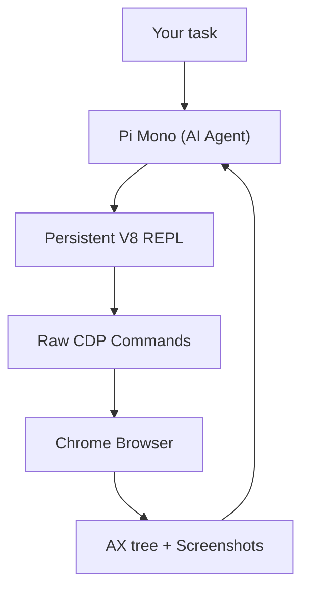

<!-- source: DeepWiki mcp.deepwiki.com · repo browser-use/browser-use-pi · page 1 Overview · fetched 2026-10-30 -->

# Overview

Relevant source files

The following files were used as context for generating this wiki page:

- [README.md](README.md)
- [docs/index.md](docs/index.md)
- [package.json](package.json)

`@browser_use/pi` is a TypeScript SDK designed for browser automation, leveraging the Pi Mono framework. It enables an AI agent to drive Chrome via raw Chrome DevTools Protocol (CDP) commands, executing JavaScript within a persistent V8 REPL (Read-Eval-Print Loop). This architecture allows for highly programmable and interactive browser control, where the agent can dynamically write and execute JavaScript to achieve its tasks [README.md:7-8]().

The core idea is to translate a high-level task into a sequence of actions performed by an AI agent. This agent, powered by Pi Mono, generates JavaScript code that is then executed in a V8 REPL. This REPL directly interacts with Chrome using CDP, allowing for fine-grained control over the browser's state and behavior. The agent receives feedback from the browser in the form of Accessibility Tree (AX tree) snapshots and screenshots, which it uses to inform its next actions [README.md:9-13]().

## High-Level Topology

The system's topology can be visualized as a loop where the agent interprets a task, generates code, executes it in the browser, and then observes the results to refine its next steps.

### System Topology

Sources: [README.md:9-13]()

## Repository Layout

The `@browser_use/pi` repository is structured to facilitate development, testing, and documentation. Key directories and files include:

- `src/`: Contains the core TypeScript source code for the SDK, including the `BrowserUse` class [README.md:28](), CDP client, browser runtime, and agent logic.
- `examples/`: Provides various example scripts demonstrating how to use the SDK for different browser automation tasks.
- `test/`: Houses the test suite for the SDK, covering agent behavior, runtime interactions, session management, and more.
- `docs/`: Contains the documentation for the project, including this wiki.
- `scripts/`: Utility scripts, such as `build-python.mjs` for building the Python client [package.json:35]().
- `python/`: The Python client and its associated tests.
- `package.json`: Defines project metadata, dependencies, and scripts [package.json:1-66]().

## Getting Started & Configuration

To begin using `@browser_use/pi`, you'll need Node.js (v22.19+) or Bun (v1.3.14+) installed [package.json:8-9](). The SDK can be installed via npm, pnpm, or bun [README.md:19-21](). Basic usage involves creating a `BrowserUse` instance, running a task, and then closing the agent [README.md:28-43](). Configuration options include specifying the model, reasoning effort, browser type (e.g., `Browser.cloud`), and workspace directory [README.md:30-35](). Environment variables like `OPENROUTER_API_KEY` and `BROWSER_USE_API_KEY` are used for authentication with model providers and cloud browser services [README.md:23-24](). Telemetry is enabled by default but can be opted out of [README.md:59]().

For detailed instructions on installation, prerequisites, quickstart examples, environment variables, and telemetry opt-out, see [Getting Started & Configuration](#1.1).

Sources: [README.md:19-49](), [package.json:8-9]()

## Models and Providers

`@browser_use/pi` integrates with various language model providers, leveraging Pi Mono's model catalog and transports [README.md:53](). It supports custom providers and allows for different reasoning effort tiers (e.g., `'xhigh'`) [README.md:31](). API keys and base URLs are used to configure access to these models. The SDK handles model stream wrapping and implements retry mechanisms for provider interactions.

For a comprehensive overview of supported model providers, reasoning effort tiers, API key configuration, and model stream handling, see [Models and Providers](#1.2).

Sources: [README.md:31](), [README.md:53]()

## Examples Gallery

The `examples/` directory contains a collection of scripts demonstrating various use cases for `@browser_use/pi`. These examples cover tasks such as data extraction, form filling, question answering, research, applying to jobs, interacting with electronic health records (EHR) systems, and automating interactions with services like OnePassword and Stripe Link [README.md:55](). These examples are exercised by the test suite in `test/examples.test.mjs`.

For a detailed walkthrough of the example scripts and how they are tested, see [Examples Gallery](#1.3).

Sources: [README.md:55]()

---

