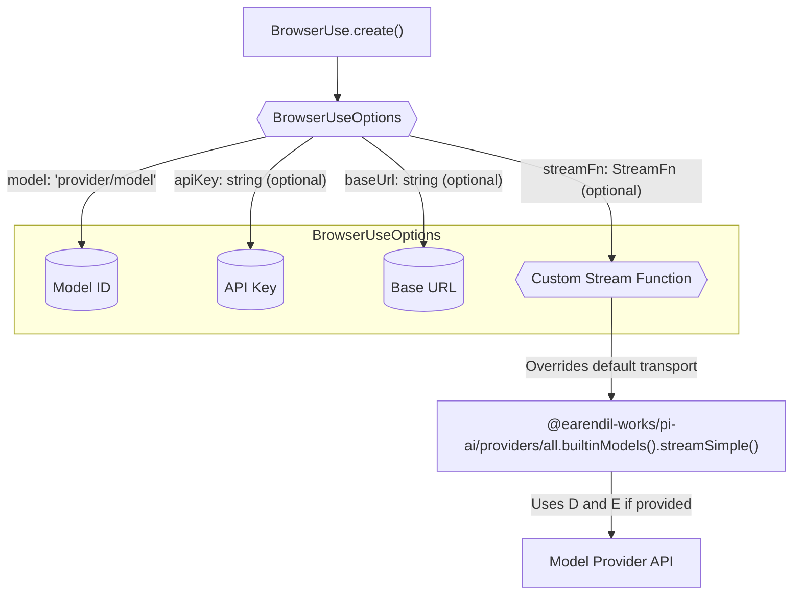
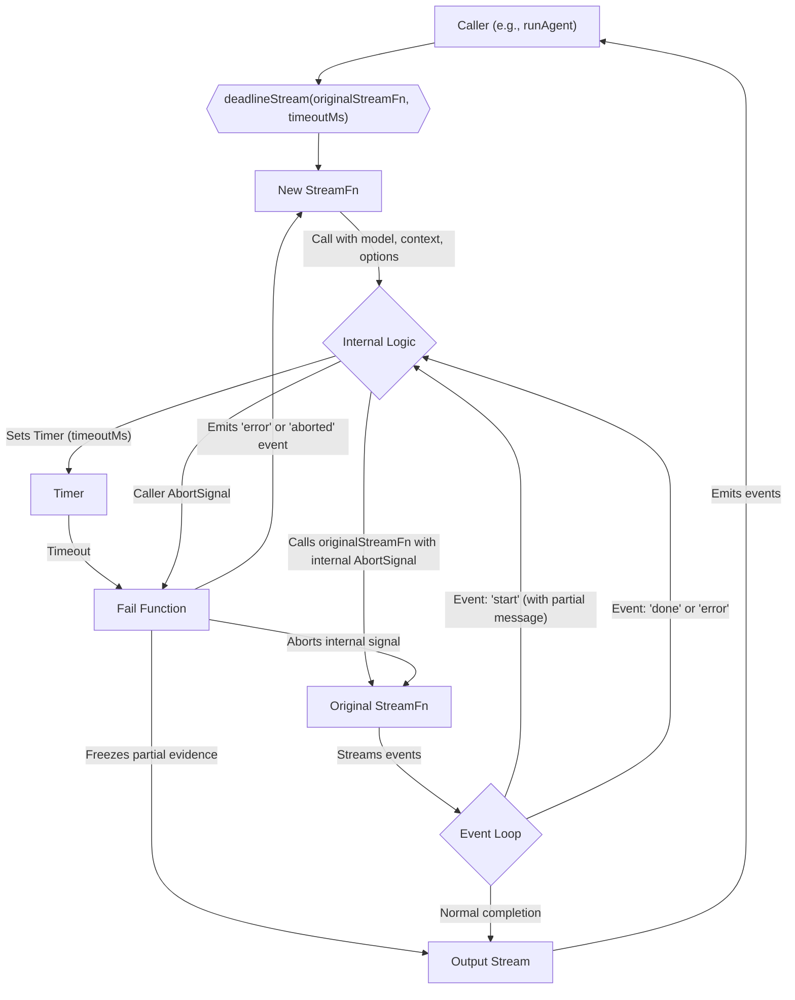

<!-- source: DeepWiki mcp.deepwiki.com · repo browser-use/browser-use-pi · page 1.2 Models and Providers · fetched 2026-10-30 -->

# Models and Providers

<details>
<summary>Relevant source files</summary>

The following files were used as context for generating this wiki page:

- [docs/models.md](docs/models.md)
- [src/model-stream.ts](src/model-stream.ts)
- [src/server.ts](src/server.ts)
- [src/types.ts](src/types.ts)
- [test/model-stream.test.mjs](test/model-stream.test.mjs)
- [test/provider.test.mjs](test/provider.test.mjs)

</details>


This page details the supported model providers, the concept of reasoning effort tiers, how API keys and base URLs are configured, the wrapping of model streams, and the retry behavior of providers within the `@browser_use/pi` codebase. It covers the integration with upstream Pi's model catalog and transport mechanisms.

## Supported Model Providers and Configuration
`@browser_use/pi` leverages the model catalog and transport mechanisms from the upstream Pi library. It does not introduce its own model definitions or silently substitute models [docs/models.md:3]().

Model selection is done by specifying a `provider/model` string. For example, `openrouter/openai/gpt-5.6-luna` or `anthropic/claude-sonnet-4-6` [docs/models.md:6-10]().

API keys for various providers are typically configured via environment variables. For instance, `OPENROUTER_API_KEY` for OpenRouter models and `ANTHROPIC_API_KEY` for Anthropic models [docs/models.md:7-10]().

```javascript
const agent = await BrowserUse.create({
  model: 'openrouter/openai/gpt-5.6-luna',
  reasoning: 'xhigh',
});
```
[docs/models.md:14-18]()

Access to specific models depends on your account entitlements with the respective providers [docs/models.md:12](). Vision models are required for screenshot interpretation [docs/models.md:12]().

Advanced users can supply a custom `Models` collection via the `models` option in `BrowserUse.create()` for new endpoints or custom catalogs [src/types.ts:26](). The `builtinModels()` function from `@earendil-works/pi-ai/providers/all` provides the default catalog [src/server.ts:5]().

A specific compatibility patch exists for "Opus 5 / OpenRouter" models, where the SDK uses OpenRouter's `/api/v1` completions transport to handle an unsupported mid-conversation effort update from Pi's Messages route [docs/models.md:22-24](). This patch is intended to be removed once the upstream Pi route is fixed [docs/models.md:24]().

Sources:
* [docs/models.md:3-24]()
* [src/types.ts:26]()
* [src/server.ts:5]()

## Reasoning Effort Tiers
The `reasoning` option in `BrowserUse.create()` allows specifying the desired thinking level for the model [src/types.ts:27](). The available reasoning levels are dependent on the chosen model [docs/models.md:21]().

Sources:
* [docs/models.md:21]()
* [src/types.ts:27]()

## API Keys and Base URLs
API keys are typically managed through environment variables. However, for custom configurations or testing, the `streamFn` option in `BrowserUse.create()` allows overriding the default model transport [src/types.ts:44](). This is particularly useful for specifying a custom `baseUrl` or `apiKey` directly, as seen in the `bu-pi-server` bridge implementation [src/server.ts:153-158]().

The `streamFn` is a function that takes the model, context, and options, and returns a stream of assistant messages [src/types.ts:4]().

### Diagram: Model Stream Configuration

Sources:
* [src/types.ts:4]()
* [src/types.ts:44]()
* [src/server.ts:153-158]()

## Model Stream Wrapping and Provider Retry Behavior
Model responses are streamed, and the system implements mechanisms to handle stalled connections, timeouts, and errors. The `deadlineStream` function wraps the underlying `StreamFn` to enforce a timeout on both connection setup and the entire response stream [src/model-stream.ts:5]().

### `deadlineStream` Function
The `deadlineStream` function takes a `StreamFn` and a `timeoutMs` value. It returns a new `StreamFn` that will abort the underlying stream if the timeout is exceeded [src/model-stream.ts:5-7]().

- **Timeout Enforcement**: A timer is set when the stream starts. If the stream does not complete within `timeoutMs`, the `fail` function is called, which aborts the stream and sets the `stopReason` to `'error'` or `'aborted'` [src/model-stream.ts:48-49]().
- **Partial Evidence Preservation**: If a timeout or cancellation occurs, any partial `AssistantMessage` received before the failure is preserved. This ensures that late provider responses cannot mutate the run history [src/model-stream.ts:21-42]().
- **Cancellation Handling**: The `deadlineStream` also listens for an `AbortSignal` from the caller. If the signal is aborted, the stream is immediately cancelled [src/model-stream.ts:44-47]().

### Diagram: Model Stream with Deadline Enforcement

Sources:
* [src/model-stream.ts:5-7]()
* [src/model-stream.ts:21-42]()
* [src/model-stream.ts:44-47]()
* [src/model-stream.ts:48-49]()

### Provider Retry Behavior
The system implements a retry mechanism for model inference in cases of timeouts or certain errors.
- **Stalled Responses**: If a real SSE response stalls (e.g., due to a `modelTimeoutMs`), the connection is aborted, and the inference is retried once [test/provider.test.mjs:9-10]().
- **Recovery from Errors**: The `runAgent` function can recover from certain model errors. If a model response fails (e.g., with an uncoded error or a server error), the system may retry the inference. The `providerRetries` count in the `RunMetrics` indicates how many times the provider was retried [test/provider.test.mjs:122]().
- **Budget Preservation**: When a retry occurs due to a timeout, the budgets (e.g., `maxCostUsd`, `maxSteps`) are not reset. This ensures that retries do not circumvent budget constraints [test/model-stream.test.mjs:75-76]().
- **Partial Tool Execution**: If a model times out after providing a partial tool call, the tool is not executed. The retry mechanism ensures that only complete and valid tool calls are processed [test/model-stream.test.mjs:75-76]().

The `modelTimeoutMs` option in `BrowserUseOptions` controls the maximum time allowed for a whole model response, including connection setup [src/types.ts:34](). Similarly, `compactionTimeoutMs` governs the timeout for compaction responses [src/types.ts:36]().

Sources:
* [test/provider.test.mjs:9-10]()
* [test/provider.test.mjs:122]()
* [test/model-stream.test.mjs:75-76]()
* [src/types.ts:34]()
* [src/types.ts:36]()

---

