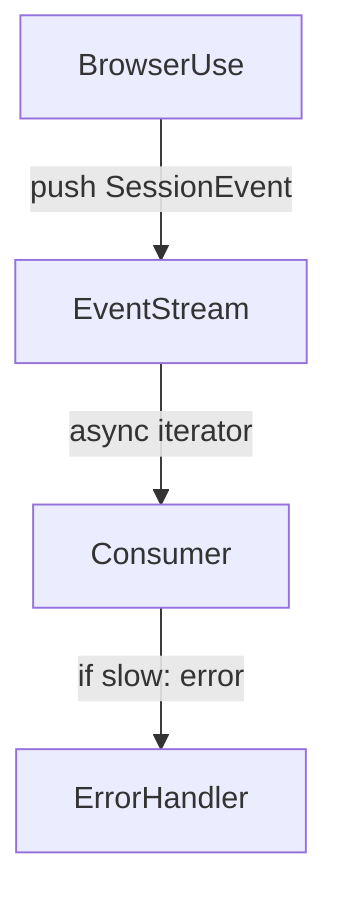
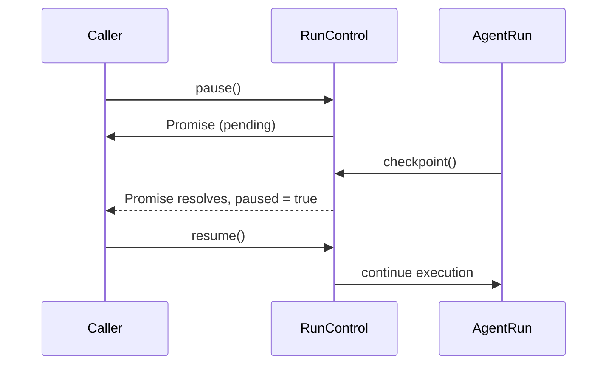

<!-- source: DeepWiki mcp.deepwiki.com · repo browser-use/browser-use-pi · page 2.2 Events, Control and Streaming · fetched 2026-10-30 -->

# Events, Control and Streaming

<details>
<summary>Relevant source files</summary>

The following files were used as context for generating this wiki page:

- [docs/api.md](docs/api.md)
- [src/control.ts](src/control.ts)
- [src/events.ts](src/events.ts)
- [src/index.ts](src/index.ts)
- [src/observer.ts](src/observer.ts)

</details>


This page describes the implementation details of how **events** are streamed asynchronously during a BrowserUse run, how execution is **controlled** (paused, resumed, steered, or canceled) via the `RunControl` interface, and how partial results and **checkpoints** are published. It also covers the structure and handling of run **journals**, which record the lifecycle of a task and its observations. All these features are key to monitoring, adjusting, and recovering agent runs programmatically.

---

## 1. Overview

The `BrowserUse` class provides a browser automation agent SDK that drives a Chrome instance via a persistent V8 REPL and raw Chrome DevTools Protocol (CDP). Beyond simple `run()` and `followUp()` methods that return final results, the SDK offers an **events() async stream** for real-time notifications and **RunControl** for responsive control over the running agent.

### Key Concepts

- **events() Async Iterator**: Streams rich events asynchronously from a run lifecycle, including start/end, agent tool calls, pauses, resumptions, and warnings.
- **RunControl**: A cooperative interface allowing the caller to pause run execution at safe points, resume it, steer the running JavaScript agent with additional input, or cancel the run.
- **Checkpoints and Partial Findings**: Agents can publish intermediate partial results known as "findings" via checkpoints, enabling useful work to be read even if a run is canceled or times out.
- **Run Journals**: Persistent JSON logs of events, checkpoints, and final run results that enable reviewing completed or aborted runs with rich telemetry and observations.

---

## 2. Event Streaming with `events()` and EventStream

### 2.1 `BrowserUse.events()` Method

The `BrowserUse` class provides an `events()` method that returns an asynchronous iterator of **SessionEvent** objects, which represent the atomic events occurring during a run.

Events include:

- Run start (`run_start`)
- Agent tool events (`agent_event`)
- Run end (`run_end`)
- Pause/resume notifications
- Warning messages

This mechanism gives full visibility into the agent's internal state machine and tool execution lifecycle, beyond just the final output or error.

#### Implementation Details

- Events are pushed into an `EventStream` instance internally.
- `EventStream` uses a bounded queue (default capacity 256) to ensure that slow consumers do not block the agent indefinitely or cause unbounded memory growth.
- If the consumer cannot keep up, the stream errors out with instructions to read the persisted run log instead.
- Each `SessionEvent` includes metadata such as sequence number, timestamp, and runId for precise order tracking.

#### `EventStream` Class Highlights

- `.push(event: SessionEvent)`: Adds an event to the internal queue, throwing an error if capacity limits are exceeded.
- `.next()`: Async iterator method to consume events.
- `.end()`: Closes the stream and cleans up.
- Handles JSON size checks on events to keep memory bounded.



### 2.2 Event Data Structure

`SessionEventData` is a tagged union type defining event shapes:

| Event Type      | Payload                                         |
|-----------------|------------------------------------------------|
| run_start       | `{ task: string; followUp: boolean }`          |
| agent_event     | `{ event: AgentEvent }`                         |
| run_end         | `{ result: RunResult }`                         |
| paused / resumed| no additional data                              |
| warning         | `{ message: string }`                           |

`SessionEvent` extends this with sequence number, timestamp (milliseconds), and runId string.

This enables rich inspection and reconstruction of the agent's behavior.

---

## 3. Run Control: Pause, Resume, Steering, Cancellation

The agent's execution can be controlled from the outside via the `RunControl` class, which is used internally by `BrowserUse` to provide hooks like `.pause()`, `.resume()`, `.steer(text)`, and `.cancel()`.

### 3.1 `RunControl` Class Overview

- `pause()` signals the request to pause; it resolves when pause is acknowledged.
- `checkpoint(signal?)` is called internally by the agent run at safe tool boundaries, awaiting external resume.
- `resume()` exits a paused state allowing the run to continue.
- `finish()` terminates the control, cleaning up internal state.
- `.steer` property is a callback that can be set to send steering text input to the running agent asynchronously.

### 3.2 Control Flow

- When `.pause()` is requested, `RunControl` marks `requested = true` and returns a Promise resolved when acknowledged.
- At a checkpoint (tool boundary), `RunControl` sets `paused = true` and signals the caller by invoking the `changed` callback.
- The agent waits on the Promise returned from `checkpoint()`, effectively halting progress.
- When `resume()` is called, the agent is allowed to continue immediately.

This cooperative design prevents pauses mid-tool execution and keeps browser input atomic.



### 3.3 Bounded Callbacks

All external callbacks and hooks supporting control signals are wrapped with a `bounded()` utility that enforces timeouts and cancellation with abort signals to prevent hangs from faulty cooperative code.

---

## 4. Partial Findings and Checkpoints

Agents can publish partial results during long or multi-step runs. These are stored as **checkpoints** and contain partial JSON findings, enabling partial data retrieval if a run is interrupted.

### 4.1 Publishing Checkpoints

Agents call:

```ts
await checkpoint('findings.json', findings, { partial: true });
```

- The checkpoint writes findings to a workspace file.
- If a run is incomplete, the result object contains a `.partial` property referencing the last checkpoint.
- Partial findings are **not** validated against the final schema and cannot replace final output.
- A new run or follow-up does *not* inherit partials automatically; the calling client must manage reading and checkpointing.

### 4.2 Run Results vs. Partial Findings

- Completed runs have `result.output`.
- Interrupted runs may have `result.partial.value`, containing the last checkpoint value.
- If no checkpoint exists, `result.text` will hold assistant output or tool observations.
- Run participants can access checkpoints by file paths in the workspace.

---

## 5. Run Journals and Persistent Logs

Runs produce journals that persist events, checkpoints, and metadata:

- Journals capture the entire run lifecycle and event stream.
- They allow reviewing historical runs offline.
- Slow consumers of the `events()` stream are encouraged to read the journal to avoid lost events.
- Journals include telemetry data such as step counts, duration, cost, status, and usage.

---

## 6. Data Flow Summary and Diagram

The following diagram bridges the natural language concepts to code entities:

```mermaid
graph TB
  subgraph Natural_Language_Space
    NL1["User task request"]
    NL2["Agent reasoning & tool execution"]
    NL3["Partial findings checkpoint"]
    NL4["Run monitoring and control"]
    NL5["Run completion"]
  end

  subgraph Code_Entity_Space
    BU[BrowserUse]
    RT[BrowserRuntime]
    AG[runAgent() - Agent engine]
    RC[RunControl]
    ES[EventStream - events() Async Stream]
    CP[checkpoint() API]
  end

  NL1 -->|start run| BU
  BU --> AG
  AG --> RT
  AG -->|call checkpoint()| CP
  CP --> BU
  AG -->|send events| ES
  NL4 -->|pause/resume/steer| RC
  RC -->|controls| AG
  AG -->|run complete| BU
  BU -->|emit run_end event| ES
```

---

## 7. Detailed Technical Notes and References

- **`BrowserUse` class** maintains a set of `EventStream` subscribers to broadcast events and captures the current run's `RunControl` instance [src/index.ts:42-156]() (not shown fully but key parts visible).
- The event stream enforces backpressure and bounded queues to protect the agent [src/events.ts:14-73]().
- `RunControl` provides pause/resume with Promises resolved once safe boundaries are reached [src/control.ts:23-83]().
- `bounded()` utility wraps callbacks to enforce hook timeouts and cancellations [src/control.ts:1-21]().
- Observers and best-effort event sinks are supported via the `Observer` class which coalesces rapid events without backpressure [src/observer.ts:4-51]().
- Partial results are checkpointed by writing to workspace files; partials are returned in the `RunResult.partial` field if the run does not complete [docs/api.md:74-95]().

---

# Summary Table: Event Types and Corresponding Code Entities

| Natural Concept        | Code Entity / Class       | Role/Description                                  |
|-----------------------|--------------------------|--------------------------------------------------|
| Agent run start/end   | `BrowserUse`, `EventStream` | Emits `run_start` and `run_end` session events   |
| Agent tool execution  | `AgentEvent` in event stream | Notifies start/end of tool calls                  |
| Pause/resume control  | `RunControl`              | Provides interactive control hooks                |
| Partial checkpointing | `checkpoint()` API        | Stores partial findings JSON to workspace         |
| Slow consumer error   | `EventStream` queue       | Errors if queue/bytes exceeds bounded limit       |
| Observation (best-effort) | `Observer` class         | Handles best-effort event callbacks without backpressure |

---

# Conclusion

The `BrowserUse` SDK enables fine-grained event streaming and run control through a carefully designed asynchronous pipeline:

- `EventStream` exposes run lifecycle events as an async iterator.
- `RunControl` allows reactive pausing, resuming, and steering at tool boundaries.
- Checkpointing supports partial JSON results and recovery.
- Journals and telemetry provide persistent records of runs for debugging and auditing.

Together, these underpin powerful scripting, monitoring, and interactive debugging of browser-driven AI agents.

---

### Sources:

- src/index.ts:42-156  
- src/events.ts:10-73  
- src/control.ts:1-83  
- src/observer.ts:4-51  
- docs/api.md:51-101

---

