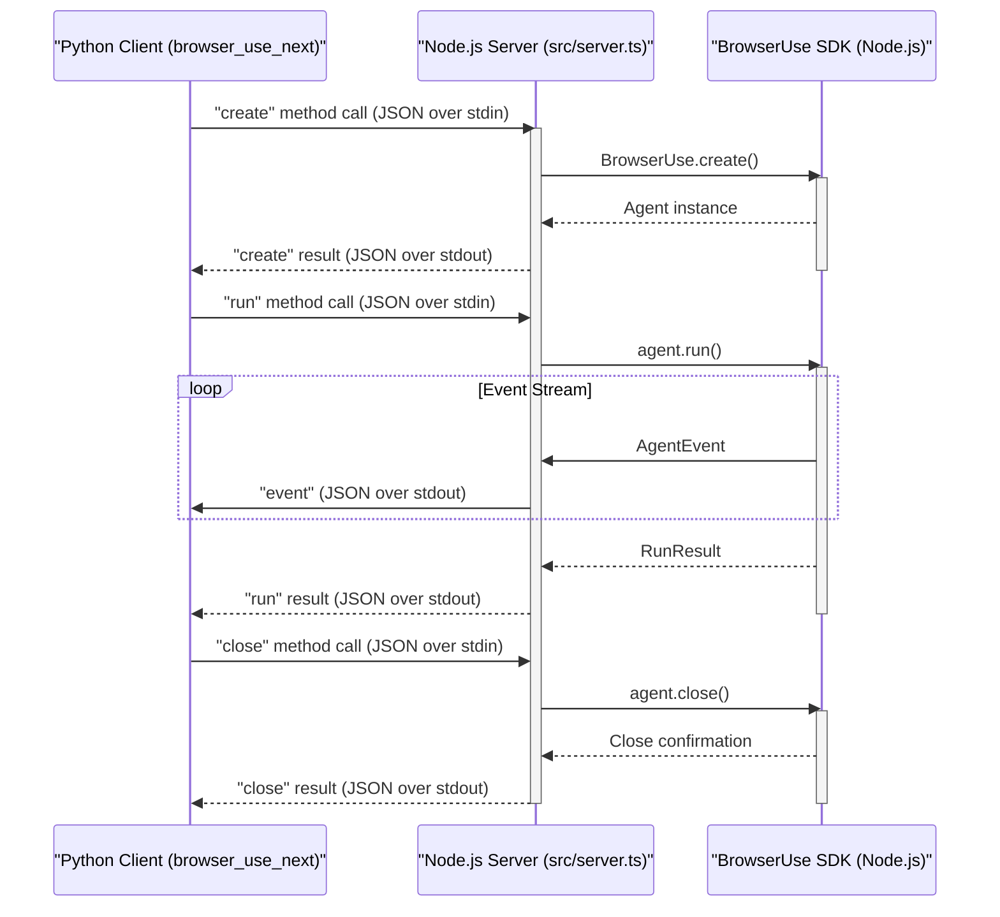
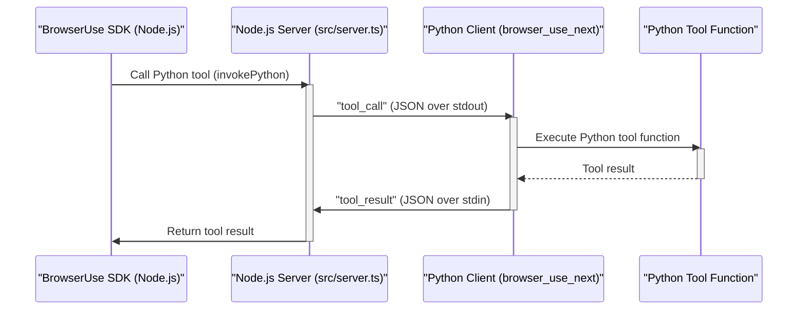

<!-- source: DeepWiki mcp.deepwiki.com · repo browser-use/browser-use-pi · page 2.4 Python Client and stdio Bridge · fetched 2026-10-30 -->

# Python Client and stdio Bridge

<details>
<summary>Relevant source files</summary>

The following files were used as context for generating this wiki page:

- [docs/benchmarks.md](docs/benchmarks.md)
- [docs/python.md](docs/python.md)
- [examples/README.md](examples/README.md)
- [examples/apply-to-job.ts](examples/apply-to-job.ts)
- [examples/ehr.ts](examples/ehr.ts)
- [python/browser_use_next/__init__.py](python/browser_use_next/__init__.py)
- [python/pyproject.toml](python/pyproject.toml)
- [python/tests/test_client.py](python/tests/test_client.py)
- [scripts/build-python.mjs](scripts/build-python.mjs)
- [src/images.ts](src/images.ts)
- [src/model-stream.ts](src/model-stream.ts)
- [src/server.ts](src/server.ts)
- [src/types.ts](src/types.ts)
- [test/images.test.mjs](test/images.test.mjs)
- [test/model-stream.test.mjs](test/model-stream.test.mjs)

</details>


This page details the Python client for the `@browser_use/pi` SDK, focusing on its asynchronous nature, Pydantic schema integration, and how Python-defined tools interact with the underlying Node.js engine. It also covers the `src/server.ts` (bu-pi-server) stdio bridge protocol and the `scripts/build-python.mjs` packaging process. The Python client provides a thin wrapper over the same Node.js engine, enabling Python developers to leverage the browser automation capabilities of the SDK.

## Python Client Overview

The Python client, `browser_use_next`, allows Python applications to interact with the Browser Use SDK. It requires Python 3.11+ and a Node.js runtime (22.19+) with Chrome installed. The client communicates with the Node.js engine via a private, versioned stdio bridge.

The client is installed by building a wheel from the repository and installing it in a Python virtual environment.

```sh
npm run build:python
uv build python --wheel --out-dir artifacts/python
uv venv
uv pip install artifacts/python/browser_use_next-0.1.0-py3-none-any.whl
```
[docs/python.md:5-9]()

Once installed, the `BrowserUse` class can be imported and used asynchronously.

```python
import asyncio
from browser_use_next import BrowserUse

async def main():
    async with await BrowserUse.create(
        model='openrouter/openai/gpt-5.6-luna',
        workspace='./work',
    ) as agent:
        result = await agent.run('Find the top story on Hacker News.')
        print(result.status, result.text)
        await agent.follow_up('Summarize the comments.')

asyncio.run(main())
```
[docs/python.md:13-27]()

The Python client is not a drop-in replacement for `browser_use.beta.Agent` but a separate client that communicates with the Node.js engine. [docs/python.md:35]()

Sources:
- [docs/python.md]()

## stdio Bridge Protocol (`src/server.ts`)

The core of the Python client's interaction with the Node.js engine is the `src/server.ts` file, which acts as a private, versioned stdio bridge. This server is a Node.js process that communicates with the Python client over standard input/output, avoiding shell or HTTP server overhead.

### Communication Flow

The communication between the Python client and the Node.js server follows a request-response pattern for method calls and a streaming pattern for events.


**Diagram: Python Client to Node.js Server Communication Flow**

The `src/server.ts` script handles incoming JSON messages from stdin, dispatches them to the `BrowserUse` SDK, and sends back JSON responses and events to stdout.

- **`send(value: unknown)`**: This function serializes a JavaScript value to a JSON string and writes it to `process.stdout` followed by a newline. It includes a mechanism to prevent output buffer overflow. [src/server.ts:18-28]()
- **`dispatch(method: string, params: Record<string, unknown>)`**: This is the main entry point for handling incoming method calls from the Python client. It routes calls like `ping`, `tool_result`, `create`, `run`, `followUp`, and `execute` to the appropriate `BrowserUse` SDK methods. [src/server.ts:93-196]()

### `BrowserUse.create` Options

When the Python client calls `BrowserUse.create`, the `dispatch` function in `src/server.ts` processes the options. It validates the provided keys against a predefined set of allowed options (`CREATE_KEYS`). [src/server.ts:67-92]()

```mermaid
graph TD
    A[Python Client] --> B{BrowserUse.create(options)}
    B --> C[src/server.ts:dispatch('create', params)]
    C --> D{Validate params against CREATE_KEYS}
    D -- Invalid Key --> E[Throw Error: Unsupported create option]
    D -- Valid Keys --> F{Extract apiKey, baseUrl, rawTools}
    F --> G{Initialize builtinModels}
    G --> H{Process rawTools into executable tools}
    H --> I[BrowserUse.create(processed_options)]
    I --> J[Start event stream from agent.events()]
    J --> K[Send events to Python Client via stdout]
    I --> L[Return { workspace: agent.workspace }]
```
**Diagram: `BrowserUse.create` Handling in `src/server.ts`**

Key aspects of `create` handling:
- **Model Configuration**: The `model` parameter is required and must be a string (e.g., `openai/gpt-5.5`). [src/server.ts:120]()
- **API Keys and Base URLs**: `apiKey` and `baseUrl` are extracted from the parameters and used to configure the `streamFn` for model interactions. [src/server.ts:121-125, 153-158]()
- **Tool Handling**: Python-defined tools are passed as `rawTools`. The server validates their structure and transforms them into executable JavaScript functions that invoke the Python client via `invokePython`. [src/server.ts:127-152]()
- **Event Streaming**: After `BrowserUse.create` successfully initializes, the server sets up an asynchronous loop to listen for `agent.events()` and forwards them to the Python client via `send({ method: 'event', params: event })`. [src/server.ts:160-166]()

Sources:
- [src/server.ts:1-196]()
- [src/types.ts:16-61]()

## Pydantic Schema Handling

The Python client leverages Pydantic for defining and validating structured outputs and tool inputs/outputs.

### Typed Output with `schema`

When calling `agent.run` or `agent.follow_up`, the `schema` parameter can be set to a Pydantic model. This ensures that the agent's output conforms to the specified Python type.

```python
from pydantic import BaseModel

class Quote(BaseModel):
    total: int

# ...
result = await agent.run("Calculate quote", schema=Quote)
# result.output will be an instance of Quote
```
[python/tests/test_client.py:17-20, 176]()
[docs/python.md:29]()

The `src/server.ts` bridge receives the Pydantic schema as a JSON object and passes it to the underlying `BrowserUse` SDK. The SDK uses TypeBox for schema validation, which is compatible with JSON Schema generated from Pydantic.

### Partial Findings

If a run stops prematurely (e.g., due to `maxSteps`), `result.partial` exposes the latest published checkpoint as a dictionary. This partial data is unvalidated against the final schema. [docs/python.md:37]()

```python
# ...
result = await agent.run("Audit", schema=Quote, maxSteps=1)
self.assertEqual(result.status, "max_steps")
self.assertIsNone(result.output)
self.assertEqual(result.partial["value"], [{"issue": "Broken search"}])
```
[python/tests/test_client.py:150-154]()

Sources:
- [docs/python.md:29, 37]()
- [python/tests/test_client.py:14-20, 148-154, 176]()
- [src/types.ts:105]()

## Python-Defined Tools

The Python client allows defining custom tools using the `Tool` class, which can then be passed to `BrowserUse.create`. These tools enable the agent to execute Python functions as part of its workflow.

### Defining a Tool

A Python tool is defined with a name, description, an input Pydantic schema, and an asynchronous callback function.

```python
from browser_use_next import Tool
from pydantic import BaseModel

class Quantity(BaseModel):
    quantity: int

class Quote(BaseModel):
    total: int

async def quote(args: Quantity) -> Quote:
    # ... implementation ...
    return Quote(total=args.quantity * 7)

tool_instance = Tool("quote", "Price the quantity", Quantity, quote)
```
[python/tests/test_client.py:14-20, 158-162]()
[docs/python.md:29, 33]()

### Tool Execution Flow

When the agent decides to call a Python tool, the following sequence occurs:


**Diagram: Python Tool Execution Flow**

1.  **Agent Calls Tool**: The `BrowserUse` SDK, running in Node.js, determines it needs to call a Python-defined tool.
2.  **`invokePython`**: The `execute` function associated with the tool in `src/server.ts` calls `invokePython`. This function generates a unique `id` for the tool call and sends a `tool_call` message to the Python client via `stdout`. [src/server.ts:31-64, 150-152]()
3.  **Python Client Receives Call**: The Python client receives the `tool_call` message, parses the arguments, and executes the corresponding Python tool function.
4.  **Python Tool Execution**: The Python tool function performs its logic and returns a result.
5.  **Python Client Sends Result**: The Python client sends a `tool_result` message back to the Node.js server via `stdin`, including the `id` of the original call and the result. [src/server.ts:95-112]()
6.  **Node.js Server Resolves Promise**: The `dispatch` function in `src/server.ts` receives the `tool_result` message, finds the pending tool call using its `id`, and resolves the promise that `invokePython` returned, passing the result back to the `BrowserUse` SDK. [src/server.ts:95-112]()

### Asynchronous and Synchronous Callbacks

-   **Asynchronous Callbacks**: Async Python tool callbacks are cancelled with the run. [docs/python.md:33]()
-   **Synchronous Callbacks**: Synchronous callbacks run in a separate thread and must cooperate with cancellation. [docs/python.md:33]()

### Pydantic Validation for Tools

Custom tools validate their input and output using Pydantic schemas. Recursive or external schema references are explicitly disallowed to prevent serialization issues. [docs/python.md:33]()

Sources:
- [docs/python.md:29, 33]()
- [python/tests/test_client.py:14-20, 158-162]()
- [src/server.ts:31-64, 95-112, 150-152]()

## Packaging with `scripts/build-python.mjs`

The `scripts/build-python.mjs` script is responsible for bundling the Node.js server and its dependencies into the Python package. This ensures that the Python client can run the Node.js engine without requiring a separate Node.js installation for the SDK itself.

```mermaid
graph TD
    A[scripts/build-python.mjs] --> B{esbuild src/server.ts}
    B --> C{esbuild src/worker.ts}
    C --> D[Output: python/browser_use_next/runtime/server.mjs]
    C --> E[Output: python/browser_use_next/runtime/worker.js]
    A --> F{Copy photon_rs_bg.wasm}
    F --> G[Output: python/browser_use_next/runtime/photon_rs_bg.wasm]
    A --> H{Collect Third-Party Licenses}
    H --> I[Output: python/browser_use_next/runtime/THIRD_PARTY_NOTICES.txt]
    D & E & G & I --> J[Python Wheel (browser_use_next-0.1.0-py3-none-any.whl)]
```
**Diagram: Python Package Build Process**

The script performs the following key actions:
-   **`esbuild`**: It uses `esbuild` to bundle `src/server.ts` into `server.mjs` and `src/worker.ts` into `worker.js`. These are placed in `python/browser_use_next/runtime/`. The bundling process includes all necessary Node.js modules, targeting `node22` and ES module format. [scripts/build-python.mjs:12-28]()
-   **`photon_rs_bg.wasm`**: It copies the `photon_rs_bg.wasm` file, which is a WebAssembly module used for image processing (e.g., resizing images for model vision), into the runtime directory. [scripts/build-python.mjs:8-10]()
-   **License Collection**: The script iterates through the `node_modules` dependencies, reads their `package.json` and license files, and compiles them into a `THIRD_PARTY_NOTICES.txt` file. This ensures compliance with open-source licenses. [scripts/build-python.mjs:29-51]()
-   **`package.json`**: A minimal `package.json` is created in the runtime directory to declare the module type as `module`. [scripts/build-python.mjs:53]()

The `pyproject.toml` file then specifies that these runtime files should be included in the Python package data. [python/pyproject.toml:18-19]()

Sources:
- [scripts/build-python.mjs:1-60]()
- [python/pyproject.toml:1-19]()
- [src/images.ts:58-65]()
- [test/images.test.mjs:12-22]()

## Browser Options and Policy

The Python client supports configuring browser options and policy settings, mirroring the JavaScript SDK.

-   **Browser Kind**: Options like `browser={"kind": "cloud", "apiKey": "..."}` or `{"kind": "chromium", "profileDir": "./profile"}` are supported. [docs/python.md:39]()
-   **Domain Policy**: `allowedDomains` and `prohibitedDomains` control navigation. [docs/python.md:39]()
-   **Sensitive Data**: `sensitiveData` is used for redacting sensitive information from logs and events. The values are not sent over the bridge in plain text. [docs/python.md:39]()
    -   The `test_browser_policy_and_secrets_cross_the_python_bridge` test confirms that sensitive data is not present in the requests sent over the bridge. [python/tests/test_client.py:135-146]()
-   **Telemetry**: `telemetry=False` can be used to opt out of anonymous usage reporting. [docs/python.md:39]()
-   **Highlight Actions**: `highlightActions=True` enables visual feedback on clicked or typed elements. [docs/python.md:37]()

Sources:
- [docs/python.md:29, 37, 39]()
- [python/tests/test_client.py:135-146]()
- [src/types.ts:16-17, 60-61]()

---

