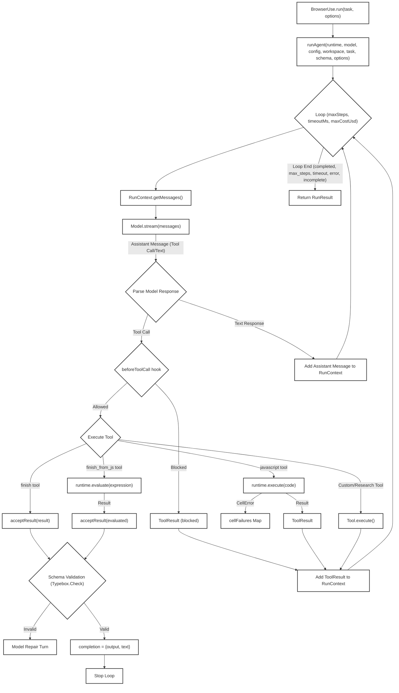

<!-- source: DeepWiki mcp.deepwiki.com · repo browser-use/browser-use-pi · page 3 Agent Engine · fetched 2026-10-30 -->

# Agent Engine

<details>
<summary>Relevant source files</summary>

The following files were used as context for generating this wiki page:

- [src/agent.ts](src/agent.ts)
- [test/agent.test.mjs](test/agent.test.mjs)

</details>


This page provides a high-level overview of how a natural language task given to the `BrowserUse` agent is transformed into model turns, tool calls, and ultimately a delivered result. It introduces the core components and processes involved, with links to child pages for detailed technical explanations.

The agent engine orchestrates the interaction between the language model and the browser environment. It manages the agent's decision-making loop, executes tools, handles context, enforces budgets, and ensures the final result adheres to specified schemas and policies.

## Agent Loop and Tools

The heart of the agent engine is the `runAgent` function [src/agent.ts:41-54](), which orchestrates the entire process. It iteratively prompts the language model, interprets its responses, and executes the requested tools. The agent's capabilities are primarily defined by the tools it has access to. Key built-in tools include `javascript` for executing code in the persistent V8 REPL, and `finish` / `finish_from_js` for delivering the final result. The agent also supports research tools and custom tools defined by the user. Hooks like `beforeToolCall` and `afterToolCall` allow for custom logic before and after tool execution, including handling cell errors.

For details, see [Agent Loop and Tools](#3.1).

## System Prompt and Agent Capabilities

The agent's behavior is heavily influenced by its `SYSTEM_PROMPT` [src/prompt.js:1-1](). This prompt provides the language model with crucial information about its environment and capabilities. It defines the semantics of the REPL, introduces browser primitives, and emphasizes an AX-tree-first strategy for interacting with web pages. The prompt also includes instructions for using workspace helpers (e.g., `artifact`, `checkpoint`, `reconnect`) and outlines the rules for delivering results.

For details, see [System Prompt and Agent Capabilities](#3.2).

## Budgets, Context and Compaction

To ensure efficient and controlled execution, the agent engine enforces various budgets, including step limits (`maxSteps`), cost limits (`maxCostUsd`), time limits (`timeoutMs`), and context window limits (`maxContextChars`). The `RunContext` [src/agent.ts:78-89]() class manages the agent's conversational history and performs compaction to stay within context limits. It also handles model stream deadlines, provider retries, and "delivery repair turns" where the model attempts to fix an invalid result. The engine tracks various termination statuses for a run, such as `completed`, `max_steps`, `timeout`, `error`, and `incomplete`.

For details, see [Budgets, Context and Compaction](#3.3).

## Policy, Secrets and Redaction

The agent operates within defined policies to ensure secure and compliant execution. This includes `allowedDomains` and `prohibitedDomains` for navigation control. Sensitive data, specified via `sensitiveData` and managed by `fillSecret`, is protected through redaction mechanisms that prevent its leakage in logs, events, and results. The engine also handles telemetry reporting, providing insights into agent performance and usage.

For details, see [Policy, Secrets and Redaction](#3.4).

### Agent Engine Overview

The following diagram illustrates the high-level flow of a task through the agent engine, highlighting the interaction between the model, tools, and the browser runtime.

```mermaid
graph TD
    subgraph "Natural Language Space"
        A[User Task] --> B{Agent.run()};
    end

    subgraph "Code Entity Space"
        B --> C(RunOptions);
        C --> D(RunContext);
        D --> E(Agent Loop);
        E -- "Model Request" --> F(Model Provider);
        F -- "Model Response (Tool Call/Text)" --> E;
        E -- "Tool Execution" --> G{Tool Dispatcher};
        G -- "javascript tool" --> H(BrowserRuntime.execute);
        G -- "finish/finish_from_js tool" --> I(Result Validation);
        G -- "research tools" --> J(Research Tools);
        G -- "custom tools" --> K(Custom Tools);
        H -- "Browser Actions" --> L(Browser Runtime Layer);
        L -- "CDP Commands" --> M(Chrome Browser);
        I -- "Schema Validation" --> N{Typebox.Check};
        N -- "Valid" --> O(RunResult);
        N -- "Invalid" --> E;
        E -- "Budget Enforcement" --> P(Budgets);
        E -- "Context Management" --> Q(RunContext.compact);
        E -- "Policy Enforcement" --> R(Policy Checks);
        E -- "Redaction" --> S(Redaction);
        O --> T[Delivered Result];
    end

    style A fill:#fff,stroke:#333,stroke-width:2px
    style B fill:#fff,stroke:#333,stroke-width:2px
    style C fill:#fff,stroke:#333,stroke-width:2px
    style D fill:#fff,stroke:#333,stroke-width:2px
    style E fill:#fff,stroke:#333,stroke-width:2px
    style F fill:#fff,stroke:#333,stroke-width:2px
    style G fill:#fff,stroke:#333,stroke-width:2px
    style H fill:#fff,stroke:#333,stroke-width:2px
    style I fill:#fff,stroke:#333,stroke-width:2px
    style J fill:#fff,stroke:#333,stroke-width:2px
    style K fill:#fff,stroke:#333,stroke-width:2px
    style L fill:#fff,stroke:#333,stroke-width:2px
    style M fill:#fff,stroke:#333,stroke-width:2px
    style N fill:#fff,stroke:#333,stroke-width:2px
    style O fill:#fff,stroke:#333,stroke-width:2px
    style P fill:#fff,stroke:#333,stroke-width:2px
    style Q fill:#fff,stroke:#333,stroke-width:2px
    style R fill:#fff,stroke:#333,stroke-width:2px
    style S fill:#fff,stroke:#333,stroke-width:2px
    style T fill:#fff,stroke:#333,stroke-width:2px
```
Sources: [src/agent.ts:41-54](), [src/agent.ts:78-89](), [src/agent.ts:94-123](), [src/agent.ts:148-157](), [src/agent.ts:158-166](), [src/agent.ts:124-146](), [src/prompt.js:1-1]()

### Agent Loop Details

The `runAgent` function [src/agent.ts:41-54]() is the central orchestrator. It manages the iterative process of generating model turns and executing tools.


Sources: [src/agent.ts:41-54](), [src/agent.ts:94-123](), [src/agent.ts:148-157](), [src/agent.ts:158-166](), [src/agent.ts:124-146](), [test/agent.test.mjs:84-101](), [test/agent.test.mjs:170-196]()

---

