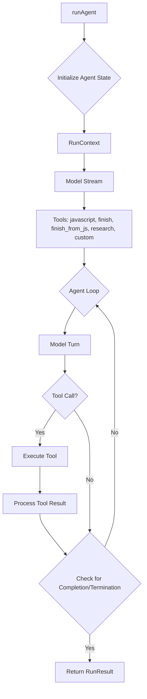

<!-- source: DeepWiki mcp.deepwiki.com · repo browser-use/browser-use-pi · page 3.1 Agent Loop and Tools · fetched 2026-10-30 -->

# Agent Loop and Tools

<details>
<summary>Relevant source files</summary>

The following files were used as context for generating this wiki page:

- [src/agent.ts](src/agent.ts)
- [src/context.ts](src/context.ts)
- [src/research-tools.ts](src/research-tools.ts)
- [test/recovery.test.mjs](test/recovery.test.mjs)

</details>


This page details the core agent orchestration within `runAgent`, focusing on how the agent interacts with various tools to achieve its goals. It covers the implementation of built-in tools like `javascript`, `finish`, and `finish_from_js`, the integration of research tools, the mechanism for custom tools, and the `beforeToolCall`/`afterToolCall` hooks, as well as error handling for JavaScript cell execution.

## Agent Orchestration: `runAgent`

The `runAgent` function [src/agent.ts:41-55]() is the central orchestrator for the agent's execution loop. It takes a `BrowserRuntime`, a `Model`, configuration options, the workspace path, the task description, a TypeBox schema for the expected result, and run-specific options. It manages the agent's state, including the number of steps, usage metrics, and warnings.

The agent operates within a loop, making decisions based on the current context and available tools. It uses a `RunContext` [src/agent.ts:78-89]() to manage the conversation history and handle context compaction.


**Diagram 3.1.1: `runAgent` Orchestration Flow**
Sources: [src/agent.ts:41-55]()

### Usage Tracking

`runAgent` tracks token and cost usage throughout the agent's execution. The `zeroUsage()` function [src/agent.ts:21-28]() initializes a usage object, and `sumUsage()` [src/agent.ts:29-39]() aggregates usage from multiple agent messages. This ensures that the total resource consumption of a run can be accurately reported.

Sources: [src/agent.ts:21-28](), [src/agent.ts:29-39]()

## Built-in Tools

The agent comes with several essential built-in tools that enable interaction with the browser environment and task completion.

### `javascript` Tool

The `javascript` tool [src/agent.ts:94-123]() allows the agent to execute arbitrary JavaScript code within a persistent Node.js REPL that has access to raw Chrome DevTools Protocol (CDP) capabilities.

- **Name**: `javascript`
- **Label**: "Browser JavaScript"
- **Description**: "Execute JavaScript in a persistent Node REPL with raw CDP. Cell deadline: ${config.cellTimeoutMs ?? 30_000} ms. Checkpoint small batches before the deadline. Use screenshot() for native images."
- **Parameters**: `code` (string)
- **Execution Mode**: `sequential`
- **Replay**: `never`

When `javascript` is called, the provided `code` is executed by the `BrowserRuntime`'s `execute` method [src/agent.ts:104-105](). If the execution results in a `CellError` [src/agent.ts:106-107](), the error is captured and stored in `cellFailures` [src/agent.ts:109](), and a descriptive error message is returned to the agent. This mechanism allows the agent to understand and potentially recover from JavaScript execution failures. The tool returns the text output and any captured images from the JavaScript execution.

Sources: [src/agent.ts:94-123](), [src/agent.ts:104-105](), [src/agent.ts:106-107](), [src/agent.ts:109]()

### `finish` Tool

The `finish` tool [src/agent.ts:148-157]() is used by the agent to deliver the final result of the task.

- **Name**: `finish`
- **Label**: "Deliver result"
- **Description**: "Submit the verified final result, matching this schema. For data already in JavaScript, prefer finish_from_js to avoid rewriting it. This ends the task."
- **Parameters**: `result` (matching the provided `schema`)
- **Execution Mode**: `sequential`

The `finish` tool calls `acceptResult()` [src/agent.ts:155]() which first validates the `result` against the `schema` using TypeBox's `Check` function [src/agent.ts:125](). If `config.validateResult` is provided, it's called to perform additional validation [src/agent.ts:129-135](). If validation passes, the `completion` object is set, and the tool signals termination of the agent loop.

Sources: [src/agent.ts:148-157](), [src/agent.ts:125](), [src/agent.ts:129-135](), [src/agent.ts:155]()

### `finish_from_js` Tool

The `finish_from_js` tool [src/agent.ts:159-166]() is a specialized version of `finish` that allows the agent to deliver a result directly from a JavaScript expression evaluated in the REPL.

- **Name**: `finish_from_js`
- **Label**: "Deliver JavaScript value"
- **Description**: "Deliver an existing value from the persistent REPL without printing or rewriting it. Expression must match the result schema of finish. For a string result use JSON.stringify(records) or an existing text variable. Evaluated once; ends the task after validation."
- **Parameters**: `expression` (string)
- **Execution Mode**: `sequential`
- **Replay**: `never`

This tool executes the provided `expression` in the `BrowserRuntime` [src/agent.ts:169-170]() and then passes the result to `acceptResult()` [src/agent.ts:171]() for validation and completion. This avoids the need for the agent to re-serialize data that is already available in the JavaScript environment.

Sources: [src/agent.ts:159-166](), [src/agent.ts:169-170](), [src/agent.ts:171]()

## Research Tools

The `researchTools` function [src/research-tools.ts:49-81]() provides a set of file and shell manipulation tools that operate independently of the browser/REPL process. These tools are created using `@earendil-works/pi-coding-agent`'s `createCodingTools` [src/research-tools.ts:50-51]().

The `write` tool within `researchTools` is augmented by `writeWithLocation()` [src/research-tools.ts:11-46]() to provide additional context about the written file's location relative to the workspace. This helps the agent understand if a file was written outside the expected directory.

```mermaid
graph TD
    A[researchTools(workspace, timeoutMs)] --> B[createCodingTools(workspace)];
    B --> C[Map Tools];
    C --> D{Tool Name == "write"?};
    D -- Yes --> E[writeWithLocation Wrapper];
    E --> F[Original write.execute];
    D -- No --> G[Original Tool.execute];
    G --> H[Adjust timeout for bash];
    F --> I[Return Augmented Tool];
    H --> I;
    I --> J[AgentTool[]];
```
**Diagram 3.1.2: Research Tools Integration**
Sources: [src/research-tools.ts:49-81](), [src/research-tools.ts:50-51](), [src/research-tools.ts:11-46]()

Sources: [src/research-tools.ts:49-81](), [src/research-tools.ts:11-46]()

## Custom Tools

The `runAgent` function accepts an array of `customTools` [src/agent.ts:200](). These tools are merged with the built-in and research tools, allowing users to extend the agent's capabilities with domain-specific functionalities. Each custom tool must conform to the `AgentTool` interface from `@earendil-works/pi-agent-core`.

Sources: [src/agent.ts:200]()

## Hooks: `beforeToolCall` and `afterToolCall`

The `runAgent` loop incorporates `beforeToolCall` and `afterToolCall` hooks [src/agent.ts:202-203]() which are part of the `BrowserUseOptions`. These hooks allow external logic to be executed before and after any tool call, providing opportunities for logging, monitoring, or modifying tool arguments/results.

- **`beforeToolCall`**: Executed before a tool is called. It receives the tool name and arguments.
- **`afterToolCall`**: Executed after a tool call completes. It receives the tool name, arguments, and the result. This hook is particularly important for handling `CellError` from the `javascript` tool, where the original error object can be restored for detailed analysis [src/agent.ts:239-244]().

These hooks are executed within a `bounded` timeout [src/agent.ts:210-214](), [src/agent.ts:230-234]() to prevent them from indefinitely blocking the agent's progress.

Sources: [src/agent.ts:202-203](), [src/agent.ts:239-244](), [src/agent.ts:210-214](), [src/agent.ts:230-234]()

## Cell Error Handling

Errors occurring during the execution of JavaScript code via the `javascript` tool are encapsulated in `CellError` objects [src/agent.ts:10-10](). When a `CellError` is caught, `runAgent` stores it in a `cellFailures` map [src/agent.ts:93-93](), keyed by the tool call ID. This allows the `afterToolCall` hook to retrieve the original `CellError` object and its associated details (like `stateReset`, `result.text`, `outputFile`) [src/agent.ts:239-244](), which are more comprehensive than the generic error message returned by the Pi agent core. This detailed error information is crucial for the agent to understand the nature of the failure and potentially adapt its strategy.

Sources: [src/agent.ts:10-10](), [src/agent.ts:93-93](), [src/agent.ts:239-244](), [test/recovery.test.mjs:37-41](), [test/recovery.test.mjs:47-51]()

---

