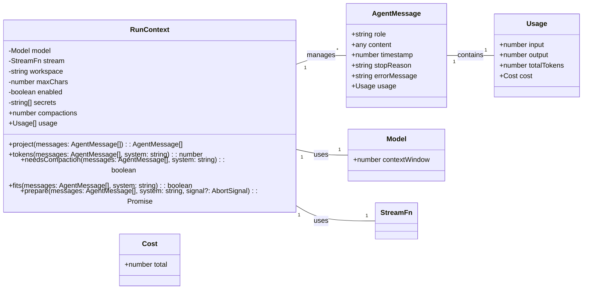

<!-- source: DeepWiki mcp.deepwiki.com · repo browser-use/browser-use-pi · page 3.3 Budgets, Context and Compaction · fetched 2026-10-30 -->

# Budgets, Context and Compaction

<details>
<summary>Relevant source files</summary>

The following files were used as context for generating this wiki page:

- [src/agent.ts](src/agent.ts)
- [src/context.ts](src/context.ts)
- [src/model-stream.ts](src/model-stream.ts)
- [src/research-tools.ts](src/research-tools.ts)
- [src/server.ts](src/server.ts)
- [src/types.ts](src/types.ts)
- [test/agent.test.mjs](test/agent.test.mjs)
- [test/model-stream.test.mjs](test/model-stream.test.mjs)
- [test/recovery.test.mjs](test/recovery.test.mjs)

</details>


This page details how `@browser_use/pi` enforces various budgets (step, cost, time, context size), manages the `RunContext` through compaction, handles model stream deadlines and provider retries, and defines the termination statuses of an agent run.

## Budget Enforcement

The agent enforces several budgets to control resource consumption and execution time. These budgets are configured via `RunOptions` [src/types.ts:62-76]() and `BrowserUseOptions` [src/types.ts:16-60]().

### Step Budget (`maxSteps`)

The `maxSteps` option [src/types.ts:63]() limits the total number of model turns (steps) the agent can take. Each time the agent requests a response from the model, it increments the step count. If `maxSteps` is reached, the run terminates with a `max_steps` status [src/types.ts:78](). The agent will not invent a completed result in this scenario [test/agent.test.mjs:121-132]().

Sources:
* [src/types.ts:63]()
* [src/types.ts:78]()
* [test/agent.test.mjs:121-132]()

### Cost Budget (`maxCostUsd`)

The `maxCostUsd` option [src/types.ts:65]() sets a soft threshold for the estimated cost of the model interactions in USD. This budget is checked between model turns. If the cumulative cost exceeds this limit, the run terminates with a `cost_limit` status [src/types.ts:78](). The agent may exceed the budget by one response, as the check occurs *between* turns.

Sources:
* [src/types.ts:65]()
* [src/types.ts:78]()

### Time Budget (`timeoutMs`, `modelTimeoutMs`, `compactionTimeoutMs`, `cellTimeoutMs`)

Several time-based budgets are enforced:

*   **`timeoutMs`**: This is the overall wall-clock timeout for the entire `run` operation [src/types.ts:64](). If the run exceeds this duration, it terminates with a `timeout` status [src/types.ts:78](). This timeout can cancel an active cell execution, and the session can recover afterwards [test/agent.test.mjs:159-168]().
*   **`modelTimeoutMs`**: This option in `BrowserUseOptions` [src/types.ts:34]() specifies the maximum time allowed for a complete model response, including connection setup.
*   **`compactionTimeoutMs`**: This option in `BrowserUseOptions` [src/types.ts:36]() sets the deadline for the context compaction process. If compaction exceeds this time, the original context is retained, and the compaction attempt fails [test/model-stream.test.mjs:131-152]().
*   **`cellTimeoutMs`**: This option in `BrowserUseOptions` [src/types.ts:33]() defines the deadline for individual JavaScript cell executions within the browser runtime.

Sources:
* [src/types.ts:33]()
* [src/types.ts:34]()
* [src/types.ts:36]()
* [src/types.ts:64]()
* [src/types.ts:78]()
* [test/agent.test.mjs:159-168]()
* [test/model-stream.test.mjs:131-152]()

### Context Budget (`maxContextChars`)

The `maxContextChars` option [src/types.ts:69]() limits the total character count of the agent's conversation history that is sent to the model. This is a soft threshold, and if the context size exceeds this limit, the agent attempts to compact the context. If compaction is disabled or fails, the run terminates with a `context_limit` status [src/types.ts:78]().

The `contextChars` function [src/context.ts:10-21]() calculates the character count of messages, excluding specific metadata like `thinkingSignature` and `textSignature`, and redacting details from `toolResult` messages.

Sources:
* [src/types.ts:69]()
* [src/types.ts:78]()
* [src/context.ts:10-21]()

## RunContext and Compaction

The `RunContext` class [src/context.ts:24-37]() manages the agent's conversation history and handles context compaction.

### RunContext Overview

The `RunContext` is responsible for:
*   Storing and managing the `AgentMessage` history.
*   Projecting messages for the model, potentially summarizing older parts.
*   Estimating token usage.
*   Determining when compaction is needed and performing it.
*   Archiving omitted observations during compaction.



Title: RunContext Class Diagram

Sources:
* [src/context.ts:24-37]()

### Compaction Process

Compaction is enabled by default (`options.compaction !== false`) [src/agent.ts:87](). The `RunContext.prepare` method [src/context.ts:83-165]() orchestrates the compaction.

1.  **Trigger**: Compaction is triggered if the projected context character count or token count exceeds a certain threshold (`needsCompaction` [src/context.ts:71-75]()). Specifically, if `contextChars` [src/context.ts:10-21]() exceeds 75% of `maxChars` or `tokens` exceeds 65% of the model's `contextWindow`.
2.  **Message Selection**: The agent keeps the last two complete assistant/tool groups to avoid orphaned tool results [src/context.ts:86-90](). Messages older than this cut-off point are considered for summarization.
3.  **Summarization**: The `generateSummaryWithUsage` function from `@earendil-works/pi-coding-agent` is used to create a summary of the older messages [src/context.ts:92-112](). This summary is then stored as an `AgentMessage` in `RunContext.summary` [src/context.ts:26]().
4.  **Archiving**: The original messages that were summarized are archived to a file within the `.browser-use/context` directory in the workspace [src/context.ts:115-163](). This archive includes redacted sensitive data and omits images and thinking blocks to reduce size. This ensures that omitted observations are privately archived and links earlier archives across repeated compaction [test/recovery.test.mjs:143-163]().
5.  **Constraint Preservation**: User messages are pinned exactly and are not summarized, ensuring that user constraints are preserved [src/context.ts:164-165]().
6.  **Failure Handling**: If compaction fails (e.g., due to `compactionTimeoutMs` [src/types.ts:36]()), the original context is retained, and the late summary is not committed [test/model-stream.test.mjs:131-152]().

```mermaid
graph TD
    A[Agent Loop] --> B{Context Exceeds Threshold?};
    B -- Yes --> C[RunContext.prepare() called];
    C --> D{Identify Messages for Summarization};
    D --> E[Call generateSummaryWithUsage()];
    E -- Success --> F[Create Summary AgentMessage];
    F --> G[Archive Omitted Messages to Workspace];
    G --> H[Update RunContext with Summary];
    H --> I[Continue Agent Loop with Compacted Context];
    E -- Failure (e.g., Timeout) --> J[Retain Original Context];
    J --> I;
    B -- No --> I;
```

Title: Context Compaction Flow

Sources:
* [src/agent.ts:87]()
* [src/context.ts:10-21]()
* [src/context.ts:26]()
* [src/context.ts:83-165]()
* [src/context.ts:71-75]()
* [src/context.ts:86-90]()
* [src/context.ts:92-112]()
* [src/context.ts:115-163]()
* [src/context.ts:164-165]()
* [src/types.ts:36]()
* [test/model-stream.test.mjs:131-152]()
* [test/recovery.test.mjs:143-163]()

## Model Stream Deadlines and Provider Retries

The agent uses `deadlineStream` [src/model-stream.ts:5-73]() to enforce deadlines on model responses and handles provider retries.

### Model Stream Deadlines

The `deadlineStream` function wraps the underlying `streamFn` (which handles communication with the model provider) to enforce a `timeoutMs` [src/model-stream.ts:5]().

*   **Connection Setup and Response**: The deadline bounds both the connection setup phase and the entire streaming response from the model [test/model-stream.test.mjs:19-30]().
*   **Abortion**: If the deadline is exceeded or an `AbortSignal` is triggered, the stream is immediately aborted. Any partial evidence received before the abortion is frozen and not mutated by late provider completion [test/model-stream.test.mjs:33-52]().
*   **Pre-Abortion**: If the `AbortSignal` is already aborted when `deadlineStream` is called, no request is made to the model provider [test/model-stream.test.mjs:54-73]().

```mermaid
graph TD
    A[Agent Requests Model Response] --> B[deadlineStream(streamFn, timeoutMs)];
    B --> C{AbortSignal Aborted?};
    C -- Yes --> D[Return Aborted Result Immediately];
    C -- No --> E[Start Timer (timeoutMs)];
    E --> F[Call Original streamFn];
    F -- Stream Events --> G[Forward Events to Output Stream];
    G --> H{Terminal Event (done/error)?};
    H -- Yes --> I[Stop Timer, End Output Stream];
    F -- Error/Exception --> J[Fail with Error Message];
    E -- Timer Expires --> J;
    G -- AbortSignal Triggered --> K[Fail with Cancelled Message];
```

Title: Model Stream Deadline Enforcement

Sources:
* [src/model-stream.ts:5-73]()
* [test/model-stream.test.mjs:19-30]()
* [test/model-stream.test.mjs:33-52]()
* [test/model-stream.test.mjs:54-73]()

### Provider Retries

If a model inference times out, the `runAgent` function [src/agent.ts:41-42]() will retry the request once. This retry does not execute partial tools or reset budgets [test/model-stream.test.mjs:75-128]().

Sources:
* [src/agent.ts:41-42]()
* [test/model-stream.test.mjs:75-128]()

## Delivery Repair Turns

When the agent attempts to deliver a result using the `finish` tool [src/agent.ts:148-157]() or `finish_from_js` tool [src/agent.ts:158-166](), the result is validated against the provided `schema` [src/agent.ts:125-128](). Additionally, if a `validateResult` hook is provided in `BrowserUseOptions` [src/types.ts:54](), it is called to perform custom validation [src/agent.ts:129-135]().

If the result is invalid (either by schema validation or the `validateResult` hook), the agent receives feedback as an error message. This triggers a "delivery repair turn," where the model is given another opportunity to correct its output and provide a valid result [test/agent.test.mjs:84-99](). The `finishRepairs` counter tracks these additional delivery-only model turns [src/agent.ts:72]().

Sources:
* [src/agent.ts:72]()
* [src/agent.ts:125-128]()
* [src/agent.ts:129-135]()
* [src/agent.ts:148-157]()
* [src/agent.ts:158-166]()
* [src/types.ts:54]()
* [test/agent.test.mjs:84-99]()

## Termination Statuses

A `RunResult` [src/types.ts:97-107]() can have several `status` values, indicating how the agent run terminated:

*   **`completed`**: The agent successfully delivered a schema-validated result [src/types.ts:99]().
*   **`max_steps`**: The `maxSteps` budget was exceeded [src/types.ts:78]().
*   **`timeout`**: The `timeoutMs` budget for the entire run was exceeded [src/types.ts:78]().
*   **`cancelled`**: The run was explicitly cancelled via an `AbortSignal` [src/types.ts:78]().
*   **`cost_limit`**: The `maxCostUsd` budget was exceeded [src/types.ts:78]().
*   **`context_limit`**: The `maxContextChars` budget was exceeded, and compaction was either disabled or failed [src/types.ts:78]().
*   **`incomplete`**: The agent terminated without delivering a final result, but also without a specific error or budget violation [src/types.ts:78](). This can happen if the model simply stops responding or provides an unfinished answer [test/agent.test.mjs:134-147]().
*   **`error`**: An unhandled error occurred during the run [src/types.ts:78](). This includes model failures where the provider returns an error [test/agent.test.mjs:134-147]().

Sources:
* [src/types.ts:78]()
* [src/types.ts:97-107]()
* [src/types.ts:99]()
* [test/agent.test.mjs:134-147]()

---

