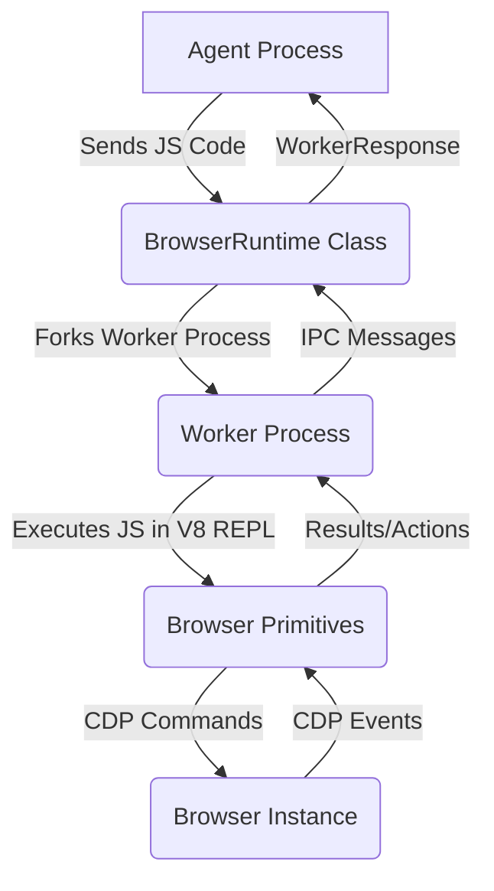
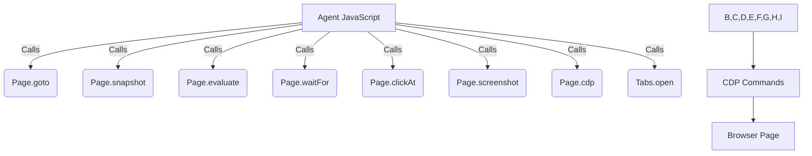

<!-- source: DeepWiki mcp.deepwiki.com · repo browser-use/browser-use-pi · page 4 Browser Runtime Layer · fetched 2026-10-30 -->

# Browser Runtime Layer

<details>
<summary>Relevant source files</summary>

The following files were used as context for generating this wiki page:

- [docs/browser.md](docs/browser.md)
- [src/page.ts](src/page.ts)
- [src/runtime.ts](src/runtime.ts)
- [test/evaluation-deadline.test.mjs](test/evaluation-deadline.test.mjs)

</details>


The Browser Runtime Layer is responsible for executing agent-generated JavaScript within a browser environment. It manages the lifecycle of a dedicated worker process, handles communication via the Chrome DevTools Protocol (CDP), and provides a set of high-level primitives for interacting with web pages. This layer ensures that agent code runs in a controlled and isolated environment, with mechanisms for state management, error handling, and resource cleanup.

This page provides a high-level overview of the components within the Browser Runtime Layer. For detailed information on each topic, please refer to the linked child pages.

## Worker Process and Cell Execution

The core of the Browser Runtime Layer is a dedicated worker process that hosts a persistent V8 REPL. This worker executes JavaScript "cells" (individual code snippets) generated by the agent. The use of a separate worker process provides isolation, allowing for robust cancellation boundaries and state management. If a cell times out or encounters a fatal error, only the worker process is terminated, preserving the main application's stability.

The `BrowserRuntime` class [src/runtime.ts:46-297]() orchestrates the worker's lifecycle, including its startup, communication, and termination. It resolves the appropriate executable for the worker [src/runtime.ts:11-32]() (supporting both Node.js and Bun environments) and manages the IPC protocol for sending code and receiving results. The worker also handles output and image spooling, and ensures proper cleanup of browser tabs it owns.

For details on the worker's lifecycle, IPC, cell timeouts, and state management, see [Worker Process and Cell Execution](#4.1).

### Browser Runtime Architecture


Sources:
- [src/runtime.ts:46-297]()
- [src/runtime.ts:11-32]()

## CDP Client and Browser Launch

Communication with the browser is handled through the Chrome DevTools Protocol (CDP). The `CDP` class [src/cdp.ts]() provides the low-level interface for connecting to a browser instance, sending commands, and receiving events. This includes capabilities for lazy attachment to targets and waiting for specific CDP events.

The `BrowserRuntime` [src/runtime.ts:46-297]() initializes the CDP connection and manages the browser launch process. It can connect to both locally launched browser instances and cloud-based browser services. This layer ensures a stable and reliable connection to the browser, which is fundamental for all subsequent browser interactions.

For a deeper dive into CDP connections, browser launching, and event handling, see [CDP Client and Browser Launch](#4.2).

### CDP Connection Flow

```mermaid
graph TD
    A[BrowserRuntime] --> B{CDP.connect(endpoint)}
    B --> C{Target.createTarget(url)}
    C --> D{Page.attach(cdp, targetId)}
    D --> E[Page Instance]
    E --> F{CDP Commands/Events}
    F --> G[Browser Instance]
```
Sources:
- [src/cdp.ts]()
- [src/runtime.ts:46-297]()
- [src/page.ts:65-80]()

## Page, Tabs and Accessibility Primitives

The Browser Runtime Layer exposes a set of high-level primitives for interacting with web pages, encapsulated primarily by the `Page` [src/page.ts:38-190]() and `Tabs` [src/page.ts:193-198]() classes. These primitives allow the agent to perform common browser actions without needing to directly interact with raw CDP commands.

Key primitives include:
*   `page.goto(url)`: Navigates to a specified URL [src/page.ts:90-94]().
*   `page.snapshot()`: Captures an Accessibility Tree (AX tree) snapshot, providing structured information about page elements, including roles, names, values, and control states [src/page.ts:144-159]().
*   `page.evaluate(fn, argument)`: Executes JavaScript code within the page context and returns the result [src/page.ts:99-120]().
*   `page.waitFor(fn, argument, {timeoutMs})`: Waits for a specific condition to become true within the page [src/page.ts:121-143]().
*   `page.clickAt(x, y)`: Simulates a mouse click at specified coordinates [src/page.ts:161-177]().
*   `page.screenshot()`: Captures a screenshot of the current page [src/page.ts:179-185]().
*   `tabs.open(url)`: Opens a new tab [src/page.ts:193-198]().

These primitives are designed to be robust and provide clear semantics for agent interactions. For example, `page.evaluate` includes a timeout mechanism to prevent infinite loops [src/page.ts:110-111](), and `page.waitFor` handles execution context destruction [src/page.ts:131-139](). The system also supports action highlighting to visually indicate agent interactions on the page [docs/browser.md:48-50]().

For detailed information on these primitives, AX snapshot semantics, and control states, see [Page, Tabs and Accessibility Primitives](#4.3).

### Page Primitives Overview


Sources:
- [src/page.ts:38-190]()
- [src/page.ts:193-198]()
- [docs/browser.md:5-17]()
- [src/page.ts:90-94]()
- [src/page.ts:144-159]()
- [src/page.ts:99-120]()
- [src/page.ts:121-143]()
- [src/page.ts:161-177]()
- [src/page.ts:179-185]()
- [src/page.ts:110-111]()
- [src/page.ts:131-139]()
- [docs/browser.md:48-50]()

---

