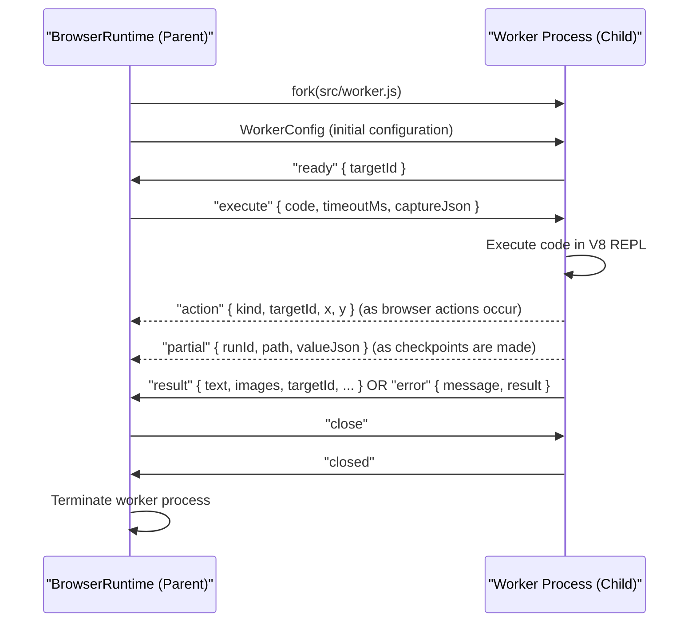

<!-- source: DeepWiki mcp.deepwiki.com · repo browser-use/browser-use-pi · page 4.1 Worker Process and Cell Execution · fetched 2026-10-30 -->

# Worker Process and Cell Execution

<details>
<summary>Relevant source files</summary>

The following files were used as context for generating this wiki page:

- [src/protocol.ts](src/protocol.ts)
- [src/runtime.ts](src/runtime.ts)
- [src/worker.ts](src/worker.ts)
- [test/ownership.test.mjs](test/ownership.test.mjs)
- [test/runtime.test.mjs](test/runtime.test.mjs)

</details>


This page details the lifecycle of the `BrowserRuntime` worker process, its executable resolution, the Inter-Process Communication (IPC) protocol, handling of cell timeouts, state resets, output and image spooling, and the cleanup of tab ownership. It covers how JavaScript code provided by the agent is executed in a persistent V8 REPL environment.

## BrowserRuntime Lifecycle

The `BrowserRuntime` class [src/runtime.ts:46-46]() manages a dedicated child process (`worker.js`) that hosts a V8 JavaScript runtime. This worker process is responsible for executing agent-provided JavaScript code and interacting with the browser via the Chrome DevTools Protocol (CDP).

### Worker Executable Resolution

The `workerExecutable()` function [src/runtime.ts:11-32]() determines the appropriate executable for the worker process. It prioritizes using the host's `node` executable if it meets the minimum version requirement (Node.js 22.19+). If the host is Bun, or if `process.versions.bun` is false and `BROWSER_USE_NODE` is not set, it attempts to find a suitable `node` executable on the system's PATH or specified by `BROWSER_USE_NODE`. This ensures that the worker always runs in a compatible Node.js environment, even if the main application is running in Bun.

### Worker Process Initialization

The `BrowserRuntime` starts the worker process via `start()` [src/runtime.ts:76-119](). This method forks `src/worker.js` as a child process. Key configurations for the child process include:
*   `execPath`: The resolved Node.js executable path.
*   `execArgv`: `--max-old-space-size=256` to limit memory usage and prevent inheriting host loaders/preloads/inspectors.
*   `env`: An empty environment to prevent inheriting sensitive environment variables like provider keys from the main process [test/ownership.test.mjs:61-66]().
*   `stdio`: Configured for IPC communication (`'ipc'`).
*   `serialization`: Set to `'json'` for cross-runtime compatibility (Node and Bun have different advanced IPC formats).

Upon startup, the worker sends a `ready` message [src/protocol.ts:44-44]() to the `BrowserRuntime` once its JavaScript context is initialized and connected to CDP.

### Worker Process Lifecycle Diagram

```mermaid
graph TD
    A[BrowserRuntime.initialize()] --> B{workerExecutable()};
    B -- "Node.js 22.19+ found" --> C[fork(src/worker.js)];
    C -- "IPC message: WorkerConfig" --> D[src/worker.js];
    D -- "IPC message: 'ready'" --> E[BrowserRuntime.start() resolves];
    E --> F[BrowserRuntime ready for cell execution];
    D -- "Worker process exits" --> G[BrowserRuntime.workerLoss set];
    G --> H[Pending cell execution rejects with error];
    F -- "BrowserRuntime.terminate()" --> I[Worker process killed];
    I --> J[BrowserRuntime.closed = true];

    subgraph BrowserRuntime
        A
        B
        C
        E
        F
        G
        H
        I
        J
    end

    subgraph Worker Process
        D
    end
```
Sources:
*   `src/runtime.ts:11-32`
*   `src/runtime.ts:76-119`
*   `src/protocol.ts:44-44`
*   `test/ownership.test.mjs:61-66`

## IPC Protocol

Communication between the `BrowserRuntime` (parent process) and the `worker.js` (child process) occurs via Node.js IPC. The protocol is defined by `WorkerRequest` and `WorkerResponse` interfaces [src/protocol.ts:37-47]().

### WorkerRequest

The parent sends `WorkerRequest` messages to the child:
*   `{ type: 'execute'; code: string; captureJson?: boolean; outputFile?: string; runId?: string }`: Instructs the worker to execute JavaScript `code`.
*   `{ type: 'close' }`: Signals the worker to shut down.

### WorkerResponse

The child sends `WorkerResponse` messages back to the parent:
*   `{ type: 'action'; action: BrowserAction }`: Reports a browser action performed by the worker.
*   `{ type: 'owned'; targetId: string }`: Indicates that the worker has taken ownership of a CDP target (e.g., a new tab).
*   `{ type: 'partial'; runId?: string; path: string; valueJson: string }`: Sends a partial checkpoint result.
*   `{ type: 'ready'; targetId: string }`: Sent once the worker is initialized and connected to CDP.
*   `{ type: 'result'; result: CellResult }`: The final result of a JavaScript cell execution.
*   `{ type: 'error'; message: string; result?: CellResult }`: Reports an error during cell execution.
*   `{ type: 'closed' }`: Acknowledges the worker's shutdown.

### IPC Data Flow Diagram


Sources:
*   `src/protocol.ts:37-47`
*   `src/runtime.ts:87-92`
*   `src/runtime.ts:105-113`
*   `src/worker.ts:20-22`

## Cell Execution and Timeouts

The `execute()` [src/runtime.ts:167-169]() and `readResult()` [src/runtime.ts:161-164]() methods in `BrowserRuntime` are used to send JavaScript code to the worker for execution. Each execution is treated as a "cell."

### Persistent V8 REPL

The `worker.js` process maintains a persistent V8 REPL (Read-Eval-Print Loop) context [src/worker.ts:85-91](). This means that variables, functions, and state defined in one cell execution persist and are available in subsequent cell executions [test/runtime.test.mjs:28-33](). The `realm` object in `src/worker.ts` holds the global context for this REPL.

The REPL context is carefully constructed to provide necessary Node.js globals (`process`, `Buffer`, `URL`, `fetch`, `setTimeout`, etc.) while preventing inheritance of host-specific environment variables or preloads [src/worker.ts:113-128]().

### Cell Timeouts

Each cell execution has a `timeoutMs` [src/runtime.ts:172-176]() parameter. If the worker does not return a result within this timeframe, the `BrowserRuntime` terminates the worker process and throws an `Error` [src/runtime.ts:145-153](). This ensures that runaway or hanging JavaScript code does not block the agent indefinitely.

The `CellError` class [src/runtime.ts:34-43]() is used to encapsulate errors originating from cell execution, including timeout errors. It includes `result` and `stateReset` properties to provide more context about the error.

### Cancellation Boundary

The termination of the worker process acts as a cancellation boundary. If a cell times out or is explicitly cancelled, the worker process is killed, effectively resetting the JavaScript state. The `stateReset` property of `CellError` indicates this [src/runtime.ts:38-38]().

```mermaid
sequenceDiagram
    participant Agent as "Agent Engine"
    participant BR as "BrowserRuntime"
    participant WP as "Worker Process"

    Agent->>BR: execute(code, timeoutMs)
    BR->>WP: "execute" { code }
    activate WP
    WP->>WP: Evaluate code in REPL
    alt Code completes within timeout
        WP->>BR: "result" { CellResult }
        deactivate WP
        BR->>Agent: CellResult
    else Code exceeds timeout
        BR->>BR: Start timeout timer
        BR->>BR: Timer expires
        BR->>BR: Terminate WP
        deactivate WP
        BR->>Agent: throws CellError (timeout, stateReset=true)
    end
```
Sources:
*   `src/runtime.ts:34-43`
*   `src/runtime.ts:145-153`
*   `src/runtime.ts:167-169`
*   `src/runtime.ts:172-176`
*   `src/worker.ts:85-91`
*   `src/worker.ts:113-128`
*   `test/runtime.test.mjs:28-33`

## State Reset and Reconnection

When the worker process exits unexpectedly (e.g., due to a crash or timeout), the JavaScript state within the REPL is lost. The `BrowserRuntime` handles this by setting `workerLoss` [src/runtime.ts:101-101]() and rejecting any pending operations.

The `reconnect()` function available in the worker's REPL context [src/worker.ts:132-143]() allows the agent to explicitly reset the browser connection and re-initialize the `browser`, `tabs`, and `page` objects. This is useful for recovering from certain browser-side issues without restarting the entire worker process. However, it's important to note that `reconnect()` does not replay browser actions and may require reacquiring page/frame handles.

## Output and Image Spooling

The worker process handles `console.log` output and image capture.

### Output Spooling

`console.log` output from the executed JavaScript code is captured by a `Writable` stream (`sink`) [src/worker.ts:59-77](). This output is:
1.  **Redacted**: Sensitive data specified in `config.redact` [src/worker.ts:21-21]() is removed before storage.
2.  **Truncated**: The `output` string in memory is limited to `hardLimit` (1MB) [src/worker.ts:50-50]().
3.  **Spooling to File**: If `outputFile` is provided in the `WorkerRequest`, the full, un-truncated output is appended to this file [src/worker.ts:56-56](). This ensures that even if the in-memory output is truncated for the model, the complete log is preserved [test/runtime.test.mjs:126-128]().

### Image Spooling

The `images` array [src/worker.ts:46-46]() in the worker collects `Image` objects [src/protocol.ts:8-12]() generated by functions like `screenshot()`. These images are base64 encoded and included in the `CellResult` [src/protocol.ts:13-13](). The `prepareModelImages()` function [src/worker.ts:16-16]() is used to process these images before sending them back to the agent.

## Tab Ownership and Cleanup

The `BrowserRuntime` is responsible for managing browser tabs opened by the SDK.

### Owned Tabs

When the worker opens a new tab (e.g., via `tabs.open()` or `page.goto()` if no page is bound), it sends an `owned` message [src/protocol.ts:43-43]() to the `BrowserRuntime` with the `targetId` of the new tab. The `BrowserRuntime` tracks these owned tabs in its `owned` set [src/runtime.ts:62-62]().

### Cleanup on Close

When `BrowserUse.close()` is called, the `BrowserRuntime` attempts to close all tabs it owns [test/ownership.test.mjs:28-38](). It verifies that these tabs have actually disappeared from the browser, not just received a close acknowledgement [test/ownership.test.mjs:97-108](). Tabs that were not opened by the SDK (e.g., pre-existing tabs or tabs opened by the caller) are left untouched [test/ownership.test.mjs:17-21](). This ensures that the SDK cleans up its own resources without interfering with other browser activity.

```mermaid
graph TD
    A[BrowserUse.create()] --> B{BrowserRuntime.start()};
    B --> C[Worker Process starts];
    C --> D[Worker calls tabs.open() or page.goto()];
    D --> E[Worker sends "owned" {targetId} to BrowserRuntime];
    E --> F[BrowserRuntime adds targetId to its 'owned' set];
    F --> G[Agent executes more cells];
    G --> H[BrowserUse.close()];
    H --> I[BrowserRuntime iterates 'owned' set];
    I --> J{For each owned targetId};
    J --> K[BrowserRuntime sends Target.closeTarget CDP command];
    K --> L[BrowserRuntime verifies tab disappearance];
    L -- "Tab disappears" --> M[Continue cleanup];
    L -- "Tab persists" --> N[Error: SDK-owned tab remains];
    M --> O[BrowserRuntime.closed = true];
```
Sources:
*   `src/runtime.ts:62-62`
*   `src/protocol.ts:43-43`
*   `test/ownership.test.mjs:17-21`
*   `test/ownership.test.mjs:28-38`
*   `test/ownership.test.mjs:97-108`

---

