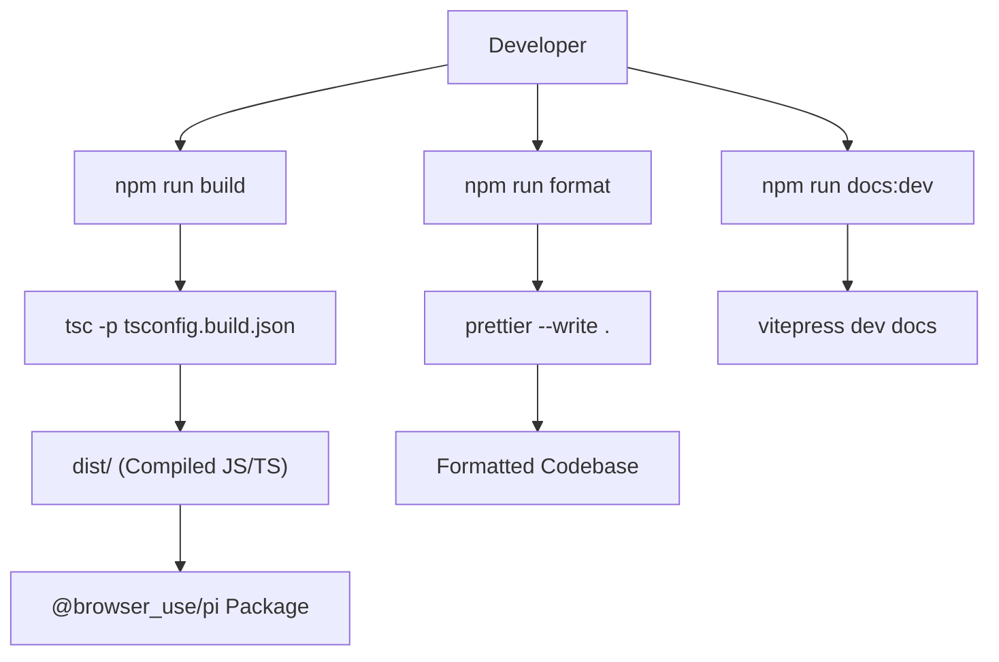
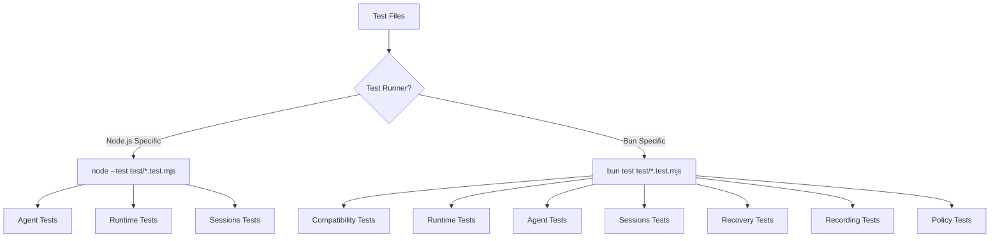

<!-- source: DeepWiki mcp.deepwiki.com · repo browser-use/browser-use-pi · page 5 Development, Testing and Evaluation · fetched 2026-10-30 -->

# Development, Testing and Evaluation

Relevant source files

The following files were used as context for generating this wiki page:

- [package.json](package.json)
- [tsconfig.build.json](tsconfig.build.json)
- [tsconfig.json](tsconfig.json)

This section provides an overview of the development lifecycle for the `@browser_use/pi` project, covering the build process, testing methodologies, and the evaluation harness used for benchmarking. It serves as a high-level guide, with detailed explanations and technical specifics delegated to dedicated child pages.

The project utilizes standard JavaScript ecosystem tools for building and formatting, alongside specialized test runners for different environments. A robust evaluation harness is in place to ensure the SDK's performance and reliability across various scenarios, including cloud browser provisioning and telemetry collection.

## 5.1. Build, Tooling and Docs Site

The build process for `@browser_use/pi` is managed through `npm` scripts defined in `package.json` [package.json:24-37](). TypeScript compilation is handled by `tsc` using `tsconfig.build.json` [tsconfig.build.json:1-4](), which extends the base `tsconfig.json` [tsconfig.json:1-21]() configuration. Code formatting is enforced with `prettier` [package.json:49](). The project's documentation site is built and served using VitePress [package.json:51]().

For details on the specific `npm` scripts, TypeScript configurations, dependency management, and the VitePress documentation setup, see [Build, Tooling and Docs Site](#5.1).

### Build and Tooling Overview

Sources: [package.json:24-37](), [tsconfig.build.json:1-4](), [tsconfig.json:1-21]()

## 5.2. Test Suite Layout

The `@browser_use/pi` project employs a comprehensive test suite to ensure the correctness and stability of its components. Tests are executed using both Node.js's built-in test runner [package.json:27]() and Bun's test runner [package.json:36](), catering to different testing needs and environments. The test suite covers various aspects of the SDK, including agent behavior, runtime interactions, session management, recovery mechanisms, recording functionalities, policy enforcement, compatibility, CDP interactions, and image handling. A key aspect of testing involves the use of fixture servers and "faux provider" patterns to simulate external dependencies and control test environments.

For a detailed breakdown of the test runners, fixture server and faux provider patterns, and the specific coverage of each test file, see [Test Suite Layout](#5.2).

### Test Runner Strategy

Sources: [package.json:27](), [package.json:36]()

## 5.3. Evaluation Harness

The evaluation harness, primarily driven by `eval/run.mjs` (not provided in the current context but referenced as a child page topic), is a critical component for benchmarking and assessing the performance and reliability of the `@browser_use/pi` SDK. This harness is responsible for parsing evaluation options, provisioning cloud browsers for consistent testing environments, and integrating with Laminar telemetry for data collection. It captures screenshot evidence, supports different "findings modes" for detailed analysis, and generates result envelopes and SDK audit archives for comprehensive post-run review.

For an in-depth understanding of the `eval/run.mjs` benchmark runner, including option parsing, cloud browser provisioning, Laminar telemetry integration, evidence collection, findings modes, and result archiving, see [Evaluation Harness](#5.3).

---

