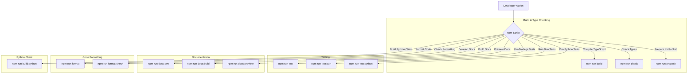
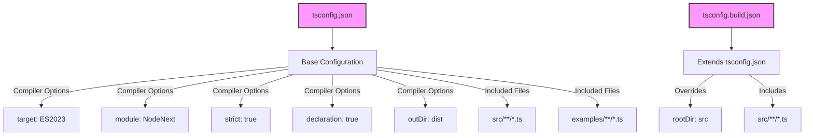

<!-- source: DeepWiki mcp.deepwiki.com · repo browser-use/browser-use-pi · page 5.1 Build, Tooling and Docs Site · fetched 2026-10-30 -->

# Build, Tooling and Docs Site

Relevant source files

The following files were used as context for generating this wiki page:

- [.prettierignore](.prettierignore)
- [.prettierrc.json](.prettierrc.json)
- [LICENSE](LICENSE)
- [docs/.vitepress/config.mts](docs/.vitepress/config.mts)
- [package-lock.json](package-lock.json)
- [package.json](package.json)
- [tsconfig.build.json](tsconfig.build.json)
- [tsconfig.json](tsconfig.json)

This page details the build process, development tooling, and documentation site configuration for the `@browser_use/pi` project. It covers npm scripts for common tasks, TypeScript configuration for compilation, code formatting with Prettier, project dependencies, and the setup for the VitePress-based documentation.

## npm Scripts

The `package.json` file defines a set of npm scripts that automate various development and maintenance tasks [package.json:24-36](). These scripts cover building the project, running tests, managing documentation, and formatting code.

### Build Scripts

*   `npm run build`: Compiles the TypeScript source files into JavaScript and declaration files. It first removes the `dist` directory to ensure a clean build [package.json:25]().
*   `npm run check`: Performs a type check without emitting any JavaScript files [package.json:26]().
*   `npm run prepack`: This script runs automatically before a package is packed (e.g., when `npm publish` is run). It ensures the project is built before packaging [package.json:31]().

### Test Scripts

*   `npm run test`: Executes the Node.js test suite after building the project. Tests are run with a concurrency of 1 [package.json:27]().
*   `npm run test:bun`: Runs a subset of tests using the Bun test runner, specifically targeting compatibility, runtime, agent, sessions, recovery, recording, and policy tests [package.json:36]().
*   `npm run test:python`: Builds the Python client and then runs its unit tests [package.json:35]().

### Documentation Scripts

*   `npm run docs:dev`: Starts the VitePress development server for the documentation site, accessible locally [package.json:28]().
*   `npm run docs:build`: Builds the static documentation site for deployment [package.json:29]().
*   `npm run docs:preview`: Serves the built documentation site locally for previewing [package.json:30]().

### Formatting Scripts

*   `npm run format`: Formats all code files using Prettier [package.json:32]().
*   `npm run format:check`: Checks if all code files adhere to Prettier's formatting rules without making any changes [package.json:33]().

### Python Client Build Script

*   `npm run build:python`: Executes a custom Node.js script to build the Python client [package.json:34]().

The following diagram illustrates the relationship between common developer actions and the `npm` scripts that facilitate them.

**Diagram 1: npm Script Overview**

Sources:
*   [package.json:24-36]()

## TypeScript Configuration

The project uses TypeScript for type safety and modern JavaScript features. The compilation process is configured via `tsconfig.json` and `tsconfig.build.json`.

### `tsconfig.json`

This is the base TypeScript configuration file [tsconfig.json:1-21](). Key compiler options include:

*   `target`: `ES2023` for modern JavaScript features [tsconfig.json:3]().
*   `module`: `NodeNext` for ES module compatibility in Node.js [tsconfig.json:4]().
*   `moduleResolution`: `NodeNext` to resolve modules according to Node.js's ES module resolution algorithm [tsconfig.json:5]().
*   `lib`: Includes `ES2023` and `DOM` typings [tsconfig.json:6]().
*   `strict`: Enables all strict type-checking options [tsconfig.json:7]().
*   `noUncheckedIndexedAccess`: Ensures indexed access returns `T | undefined` [tsconfig.json:8]().
*   `exactOptionalPropertyTypes`: Requires explicit `undefined` for optional properties [tsconfig.json:9]().
*   `noUnusedLocals` and `noUnusedParameters`: Flags unused variables and parameters [tsconfig.json:10-11]().
*   `verbatimModuleSyntax`: Ensures module specifiers are preserved [tsconfig.json:12]().
*   `skipLibCheck`: Skips type checking of declaration files [tsconfig.json:13]().
*   `declaration`: Generates declaration files (`.d.ts`) [tsconfig.json:14]().
*   `sourceMap` and `inlineSources`: Generates source maps for debugging [tsconfig.json:15,18]().
*   `outDir`: Specifies the output directory for compiled JavaScript files as `dist` [tsconfig.json:16]().
*   `rootDir`: Sets the root directory for source files to the project root [tsconfig.json:17]().
*   `include`: Specifies that `src/**/*.ts` and `examples/**/*.ts` files should be included in the compilation [tsconfig.json:20]().

### `tsconfig.build.json`

This file extends `tsconfig.json` and is specifically used for the production build [tsconfig.build.json:1-5](). It overrides `rootDir` to `src` and explicitly includes only `src/**/*.ts` files, ensuring that only the core library code is compiled into the `dist` directory [tsconfig.build.json:3-4]().

**Diagram 2: TypeScript Configuration Inheritance**

Sources:
*   [tsconfig.json:1-21]()
*   [tsconfig.build.json:1-5]()

## Code Formatting with Prettier

Prettier is used to maintain consistent code style across the project.

### Configuration

The `.prettierrc.json` file defines the Prettier configuration [.prettierrc.json:1]():
*   `singleQuote`: `true` enforces the use of single quotes for strings.
*   `printWidth`: `100` sets the maximum line length before wrapping.
*   `trailingComma`: `all` ensures trailing commas are used wherever syntactically valid.

### Ignored Files

The `.prettierignore` file specifies files and directories that Prettier should ignore during formatting [.prettierignore:1-7](). This typically includes generated files, build artifacts, and dependency directories:
*   `node_modules`
*   `artifacts`
*   `dist`
*   `docs/.vitepress/cache`
*   `docs/.vitepress/dist`
*   `package-lock.json`
*   `evidence`

Sources:
*   [.prettierrc.json:1]()
*   [.prettierignore:1-7]()

## Project Dependencies

The project's dependencies are managed in `package.json` and `package-lock.json`.

### Core Dependencies

These are the packages required for the application to run [package.json:38-44]():
*   `@earendil-works/pi-agent-core`: Core agent functionalities.
*   `@earendil-works/pi-ai`: AI-related utilities.
*   `@earendil-works/pi-coding-agent`: Coding agent specific functionalities.
*   `devtools-protocol`: TypeScript types for the Chrome DevTools Protocol.
*   `typebox`: A JSON schema validator and type builder.

### Development Dependencies

These packages are used during development, testing, and building [package.json:45-52]():
*   `@lmnr-ai/lmnr`: A tool for AI-related tasks, likely for evaluation or telemetry.
*   `@types/node`: TypeScript type definitions for Node.js.
*   `esbuild`: A fast JavaScript bundler and minifier.
*   `prettier`: Code formatter.
*   `typescript`: The TypeScript compiler.
*   `vitepress`: The static site generator used for documentation.

### Overrides

The `overrides` field is used to force a specific version of `vite` to `6.4.3` [package.json:53-55](). This can be useful to resolve dependency conflicts or ensure compatibility.

### Engine Requirements

The project specifies minimum required versions for Node.js (`>=22.19`) and Bun (`>=1.3.14`) [package.json:7-10]().

Sources:
*   [package.json:38-55]()
*   [package.json:7-10]()
*   [package-lock.json:1-175]()

## Documentation Site Configuration

The project's documentation is built using VitePress, configured in `docs/.vitepress/config.mts`.

### Basic Configuration

*   `title`: "Browser Use Pi" [docs/.vitepress/config.mts:4]().
*   `description`: "Browser Use, built on Pi. Persistent V8 REPL + raw CDP, in TypeScript." [docs/.vitepress/config.mts:5]().
*   `cleanUrls`: `true` enables clean URLs without `.html` extensions [docs/.vitepress/config.mts:6]().

### Theme Configuration

The `themeConfig` object customizes the documentation theme [docs/.vitepress/config.mts:7-20]():
*   `logo`: Sets the logo to `/mark.svg` [docs/.vitepress/config.mts:8]().
*   `nav`: Defines the navigation bar links. Currently, it includes a link to the GitHub repository [docs/.vitepress/config.mts:9]().
*   `sidebar`: Configures the sidebar navigation with links to various documentation pages such as Quickstart, Models, Browser primitives, Sessions & login, API, Python, and Historical benchmarks [docs/.vitepress/config.mts:10-18]().
*   `search`: Configures local search functionality [docs/.vitepress/config.mts:19]().

Sources:
*   [docs/.vitepress/config.mts:1-21]()

---

