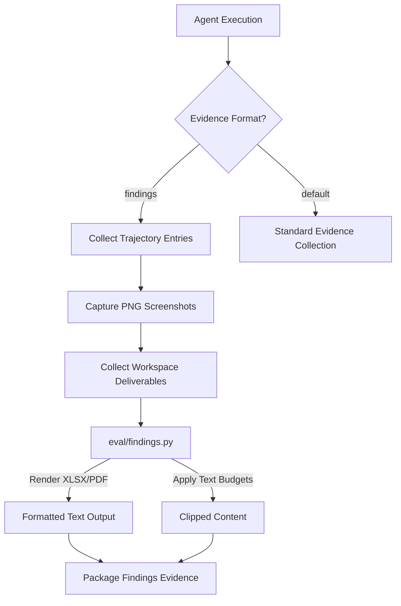

<!-- source: DeepWiki mcp.deepwiki.com · repo browser-use/browser-use-pi · page 5.3 Evaluation Harness · fetched 2026-10-30 -->

# Evaluation Harness

<details>
<summary>Relevant source files</summary>

The following files were used as context for generating this wiki page:

- [docs/benchmarks.md](docs/benchmarks.md)
- [docs/python.md](docs/python.md)
- [eval/README.md](eval/README.md)
- [eval/findings.py](eval/findings.py)
- [eval/run.mjs](eval/run.mjs)
- [eval/setup.sh](eval/setup.sh)
- [examples/README.md](examples/README.md)
- [examples/apply-to-job.ts](examples/apply-to-job.ts)
- [examples/ehr.ts](examples/ehr.ts)
- [test/eval.test.mjs](test/eval.test.mjs)
- [test/findings_evidence.py](test/findings_evidence.py)

</details>


The `eval/run.mjs` script serves as the benchmark runner for the `@browser_use/pi` SDK. Its primary purpose is to execute agent tasks within a controlled environment, typically involving a single, isolated cloud browser instance. This harness is designed to collect comprehensive evidence of agent performance, including telemetry, screenshots, and detailed run artifacts, for evaluation by external judges. It does not perform action replay or read rubrics/answer keys [eval/README.md:3-5]().

## Option Parsing and Validation

The `parseOptions` function [eval/run.mjs:10-70]() is responsible for parsing and validating various configuration options that control the agent's behavior and the evaluation environment. These options include:

*   `reasoning_effort`: Controls the model's reasoning intensity (e.g., 'medium', 'xhigh').
*   `max_context_chars`: Sets the maximum character limit for the model's context.
*   `task_timeout_seconds`: Defines the maximum duration for the agent's task.
*   `proxy_country_code`: Specifies the country code for the browser's proxy.
*   `browser_timeout_minutes`: Sets the maximum lifetime for the provisioned browser.
*   `browser_allow_resizing`: A boolean indicating whether the browser viewport can be resized [eval/README.md:14-17]().
*   `evidence_format`: Specifies the format for evidence collection, primarily 'findings' for the BU_Bench_v2 judge [eval/README.md:5-6]().
*   `research_tools`: A boolean to enable or disable upstream Pi read/write/edit/bash tools [eval/README.md:19-20]().
*   `delivery_review`: A boolean to enable or disable delivery review.

The function enforces strict validation rules for each option, ensuring that values are within acceptable ranges and types. For instance, `task_timeout_seconds` must be between 1 and 7200 seconds, and `browser_timeout_minutes` must exceed `task_timeout_seconds` by at least 30 seconds [eval/run.mjs:46-55]().

```mermaid
graph TD
    A[parseOptions(value)] --> B{Validate 'reasoning_effort'};
    B --> C{Validate 'max_context_chars'};
    C --> D{Validate 'task_timeout_seconds'};
    D --> E{Validate 'proxy_country_code'};
    E --> F{Validate 'browser_timeout_minutes'};
    F --> G{Validate 'browser_allow_resizing'};
    G --> H{Validate 'evidence_format'};
    H --> I{Validate 'research_tools'};
    I --> J{Validate 'delivery_review'};
    J --> K{Return validated options};
    K -- Invalid input --> L[Throw Error];
```
**Diagram: `parseOptions` Data Flow**

Sources:
* [eval/run.mjs:10-70]()
* [eval/README.md:3-5]()
* [eval/README.md:14-17]()
* [eval/README.md:19-20]()
* [eval/run.mjs:46-55]()

## Cloud Browser Provisioning

The evaluation harness provisions and manages a single cloud browser instance per task [eval/README.md:3](). This is handled through interactions with the `api.browser-use.com` endpoint [eval/run.mjs:171-181](). The `cloudRequest` function [eval/run.mjs:171-181]() makes authenticated HTTP requests to the Browser Use API, using the `BROWSER_USE_API_KEY` environment variable for authentication.

The `main` function [eval/run.mjs:153]() orchestrates the browser lifecycle:
1.  **Provisioning**: A new browser is requested from the cloud provider.
2.  **Connection**: The harness connects to the provisioned browser via CDP.
3.  **Task Execution**: The agent runs its task within this browser.
4.  **Cleanup**: After the task, the browser is closed and any associated resources are released.

Sources:
* [eval/run.mjs:171-181]()
* [eval/run.mjs:153]()
* [eval/README.md:3]()

## Laminar Telemetry

The harness integrates with Laminar for telemetry collection. It initializes Laminar, starts and ends spans for various operations, and sets attributes on these spans [test/eval.test.mjs:139-149](). This allows for detailed tracing and monitoring of the agent's execution, including model interactions, tool calls, and browser operations. The `spans` Map [eval/run.mjs:158]() and `modelSpan` variable [eval/run.mjs:159]() are used to manage active spans.

Sources:
* [test/eval.test.mjs:139-149]()
* [eval/run.mjs:158]()
* [eval/run.mjs:159]()

## Screenshot Evidence

When `evidence_format` is set to 'findings', the harness collects PNG screenshots tied to numbered trajectory entries [eval/README.md:5-6](). These screenshots provide visual evidence of the agent's interactions with the browser. The `cleanScreenshots` option [test/eval.test.mjs:81]() can be used to control whether agent screenshots are cleaned up.

Sources:
* [eval/README.md:5-6]()
* [test/eval.test.mjs:81]()

## Findings Mode

Findings mode (`evidence_format: "findings"`) is a specialized evidence collection format designed for the BU_Bench_v2 findings judge [eval/README.md:5-6](). In this mode, the adapter includes:
*   Numbered trajectory entries.
*   PNG screenshots linked to these entries.
*   Rendered workspace deliverables.

The `eval/findings.py` script [eval/findings.py:1-7]() is responsible for packaging ordinary workspace files for the findings judge. It includes functions for rendering binary files like XLSX and PDF into human-readable text, applying text budgets, and clipping content to fit within limits [eval/findings.py:16-98](). This ensures that the judge receives comprehensive and formatted evidence.


**Diagram: Findings Mode Evidence Collection**

Sources:
* [eval/README.md:5-6]()
* [eval/findings.py:1-7]()
* [eval/findings.py:16-98]()

## Result Envelopes

The `resultEnvelope` function [eval/run.mjs:82-110]() constructs a standardized result object that encapsulates the outcome of an agent run. This envelope includes:
*   `status`: 'completed' or 'failed'.
*   `final_output`: The agent's final text output.
*   `self_reported_success`: Always `null` as a schema-valid finish is not a claim of factual correctness [eval/run.mjs:86]().
*   `error`: Any error encountered during the run.
*   `metrics`: Performance metrics such as steps, duration, token usage (input, output, cached, total), and total cost.
*   `artifacts`: A list of generated artifacts.
*   `metadata`: Additional run details including `stop_reason`, `finish_repairs`, `compactions`, `provider_retries`, `max_output_tokens`, `warnings`, `usage`, and `model` information.

This structured output ensures that evaluation results are consistent and easily parsable by external systems.

Sources:
* [eval/run.mjs:82-110]()
* [eval/run.mjs:86]()

## SDK Audit Archives

After browser cleanup, the harness packages SDK audit records into a `sdk-audit.tar.gz` archive [eval/README.md:8-9](). This archive contains regular files from `.browser-use/context`, `cells`, and `runs` directories within the agent's workspace [eval/run.mjs:125-134](). Hidden files and symlinks are excluded from this archive [eval/run.mjs:135-136]().

The `archiveAudit` function [eval/run.mjs:124-151]() is responsible for creating this archive using the `tar` executable. Archive failures are reported in `metadata.sdk_audit_archive_error` but do not prevent the agent's result from being reported [eval/README.md:9]().

```mermaid
graph TD
    A[Agent Workspace] --> B[agent_outputs/];
    B --> C[.browser-use/context/];
    B --> D[.browser-use/cells/];
    B --> E[.browser-use/runs/];
    C & D & E --> F[archiveAudit(workspace)];
    F --> G{Collect regular files};
    G --> H{Exclude hidden files/symlinks};
    H --> I[Create sdk-audit.tar.gz];
    I --> J[Attach to result envelope];
    I -- Failure --> K[Report error in metadata];
```
**Diagram: SDK Audit Archive Process**

Sources:
* [eval/run.mjs:124-151]()
* [eval/run.mjs:125-134]()
* [eval/run.mjs:135-136]()
* [eval/README.md:8-9]()

---

