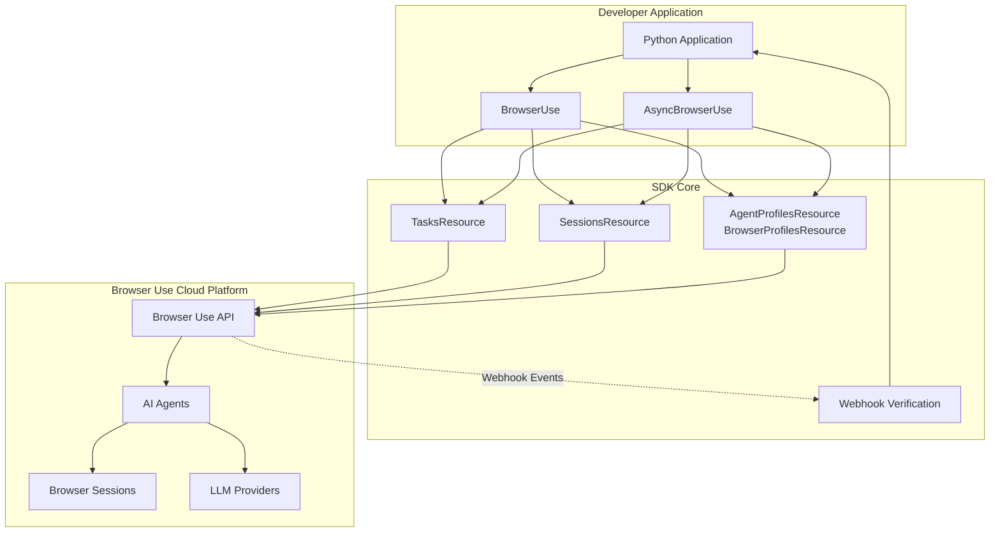
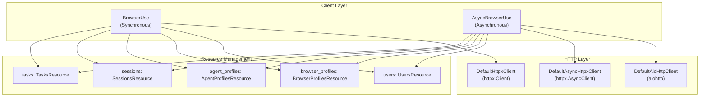
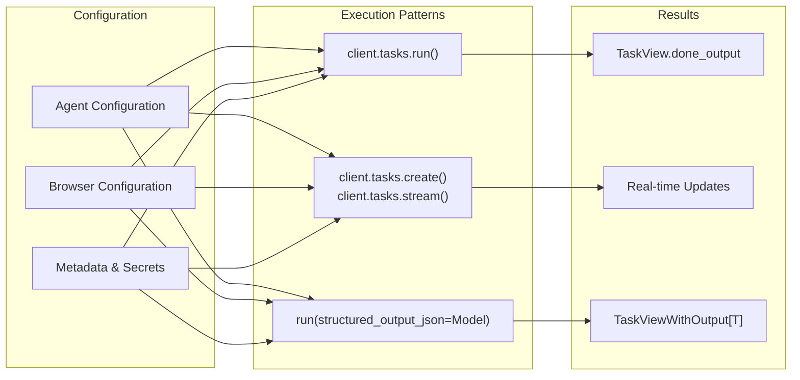
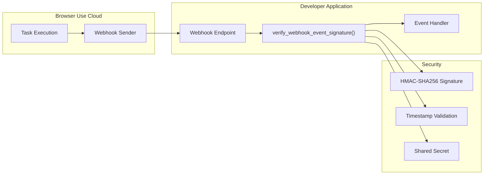
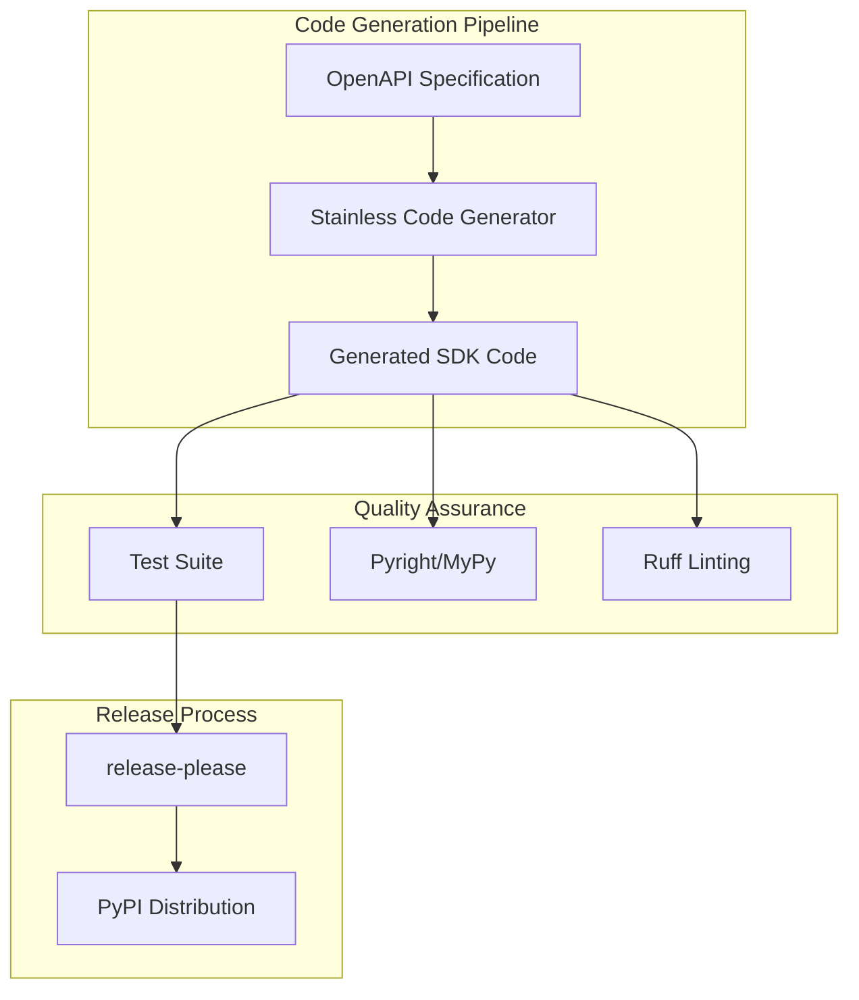

<!-- source: DeepWiki mcp.deepwiki.com · repo browser-use/browser-use-python · page 1 Overview · fetched 2026-10-30 -->

# Overview

<details>
<summary>Relevant source files</summary>

The following files were used as context for generating this wiki page:

- [README.md](README.md)
- [pyproject.toml](pyproject.toml)

</details>


## Purpose and Scope

The browser-use-sdk is the official Python library for interfacing with the Browser Use Cloud platform, providing developers with programmatic access to AI-powered browser automation capabilities. This document covers the high-level architecture, core components, and execution patterns of the SDK.

For detailed API reference, see [Client API Reference](#4). For installation and basic usage patterns, see [Getting Started](#2). For advanced features like webhooks and structured output, see [Advanced Features](#5).

## System Architecture

The browser-use-sdk implements a client-server architecture where Python applications communicate with the Browser Use Cloud platform through a REST API. The SDK provides both synchronous and asynchronous client interfaces for different use cases.



Sources: [README.md:1-392](), [src/browser_use_sdk/_version.py:1-5](), [tests/test_client.py:24-35]()

## Core Client Classes

The SDK provides two primary client classes that expose identical functionality through different execution models:



Sources: [README.md:16-18](), [README.md:144-166](), [README.md:168-199](), [tests/test_client.py:61-63](), [tests/test_client.py:868-870]()

### Authentication and Configuration

Both client classes require API key authentication and support various configuration options:

| Configuration | Environment Variable | Description |
|---------------|---------------------|-------------|
| API Key | `BROWSER_USE_API_KEY` | Required for authentication |
| Base URL | `BROWSER_USE_BASE_URL` | Cloud platform endpoint |
| Timeout | N/A | Request timeout configuration |
| Max Retries | N/A | Retry behavior for failed requests |
| HTTP Client | N/A | Custom httpx client instance |

Sources: [tests/test_client.py:341-347](), [tests/test_client.py:558-561](), [tests/test_client.py:269-282]()

## Task Execution Patterns

The SDK supports multiple patterns for executing browser automation tasks, each suited to different use cases:



Sources: [README.md:15-25](), [README.md:57-98](), [README.md:29-55]()

### Simple Task Execution

The most straightforward pattern uses the `run()` method for one-shot task execution:

```python
client.tasks.run(task="Search for the top 10 Hacker News posts")
```

Sources: [README.md:20-22]()

### Streaming Execution

For long-running tasks requiring real-time updates, the SDK provides streaming capabilities:

```python
task = client.tasks.create(task="...")
for update in client.tasks.stream(task.id):
    print(f"{update.status}: {update.steps[-1].next_goal}")
```

Sources: [README.md:73-83]()

### Structured Output

Tasks can return structured data using Pydantic models for type safety:

```python
result = client.tasks.run(
    task="Find top 10 articles",
    structured_output_json=SearchResult
)
```

Sources: [README.md:42-47]()

## Webhook Integration

The SDK provides webhook signature verification for real-time task notifications:



Sources: [README.md:100-140](), [README.md:124-129]()

## Error Handling and Resilience

The SDK implements comprehensive error handling with automatic retry mechanisms:

| Error Type | Status Code | Retry Behavior |
|------------|-------------|----------------|
| `APIConnectionError` | N/A | Automatic retry |
| `RateLimitError` | 429 | Automatic retry with backoff |
| `InternalServerError` | ≥500 | Automatic retry |
| `AuthenticationError` | 401 | No retry |
| `NotFoundError` | 404 | No retry |

Default retry configuration includes 2 retries with exponential backoff for transient failures.

Sources: [README.md:203-267](), [pyproject.toml:10-17]()

## Development and Code Generation

The SDK is generated from OpenAPI specifications using the Stainless code generator, ensuring type safety and API consistency:



Sources: [src/browser_use_sdk/_version.py:1-2](), [pyproject.toml:44-61](), [CHANGELOG.md:1-69]()

## Dependencies and Platform Support

The SDK supports Python 3.8+ with the following core dependencies:

- `httpx` (0.23.0+): HTTP client for API communication  
- `pydantic` (1.9.0+): Data validation and serialization
- `typing-extensions` (4.10+): Enhanced type annotations
- `anyio` (3.5.0+): Async compatibility layer

Optional dependencies include `aiohttp` for enhanced async performance.

Sources: [pyproject.toml:10-17](), [pyproject.toml:18](), [pyproject.toml:41-42](), [README.md:385-387]()

---

