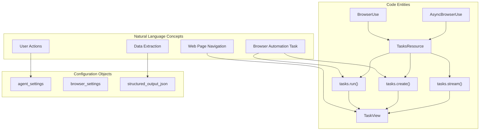
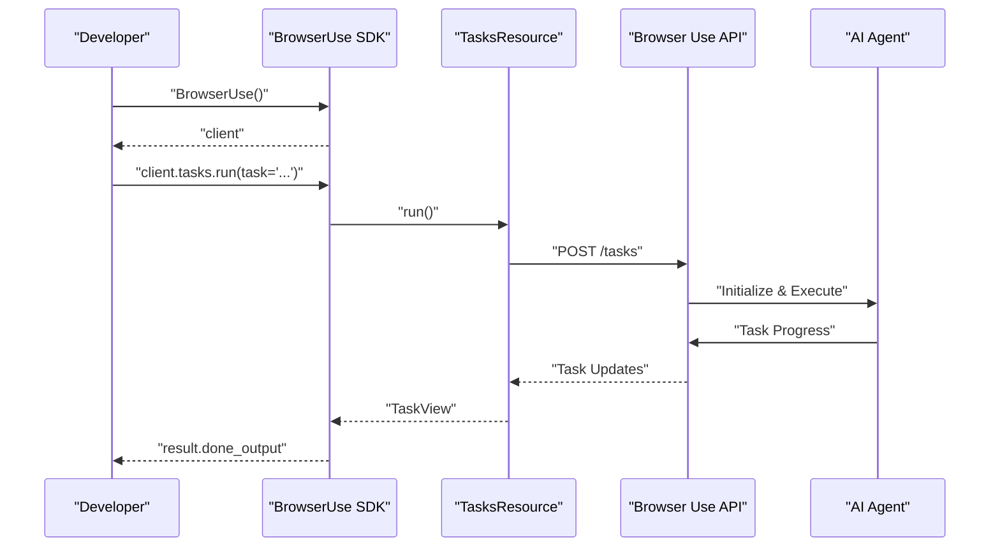

<!-- source: DeepWiki mcp.deepwiki.com · repo browser-use/browser-use-python · page 2 Getting Started · fetched 2026-10-30 -->

# Getting Started

<details>
<summary>Relevant source files</summary>

The following files were used as context for generating this wiki page:

- [README.md](README.md)
- [pyproject.toml](pyproject.toml)

</details>


This page guides you through installing the browser-use-sdk Python library, setting up authentication, and executing your first browser automation tasks. It covers the essential setup steps and basic usage patterns needed to start automating web browsers using AI agents.

For detailed information about task management and advanced execution patterns, see [Task Management API](#4.1). For webhook setup and event handling, see [Webhooks](#5.1). For comprehensive usage examples, see [Examples](#6).

## Installation

Install the browser-use-sdk from PyPI using pip:

```bash
pip install browser-use-sdk
```

For asynchronous operations with improved performance, you can optionally install the aiohttp backend:

```bash
pip install browser-use-sdk[aiohttp]
```

Sources: [README.md:5-7](), [README.md:174-177]()

## Authentication Setup

The browser-use-sdk requires an API key from Browser Use Cloud to authenticate requests:

1. **Get your API key** from [Browser Use Cloud](https://cloud.browser-use.com)
2. **Set the API key** using one of these methods:

### Environment Variable (Recommended)

```bash
export BROWSER_USE_API_KEY="bu_..."
```

### Direct Initialization

```python
from browser_use_sdk import BrowserUse

client = BrowserUse(api_key="bu_...")
```

Sources: [README.md:11](), [README.md:16-18](), [examples/create.py:9-10]()

## Client Initialization

The SDK provides two main client classes for different execution patterns:

### Synchronous Client

```python
from browser_use_sdk import BrowserUse

# Uses BROWSER_USE_API_KEY environment variable
client = BrowserUse()

# Or with explicit API key
client = BrowserUse(api_key="bu_...")
```

### Asynchronous Client

```python
import asyncio
from browser_use_sdk import AsyncBrowserUse

async def main():
    client = AsyncBrowserUse()
    # Your async code here

asyncio.run(main())
```

### Asynchronous Client with AioHTTP

```python
from browser_use_sdk import AsyncBrowserUse, DefaultAioHttpClient

async def main():
    async with AsyncBrowserUse(
        api_key="bu_...",
        http_client=DefaultAioHttpClient(),
    ) as client:
        # Your async code here
```

Sources: [README.md:144-154](), [README.md:179-199](), [examples/create.py:7-10](), [tests/test_client.py:62]()

## Basic Task Execution

### Client-to-Code Entity Mapping



Sources: [README.md:15-25](), [examples/run.py:14-29](), [examples/create.py:14-25]()

### Simple Task Execution

The most straightforward way to execute a browser automation task:

```python
from browser_use_sdk import BrowserUse

client = BrowserUse()

result = client.tasks.run(
    task="Search for the top 10 Hacker News posts and return the title and url."
)

print(result.done_output)
```

This pattern blocks until the task completes and returns the final result in `result.done_output`.

Sources: [README.md:15-25](), [examples/run.py:14-29]()

### Task Execution Flow



Sources: [README.md:20-24](), [examples/run.py:15-28]()

### Structured Output with Pydantic

For type-safe data extraction, use Pydantic models to define the expected output structure:

```python
from typing import List
from pydantic import BaseModel
from browser_use_sdk import BrowserUse

class HackerNewsPost(BaseModel):
    title: str
    url: str

class SearchResult(BaseModel):
    posts: List[HackerNewsPost]

client = BrowserUse()

result = client.tasks.run(
    task="Find top 10 Hacker News articles and return the title and url.",
    structured_output_json=SearchResult,
)

if result.parsed_output is not None:
    for post in result.parsed_output.posts:
        print(f" - {post.title} - {post.url}")
```

Sources: [README.md:29-55](), [examples/run.py:32-58]()

### Agent and Browser Configuration

Customize the AI agent and browser behavior using configuration parameters:

```python
result = client.tasks.run(
    task="Your automation task",
    agent_settings={"llm": "gpt-4.1"},
    browser_settings={"profile": "default"},
    metadata={"custom_key": "custom_value"}
)
```

| Parameter | Type | Description |
|-----------|------|-------------|
| `task` | `str` | Natural language description of the automation task |
| `agent_settings` | `dict` | AI agent configuration including LLM selection |
| `browser_settings` | `dict` | Browser profile and session settings |
| `structured_output_json` | `Type[BaseModel]` | Pydantic model for structured output |
| `metadata` | `dict` | Custom metadata attached to the task |

Sources: [examples/create.py:19](), [examples/run.py:19](), [examples/create.py:41]()

## Asynchronous Execution

For concurrent operations or when integrating with async frameworks:

```python
import asyncio
from browser_use_sdk import AsyncBrowserUse

async def main():
    client = AsyncBrowserUse()
    
    result = await client.tasks.run(
        task="Search for the top 10 Hacker News posts and return the title and url."
    )
    
    print(result.done_output)

asyncio.run(main())
```

The asynchronous client provides identical functionality to the synchronous version, with all methods requiring `await`.

Sources: [README.md:142-166]()

## Error Handling

The SDK provides specific exception types for different error conditions:

```python
import browser_use_sdk
from browser_use_sdk import BrowserUse

client = BrowserUse()

try:
    result = client.tasks.run(task="Your task")
except browser_use_sdk.APIConnectionError as e:
    print("Network connection error")
except browser_use_sdk.AuthenticationError as e:
    print("Invalid API key")
except browser_use_sdk.RateLimitError as e:
    print("Rate limit exceeded")
except browser_use_sdk.APIStatusError as e:
    print(f"API error: {e.status_code}")
```

| Status Code | Exception Type |
|-------------|----------------|
| 400 | `BadRequestError` |
| 401 | `AuthenticationError` |
| 403 | `PermissionDeniedError` |
| 404 | `NotFoundError` |
| 422 | `UnprocessableEntityError` |
| 429 | `RateLimitError` |
| >=500 | `InternalServerError` |

Sources: [README.md:212-244]()

## Next Steps

Once you have completed the basic setup:

- **Learn about task lifecycle management**: See [Tasks](#3.1) for detailed information about task creation, monitoring, and lifecycle management
- **Explore real-time task monitoring**: See [Task Streaming](#5.3) for streaming task updates and progress monitoring
- **Set up webhook notifications**: See [Webhooks](#5.1) for receiving real-time task status updates
- **Review complete examples**: See [Synchronous Examples](#6.1) and [Asynchronous Examples](#6.2) for comprehensive usage patterns
- **Understand the complete API**: See [Client API Reference](#4) for full method documentation

Sources: [README.md:27]()

---

