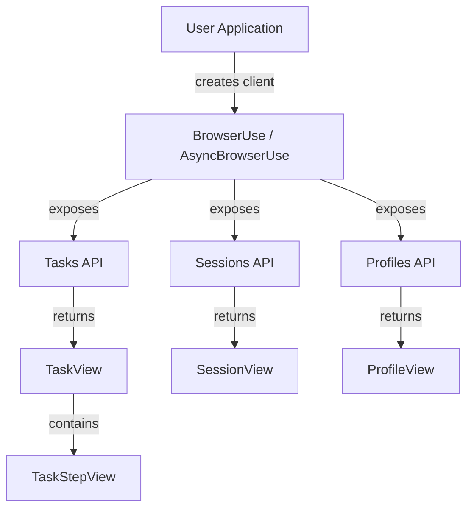
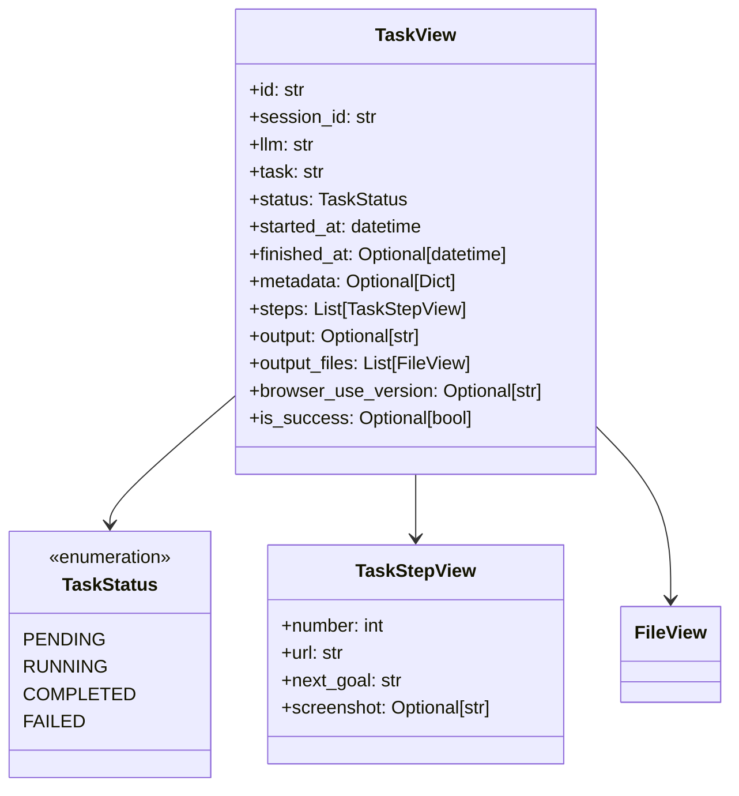
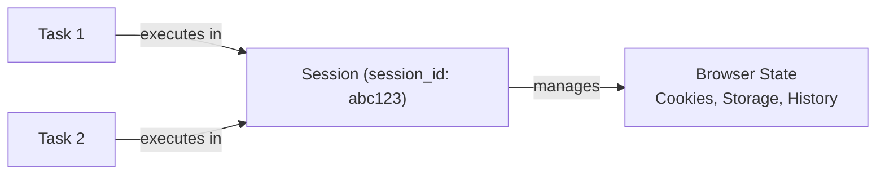
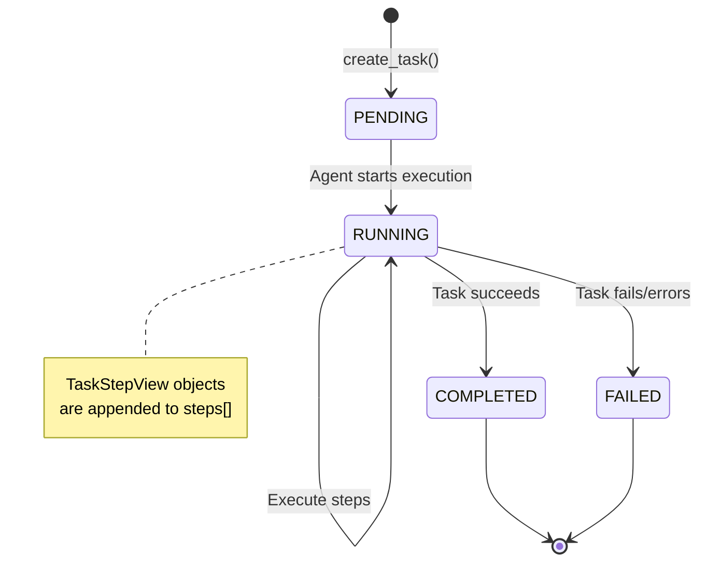
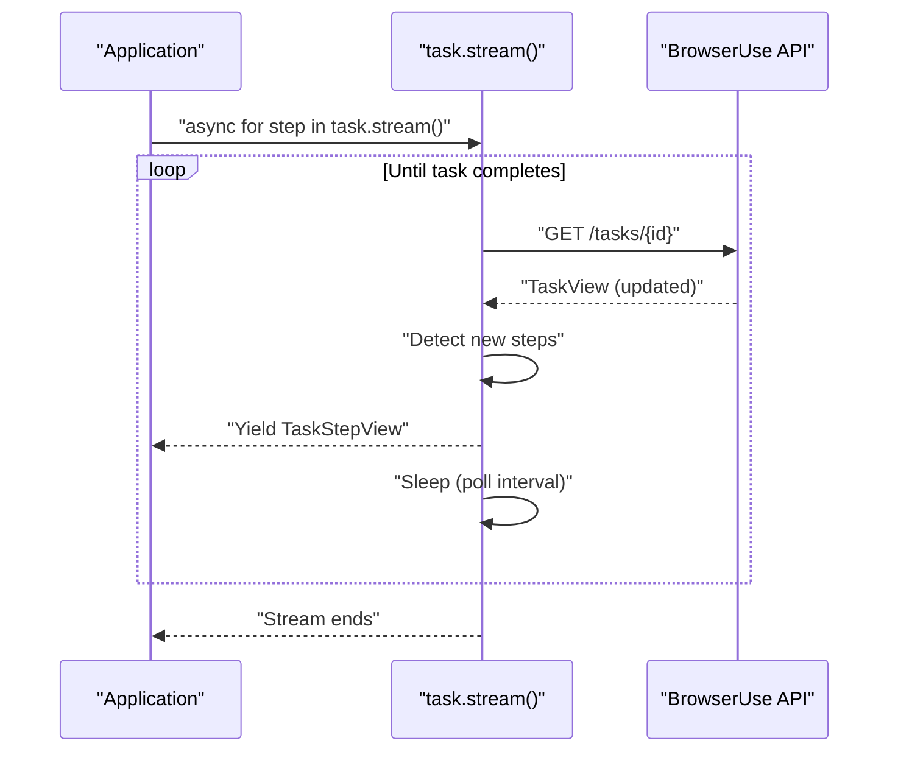
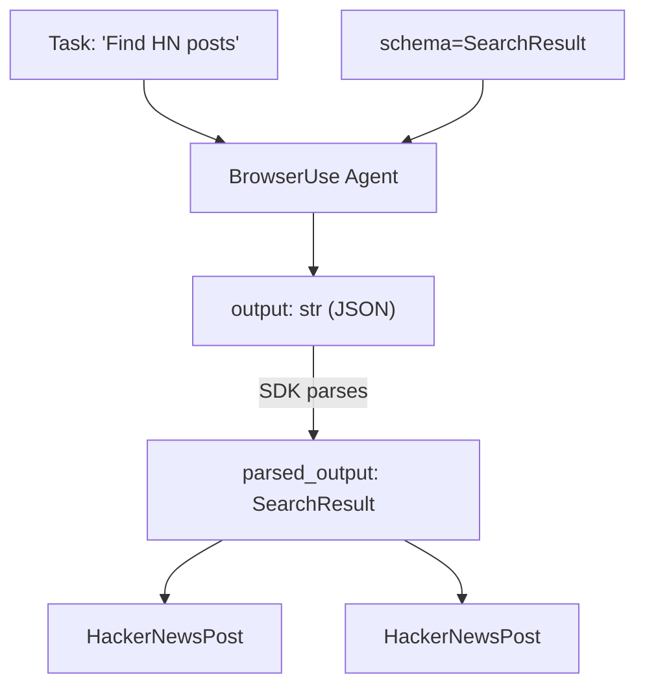

<!-- source: DeepWiki mcp.deepwiki.com · repo browser-use/browser-use-python · page 3 Core Concepts · fetched 2026-10-30 -->

# Core Concepts

<details>
<summary>Relevant source files</summary>

The following files were used as context for generating this wiki page:

- [README.md](README.md)
- [src/browser_use_sdk/types/__init__.py](src/browser_use_sdk/types/__init__.py)
- [src/browser_use_sdk/types/task_item_view.py](src/browser_use_sdk/types/task_item_view.py)
- [src/browser_use_sdk/types/task_view.py](src/browser_use_sdk/types/task_view.py)

</details>


This document explains the fundamental concepts underlying the browser-use-python SDK, including tasks, sessions, profiles, and the data models that represent them. It provides a high-level overview of how these components work together to enable browser automation via the BrowserUse Cloud API.

For detailed information about specific concepts, see:
- [Tasks](#3.1) - In-depth coverage of task creation, management, and lifecycle
- [Sessions and Profiles](#3.2) - Detailed explanation of execution contexts and browser profiles
- [Data Models and Types](#3.3) - Complete reference for all data structures used in the SDK

## Fundamental Architecture

The browser-use-python SDK is built around a small set of core abstractions that enable programmatic browser automation. The primary concepts are:

1. **Tasks** - Units of browser automation work with specific goals
2. **Sessions** - Execution contexts that manage browser state and lifecycle
3. **Profiles** - Persistent browser configurations and stored data
4. **Data Models** - Strongly-typed representations of API resources



**Core SDK Architecture: Client and Resource APIs**

The SDK client ([src/browser_use_sdk/client.py]()) exposes separate API clients for each resource type. All API operations return strongly-typed data models defined in [src/browser_use_sdk/types/]().

Sources: [README.md:1-200](), [src/browser_use_sdk/types/task_view.py:1-88]()

## Tasks: The Central Abstraction

A **task** represents a single browser automation job with a specific goal. Each task is defined by a natural language prompt that describes what the agent should accomplish. Tasks are the primary way users interact with the BrowserUse system.

### Task Structure



**TaskView Data Model Structure**

The `TaskView` class ([src/browser_use_sdk/types/task_view.py:16-88]()) is the primary representation of a task. Key fields include:

| Field | Type | Purpose |
|-------|------|---------|
| `id` | `str` | Unique task identifier |
| `session_id` | `str` | Associated session for browser context |
| `llm` | `str` | LLM model used (e.g., "gpt-4.1") |
| `task` | `str` | Natural language task description |
| `status` | `TaskStatus` | Current execution state |
| `steps` | `List[TaskStepView]` | Execution steps taken by the agent |
| `output` | `Optional[str]` | Final result or parsed data |
| `is_success` | `Optional[bool]` | Self-reported success indicator |

Sources: [src/browser_use_sdk/types/task_view.py:16-88](), [src/browser_use_sdk/types/task_item_view.py:14-84]()

### Task Creation and Execution

Tasks are created through the `tasks.create_task()` method and can include optional parameters for structured output, metadata, and LLM selection:

```python
# Basic task creation
task = client.tasks.create_task(
    task="Search for the top 10 Hacker News posts and return the title and url.",
    llm="gpt-4.1"
)
```

The SDK provides multiple patterns for task execution:
- **Blocking completion**: `task.complete()` waits for task to finish
- **Streaming updates**: `task.stream()` yields real-time progress
- **Polling**: `client.tasks.get_task(task_id)` retrieves current state

Sources: [README.md:29-42](), [README.md:162-181]()

## Sessions: Execution Context

A **session** represents a browser execution context. Each task is associated with a session, which maintains browser state, cookies, and navigation history throughout the task lifecycle. Sessions can be:

- **Ephemeral**: Created automatically and destroyed after task completion
- **Persistent**: Explicitly created and reused across multiple tasks



**Session Management and Task Association**

When a task specifies a `session_id`, it executes within that session's browser context, allowing state to persist across multiple tasks. The `session_id` field in `TaskView` ([src/browser_use_sdk/types/task_view.py:26]()) links each task to its execution session.

Sources: [src/browser_use_sdk/types/task_view.py:26](), [src/browser_use_sdk/types/task_item_view.py:24-27]()

## Profiles: Browser Configuration

A **profile** is a persistent browser configuration that stores settings, extensions, and user data. Profiles allow tasks to:

- Maintain logged-in state across sessions
- Use specific browser configurations
- Preserve cookies and local storage
- Apply custom browser extensions

Profiles are managed through the `profiles` API and can be associated with sessions to provide a specific browser environment for task execution.

Sources: [README.md:1-200]()

## Task Lifecycle and State Transitions

Tasks progress through a well-defined lifecycle from creation to completion:



**Task State Transitions**

The `TaskStatus` enum defines the possible states. During execution, the `steps` field ([src/browser_use_sdk/types/task_view.py:59]()) is progressively populated with `TaskStepView` objects representing each action taken by the agent.

### Task Timestamps

Tasks track execution timing through two datetime fields:

- `started_at` ([src/browser_use_sdk/types/task_view.py:42-45]()): UTC timestamp when task began execution
- `finished_at` ([src/browser_use_sdk/types/task_view.py:47-52]()): UTC timestamp when task completed (or `None` if still running)

These timestamps enable duration calculation and execution monitoring.

Sources: [src/browser_use_sdk/types/task_view.py:37-52](), [src/browser_use_sdk/types/task_item_view.py:39-50]()

## Real-time Updates via Streaming

The SDK provides a streaming interface for receiving real-time task progress updates without manual polling:



**Streaming Implementation Pattern**

The `.stream()` method ([README.md:84-114]()) returns an async generator that automatically polls the API and yields `TaskStepView` objects as the agent progresses through the task.

### Streaming Usage Pattern

```python
async for step in task.stream():
    print(f"Step {step.number}: {step.url} ({step.next_goal})")
```

This pattern allows applications to display live progress updates without implementing manual polling logic.

Sources: [README.md:80-114]()

## Structured Output with Pydantic Schemas

Tasks can return structured data by specifying a Pydantic model as the `schema` parameter. The SDK automatically parses the task output into the specified model:



**Structured Output Data Flow**

When a `schema` is provided to `create_task()`, the agent formats its output as JSON matching the schema. The SDK parses this and populates the `parsed_output` field with a validated Pydantic instance.

### Schema Definition Example

The `output` field ([src/browser_use_sdk/types/task_view.py:60-63]()) contains the raw string output, while `parsed_output` (when using schemas) contains the validated Pydantic model instance. This is demonstrated in [README.md:50-78]():

```python
class HackerNewsPost(BaseModel):
    title: str
    url: str

class SearchResult(BaseModel):
    posts: List[HackerNewsPost]

task = await client.tasks.create_task(
    task="Find top 10 Hacker News articles",
    schema=SearchResult,
)
result = await task.complete()
# result.parsed_output is now a SearchResult instance
```

Sources: [README.md:46-78](), [src/browser_use_sdk/types/task_view.py:60-63]()

## Task Metadata and Custom Fields

Tasks support arbitrary metadata through the `metadata` field ([src/browser_use_sdk/types/task_view.py:54-57]()):

```python
task = client.tasks.create_task(
    task="...",
    metadata={"user_id": "123", "source": "api", "priority": "high"}
)
```

This `Dict[str, Any]` field allows applications to attach custom data to tasks for tracking, filtering, or business logic purposes. The metadata is stored with the task and returned in both `TaskView` and `TaskItemView` representations.

Sources: [src/browser_use_sdk/types/task_view.py:54-57](), [src/browser_use_sdk/types/task_item_view.py:52-55]()

## Task Output Artifacts

In addition to text output, tasks can produce files that are accessible through the `output_files` field ([src/browser_use_sdk/types/task_view.py:65]()). This field contains a list of `FileView` objects representing screenshots, downloads, or other artifacts generated during task execution.

### Success Indicator

The `is_success` field ([src/browser_use_sdk/types/task_view.py:73-78]()) is a self-reported boolean indicating whether the agent believes it successfully completed the task. This is distinct from the `status` field, which tracks execution state. A task can have `status=COMPLETED` but `is_success=False` if the agent finished execution but failed to achieve the goal.

Sources: [src/browser_use_sdk/types/task_view.py:65-78](), [src/browser_use_sdk/types/task_item_view.py:62-74]()

## Data Model Variants

The SDK provides two representations of tasks:

| Model | Use Case | Fields |
|-------|----------|--------|
| `TaskView` | Detailed single task retrieval | Full details including `steps`, `output_files` |
| `TaskItemView` | List operations | Lightweight, excludes `steps` and `output_files` |

`TaskItemView` ([src/browser_use_sdk/types/task_item_view.py:14-84]()) is optimized for listing many tasks by omitting large fields like the step-by-step history. Both models share core fields like `id`, `session_id`, `status`, `output`, and `is_success`.

Sources: [src/browser_use_sdk/types/task_view.py:16-88](), [src/browser_use_sdk/types/task_item_view.py:14-84]()

## Version Tracking

The `browser_use_version` field ([src/browser_use_sdk/types/task_view.py:66-71]()) tracks which version of the underlying browser-use library was used to execute the task. This is useful for debugging and understanding behavior changes across versions. Older tasks may not have this field populated.

Sources: [src/browser_use_sdk/types/task_view.py:66-71](), [src/browser_use_sdk/types/task_item_view.py:62-67]()

---

