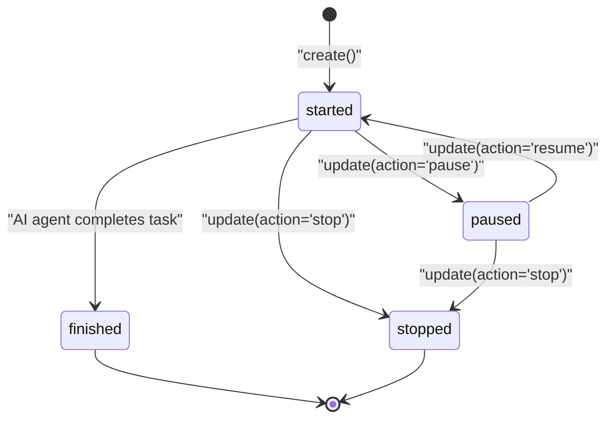
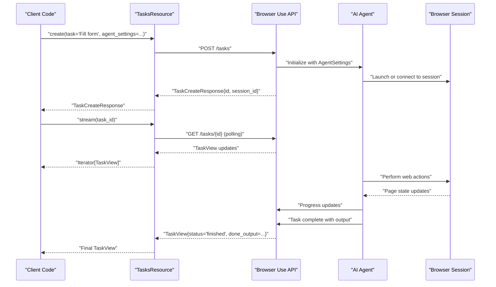
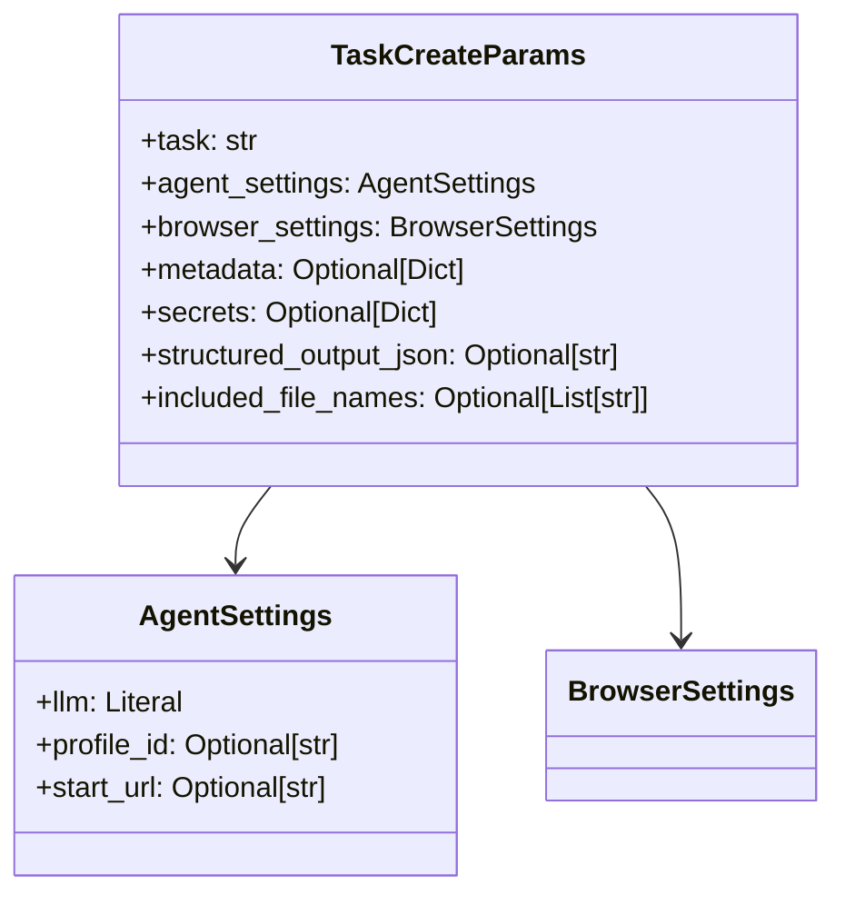
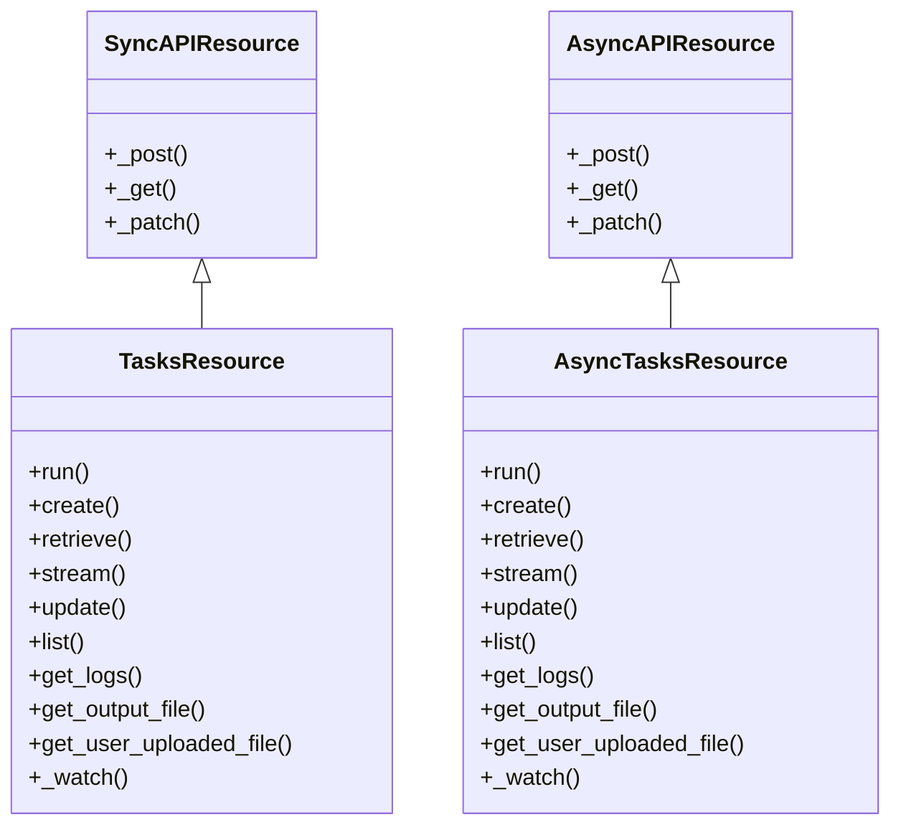

<!-- source: DeepWiki mcp.deepwiki.com · repo browser-use/browser-use-python · page 3.1 Tasks · fetched 2026-10-30 -->

# Tasks

<details>
<summary>Relevant source files</summary>

The following files were used as context for generating this wiki page:

- [README.md](README.md)
- [src/browser_use_sdk/tasks/raw_client.py](src/browser_use_sdk/tasks/raw_client.py)
- [src/browser_use_sdk/types/task_item_view.py](src/browser_use_sdk/types/task_item_view.py)
- [src/browser_use_sdk/types/task_view.py](src/browser_use_sdk/types/task_view.py)
- [src/browser_use_sdk/types/too_many_concurrent_active_sessions_error.py](src/browser_use_sdk/types/too_many_concurrent_active_sessions_error.py)

</details>


This document covers the core task functionality in the browser-use-sdk, including task creation, execution, monitoring, and management. Tasks represent individual AI agent jobs that perform web automation within browser sessions.

For information about session and profile management, see [Sessions and Profiles](#3.2). For webhook notifications about task events, see [Webhooks](#5.1). For structured output configuration, see [Structured Output](#5.2). For real-time task monitoring, see [Task Streaming](#5.3).

## Overview

Tasks are the fundamental unit of work in the browser-use-sdk. Each task represents a specific instruction given to an AI agent, such as "fill out this form" or "extract data from this website". Tasks execute within browser sessions and can either start new sessions or continue existing ones.

The task system provides two main interfaces: `TasksResource` for synchronous operations and `AsyncTasksResource` for asynchronous operations, both located in [src/browser_use_sdk/resources/tasks.py]().

Sources: [src/browser_use_sdk/resources/tasks.py:41-42](), [src/browser_use_sdk/resources/tasks.py:835-836]()

## Task Lifecycle

### Task States

Tasks progress through a defined lifecycle with the following states:

| State | Description |
|-------|-------------|
| `started` | Task is currently running |
| `paused` | Task execution temporarily suspended (can be resumed) |
| `finished` | Task completed successfully |
| `stopped` | Task manually terminated (cannot be resumed) |



**Task Lifecycle State Machine**

Sources: [src/browser_use_sdk/types/task_view.py:56-63](), [src/browser_use_sdk/resources/tasks.py:524](), [src/browser_use_sdk/resources/tasks.py:1325]()

### Task Execution Flow



**Task Execution Sequence with Code Entities**

Sources: [src/browser_use_sdk/resources/tasks.py:199-307](), [src/browser_use_sdk/resources/tasks.py:444-483]()

## Task Execution Patterns

### Simple Task Execution

The `run()` method provides a simplified interface that combines task creation, execution, and completion waiting:

```python
# Synchronous execution
result = client.tasks.run(
    task="Navigate to example.com and extract the page title",
    agent_settings={"llm": "gpt-4o"},
    browser_settings={"profile_id": "my-profile"}
)

# Asynchronous execution
result = await client.tasks.run(
    task="Fill out the contact form",
    agent_settings={"llm": "gpt-4o"}
)
```

The `run()` method internally calls `create()` followed by `stream()` and returns when the task reaches `finished` status.

Sources: [src/browser_use_sdk/resources/tasks.py:99-159](), [src/browser_use_sdk/resources/tasks.py:893-953]()

### Streaming Task Execution

For real-time monitoring, use the `create()` and `stream()` methods separately:

```python
# Create task
task_response = client.tasks.create(
    task="Extract product data from e-commerce site",
    agent_settings={"llm": "gpt-4o", "start_url": "https://example.com"}
)

# Stream progress updates
for task_view in client.tasks.stream(task_response.id):
    print(f"Status: {task_view.status}, Steps: {len(task_view.steps)}")
    if task_view.status == "finished":
        break
```

The `stream()` method uses polling via the private `_watch()` method with hash-based change detection to efficiently stream updates.

Sources: [src/browser_use_sdk/resources/tasks.py:444-483](), [src/browser_use_sdk/resources/tasks.py:485-518]()

### Structured Output Execution

Tasks can return structured data using Pydantic models:

```python
from pydantic import BaseModel

class ProductData(BaseModel):
    name: str
    price: float
    in_stock: bool

# Returns TaskViewWithOutput[ProductData] with parsed_output field
result = client.tasks.run(
    task="Extract product information",
    structured_output_json=ProductData
)

product = result.parsed_output  # Type: ProductData
```

Structured output is handled by overloaded methods that accept `type[BaseModel]` parameters and return `TaskViewWithOutput[T]` objects.

Sources: [src/browser_use_sdk/resources/tasks.py:80-97](), [src/browser_use_sdk/lib/parse.py:26]()

## Task Configuration

### Agent Settings

The `AgentSettings` class configures the AI agent behavior:

| Parameter | Type | Description |
|-----------|------|-------------|
| `llm` | `Literal` | LLM model selection (gpt-4o, claude-3-5-sonnet, etc.) |
| `profile_id` | `Optional[str]` | Agent profile ID for custom behavior |
| `start_url` | `Optional[str]` | Initial URL (not modified as a step) |



**Task Configuration Class Structure**

Sources: [src/browser_use_sdk/types/task_create_params.py:41-59](), [src/browser_use_sdk/types/task_create_params.py:13-39]()

### Browser Settings

The `BrowserSettings` class controls browser session behavior:

| Parameter | Type | Description |
|-----------|------|-------------|
| `session_id` | `Optional[str]` | Continue existing session |
| `profile_id` | `Optional[str]` | Browser profile for new session |

Use `session_id` to continue an existing browser session (no additional startup costs) or `profile_id` to start a new session with specific browser configuration.

Sources: [src/browser_use_sdk/types/task_create_params.py:61-64]()

### File and Metadata Configuration

Tasks support additional configuration options:

- **File Uploads**: `included_file_names` references files uploaded to your account
- **Metadata**: `metadata` adds custom key-value pairs for tracking
- **Secrets**: `secrets` provides secure configuration values to the agent
- **Structured Output**: `structured_output_json` defines expected response format

Sources: [src/browser_use_sdk/types/task_create_params.py:32-38]()

## Task Monitoring and Control

### Task Information Retrieval

The `retrieve()` method fetches current task status and details:

```python
task_view = client.tasks.retrieve(task_id)

print(f"Status: {task_view.status}")
print(f"Steps completed: {len(task_view.steps)}")
print(f"Output files: {len(task_view.output_files)}")
```

The `TaskView` object contains comprehensive task information including session details, execution steps, and file references.

Sources: [src/browser_use_sdk/resources/tasks.py:336-414](), [src/browser_use_sdk/types/task_view.py:34-80]()

### Task Control Operations

The `update()` method controls task execution:

| Action | Description |
|--------|-------------|
| `stop` | Terminate current task |
| `pause` | Suspend task (resumable) |
| `resume` | Continue paused task |
| `stop_task_and_session` | Stop task and end browser session |

```python
# Pause a running task
client.tasks.update(task_id, action="pause")

# Resume a paused task
client.tasks.update(task_id, action="resume")

# Stop task and session
client.tasks.update(task_id, action="stop_task_and_session")
```

Sources: [src/browser_use_sdk/resources/tasks.py:520-586]()

### Task Listing and Filtering

The `list()` method provides paginated access to tasks with filtering options:

```python
# List recent tasks
tasks = client.tasks.list(page_size=20)

# Filter by status
running_tasks = client.tasks.list(filter_by="started")

# Filter by session
session_tasks = client.tasks.list(session_id="session-123")

# Date range filtering
recent_tasks = client.tasks.list(
    after="2024-01-01T00:00:00Z",
    before="2024-01-31T23:59:59Z"
)
```

Sources: [src/browser_use_sdk/resources/tasks.py:588-654]()

## File Handling

### Task Logs

The `get_logs()` method provides access to detailed execution logs:

```python
logs_response = client.tasks.get_logs(task_id)
download_url = logs_response.download_url
```

Task logs contain step-by-step reasoning, actions taken, error messages, and performance metrics useful for debugging and optimization.

Sources: [src/browser_use_sdk/resources/tasks.py:656-715]()

### Output Files

AI agents can generate various output files during execution. Access them via `get_output_file()`:

```python
# Get specific output file
file_response = client.tasks.get_output_file(
    task_id=task_id,
    file_id=file_id
)
download_url = file_response.download_url
```

Output files include screenshots, extracted data (CSV/JSON), generated reports, and downloaded web content.

Sources: [src/browser_use_sdk/resources/tasks.py:717-775]()

### User Uploaded Files

Access files that were uploaded for the task via `get_user_uploaded_file()`:

```python
# Get user uploaded file used in task
file_response = client.tasks.get_user_uploaded_file(
    task_id=task_id,
    file_id=file_id
)
download_url = file_response.download_url
```

These are files referenced by `included_file_names` during task creation.

Sources: [src/browser_use_sdk/resources/tasks.py:777-832]()

## Implementation Details

### Resource Class Hierarchy



**Tasks Resource Class Hierarchy**

### Streaming Implementation

The streaming functionality uses a polling-based approach with hash-based change detection:

1. `stream()` calls the private `_watch()` method
2. `_watch()` polls `retrieve()` at regular intervals (default 1 second)
3. `hash_task_view()` detects changes to avoid duplicate updates
4. Streaming stops when task reaches terminal state (`finished`, `stopped`, `paused`)

The async implementation includes additional state checking and uses `asyncio.sleep()` for non-blocking waits.

Sources: [src/browser_use_sdk/resources/tasks.py:485-518](), [src/browser_use_sdk/resources/tasks.py:1279-1319](), [src/browser_use_sdk/lib/parse.py:26]()

### Type Safety and Overloads

The task methods use Python's `@overload` decorator to provide type-safe interfaces for structured output:

- Methods without `structured_output_json` return `TaskView`
- Methods with `structured_output_json: type[T]` return `TaskViewWithOutput[T]`
- Runtime logic handles both cases in a single implementation

This enables full type checking while maintaining a clean API.

Sources: [src/browser_use_sdk/resources/tasks.py:61-97](), [src/browser_use_sdk/resources/tasks.py:309-347]()

---

