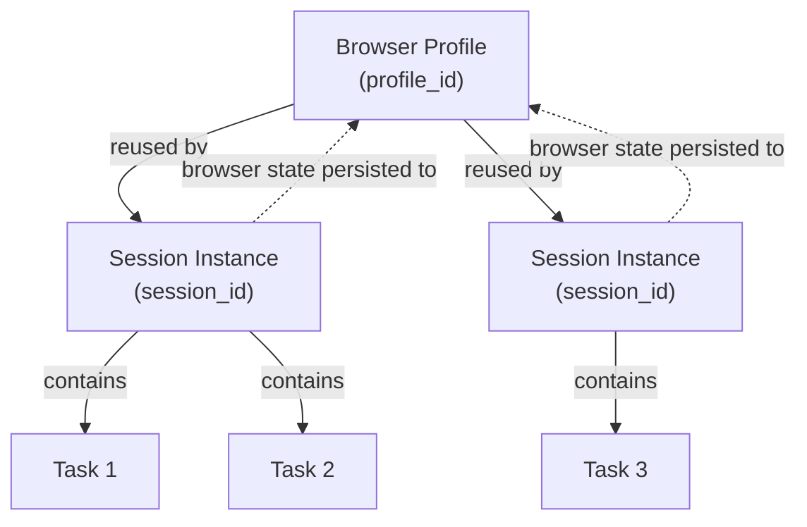
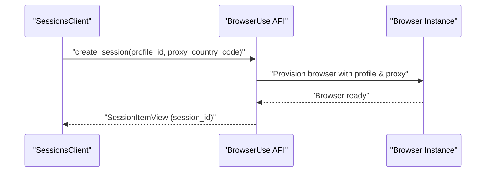
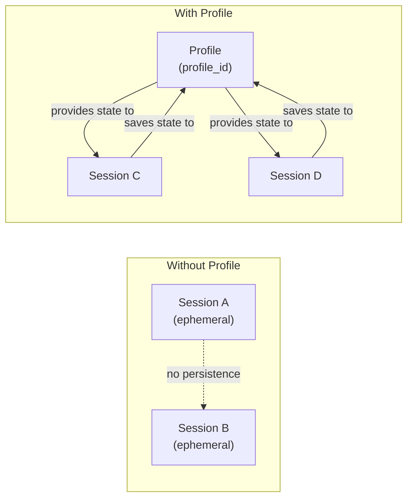
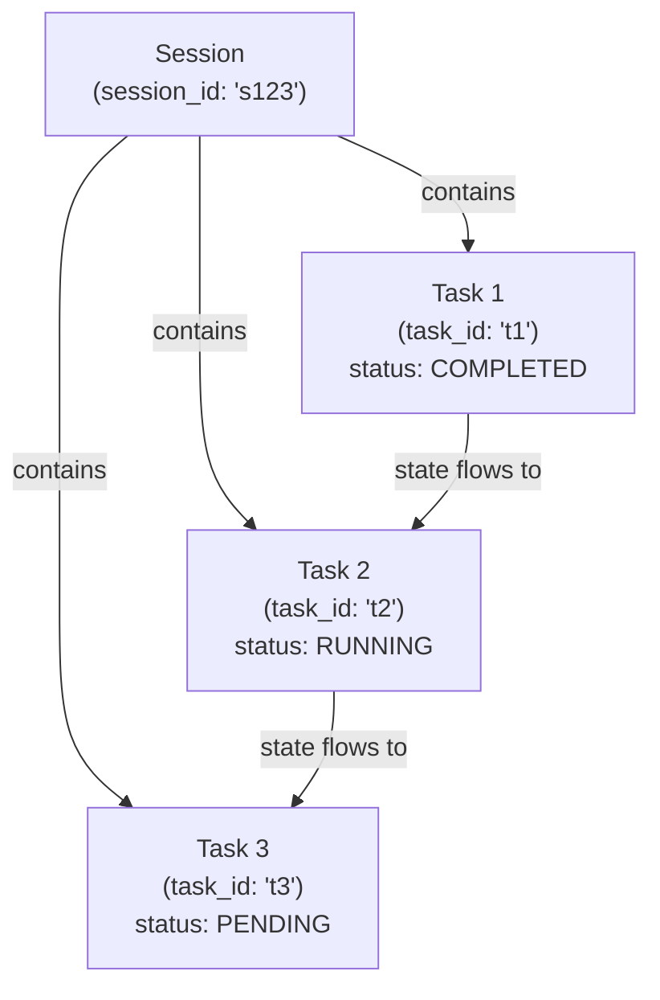
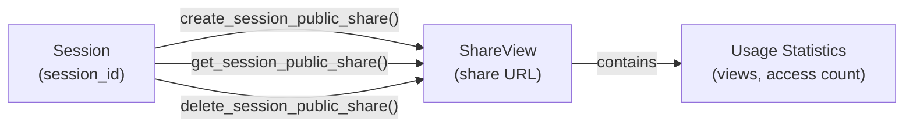
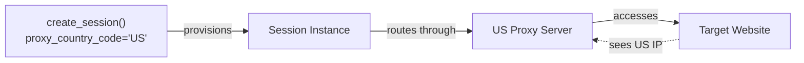

<!-- source: DeepWiki mcp.deepwiki.com · repo browser-use/browser-use-python · page 3.2 Sessions and Profiles · fetched 2026-10-30 -->

# Sessions and Profiles

Relevant source files

The following files were used as context for generating this wiki page:

- [src/browser_use_sdk/sessions/client.py](src/browser_use_sdk/sessions/client.py)
- [src/browser_use_sdk/types/session_list_response.py](src/browser_use_sdk/types/session_list_response.py)

## Purpose and Scope

This page explains the core concepts of **sessions** and **browser profiles** in the browser-use SDK. It covers what these entities are, how they relate to each other and to tasks, and their role in managing browser automation workflows. For detailed API documentation on session and profile management methods, see [Session and Profile Management](#4.2). For information about tasks and their execution, see [Tasks](#3.1).

---

## Overview

Sessions and profiles are fundamental building blocks for organizing browser automation work in the browser-use SDK. A **session** represents an active browser instance running on the BrowserUse Cloud platform, while a **profile** provides persistent browser state (cookies, local storage, authentication, etc.) that can be reused across multiple sessions.

**Sources:** [src/browser_use_sdk/sessions/client.py:75-113]()

---

## Sessions

### What is a Session?

A **session** is a browser instance that runs on the BrowserUse Cloud infrastructure. Each session:

- Has a unique `session_id` identifier
- Maintains browser state (tabs, cookies, DOM, etc.) during its lifetime
- Can execute one or more tasks sequentially
- May be associated with a browser profile for state persistence
- Can be configured with proxy settings for geo-location

Sessions are represented in code by the `SessionView` and `SessionItemView` types, which contain session metadata including status, URLs, and associated task information.

### Session States

Sessions have a lifecycle tracked through `SessionStatus`:

| Status | Description |
|--------|-------------|
| `ACTIVE` | Session is running and can execute tasks |
| `STOPPED` | Session has been terminated |
| `PENDING` | Session is being provisioned |
| `FAILED` | Session failed to initialize |

**Sources:** [src/browser_use_sdk/sessions/client.py:1-13](), [src/browser_use_sdk/types/session_view.py]()

### Session Creation

Sessions are created via the `create_session()` method on both `SessionsClient` and `AsyncSessionsClient`. At creation time, you can specify:

- **`profile_id`** (optional): The ID of a browser profile to associate with the session
- **`proxy_country_code`** (optional): Country code for proxy location (type: `ProxyCountryCode`)

**Sources:** [src/browser_use_sdk/sessions/client.py:75-113](), [src/browser_use_sdk/sessions/client.py:337-383]()

### Session Lifecycle Management

The SDK provides methods to manage the session lifecycle:

| Method | Description | Returns |
|--------|-------------|---------|
| `list_sessions()` | Get paginated list of sessions with optional status filtering | `SessionListResponse` |
| `create_session()` | Create a new session | `SessionItemView` |
| `get_session()` | Get detailed session information | `SessionView` |
| `update_session()` | Stop a session and all its running tasks | `SessionView` |

**Sources:** [src/browser_use_sdk/sessions/client.py:34-175]()

---

## Browser Profiles

### What is a Browser Profile?

A **browser profile** is a persistent container for browser state that can be reused across multiple sessions. Profiles store:

- Cookies and authentication tokens
- Local storage and session storage
- Browser history
- Cache
- Extension state
- User preferences

Profiles enable use cases such as:
- Maintaining logged-in state across sessions
- Reusing authentication without re-login
- Preserving site-specific settings
- Testing with consistent user state

### Profile Association

When creating a session, you can optionally specify a `profile_id` to associate the session with an existing profile. If no profile is specified, the session runs in an ephemeral state without persistence.

**Sources:** [src/browser_use_sdk/sessions/client.py:78-88](), [src/browser_use_sdk/sessions/client.py:349-350]()

### Profile Management

Profile creation and management is handled through the `ProfilesClient` (documented in detail in [Session and Profile Management](#4.2)). The profile ID can then be passed to `create_session()` to associate a session with that profile.

**Sources:** [src/browser_use_sdk/profiles/client.py]()

---

## Session-Task Relationship

Sessions and tasks have a one-to-many relationship: a single session can contain and execute multiple tasks. Tasks are executed sequentially within a session, maintaining browser state between tasks.

### Retrieving Session Information

The `SessionView` type returned by `get_session()` contains comprehensive information about the session including:

- Session ID and status
- Associated profile ID (if any)
- Proxy configuration
- List of tasks executed in the session
- URLs for accessing the session

This allows you to monitor all tasks within a session and understand the complete execution context.

**Sources:** [src/browser_use_sdk/sessions/client.py:115-143](), [src/browser_use_sdk/types/session_view.py]()

---

## Session Sharing

Sessions can be shared publicly via a share URL, enabling others to view the session execution without authentication. This is useful for:

- Debugging and troubleshooting
- Demonstrating automation workflows
- Sharing results with team members
- Creating public examples

### Share Management Methods

| Method | Purpose | Returns |
|--------|---------|---------|
| `create_session_public_share()` | Create or return existing public share | `ShareView` |
| `get_session_public_share()` | Get existing public share information | `ShareView` |
| `delete_session_public_share()` | Remove public share access | `None` |

The `ShareView` object contains the public URL and usage statistics for the shared session.

**Sources:** [src/browser_use_sdk/sessions/client.py:177-270](), [src/browser_use_sdk/sessions/client.py:465-582]()

---

## Proxy Configuration

Sessions can be configured to use proxies for geo-location and IP address management. When creating a session, you can specify a `proxy_country_code` parameter to route the browser traffic through a specific country.

The `ProxyCountryCode` type defines valid country codes that can be used for proxy configuration. This feature is useful for:

- Testing geo-restricted content
- Simulating users from different regions
- Accessing region-specific services
- Bypassing IP-based restrictions

**Sources:** [src/browser_use_sdk/sessions/client.py:79-80](), [src/browser_use_sdk/sessions/client.py:340-342](), [src/browser_use_sdk/types/proxy_country_code.py]()

---

## Code Entity Reference

The following table maps conceptual entities to their code implementations:

| Concept | Primary Type | Client Methods | Location |
|---------|--------------|----------------|----------|
| Session | `SessionView`, `SessionItemView` | `create_session()`, `get_session()`, `update_session()`, `list_sessions()` | [src/browser_use_sdk/sessions/client.py:19-271]() |
| Profile | `ProfileView` (implied) | Via `ProfilesClient` | [src/browser_use_sdk/profiles/client.py]() |
| Session List | `SessionListResponse` | `list_sessions()` | [src/browser_use_sdk/types/session_list_response.py:13-46]() |
| Session Status | `SessionStatus` | Used in filtering and status tracking | [src/browser_use_sdk/types/session_status.py]() |
| Session Share | `ShareView` | `create_session_public_share()`, `get_session_public_share()`, `delete_session_public_share()` | [src/browser_use_sdk/sessions/client.py:177-270]() |
| Proxy Config | `ProxyCountryCode` | Parameter in `create_session()` | [src/browser_use_sdk/types/proxy_country_code.py]() |

**Sources:** [src/browser_use_sdk/sessions/client.py:1-583](), [src/browser_use_sdk/types/session_list_response.py:1-46]()

---

## Pagination

Session lists are paginated for efficient retrieval. The `list_sessions()` method accepts pagination parameters:

| Parameter | Type | Description |
|-----------|------|-------------|
| `page_size` | `int` (optional) | Number of items per page |
| `page_number` | `int` (optional) | Page number to retrieve (0-indexed) |
| `filter_by` | `SessionStatus` (optional) | Filter sessions by status |

The response (`SessionListResponse`) includes pagination metadata:

- `items`: List of `SessionItemView` objects for the current page
- `total_items`: Total number of sessions matching the filter
- `page_number`: Current page number
- `page_size`: Number of items per page

**Sources:** [src/browser_use_sdk/sessions/client.py:34-73](), [src/browser_use_sdk/types/session_list_response.py:13-46]()

---

