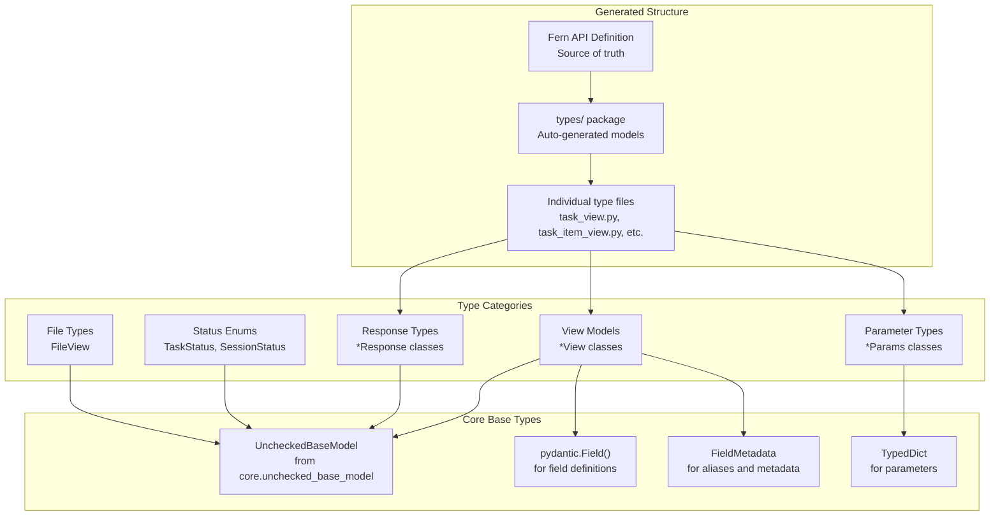
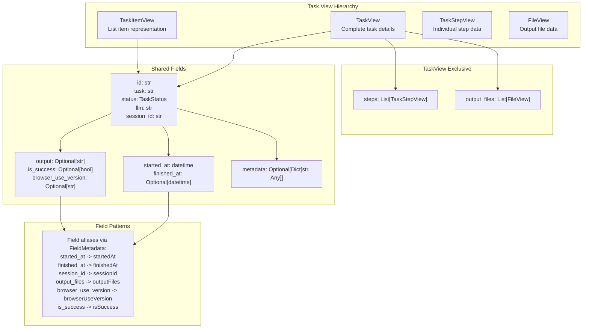
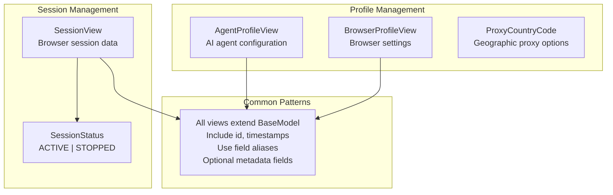
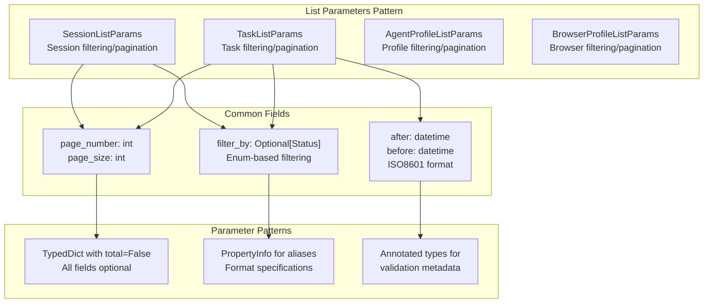
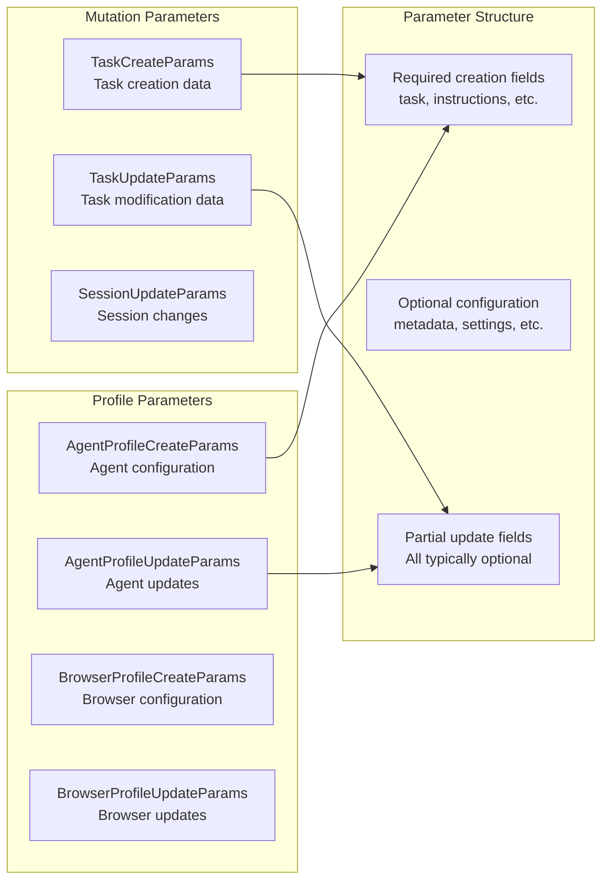
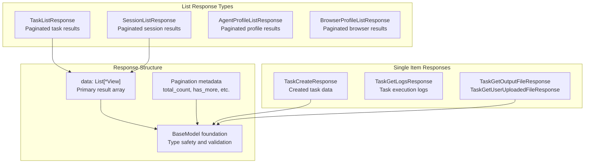
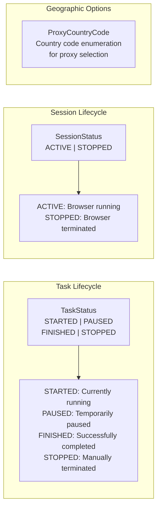
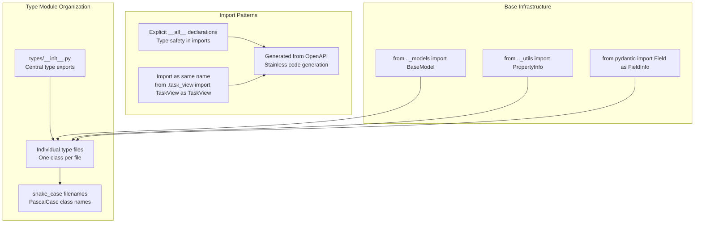

<!-- source: DeepWiki mcp.deepwiki.com · repo browser-use/browser-use-python · page 3.3 Data Models and Types · fetched 2026-10-30 -->

# Data Models and Types

<details>
<summary>Relevant source files</summary>

The following files were used as context for generating this wiki page:

- [src/browser_use_sdk/types/__init__.py](src/browser_use_sdk/types/__init__.py)
- [src/browser_use_sdk/types/task_item_view.py](src/browser_use_sdk/types/task_item_view.py)
- [src/browser_use_sdk/types/task_view.py](src/browser_use_sdk/types/task_view.py)

</details>


This page provides an overview of the type system, data models, and parameter structures used throughout the browser-use-sdk. It covers the organizational patterns, base types, and conventions that define how data flows through the SDK.

For specific usage of these types in task operations, see [Tasks](#3.1). For API method signatures that use these types, see [Client API Reference](#4). For advanced type-safe output handling, see [Structured Output](#5.2).

## Type System Overview

The browser-use-sdk uses a comprehensive type system built on Pydantic models to provide type safety and runtime validation. All types are automatically generated from an API definition using Fern and organized into distinct categories based on their purpose. The SDK supports both Pydantic v1 and v2 with conditional configuration.



**Sources:** [src/browser_use_sdk/types/task_view.py:1-11](), [src/browser_use_sdk/types/task_item_view.py:1-12]()

## View Models

View models represent data entities returned by the API. These models use `BaseModel` as their foundation and include field aliases to map between Python naming conventions and API field names.

### Task Data Models



#### TaskView

The `TaskView` class represents complete task execution details with all steps and output files. It extends `UncheckedBaseModel` and is immutable (frozen).

| Field | Type | Alias | Description |
|-------|------|-------|-------------|
| `id` | `str` | - | Unique task identifier |
| `session_id` | `str` | `sessionId` | Associated browser session ID |
| `llm` | `str` | - | LLM model string identifier |
| `task` | `str` | - | Task prompt/instruction |
| `status` | `TaskStatus` | - | Current execution status |
| `started_at` | `datetime` | `startedAt` | Naive UTC timestamp of task start |
| `finished_at` | `Optional[datetime]` | `finishedAt` | Naive UTC timestamp of completion (None if running) |
| `metadata` | `Optional[Dict[str, Any]]` | - | User-provided task metadata |
| `steps` | `List[TaskStepView]` | - | Execution steps taken |
| `output` | `Optional[str]` | - | Final task result/output |
| `output_files` | `List[FileView]` | `outputFiles` | Files produced by the task |
| `browser_use_version` | `Optional[str]` | `browserUseVersion` | Version of browser-use used |
| `is_success` | `Optional[bool]` | `isSuccess` | Agent-reported success status |

**Sources:** [src/browser_use_sdk/types/task_view.py:16-87]()

#### TaskItemView

The `TaskItemView` class provides a lighter representation for task lists, omitting the detailed steps and output files.

| Field | Type | Alias | Description |
|-------|------|-------|-------------|
| `id` | `str` | - | Unique task identifier |
| `session_id` | `str` | `sessionId` | Associated browser session ID |
| `llm` | `str` | - | LLM model string identifier |
| `task` | `str` | - | Task prompt/instruction |
| `status` | `TaskStatus` | - | Current execution status |
| `started_at` | `datetime` | `startedAt` | Naive UTC timestamp of task start |
| `finished_at` | `Optional[datetime]` | `finishedAt` | Naive UTC timestamp of completion |
| `metadata` | `Optional[Dict[str, Any]]` | - | User-provided task metadata |
| `output` | `Optional[str]` | - | Final task result/output |
| `browser_use_version` | `Optional[str]` | `browserUseVersion` | Version of browser-use used |
| `is_success` | `Optional[bool]` | `isSuccess` | Agent-reported success status |

**Sources:** [src/browser_use_sdk/types/task_item_view.py:14-83]()

### Session and Profile Models



**Sources:** [src/browser_use_sdk/types/__init__.py:8,13,19]()

## Parameter Types

Parameter types define the structure for API method inputs. They use `TypedDict` with `total=False` to allow optional parameters and include `PropertyInfo` for field validation and aliases.

### Query and Filter Parameters



The `TaskListParams` demonstrates the parameter pattern:

```python
class TaskListParams(TypedDict, total=False):
    page_number: Annotated[int, PropertyInfo(alias="pageNumber")]
    page_size: Annotated[int, PropertyInfo(alias="pageSize")]
    filter_by: Annotated[Optional[TaskStatus], PropertyInfo(alias="filterBy")]
    after: Annotated[Union[str, datetime, None], PropertyInfo(format="iso8601")]
    before: Annotated[Union[str, datetime, None], PropertyInfo(format="iso8601")]
    session_id: Annotated[Optional[str], PropertyInfo(alias="sessionId")]
```

**Sources:** [src/browser_use_sdk/types/task_list_params.py:1-34](), [src/browser_use_sdk/types/session_list_params.py:1-25]()

### Create and Update Parameters



**Sources:** [src/browser_use_sdk/types/__init__.py:15,17,22,25,27,29,31]()

## Response Types

Response types wrap API responses and provide structured access to returned data. They typically include the primary data along with pagination metadata for list operations.

### List Response Pattern



**Sources:** [src/browser_use_sdk/types/__init__.py:16,21,26,30,32,33]()

## Status Enumerations

The SDK uses string-based enumerations to represent state information with clear documentation of possible values.



**Sources:** [src/browser_use_sdk/types/__init__.py:7,9,14](), [src/browser_use_sdk/types/task_item_view.py:25-32]()

## Type Organization and Patterns

### File Structure and Exports



### Common Type Patterns

| Pattern | Purpose | Example |
|---------|---------|---------|
| `*View` classes | Data representation | `TaskView`, `SessionView` |
| `*Params` classes | Input parameters | `TaskCreateParams`, `TaskListParams` |
| `*Response` classes | API responses | `TaskListResponse`, `TaskCreateResponse` |
| Field aliases | API compatibility | `started_at` → `startedAt` |
| Optional fields | Flexible data models | `Optional[str]`, `Optional[datetime]` |
| Annotated types | Validation metadata | `Annotated[int, PropertyInfo(...)]` |
| TypedDict with `total=False` | Optional parameters | All parameter classes |

**Sources:** [src/browser_use_sdk/types/__init__.py:1-34](), [src/browser_use_sdk/types/task_item_view.py:1-8](), [src/browser_use_sdk/types/task_list_params.py:1-11]()

---

