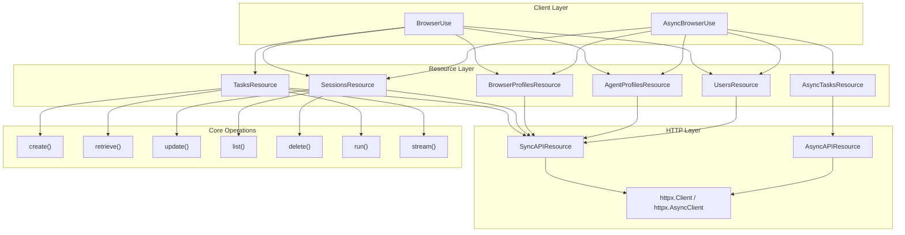
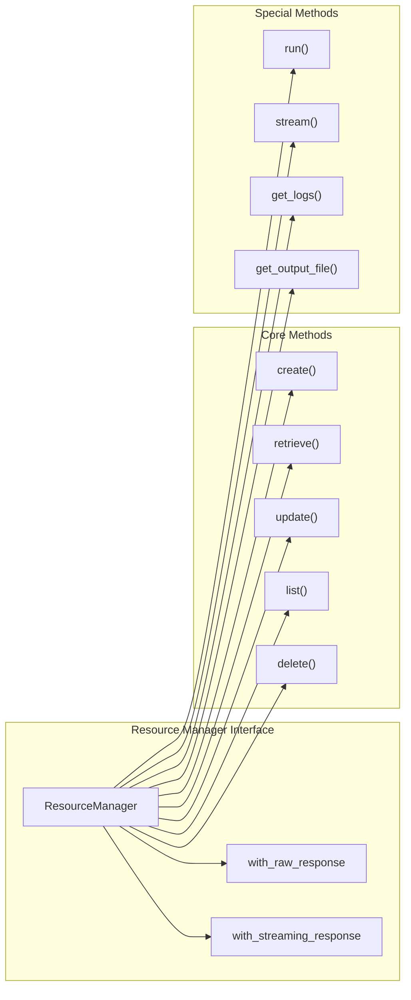
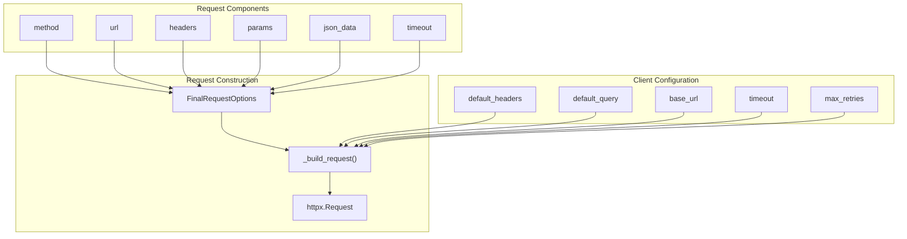

<!-- source: DeepWiki mcp.deepwiki.com · repo browser-use/browser-use-python · page 4 Client API Reference · fetched 2026-10-30 -->

# Client API Reference

<details>
<summary>Relevant source files</summary>

The following files were used as context for generating this wiki page:

- [README.md](README.md)
- [reference.md](reference.md)
- [src/browser_use_sdk/core/client_wrapper.py](src/browser_use_sdk/core/client_wrapper.py)
- [src/browser_use_sdk/types/task_view.py](src/browser_use_sdk/types/task_view.py)

</details>


This document provides a comprehensive reference for the `BrowserUse` and `AsyncBrowserUse` client interfaces in the browser-use-sdk. It covers client instantiation, resource management, configuration options, and response handling patterns.

For detailed information about task execution patterns, see [Task Management API](#4.1). For session and profile management specifics, see [Session and Profile Management](#4.2). For advanced features like webhooks and structured output, see [Advanced Features](#5).

## Client Classes Overview

The browser-use-sdk provides two primary client classes that expose identical functionality through synchronous and asynchronous interfaces:

- **`BrowserUse`** - Synchronous client for blocking operations
- **`AsyncBrowserUse`** - Asynchronous client for non-blocking operations

Both clients provide access to resource managers that handle different aspects of the Browser Use platform:

| Resource | Purpose | Key Operations |
|----------|---------|----------------|
| `tasks` | AI agent task execution | `run()`, `create()`, `stream()`, `retrieve()` |
| `sessions` | Browser session management | `retrieve()`, `update()`, `list()`, `delete()` |
| `browser_profiles` | Browser configuration profiles | `create()`, `retrieve()`, `update()`, `list()`, `delete()` |
| `agent_profiles` | AI agent behavior profiles | `create()`, `retrieve()`, `update()`, `list()`, `delete()` |
| `users` | User account management | `me.retrieve()`, `me.files.create_presigned_url()` |

Sources: [src/browser_use_sdk/resources/tasks.py:41-833](), [api.md:1-116](), [README.md:15-26]()

## Client Architecture



Sources: [src/browser_use_sdk/resources/tasks.py:41-42](), [src/browser_use_sdk/resources/tasks.py:835-836]()

## Client Instantiation

### Basic Initialization

```python
from browser_use_sdk import BrowserUse, AsyncBrowserUse

# Synchronous client
client = BrowserUse(api_key="bu_...")

# Asynchronous client  
async_client = AsyncBrowserUse(api_key="bu_...")
```

### Configuration Parameters

| Parameter | Type | Description | Default |
|-----------|------|-------------|---------|
| `api_key` | `str` | Browser Use API key | From `BROWSER_USE_API_KEY` env var |
| `base_url` | `str` | API base URL | From `BROWSER_USE_BASE_URL` env var |
| `timeout` | `httpx.Timeout` | Request timeout configuration | 60 seconds |
| `max_retries` | `int` | Maximum retry attempts | 2 |
| `default_headers` | `Dict[str, str]` | Default headers for all requests | `{}` |
| `default_query` | `Dict[str, str]` | Default query parameters | `{}` |
| `http_client` | `httpx.Client` | Custom HTTP client instance | Auto-created |

Sources: [tests/test_client.py:269-276](), [tests/test_client.py:318-324](), [README.md:254-267]()

## Resource Interface Pattern

All resource managers follow a consistent interface pattern with both synchronous and asynchronous variants:



### Response Wrappers

Each resource provides response wrapper access:

- **`with_raw_response`** - Returns raw `httpx.Response` objects
- **`with_streaming_response`** - Returns streaming response objects without eager body reading

```python
# Raw response access
response = client.tasks.with_raw_response.create(task="example")
print(response.headers.get('X-My-Header'))
task = response.parse()

# Streaming response access  
with client.tasks.with_streaming_response.create(task="example") as response:
    # Process response incrementally
    pass
```

Sources: [src/browser_use_sdk/resources/tasks.py:42-59](), [README.md:322-340]()

## Core Client Operations

### Request Building and Configuration



### Method Overloading Pattern

The SDK uses method overloading extensively to provide type-safe interfaces for different use cases:

```python
# Basic task creation
task = client.tasks.create(task="Search for news")

# Task creation with structured output
class NewsResult(BaseModel):
    headlines: List[str]

task = client.tasks.create(
    task="Search for news",
    structured_output_json=NewsResult
)
```

This pattern is implemented through `@overload` decorators that provide different type signatures while maintaining a single implementation.

Sources: [src/browser_use_sdk/resources/tasks.py:61-97](), [src/browser_use_sdk/resources/tasks.py:161-197]()

## Error Handling and Retries

### Exception Hierarchy

| Exception | Status Codes | Description |
|-----------|--------------|-------------|
| `APIConnectionError` | N/A | Network connectivity issues |
| `APITimeoutError` | N/A | Request timeout exceeded |
| `BadRequestError` | 400 | Invalid request parameters |
| `AuthenticationError` | 401 | Invalid or missing API key |
| `PermissionDeniedError` | 403 | Insufficient permissions |
| `NotFoundError` | 404 | Resource not found |
| `UnprocessableEntityError` | 422 | Invalid request data |
| `RateLimitError` | 429 | API rate limit exceeded |
| `InternalServerError` | ≥500 | Server-side errors |

### Retry Configuration

The client automatically retries certain types of errors with exponential backoff:

- Connection errors
- 408 Request Timeout
- 409 Conflict  
- 429 Rate Limit
- ≥500 Internal Server Errors

```python
# Configure retry behavior
client = BrowserUse(
    api_key="bu_...",
    max_retries=5  # Override default of 2
)

# Per-request retry override
client.with_options(max_retries=0).tasks.create(task="example")
```

Sources: [README.md:203-267](), [tests/test_client.py:722-740]()

## Client Configuration Methods

### Dynamic Configuration

```python
# Client copying with new configuration
new_client = client.copy(
    timeout=httpx.Timeout(30.0),
    max_retries=5,
    default_headers={"X-Custom": "value"}
)

# Per-request configuration
response = client.with_options(
    timeout=10.0,
    extra_headers={"X-Request-ID": "123"}
).tasks.create(task="example")
```

### Context Manager Support

Both client types support context manager protocols for proper resource cleanup:

```python
# Synchronous context manager
with BrowserUse(api_key="bu_...") as client:
    result = client.tasks.run(task="example")

# Asynchronous context manager  
async with AsyncBrowserUse(api_key="bu_...") as client:
    result = await client.tasks.run(task="example")
```

Sources: [tests/test_client.py:649-656](), [tests/test_client.py:1461-1467](), [README.md:373-383]()

## HTTP Client Customization

### Custom HTTP Clients

```python
import httpx
from browser_use_sdk import BrowserUse, DefaultHttpxClient

# Custom httpx client
client = BrowserUse(
    api_key="bu_...",
    http_client=DefaultHttpxClient(
        proxy="http://proxy.example.com",
        transport=httpx.HTTPTransport(local_address="0.0.0.0")
    )
)

# aiohttp support for async clients
from browser_use_sdk import AsyncBrowserUse, DefaultAioHttpClient

async with AsyncBrowserUse(
    api_key="bu_...",
    http_client=DefaultAioHttpClient()
) as client:
    result = await client.tasks.run(task="example")
```

### Connection Management

The SDK manages HTTP connections automatically but provides control over connection lifecycle:

- Clients close connections when garbage collected
- Context managers ensure proper cleanup
- Connection pooling is handled by the underlying HTTP client
- Open connection tracking for debugging and testing

Sources: [README.md:344-370](), [README.md:168-199](), [tests/test_client.py:53-59]()

---

