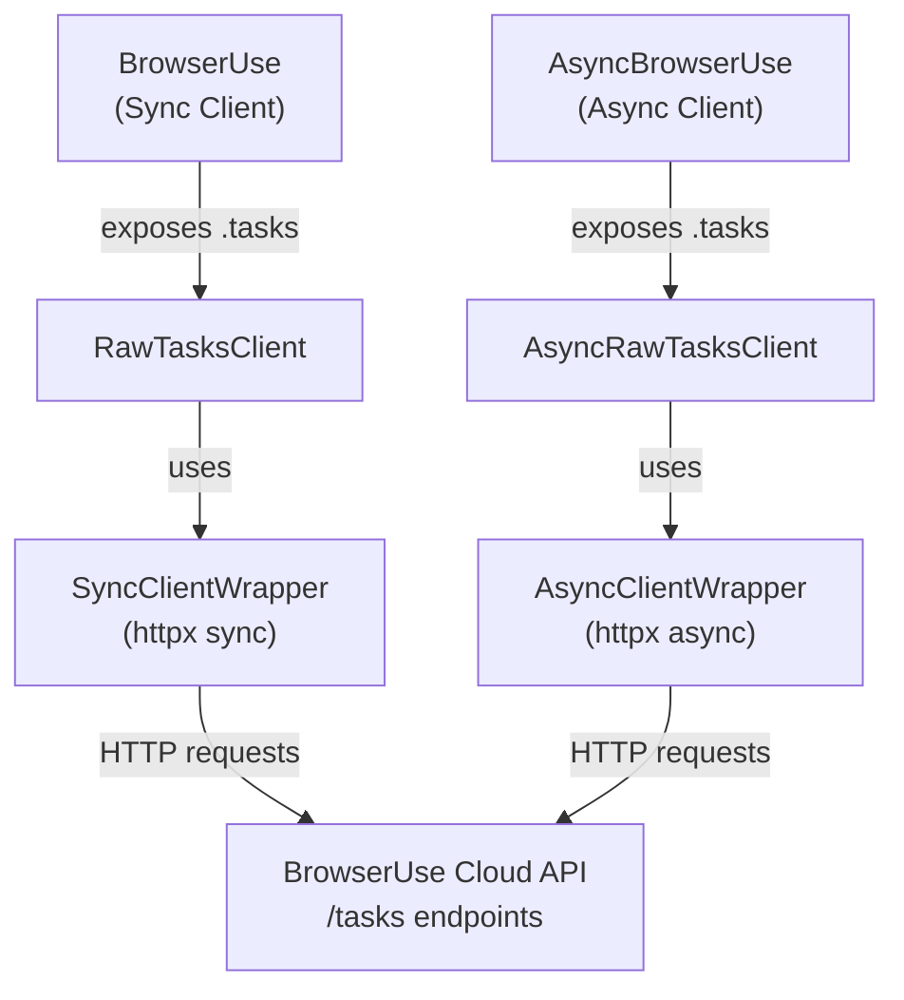
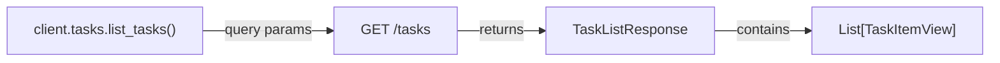
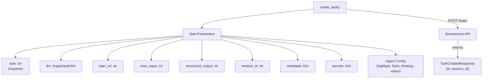
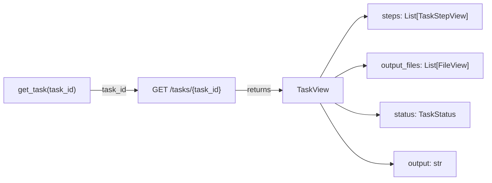
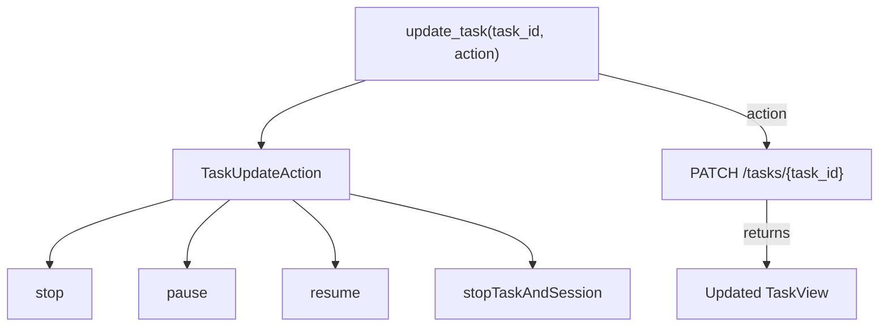
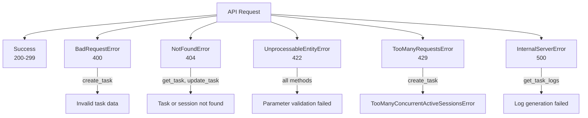
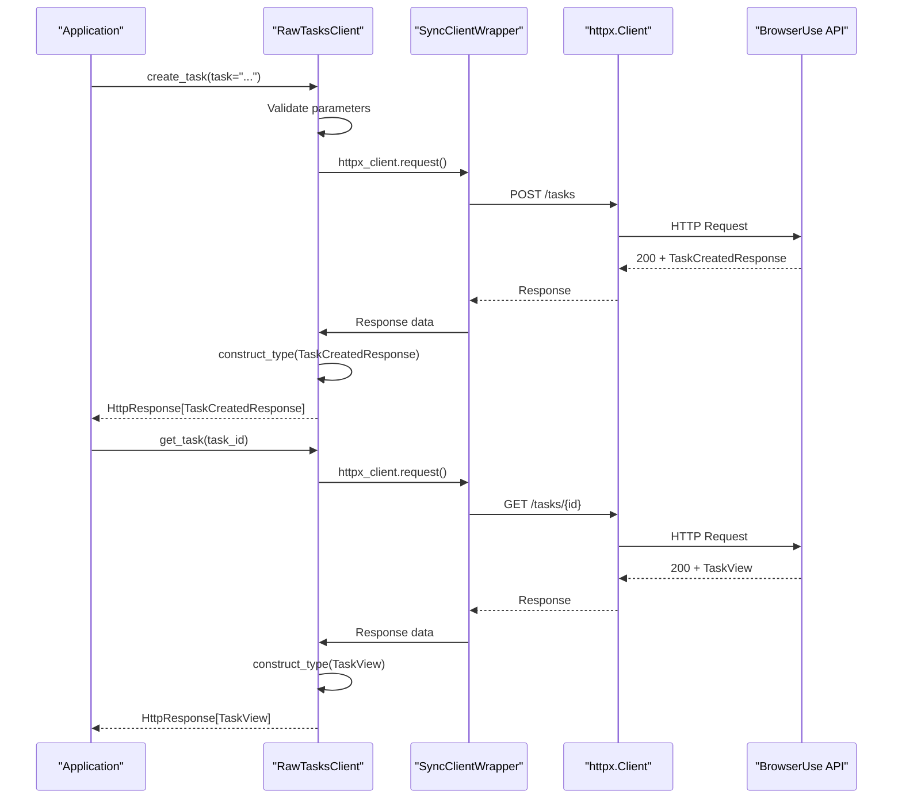

<!-- source: DeepWiki mcp.deepwiki.com · repo browser-use/browser-use-python · page 4.1 Task Management API · fetched 2026-10-30 -->

# Task Management API

<details>
<summary>Relevant source files</summary>

The following files were used as context for generating this wiki page:

- [reference.md](reference.md)
- [src/browser_use_sdk/tasks/raw_client.py](src/browser_use_sdk/tasks/raw_client.py)
- [src/browser_use_sdk/types/task_item_view.py](src/browser_use_sdk/types/task_item_view.py)
- [src/browser_use_sdk/types/task_view.py](src/browser_use_sdk/types/task_view.py)
- [src/browser_use_sdk/types/too_many_concurrent_active_sessions_error.py](src/browser_use_sdk/types/too_many_concurrent_active_sessions_error.py)

</details>


## Purpose and Scope

This document provides a comprehensive reference for the Task Management API, which enables creating, retrieving, updating, and monitoring AI agent tasks through the BrowserUse SDK. The API is exposed through the `tasks` sub-client on the main SDK client instances (`BrowserUse` and `AsyncBrowserUse`).

For conceptual information about tasks and their lifecycle, see [Tasks](#3.1). For advanced streaming capabilities, see [Task Streaming](#5.3). For structured output configuration, see [Structured Output](#5.2).

## Overview

The Task Management API provides methods to:

- Create new tasks with configurable agent parameters
- List and filter existing tasks
- Retrieve detailed task information including steps and outputs
- Control task execution (stop, pause, resume)
- Access task execution logs

Both synchronous and asynchronous client implementations are available through `RawTasksClient` and `AsyncRawTasksClient` respectively.

**Sources:** [src/browser_use_sdk/tasks/raw_client.py:1-912]()

## Client Architecture



The task management functionality is accessed through the `tasks` attribute on the main client. Both synchronous and asynchronous variants provide identical method signatures, differing only in their execution model.

**Sources:** [src/browser_use_sdk/tasks/raw_client.py:32-34](), [src/browser_use_sdk/tasks/raw_client.py:473-475]()

## Core Methods

### Method Overview

| Method | HTTP Verb | Endpoint | Purpose |
|--------|-----------|----------|---------|
| `list_tasks()` | GET | `/tasks` | Get paginated list of tasks with filtering |
| `create_task()` | POST | `/tasks` | Create and start a new task |
| `get_task()` | GET | `/tasks/{task_id}` | Get detailed task information |
| `update_task()` | PATCH | `/tasks/{task_id}` | Control task execution |
| `get_task_logs()` | GET | `/tasks/{task_id}/logs` | Get task execution logs |

**Sources:** [src/browser_use_sdk/tasks/raw_client.py:36-471]()

## Method Details

### list_tasks()



Retrieves a paginated list of tasks with optional filtering capabilities.

**Method Signature:**
```python
def list_tasks(
    self,
    *,
    page_size: Optional[int] = None,
    page_number: Optional[int] = None,
    session_id: Optional[str] = None,
    filter_by: Optional[TaskStatus] = None,
    after: Optional[dt.datetime] = None,
    before: Optional[dt.datetime] = None,
    request_options: Optional[RequestOptions] = None,
) -> HttpResponse[TaskListResponse]
```

**Parameters:**

| Parameter | Type | Description |
|-----------|------|-------------|
| `page_size` | `Optional[int]` | Number of tasks per page |
| `page_number` | `Optional[int]` | Page number to retrieve (1-indexed) |
| `session_id` | `Optional[str]` | Filter tasks by session ID |
| `filter_by` | `Optional[TaskStatus]` | Filter by task status (e.g., running, completed) |
| `after` | `Optional[dt.datetime]` | Filter tasks started after this timestamp |
| `before` | `Optional[dt.datetime]` | Filter tasks started before this timestamp |
| `request_options` | `Optional[RequestOptions]` | Request-specific configuration |

**Returns:** `HttpResponse[TaskListResponse]` containing a list of `TaskItemView` objects

**Raises:**
- `UnprocessableEntityError` (422) - Invalid request parameters

**Sources:** [src/browser_use_sdk/tasks/raw_client.py:36-109](), [reference.md:64-169]()

### create_task()



Creates and starts a new task. Can either auto-create a new session or run in an existing session.

**Method Signature:**
```python
def create_task(
    self,
    *,
    task: str,
    llm: Optional[SupportedLlMs] = OMIT,
    start_url: Optional[str] = OMIT,
    max_steps: Optional[int] = OMIT,
    structured_output: Optional[str] = OMIT,
    session_id: Optional[str] = OMIT,
    metadata: Optional[Dict[str, Optional[str]]] = OMIT,
    secrets: Optional[Dict[str, Optional[str]]] = OMIT,
    allowed_domains: Optional[Sequence[str]] = OMIT,
    highlight_elements: Optional[bool] = OMIT,
    flash_mode: Optional[bool] = OMIT,
    thinking: Optional[bool] = OMIT,
    vision: Optional[bool] = OMIT,
    system_prompt_extension: Optional[str] = OMIT,
    request_options: Optional[RequestOptions] = None,
) -> HttpResponse[TaskCreatedResponse]
```

**Parameters:**

| Parameter | Type | Required | Description |
|-----------|------|----------|-------------|
| `task` | `str` | Yes | Task prompt/instruction for the agent |
| `llm` | `Optional[SupportedLlMs]` | No | LLM model to use |
| `start_url` | `Optional[str]` | No | Starting URL for the task |
| `max_steps` | `Optional[int]` | No | Maximum agent steps before stopping |
| `structured_output` | `Optional[str]` | No | JSON schema for structured output |
| `session_id` | `Optional[str]` | No | Existing session ID to use |
| `metadata` | `Optional[Dict]` | No | Custom metadata for the task |
| `secrets` | `Optional[Dict]` | No | Secrets accessible to the agent |
| `allowed_domains` | `Optional[Sequence[str]]` | No | Domain whitelist for the task |
| `highlight_elements` | `Optional[bool]` | No | Highlight interactive elements |
| `flash_mode` | `Optional[bool]` | No | Enable flash mode |
| `thinking` | `Optional[bool]` | No | Enable thinking mode |
| `vision` | `Optional[bool]` | No | Enable vision capabilities |
| `system_prompt_extension` | `Optional[str]` | No | Additional system prompt text |

**Returns:** `HttpResponse[TaskCreatedResponse]` containing task ID and session ID

**Raises:**
- `BadRequestError` (400) - Invalid request data
- `NotFoundError` (404) - Session not found (if session_id provided)
- `UnprocessableEntityError` (422) - Validation error
- `TooManyRequestsError` (429) - Too many concurrent active sessions

**Sources:** [src/browser_use_sdk/tasks/raw_client.py:111-269](), [reference.md:172-345]()

### get_task()



Retrieves detailed information about a specific task, including its execution steps, status, and outputs.

**Method Signature:**
```python
def get_task(
    self,
    task_id: str,
    *,
    request_options: Optional[RequestOptions] = None
) -> HttpResponse[TaskView]
```

**Parameters:**

| Parameter | Type | Description |
|-----------|------|-------------|
| `task_id` | `str` | Unique identifier of the task |
| `request_options` | `Optional[RequestOptions]` | Request-specific configuration |

**Returns:** `HttpResponse[TaskView]` with complete task information

**Raises:**
- `NotFoundError` (404) - Task not found
- `UnprocessableEntityError` (422) - Invalid task ID format

**Sources:** [src/browser_use_sdk/tasks/raw_client.py:271-329](), [reference.md:348-415]()

### update_task()



Controls task execution by performing actions like stop, pause, or resume.

**Method Signature:**
```python
def update_task(
    self,
    task_id: str,
    *,
    action: TaskUpdateAction,
    request_options: Optional[RequestOptions] = None
) -> HttpResponse[TaskView]
```

**Parameters:**

| Parameter | Type | Description |
|-----------|------|-------------|
| `task_id` | `str` | Unique identifier of the task |
| `action` | `TaskUpdateAction` | Action to perform (`"stop"`, `"pause"`, `"resume"`, `"stopTaskAndSession"`) |
| `request_options` | `Optional[RequestOptions]` | Request-specific configuration |

**Returns:** `HttpResponse[TaskView]` with updated task state

**Raises:**
- `NotFoundError` (404) - Task not found
- `UnprocessableEntityError` (422) - Invalid action or task state

**Sources:** [src/browser_use_sdk/tasks/raw_client.py:331-399](), [reference.md:418-494]()

### get_task_logs()

Retrieves a secure presigned URL for downloading detailed task execution logs.

**Method Signature:**
```python
def get_task_logs(
    self,
    task_id: str,
    *,
    request_options: Optional[RequestOptions] = None
) -> HttpResponse[TaskLogFileResponse]
```

**Parameters:**

| Parameter | Type | Description |
|-----------|------|-------------|
| `task_id` | `str` | Unique identifier of the task |
| `request_options` | `Optional[RequestOptions]` | Request-specific configuration |

**Returns:** `HttpResponse[TaskLogFileResponse]` containing presigned download URL

**Raises:**
- `NotFoundError` (404) - Task not found
- `UnprocessableEntityError` (422) - Invalid task ID format
- `InternalServerError` (500) - Log generation failed

**Sources:** [src/browser_use_sdk/tasks/raw_client.py:401-470](), [reference.md:497-564]()

## Data Models

### TaskView

The primary model representing a complete task with all execution details.

**Key Fields:**

| Field | Type | Description |
|-------|------|-------------|
| `id` | `str` | Unique task identifier |
| `session_id` | `str` | Associated session ID |
| `llm` | `str` | LLM model used |
| `task` | `str` | Original task prompt |
| `status` | `TaskStatus` | Current execution status |
| `started_at` | `datetime` | Task start timestamp (naive UTC) |
| `finished_at` | `Optional[datetime]` | Task completion timestamp |
| `metadata` | `Optional[Dict]` | User-defined metadata |
| `steps` | `List[TaskStepView]` | Execution steps |
| `output` | `Optional[str]` | Final task output |
| `output_files` | `List[FileView]` | Generated output files |
| `browser_use_version` | `Optional[str]` | Browser-use version |
| `is_success` | `Optional[bool]` | Self-reported success status |

**Sources:** [src/browser_use_sdk/types/task_view.py:16-87]()

### TaskItemView

A lightweight task representation used in list responses, excluding the `steps` and `output_files` fields.

**Sources:** [src/browser_use_sdk/types/task_item_view.py:14-83]()

### TaskStatus

Enumeration of possible task states. Common values include:
- `"running"` - Task is currently executing
- `"completed"` - Task has finished
- `"failed"` - Task encountered an error
- `"stopped"` - Task was stopped by user
- `"paused"` - Task is paused

**Sources:** [src/browser_use_sdk/types/task_view.py:37-40]()

## Error Handling



All methods raise typed exceptions that can be caught and handled:

**Common Exception Types:**

| Exception | Status Code | When Raised |
|-----------|-------------|-------------|
| `BadRequestError` | 400 | Invalid request data format |
| `NotFoundError` | 404 | Task or session not found |
| `UnprocessableEntityError` | 422 | Validation failed |
| `TooManyRequestsError` | 429 | Concurrent session limit exceeded |
| `InternalServerError` | 500 | Server-side processing error |
| `ApiError` | Various | Generic API error fallback |

**Sources:** [src/browser_use_sdk/tasks/raw_client.py:7-27](), [src/browser_use_sdk/types/too_many_concurrent_active_sessions_error.py:10-24]()

## Async Client

The `AsyncRawTasksClient` provides identical functionality with async/await support. All methods have the same signatures but are defined as `async def` and return `AsyncHttpResponse` instead of `HttpResponse`.

**Usage Pattern:**
```python
# Async usage
async with AsyncBrowserUse(api_key="...") as client:
    response = await client.tasks.get_task("task_id")
    task = response.data
```

**Sources:** [src/browser_use_sdk/tasks/raw_client.py:473-911]()

## Request Flow



The client handles request serialization, response deserialization, and error mapping automatically. The `HttpResponse` wrapper provides access to both the raw response object and the parsed data model.

**Sources:** [src/browser_use_sdk/tasks/raw_client.py:72-109](), [src/browser_use_sdk/tasks/raw_client.py:187-269]()

---

