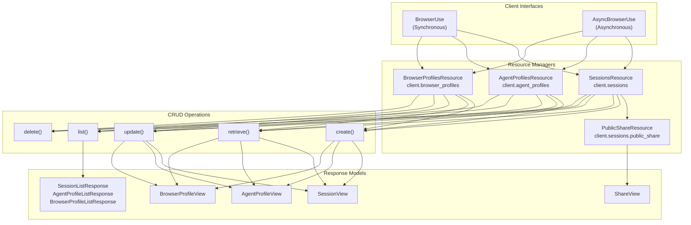
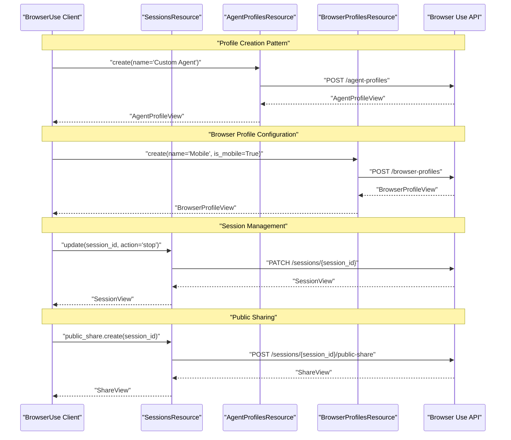

<!-- source: DeepWiki mcp.deepwiki.com · repo browser-use/browser-use-python · page 4.2 Session and Profile Management · fetched 2026-10-30 -->

# Session and Profile Management

<details>
<summary>Relevant source files</summary>

The following files were used as context for generating this wiki page:

- [reference.md](reference.md)
- [src/browser_use_sdk/sessions/client.py](src/browser_use_sdk/sessions/client.py)
- [src/browser_use_sdk/types/session_list_response.py](src/browser_use_sdk/types/session_list_response.py)

</details>


This document provides complete API reference documentation for managing sessions, agent profiles, and browser profiles in the browser-use-sdk. These APIs allow you to create, retrieve, update, list, and delete persistent configurations that control browser behavior and agent capabilities.

For conceptual explanations of sessions and profiles, see [Sessions and Profiles](#3.2). For task-specific operations, see [Task Management API](#4.1).

## Overview

The browser-use-sdk provides three primary resource management APIs:

| Resource Type | Purpose | Key Use Cases |
|---------------|---------|---------------|
| **Sessions** | Manage browser session lifecycle and sharing | Control browser instances, enable public sharing |
| **Agent Profiles** | Configure AI agent behavior and capabilities | Set custom prompts, domain restrictions, agent limits |
| **Browser Profiles** | Define browser environment settings | Configure proxies, viewports, mobile emulation |

All three resource types follow consistent CRUD patterns and are available through both synchronous and asynchronous client interfaces.

## Session Management API

Sessions represent active browser instances managed by the Browser Use platform. The `SessionsResource` provides methods to control session lifecycle and enable public sharing capabilities.

### Core Session Operations

```python
# Available through client.sessions
client.sessions.retrieve(session_id)      # Get session details
client.sessions.update(session_id, **params)  # Modify session state  
client.sessions.list(**params)            # List user sessions
client.sessions.delete(session_id)        # Terminate session
```

### Session Status Management

The `update` method accepts an `action` parameter to control session state:

```python
# Stop a running session
session = client.sessions.update(
    session_id="session-uuid",
    action="stop"
)
```

### Session Filtering and Pagination

The `list` method supports filtering and pagination:

```python
# List active sessions with pagination
sessions = client.sessions.list(
    filter_by="active",
    page_number=1,
    page_size=10
)
```

### Public Sharing

Sessions include a nested `public_share` resource for creating shareable links:

```python
# Create public share link
share = client.sessions.public_share.create(session_id)

# Retrieve existing share
share = client.sessions.public_share.retrieve(session_id)

# Remove public sharing
client.sessions.public_share.delete(session_id)
```

**Sources:** [api.md:56-84](), [tests/api_resources/test_sessions.py:25-189](), [tests/api_resources/sessions/test_public_share.py:22-144]()

## Agent Profiles API

Agent profiles define the behavior and capabilities of AI agents. The `AgentProfilesResource` manages reusable agent configurations that can be applied to tasks.

### Profile CRUD Operations

```python
# Create new agent profile
profile = client.agent_profiles.create(
    name="Custom Agent",
    description="Specialized for e-commerce tasks",
    max_agent_steps=50,
    allowed_domains=["example.com", "shop.example.com"]
)

# Retrieve existing profile
profile = client.agent_profiles.retrieve("profile-uuid")

# Update profile configuration
profile = client.agent_profiles.update(
    profile_id="profile-uuid",
    flash_mode=True,
    vision=True,
    thinking=True
)

# List all profiles
profiles = client.agent_profiles.list(page_size=20)

# Delete profile
client.agent_profiles.delete("profile-uuid")
```

### Agent Configuration Options

| Parameter | Type | Description |
|-----------|------|-------------|
| `name` | string | Profile display name (required for creation) |
| `description` | string | Profile description |
| `max_agent_steps` | integer | Maximum steps agent can take |
| `allowed_domains` | list[string] | Domains agent can access |
| `custom_system_prompt_extension` | string | Additional system prompt text |
| `flash_mode` | boolean | Enable faster processing mode |
| `highlight_elements` | boolean | Highlight interactive elements |
| `thinking` | boolean | Enable agent reasoning display |
| `vision` | boolean | Enable visual processing capabilities |

**Sources:** [api.md:101-115](), [tests/api_resources/test_agent_profiles.py:25-487]()

## Browser Profiles API

Browser profiles configure the browser environment and network settings. The `BrowserProfilesResource` manages reusable browser configurations for different automation scenarios.

### Browser Configuration Management

```python
# Create browser profile with proxy
profile = client.browser_profiles.create(
    name="Mobile US Profile",
    is_mobile=True,
    proxy=True,
    proxy_country_code="us",
    browser_viewport_width=375,
    browser_viewport_height=812,
    ad_blocker=True,
    store_cache=True,
    persist=True
)

# Update existing profile
profile = client.browser_profiles.update(
    profile_id="profile-uuid",
    ad_blocker=False,
    store_cache=False
)
```

### Browser Environment Options

| Parameter | Type | Description |
|-----------|------|-------------|
| `name` | string | Profile display name (required for creation) |
| `description` | string | Profile description |
| `browser_viewport_width` | integer | Browser window width in pixels |
| `browser_viewport_height` | integer | Browser window height in pixels |
| `is_mobile` | boolean | Enable mobile device emulation |
| `proxy` | boolean | Enable proxy usage |
| `proxy_country_code` | ProxyCountryCode | Proxy server country (e.g., "us", "uk") |
| `ad_blocker` | boolean | Enable ad blocking |
| `store_cache` | boolean | Persist browser cache between sessions |
| `persist` | boolean | Maintain profile data across tasks |

**Sources:** [api.md:85-99](), [tests/api_resources/test_browser_profiles.py:25-491]()

## API Client Architecture



**Sources:** [api.md:56-115](), [tests/api_resources/test_sessions.py](), [tests/api_resources/test_agent_profiles.py](), [tests/api_resources/test_browser_profiles.py]()

## Resource Method Patterns



**Sources:** [api.md:56-115](), [tests/api_resources/test_sessions.py:67-72](), [tests/api_resources/test_agent_profiles.py:25-29](), [tests/api_resources/test_browser_profiles.py:25-29]()

## Common Response Handling

All resource methods support the standard response handling patterns:

### Raw Response Access
```python
# Access raw HTTP response
response = client.sessions.with_raw_response.retrieve(session_id)
assert response.http_request.headers.get("X-Stainless-Lang") == "python"
session = response.parse()
```

### Streaming Response
```python
# Stream response for large operations
with client.browser_profiles.with_streaming_response.list() as response:
    profiles = response.parse()
```

### Error Handling
```python
# Empty values raise ValueError
with pytest.raises(ValueError, match=r"Expected a non-empty value"):
    client.agent_profiles.retrieve("")
```

**Sources:** [tests/api_resources/test_sessions.py:33-55](), [tests/api_resources/test_agent_profiles.py:83-105](), [tests/api_resources/test_browser_profiles.py:84-106]()

## Pagination and Filtering

List operations support consistent pagination parameters:

| Parameter | Type | Description |
|-----------|------|-------------|
| `page_number` | integer | Page number (1-indexed) |
| `page_size` | integer | Number of items per page |
| `filter_by` | string | Filter criteria (sessions only: "active") |

```python
# Example pagination usage
sessions = client.sessions.list(
    filter_by="active",
    page_number=2, 
    page_size=25
)

agent_profiles = client.agent_profiles.list(
    page_number=1,
    page_size=50
)
```

**Sources:** [tests/api_resources/test_sessions.py:119-125](), [tests/api_resources/test_agent_profiles.py:182-187](), [tests/api_resources/test_browser_profiles.py:183-189]()

---

